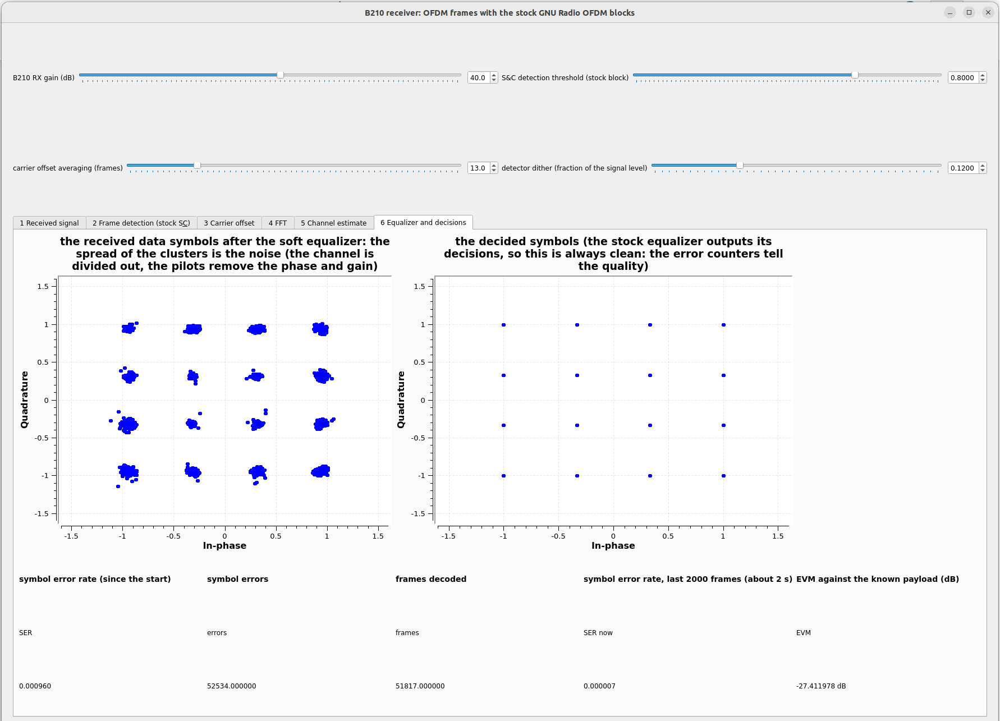

# P501 FPGA radio lab

**Learn digital modulation by building it in an FPGA.** This lab takes the PZSDR P501 (Zynq UltraScale+ ZU5EV with an AD9361 radio) from a streaming FFT to a complete 16-QAM OFDM modem, one PYNQ overlay at a time. Every step is simulated, checked bit for bit against a Python model, tested on the board in the chip's digital loopback and then over the air, and cross-checked against a USRP B210 running GNU Radio.

[Get started :material-rocket-launch:](docs/getting-started.md){ .md-button .md-button--primary }
[The design flow :material-source-branch:](tutorial/DESIGN_FLOW.md){ .md-button }
[Source on GitHub :fontawesome-brands-github:](https://github.com/fllay/p501_fft_example){ .md-button }

---

## The tutorials

-   :material-chart-bell-curve-cumulative: **1. FFT on the ADC data**

    ---

    Add a streaming FFT to the P501 overlay block by block, and read the spectrum from PYNQ.

    [:octicons-arrow-right-24: Tutorial 1](tutorial/TUTORIAL.md)

-   :material-sine-wave: **2. A hardware DDS**

    ---

    Replace the Python tone by a DDS on the DAC, with registers and a safe parameter hand-over.

    [:octicons-arrow-right-24: Tutorial 2](tutorial/TUTORIAL_DDS.md)

-   :material-swap-horizontal: **3. DDS and FFT together**

    ---

    A tone out, a spectrum back, over the air.

    [:octicons-arrow-right-24: Tutorial 3](tutorial/TUTORIAL_DDS_FFT.md)

-   :material-radio-tower: **4. QPSK**

    ---

    Transmitter, receiver with FLL / Costas loops and frame synchronisation, tested against GNU Radio.

    [:octicons-arrow-right-24: Tutorial 4](tutorial/TUTORIAL_QPSK.md)

-   :material-grid: **5. 16-QAM**

    ---

    A Zadoff-Chu frame synchroniser, a band-edge FLL and a symbol-by-symbol checker in the FPGA.

    [:octicons-arrow-right-24: Tutorial 5](tutorial/TUTORIAL_QAM16.md)

-   :material-waveform: **6. OFDM**

    ---

    IFFT and cyclic prefix, Schmidl-and-Cox or short-training-field synchronisation, the transmitter **and** the receiver in the FPGA.

    [:octicons-arrow-right-24: Tutorial 6](tutorial/TUTORIAL_OFDM.md)

## Start here

-   :material-sd: **Flash the SD card, run an overlay**

    ---

    The PYNQ image, the built overlays, copying them to the board and the first test in the digital loopback.

    [:octicons-arrow-right-24: Getting started](docs/getting-started.md)

-   :material-map-legend: **The overlays at a glance**

    ---

    Every overlay of the repository, its build options and the chapter that explains it.

    [:octicons-arrow-right-24: Overlays](docs/overlays.md)

-   :material-source-branch: **From an idea to a tested FPGA radio**

    ---

    Float model, integer model, RTL with xsim, overlay build, board, GNU Radio: the method behind every chapter, with the bugs found at each stage.

    [:octicons-arrow-right-24: Design flow](tutorial/DESIGN_FLOW.md)

-   :material-test-tube: **What was measured**

    ---

    The plans and the reports, with what was run and what was not.

    [:octicons-arrow-right-24: OFDM report](tutorial/ofdm/REPORT_OFDM.md)

## What it looks like

{ loading=lazy }

{ loading=lazy }

*Left: the live notebook of the P501 receiving an OFDM frame (the STS overlay). Right: a B210 with GNU Radio decoding the frames of the FPGA transmitter.*

## The method in one paragraph

Every stage must reproduce the previous one to the last bit before the next is built, and an independent radio (a USRP B210 with GNU Radio) checks the whole chain, because two blocks that are wrong in the same way agree with each other. A bug that the hardware finds is a missing test in the model: it is added there first, then fixed in the RTL. [Read the design flow.](tutorial/DESIGN_FLOW.md)

!!! warning "Radiation"
    Several tests send a signal out of the antenna. Start with a large TX attenuation and step down, keep antennas a few centimetres apart or use a cable with an attenuator, and use the AD9361's digital loopback when no radio signal is needed.
