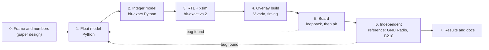

# Design flow: from a modulation idea to a tested FPGA radio

This is the method behind the QPSK, 16-QAM and OFDM tutorials of this repository, written down as a recipe you can reuse for the next modulation. The examples are from the OFDM work (`tutorial/ofdm/`, `TUTORIAL_OFDM.md`); the same files exist, with other names, in the QPSK and 16-QAM folders.

The one rule behind everything: **every stage is checked against the stage before it, and the numbers of one stage are the reference of the next.** A stage is finished when it reproduces its reference (to the last bit where the reference is an integer model), not when it "looks right". Then an independent receiver or transmitter checks the whole chain, because two blocks that are wrong in the same way agree with each other.

A bug found late is fixed **at the earliest stage that could have caught it** (the model first, then the RTL, then the build), so that every stage again equals the one before it. The dotted arrows are not failures of the method; they happened every time (examples below).

| # | stage | what you write | pass criterion | OFDM example |
|---|---|---|---|---|
| 0 | frame and numbers | the frame (preamble, training, data, idle), rates, sizes, the link budget | the numbers fit the hardware (sample rate, clock, FFT size, timing) | `PLAN_OFDM.md` sections 1 to 7 |
| 1 | float model | transmitter, channel, receiver in NumPy | works on synthetic channels: carrier offset, delay, clock error, echoes, noise | `ofdm_model.py`, `ofdm_study.py`, `ofdm_sync_compare.py`, `results_ofdm.txt` |
| 2 | integer model | the same algorithm with every register width, shift and rounding of the RTL | bit-exact to itself on fixed vectors; **within a fraction of a dB of the float model** | `ofdm_fixed.py`, `ofdm_tx_fixed.py`, `results_ofdm_fixed.txt` |
| 3 | RTL and simulation | Verilog, one block at a time, then the top level | xsim output **equals the integer model sample for sample, zero mismatches**, on the vectors of stage 2 | `rtl/ofdm_*.v`, `sim/run_fft.sh`, `run_rx.sh`, `run_tx.sh` |
| 4 | overlay | build options, block design, clock-crossing constraints, bitstream | timing met, the design validates, the IP IDs read back right | `create_project.tcl OFDMRXSC=1 OFDMTXSC=1`, `bd/`, `src/*_cdc.xdc`, `overlays/` |
| 5 | board | driver, scripts, notebook; **digital loopback first, over the air second** | loopback: **zero errors** in millions of symbols; air: the error rate follows the SNR | `p501_ofdm_txtest.py`, `p501_ofdm_txair.py`, `P501_OFDM_Live.ipynb` |
| 6 | independent reference | GNU Radio flowgraphs on the B210, both directions | the other radio decodes ours and ours decodes the other | `ofdm_b210_frame_tx*.grc`, `ofdm_b210_frame_rx*.grc` |
| 7 | results | tables with what was run and what was not, plots, the plan | every claim has a measurement behind it | `REPORT_OFDM.md`, `results_board_*.txt` |

---

## 0. Frame and numbers on paper

Decide before any code: the frame (what is sent, in what order, how long, what repeats), the sample rate, the sizes (FFT length, prefix, number of symbols), who needs what from whom (the receiver finds the frame, the carrier, the channel), and what has to fit in the FPGA (clock, DSP blocks, the time one symbol takes against the time the hardware needs for it).

Write the plan down (`PLAN_OFDM.md`). The numbers in it are **tested by the float model in stage 1 and corrected there**, not defended.

*Examples of what this stage fixed:* 3840 samples = 1 ms per frame so that the PRBS restarts every frame; 64 subcarriers, 28 used; the transmitter's 100 MHz IFFT (9 us) against a symbol of 20.8 us.

## 1. Float model

Write the whole link in NumPy: transmitter, a channel with the impairments of the real hardware (carrier offset, delay, clock error, multipath, noise, a DC offset, the idle slot), receiver. Use it to **choose** (detector, thresholds, window positions, number of training symbols) and to **predict** (error rate against SNR).

* Keep it short and readable: it is the specification the rest follows.
* Compare alternatives here, where a change costs minutes: the Schmidl-and-Cox and the short-training-field detector were compared in `ofdm_sync_compare.py` before either was built.
* Write down the expected numbers (`results_*.txt`). Later stages are judged against them.

## 2. Integer model

Re-write the receiver and the transmitter with the numbers of the hardware: bit widths, Q formats, shifts, rounding, saturation, the exact order of operations. This is the stage that is skipped most often and pays most.

* It must still work: **within 0.1 to 0.3 dB of the float model** (OFDM: `results_ofdm_fixed.txt`). If it does not, the word length is wrong, and it is cheap to change here.
* It finds the overflows: the OFDM FFT has no scaling and a 20-bit data path, and the model asserts that no value leaves it.
* Put the functions that the RTL implements as functions of the model (`fft64`, `derotate`, `detect_info`, `receive_fixed`), so that the testbenches can call them to make vectors.
* Keep the variants in tables (S&C and STS differ only in a few constants): it makes the RTL parameters obvious.

## 3. RTL and simulation (xsim)

Write the Verilog **block by block** and test each block alone against the integer model, then the whole receiver / transmitter.

* A generator script writes input vectors (`gen_*_vectors.py`), a testbench reads them and writes the outputs, a compare script checks them against the model (`compare_*.py`). One shell script runs all three (`sim/run_*.sh`).
* The criterion is **equality**, not "close": zero mismatches over thousands of samples, for several parameter sets (OFDM transmitter: three DAC strobe rates, three amplitudes, both variants, more than two frames).
* Run the model of the next stage on the simulated output (the integer receiver model decoding the simulated transmitter frames: SER 0, EVM -46 dB). It catches interface mistakes that bit-exactness of one block cannot.
* Hardware that works in two clock domains is checked here with the real ratio of the clocks.

## 4. Overlay build

The overlay is a project option, not a hand-edited design: `create_project.tcl` takes `OFDMRXSC=1 OFDMTXSC=1`, the block-design Tcl adds the block, the clock-crossing constraints go in `src/`.

* Check **timing** (WNS, WHS) and the IDs of the registers, not just that a bitstream came out.
* **Build one project at a time**: two Vivado builds in parallel used all 31 GB of the machine, the system killed the browser and the session.
* Keep a build alive for the whole wait (a background process ends with the session). If a run is stuck as "running", `reset_run` it first.
* Run `tools/fix_hwh.py` on the `.hwh` before PYNQ loads it; commit the finished overlays (`overlays/`) so that a clone does not need Vivado.

## 5. Board: loopback first, then air

1. **Digital loopback of the AD9361** (the transmitter feeds the receiver inside the chip): **nothing is radiated**. It tests the FPGA logic and the register driver without any radio. The criterion is zero errors: 126 million symbols in two minutes for the OFDM transmitter.
2. **Over the air**, antennas a few centimetres apart or a cable with an attenuator, **starting with a large attenuation and stepping down**. The error rate must follow the SNR the receiver reports.
3. A **notebook** with self-test cells (every claim a PASS or FAIL line) and a live picture is the bench for students and for you: the same cells run headless with `jupyter nbconvert --execute`.

Write the counters so that they can be read as differences (cumulative counts, then a window of a few seconds): "since the start" numbers include the start-up.

**Read the level at the ADC before believing an error rate.** At the same TX attenuation the level changed by up to 14 dB between runs (every bring-up of the AD9361 is different); the error rate followed the level, not the design.

## 6. An independent reference: GNU Radio and the B210

Two blocks written by the same person from the same understanding can be wrong in the same way and agree. The B210 with GNU Radio is not.

* **Both directions**: the B210 transmits and the P501 receives; the P501 transmits and the B210 receives.
* Build the GNU Radio receiver **one block per stage** with a plot tab per stage (the same stages as the FPGA): when something is wrong, the first wrong plot says where.
* A second version from the stock blocks of GNU Radio shows what the library does and where it needs help (the stock Schmidl-and-Cox block needed three fixes on the B210; the stock equalizer makes errors on this link).
* **Real time is a requirement, not an optimisation**: at 3.84 MS/s a Python block per frame is too slow (`O` in the terminal = UHD overflow = lost samples = lost frames, which looks like a bad link). Test the throughput on a recording first; keep per-frame Python out of the 1000-frames-per-second path or batch it.
* **Record the samples** from the B210 (a UHD source into a file sink, a few lines of GNU Radio) and run offline receivers on the same recording: the model receiver, the stock chain and the new block, all on identical input, tell a bad link from a bad receiver (the stock equalizer: 4.7e-4 errors, the pilot equalizer on the same recording: almost none).
* Use the stock blocks and the model together: where they disagree, one of them is wrong, and you now have the vectors to find out which.

## 7. Results and documents

* Every number has a source: a script that was run, a screenshot (say "read off the screenshot"), a results file.
* **Say what was not measured.** A comparison of two runs with a different gain, an unrecorded level and different blocks is not a comparison; say so next to the numbers.
* **Correct wrong claims when they are found**, in the same place they were made: during this work "the B210 compresses above 78 dB", "overload at 60 dB" and "an EVM of -25 dB for the stock equalizer" were written, checked against more data and withdrawn.
* Commit when the work is checked, in logical pieces (a feature, its documents, the generated files), and say in the message what is verified.
* Ask before anything that radiates; start with the weakest setting.

---

## What went wrong, and at which stage it should have been caught

| bug | found at | root cause | fixed in |
|---|---|---|---|
| a strong frame followed by the empty idle slot fired the detector (every frame cut early) | board, B210 to P501 | the model had no frame ending in an almost empty slot | model first (`EA <= 2 E` guard), then RTL, rebuild |
| the stock S&C block fired on the idle slot; the carrier offset scattered by 1 to 2 kHz | GNU Radio on the B210 | a stock block has no energy guard and no averaging | dither, averaging, `alpha`; documented |
| UHD overflows, error rate 0.9 % that the EVM could not explain | GNU Radio on the B210 | Python blocks too slow for 3.84 MS/s | synchroniser on the stream history, counters per frame, buffers |
| 4.7e-4 errors left at an EVM of -23 dB | recording of the real link, offline | decision-directed channel update of the stock equalizer | `pilot_eq.py`: channel from the training symbol, pilots per symbol |
| two builds at once killed the session | the build | memory | one build at a time |
| the notebooks on the board were the old copies again | after copying | overwritten on the board (cause not known; an open notebook that was saved is the likely one) | checksums compared after every copy |

The pattern: **a bug that the hardware or the reference radio finds is a missing test in the model.** Add the case to the float model, then the integer model, then the testbench, then fix the RTL. The next stage then again equals the one before it.

## A checklist for the next modulation

1. Frame on paper; link budget; what has to fit in the FPGA.
2. Float model with the impairments of the real channel; choose the algorithms; write down the expected error rates.
3. Integer model; within a fraction of a dB of the float model; no overflow asserts firing.
4. RTL block by block; testbench, vector generator, compare script, one `run_*.sh` per block; zero mismatches; then the top level and the receiver model on the transmitter's output.
5. Project option in `create_project.tcl`, block-design Tcl, CDC constraints; timing met; one build at a time.
6. Board: IDs, digital loopback with millions of symbols, then over the air from a large attenuation; a notebook with self-tests.
7. GNU Radio and the B210, both directions, a plot tab per stage; throughput test on a recording; offline receivers on the same recording.
8. Results file with what was and was not measured; documents; commit in pieces.

For a transmitter the steps are the same, in the reverse order of thinking: the integer model of the transmitter is checked by decoding it with the integer model of the receiver, and the board test is the transmitter into the receiver of the same overlay.
