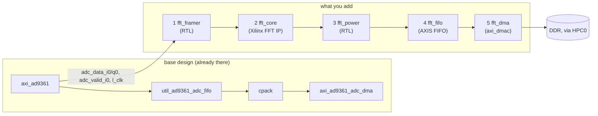
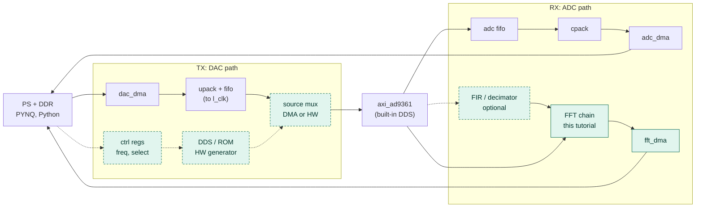
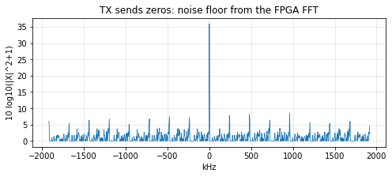
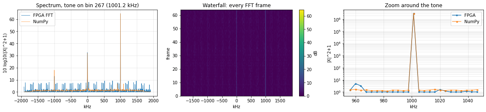

# Tutorial: add an FFT to the P501 PYNQ overlay, block by block

In this tutorial you start from the **P501 base block design** (the design the PYNQ base overlay is built from: Zynq PS,
AD9361 interface `axi_ad9361`, ADC/DAC DMAs, Ethernet bridge) and add a streaming FFT to it, one block at a time.
You then build the bitstream, copy it to the board, load it as a PYNQ overlay and test it from a notebook.



| step | you do | result |
|---|---|---|
| 0 | create the starting project, look at the top level | Vivado project with the base design only |
| 1-5 | add the five blocks | the FFT chain, validated after each block |
| 6 | generate the bitstream | `.bit` + `.hwh` |
| 7 | fix the `.hwh`, copy both files to the board | overlay on the board |
| 8 | load the overlay in a PYNQ notebook | `ol.fft_dma` is there |
| 9 | run the test notebook | four tests, each `PASS`/`FAIL` |

### The big picture: both data paths

The base design already moves samples both ways through DMAs, so Python can read and write them. The chip's core also has a built-in DDS
(selected by a register, which we used for the DDS-versus-DMA test). The tutorial adds one DSP branch on the receive side (FFT); the dashed
blocks show where a hardware signal source for the DAC, or more DSP such as a FIR filter, would go.



**You need:** Vivado 2024.1, the ADI hdl library of the [puzi501iio](https://github.com/fllay/puzi501iio) repository (the script finds it at
`../pzsdr-p501/hdl/library`, otherwise pass `LIB=<dir>`), a P501 board running the PYNQ image with network access, and about 45 minutes
(most of it the 12 minute build).

Every step can be done **in the Vivado GUI** (recipes below) or **with one Tcl command** (`tutorial/steps/stepN_*.tcl`, the exact
same commands). Do it by hand once to learn the design, use the scripts when you just want the result. The scripts are the tested path
(see [Verification](#verification)); GUI menu names can differ a little between Vivado versions.

---

## 1. Background: what flows where

**Clock.** `axi_ad9361` produces the data clock `l_clk` from the AD9361 interface clock. In 1R1T mode `l_clk` = 2 x the sample rate
(7.68 MHz at 3.84 MSPS, 122.88 MHz at 61.44 MSPS), and `adc_valid_i0` is high every second `l_clk`. The whole FFT chain runs on `l_clk`:
no clock-domain crossing is needed until the DMA, which does it internally.

**Samples.** `adc_data_i0` / `adc_data_q0` are the 16-bit I and Q of receive channel 0. These nets already feed the ADC FIFO and the
ADC DMA of the base design; we just connect more loads to them, so the raw capture path stays exactly as it was.

**AXI-Stream.** The FFT IP speaks AXI-Stream: `TDATA` + `TVALID` (+ `TREADY`) and `TLAST` marking the last sample of a frame. Blocks
are connected with a single *interface* connection; a valid gap (`TVALID` low) is allowed anywhere.

**Frames.** The FFT transforms N samples at a time. Something has to mark the frame boundaries: that is `fft_framer`, which counts
`TVALID` beats and raises `TLAST` every N. It runs free: frame boundaries are arbitrary relative to the signal, which is fine for a spectrum.

**Configuration.** The Xilinx FFT wants a *configuration word* per frame (forward/inverse and the scaling schedule). We use a fixed
length, direction and scaling, so a constant word with `TVALID` tied high does the job.

**Scaling.** The FFT core is used in *scaled* mode: each radix-2² stage can divide by 4 to avoid overflow. We pick the total shift
`fft_scale_shift` (bits). A tone of amplitude A (ADC counts) gives a bin of about `A * N / 2^shift`, while noise of r.m.s. σ gives about
`σ * sqrt(N) / 2^shift` per bin. With N = 1024 and shift = 6 the tone gain is 16 and the noise gain 0.5. Keep the peak below 2^15
(raise the shift if the output overflows) and the noise floor above about one LSB (lower the shift if the floor shows as all zeros).

**Power and the frame gate.** `fft_power` computes `re² + im²` (32 bit unsigned) and decides, at the first bin of every frame, whether
the frame passes: only if the DMA currently has a transfer pending. So every DMA transfer starts on a frame boundary and gets whole
frames, while the FFT itself is never stalled.

**FIFO and DMA.** The FIFO is two frames deep. The ADI `axi_dmac`, configured with an **AXI-Stream source**, writes the stream to DDR
through the PS port `HPC0` (cache-coherent, so Python sees the data without cache maintenance beyond `invalidate()`). The PS controls it
through AXI-Lite registers.

---

## 2. Step 0 - create the starting project and look at the top level

```bash
cd p501_fft_example
vivado -mode batch -source create_project.tcl -tclargs FFT=0     # base design only; project "p501_fft_tut"
vivado build/p501_fft_tut/p501_fft_tut.xpr                       # open it in the GUI
```

(`FFT=0` skips the FFT chain. The script recreates the base block design from `bd/p501_base_bd.tcl`, adds the RTL sources in `src/` and
`rtl/`, the constraints, and the HDL wrapper. It takes a few minutes. Options: `LIB=...`, `NFFT_LOG2`, `SCALE_SHIFT`, see `README.md`.)

In the GUI: **Flow Navigator → IP INTEGRATOR → Open Block Design**. Take a look around (use the *Regenerate Layout* button if the
diagram is cluttered, and the **Address Editor** tab for the memory map):

| block | what it is |
|---|---|
| `sys_ps8` | the Zynq UltraScale+ processing system; `pl_clk0` is the PS-side clock (100 MHz) |
| `axi_ad9361` | ADI AD9361 interface: LVDS data pins, produces `l_clk`, ADC/DAC data and valid per channel, control registers at `0x99020000` |
| `util_ad9361_adc_fifo`, `util_ad9361_adc_pack`, `axi_ad9361_adc_dma` | RX path: clock crossing FIFO, channel packer, DMA to DDR (registers `0x9C400000`) |
| `axi_ad9361_dac_dma`, `util_ad9361_dac_upack`, `axi_ad9361_dac_fifo` | TX path (registers `0x9C420000`) |
| `axi_cpu_interconnect` | SmartConnect from the PS (`M_AXI_HPM0_LPD`) to every register block: **4** master ports, we will use a 5th |
| `axi_hp1_interconnect` | SmartConnect from the DMAs to the PS `HPC0` port: **1** slave port, we will use a 2nd |
| `gmii_to_rgmii_0`, `clk_wiz_0`, ... | the Ethernet RGMII bridge and clocks: keep them, `eth0` of the board runs through the PL |

Find these two things, you will connect to them: **`axi_ad9361/l_clk`** and **`axi_ad9361/adc_data_i0`**, `adc_data_q0`, `adc_valid_i0`.

Now open the **Tcl Console** (bottom of the GUI) and set the two design parameters once; the step scripts read them:

```tcl
set fft_nlog2 10          ;# FFT length N = 2^10 = 1024
set fft_scale_shift 6     ;# total FFT scaling in bits (even); default is nlog2-4
```

> **Checkpoint 0.** `validate_bd_design` in the console (or **Tools → Validate Design**) ends with "Validation successful". Warnings about
> excluded address segments (`HPC0_QSPI`, `HPC0_LPS_OCM`, ...) and the SmartConnect "Low-area mode" belong to the base design.

---

## 3. Step 1 - the frame generator (`fft_framer`)

*Goal:* turn `{adc_data_q0, adc_data_i0, adc_valid_i0}` into an AXI-Stream with `TLAST` every N samples.

**Tcl:** `source tutorial/steps/step1_framer.tcl` - or by hand:

1. The RTL `rtl/adc_frame_gen.v` is already a project source (the script added it; in your own project use *Add Sources → Add or create design
   sources*). In the diagram: right-click on the canvas → **Add Module…** → `adc_frame_gen` → OK. Select the new block and set its **name**
   to `fft_framer` (Block Properties panel).
2. Double-click the block (*Re-customize Module*) and set **N_LOG2** = 10 (your `fft_nlog2`).
3. Right-click → **Add IP…** → `Utility Vector Logic` (`util_vector_logic`), name it `fft_rstn_inv`, double-click: **C_OPERATION** = `not`, **C_SIZE** = 1.
   `axi_ad9361/rst` is active high; the framer, FFT and FIFO want an active-low reset. We use the AD9361's own reset so the FFT side is reset together with `l_clk`.
4. Connect (drag from pin to pin):

| from | to |
|---|---|
| `axi_ad9361/rst` | `fft_rstn_inv/Op1` |
| `axi_ad9361/l_clk` | `fft_framer/clk` |
| `fft_rstn_inv/Res` | `fft_framer/resetn` |
| `axi_ad9361/adc_data_i0` | `fft_framer/smp_i` |
| `axi_ad9361/adc_data_q0` | `fft_framer/smp_q` |
| `axi_ad9361/adc_valid_i0` | `fft_framer/smp_valid` |

> **Checkpoint 1.** Validate. The new nets are shared with the existing FIFO: if you click the `adc_data_i0` net, both
> `util_ad9361_adc_fifo` and `fft_framer/smp_i` are highlighted. The `m_axis` interface of the framer is still unconnected, which is fine.

How the module works: it registers `{Q, I}` into a 32-bit `m_axis_tdata`, passes the valid strobe as `m_axis_tvalid`, and counts accepted samples;
`m_axis_tlast` is high when the count is `2^N_LOG2 - 1`. The block has `X_INTERFACE_*` attributes so Vivado shows `m_axis` as an AXI-Stream interface
and `clk`/`resetn` as clock/reset (open `rtl/adc_frame_gen.v`; the same attributes are the recipe for your own modules).

---

## 4. Step 2 - the Xilinx FFT IP (`fft_core`) and its configuration

*Goal:* a pipelined streaming FFT that takes one sample per valid, outputs natural-order bins, scaled.

**Tcl:** `source tutorial/steps/step2_fft.tcl` - or by hand:

1. **Add IP…** → `Fast Fourier Transform` (`xfft` 9.1), name `fft_core`. Double-click and set (tab names can differ slightly; the Tcl property is in the last column):

| setting | value | Tcl property |
|---|---|---|
| Transform Length | 1024 (2^`fft_nlog2`) | `transform_length` |
| Architecture (Implementation Options) | Pipelined, Streaming I/O | `implementation_options` = `pipelined_streaming_io` |
| Target Clock Frequency | 150 MHz | `target_clock_frequency` |
| Data Input Width / Phase Factor Width | 16 / 16 | `input_width`, `phase_factor_width` |
| Scaling Options | Scaled | `scaling_options` = `scaled` |
| Rounding Mode | Convergent Rounding | `rounding_modes` = `convergent_rounding` |
| Output Ordering | Natural Order | `output_ordering` = `natural_order` |
| Throttle Scheme | Non Real Time | `throttle_scheme` = `nonrealtime` |
| Optional pins | **ARESETn** on | `aresetn` = `true` |

2. **Configuration word.** The core has an AXI-Stream configuration channel `S_AXIS_CONFIG` whose `TDATA` width Vivado computes
   (here 16 bit). Bit 0 is **FWD_INV** (1 = forward transform); above it come the **SCALE_SCH** fields, 2 bits per radix-2² stage,
   the first stage in the least significant bits; the value 2 means "divide by 4 in this stage". N = 1024 has 5 stages. For
   `fft_scale_shift` = 6 we divide by 4 in the first three stages: `SCALE_SCH = 0b00_00_10_10_10`, so the word is `(0b101010 << 1) | 1 = 0x55`.
   The script computes this for any N and shift. Add two **Constant** IPs (`xlconstant`):

| name | width | value |
|---|---|---|
| `fft_cfg_data` | 16 (the width of `s_axis_config_tdata`) | `0x55` (decimal 85) |
| `fft_cfg_valid` | 1 | 1 |

3. Connect:

| from | to |
|---|---|
| `axi_ad9361/l_clk` | `fft_core/aclk` |
| `fft_rstn_inv/Res` | `fft_core/aresetn` |
| `fft_framer/m_axis` (interface) | `fft_core/S_AXIS_DATA` |
| `fft_cfg_data/dout` | `fft_core/s_axis_config_tdata` |
| `fft_cfg_valid/dout` | `fft_core/s_axis_config_tvalid` |

`TVALID` tied high is intentional: the core buffers the configuration in a small FIFO and uses one copy per frame; the surplus
simply waits. The core's `S_AXIS_CONFIG` is a plain stream interface, so if you want the scaling to be changeable from software
later, replace the two constants by a small AXI-Lite register block.

> **Checkpoint 2.** Validate. `fft_core/M_AXIS_DATA` carries 32 bits `{im[15:0], re[15:0]}` per bin (still unconnected).

---

## 5. Step 3 - power spectrum and frame gate (`fft_power`)

*Goal:* `|X|²` per bin, and let frames through only while the DMA is running.

**Tcl:** `source tutorial/steps/step3_power.tcl` - or by hand: **Add Module…** → `fft_power_gate`, name `fft_power`, and connect

| from | to |
|---|---|
| `axi_ad9361/l_clk` | `fft_power/clk` |
| `fft_rstn_inv/Res` | `fft_power/resetn` |
| `fft_core/M_AXIS_DATA` (interface) | `fft_power/s_axis` |

`fft_power/frame_en` stays open until step 5. Open `rtl/fft_power_gate.v` to see the logic: three pipeline stages for the squares, and a
gate that samples `frame_en` on the first bin of each frame and keeps that decision for the whole frame.

Why a separate block and not just "the DMA takes what it gets"? Without the gate a transfer would start in the middle of a frame (the
stream is free running), and every spectrum in the buffer would be rotated by an unknown number of bins.

> **Checkpoint 3.** Validate.

---

## 6. Step 4 - the output FIFO (`fft_fifo`)

*Goal:* two frames of buffering between the gate and the DMA.

**Tcl:** `source tutorial/steps/step4_fifo.tcl` - or by hand: **Add IP…** → `AXI4-Stream Data FIFO` (`axis_data_fifo`), name `fft_fifo`:

| setting | value | Tcl property |
|---|---|---|
| TDATA width (bytes) | 4 | `TDATA_NUM_BYTES` |
| TLAST | enabled | `HAS_TLAST` = 1 |
| FIFO depth | 2048 (= 2 x N) | `FIFO_DEPTH` |

| from | to |
|---|---|
| `axi_ad9361/l_clk` | `fft_fifo/s_axis_aclk` |
| `fft_rstn_inv/Res` | `fft_fifo/s_axis_aresetn` |
| `fft_power/m_axis` (interface) | `fft_fifo/S_AXIS` |

The gate has no back-pressure (`s_axis_tready` is always 1, the FFT is never stalled), so the FIFO has to absorb a whole frame
whenever the DMA is momentarily not ready: it must be at least one frame deep. Two frames leave margin for the DMA's burst
behaviour.

> **Checkpoint 4.** Validate.

---

## 7. Step 5 - DMA to DDR (`fft_dma`) and the PS connections

*Goal:* write the power spectra to memory, with registers the PS can program.

**Tcl:** `source tutorial/steps/step5_dma.tcl` - or by hand:

1. **Add IP…** → `AXI DMAC` (`axi_dmac`, vendor analog.com), name `fft_dma`. Double-click and set:

| setting | value | Tcl property |
|---|---|---|
| Source type | AXI Stream | `DMA_TYPE_SRC` = 1 |
| Destination type | Memory-Mapped AXI | `DMA_TYPE_DEST` = 0 |
| Source data width / destination data width | 32 / 64 | `DMA_DATA_WIDTH_SRC` / `DMA_DATA_WIDTH_DEST` |
| Cyclic, 2D transfer, source/destination register slices, start synchronisation | all off | `CYCLIC`, `DMA_2D_TRANSFER`, `AXI_SLICE_SRC`, `AXI_SLICE_DEST`, `SYNC_TRANSFER_START` = false |
| Allow asymmetric memory | on | `ALLOW_ASYM_MEM` = 1 |

2. **More ports on the interconnects.** Double-click `axi_cpu_interconnect` → *Number of Master Interfaces* **5**; double-click
   `axi_hp1_interconnect` → *Number of Slave Interfaces* **2**.
3. Connect:

| from | to | what it is |
|---|---|---|
| `axi_ad9361/l_clk` | `fft_dma/s_axis_aclk` | stream clock |
| `fft_fifo/M_AXIS` (interface) | `fft_dma/s_axis` | the spectra |
| `fft_dma/s_axis_xfer_req` | `fft_power/frame_en` | tells the gate a transfer is pending |
| `axi_cpu_interconnect/M04_AXI` | `fft_dma/s_axi` | control registers |
| `fft_dma/m_dest_axi` | `axi_hp1_interconnect/S01_AXI` | data to DDR |
| `sys_ps8/pl_clk0` | `fft_dma/s_axi_aclk` and `fft_dma/m_dest_axi_aclk` | PS-side clock |
| `sys_rstgen/peripheral_aresetn` | `fft_dma/s_axi_aresetn` and `fft_dma/m_dest_axi_aresetn` | PS-side reset |

4. **Addresses** (Window → *Address Editor*). Two lines are unassigned:
   * `sys_ps8/Data` → `fft_dma/s_axi/axi_lite`: offset **`0x9C440000`**, range **4K**. This address ends up in the `.hwh` and
     is what PYNQ's `ol.fft_dma` uses.
   * `fft_dma/m_dest_axi` → `sys_ps8/SAXIGP0/HPC0_DDR_LOW`: offset `0x0000_0000`, range **2G**. (Right-click an unassigned row → *Assign
     Address*, then edit offset/range.) The DMA writes physical addresses handed out by `pynq.allocate()`, all below 2 GB.

> **A note on `TLAST`.** `fft_power` raises no `TLAST` on its output (`m_axis_tlast` is tied low in `rtl/fft_power_gate.v`), although the FIFO
> has a `TLAST` input. The ADI DMA ends an AXI-Stream transfer at the *first* `TLAST` it sees: with the per-frame `TLAST` forwarded, a request for 64 frames
> returns one frame and 63 frames of zeros. (We found this the hard way: test 3 of the notebook is the regression test for it.)

> **Checkpoint 5.** Validate: "Validation successful". You now have the same design as `create_project.tcl` builds by default. If you want to
> compare, run `write_bd_tcl -force mine.tcl` and diff it with the one of a `FFT=1` project: they are identical.
> Then **File → Save Block Design**.

---

## 8. Step 6 - build the bitstream

If you used the GUI: **Flow Navigator → PROGRAM AND DEBUG → Generate Bitstream** (it runs synthesis and implementation first, answer *Yes* to
the dialogs; use 8 jobs). Then **close the GUI** (the batch script needs the project unlocked) or build from the console. From a shell, with the project saved:

```bash
vivado -mode batch -source build.tcl -tclargs RUN=bit NAME=p501_fft_tut JOBS=8
```

This takes about 12 minutes and collects the overlay files in `build/overlay/p501_fft_tut.bit` and `.hwh`. (If you built in the GUI instead, the
files are `build/p501_fft_tut/p501_fft_tut.runs/impl_1/system_top.bit` and
`build/p501_fft_tut/p501_fft_tut.gen/sources_1/bd/system/hw_handoff/system.hwh`.)

> **Checkpoint 6.** In the implementation log or *Report Timing Summary*: **WNS ≥ 0 and WHS ≥ 0**. The reference build has WNS +0.42 ns, WHS +0.01 ns.
> One *pulse width* endpoint shows -0.002 ns; it comes from the base design and is harmless.
>
> If the build stops in synthesis with *named port connection 'MDIO_PHY_mdio_io' does not exist*, your `system_top.v` is not the one in `src/`: the
> block design exposes `MDIO_PHY_mdio_i/_o/_t` and the top level adds the IO buffer (`src/system_top.v`, search for `IOBUF`).

---

## 9. Step 7 - fix the `.hwh` and copy the overlay to the board

PYNQ reads `<name>.hwh` next to `<name>.bit` to learn the IPs and their addresses. Vivado writes two things in it that the PYNQ metadata
parser cannot digest (unconnected tie-off connections of the PS and the PS-to-`gmii_to_rgmii` MDIO nets). One command removes them:

```bash
python3 tools/fix_hwh.py build/overlay/p501_fft_tut.hwh
```

Copy `.bit`, `.hwh` and the test notebook to the board (default PYNQ user `xilinx`, password `xilinx`; the board is `192.168.2.1` on USB networking, or `pynq`):

```bash
scp build/overlay/p501_fft_tut.bit build/overlay/p501_fft_tut.hwh notebook/P501_FFT_Tutorial.ipynb \
    xilinx@192.168.2.1:/home/xilinx/jupyter_notebooks/p501_fft_tut/
```

(Create the folder first with `ssh xilinx@192.168.2.1 mkdir -p /home/xilinx/jupyter_notebooks/p501_fft_tut`, or use the *Upload* button of the
Jupyter file browser at `http://192.168.2.1:9090`.) **The `.bit` and `.hwh` must have the same base name.**

The notebook also needs the AD9361 driver files that come with the P501 PYNQ image in `/home/xilinx/jupyter_notebooks`
(`ad9361_driver.py`, `axi_dmac.py`, ...).

---

## 10. Step 8 - load the overlay in a notebook

```python
from pynq import Overlay
ol = Overlay("/home/xilinx/jupyter_notebooks/p501_fft_tut/p501_fft_tut.bit")   # programs the PL
print(sorted(k for k in ol.ip_dict if k.startswith(("fft", "axi_ad9361"))))
# ['axi_ad9361', 'axi_ad9361_adc_dma', 'axi_ad9361_dac_dma', 'fft_dma']
print(hex(ol.ip_dict["fft_dma"]["phys_addr"]))                                  # 0x9c440000
```

If this works, steps 1-7 are right: the PL is programmed and PYNQ found the DMA you added at the address you assigned. (Loading an overlay replaces
the whole PL, which is why the base design with the Ethernet bridge is kept in it; USB networking is unaffected.)

---

## 11. Step 9 - the test notebook

Open `P501_FFT_Tutorial.ipynb` on the board and **Run All** (the AD9361 bring-up in the middle takes about a minute). Put the TX1 and RX1 antennas near each
other. The notebook configures the AD9361 (the same software flow as the base design) and runs four tests:

| test | what it does | what it proves |
|---|---|---|
| 0 | loads the overlay, reads the DMA's version register | PL, `.hwh` and address map are right |
| 1 | TX sends zeros, 8 frames are read | the stream/DMA path is alive; floor is flat with a DC spike (below) |
| 2 | tones on bins +100, +267, -180 | the peak lands on the bin sent, also for negative bins: I/Q order is right |
| 3 | 64 frames in one transfer | no frame is empty: the DMA is not cut short by `TLAST` |
| 4 | compares with NumPy's FFT of a raw ADC capture | scaling and the power computation are right (we get 0.0 dB difference) |

Expected output of a good run:

```
PASS  overlay loaded: fft_dma at 0x9C440000, core version 0x00040461
PASS  idle frames arrive: 8 frames x 1024 bins, floor 0.5 dB, strongest spur 35 dB over it
PASS  tone in the right bin: sent +100 -> peak +100 (64 dB over floor); sent +267 -> peak +267 (64 dB over floor); sent -180 -> peak -180 (63 dB over floor)
PASS  all frames carry data: 64/64 frames non-empty, peak power per frame 2.41e+06 .. 2.43e+06
PASS  matches NumPy at the tone: FPGA / NumPy = -0.05 dB
PASS  no overflow: max power 2.43e+06 (limit 2^31 = 2.15e+09)
ALL TESTS PASSED
```

| Test 1: TX sends zeros | Test 4: FPGA vs NumPy, waterfall of the 64 frames, zoom on the tone |
|---|---|
|  |  |

The notebook ends with a table of what to check when a test fails, and with ideas for experiments.

How the notebook reads a spectrum, the essence:

```python
fftd = AxiDmac(ol.fft_dma)                                   # same helper as for the ADI DMAs of the base design
buf  = allocate(shape=(FRAMES, N), dtype=np.uint32)          # FRAMES x N power values, 32 bit each
fftd.transfer_to_memory(buf.physical_address, buf.nbytes)    # DMA request; the gate lets whole frames in
buf.invalidate()
spectrum_db = 10 * np.log10(np.fft.fftshift(np.array(buf, dtype=float), axes=1) + 1)   # bin 0 = DC, fftshift to centre it
```

---

## 12. Design notes

* **Why `l_clk` and not the PS clock?** The ADC samples are valid on `l_clk`; staying in that domain avoids an extra clock-crossing FIFO in front of the FFT.
  The DMA does the crossing (it has asynchronous stream and memory clocks).
* **Bandwidth check.** At 61.44 MSPS the stream is 61.44 M x 4 bytes = 246 MB/s into the DMA. The `HPC0` port easily takes it. The
  1024-point pipelined FFT keeps up with one sample per valid at any rate the AD9361 can produce.
* **Resources.** The FFT is a pipelined radix-2² core: a few DSP slices per stage and BRAM/LUTRAM for the delay lines; the whole chain is small compared with the base design.
* **2R2T.** In 2R2T mode `l_clk` = 4 x the sample rate and there are two receive channels; add a second chain from `adc_data_i1` / `adc_valid_i1`.
* **Changing N.** Set `fft_nlog2` (e.g. 12 for 4096 points) and `fft_scale_shift` before step 1 and the notebook's `NFFT_LOG2` to the same value.
  The configuration word and the FIFO depth follow automatically in the step scripts.
* **Averaging, windows.** Not included, to keep the first design readable. A Hann window is a ROM of N coefficients and a multiplier between `fft_framer` and
  `fft_core`; K-frame averaging is a BRAM accumulator after `fft_power`.

## 13. Where to go next

1. **Window** the input (Hann): new module between steps 1 and 2.
2. **Average K frames** in BRAM and send one averaged spectrum per transfer (less DDR traffic, lower floor).
3. **Software-controlled scaling**: replace the constant configuration word by an AXI-Lite register (GPIO IP or a small register block) that Python writes.
4. **Decimate before the FFT** (CIC + FIR) for a high-resolution zoom FFT at a high sample rate.
5. **Interrupts**: connect `fft_dma/irq` to the PS (see how `axi_ad9361_adc_dma/irq` is wired into `sys_concat_intc_*`).

## Verification

What has been run, on Vivado 2024.1 and a P501 board:

* The five step scripts were run one after the other on the base project (`FFT=0`) with `validate_bd_design` after each step: all succeed
  with only the base design's own warnings. The exported block design (`write_bd_tcl`) is byte-for-byte identical to the one `create_project.tcl` builds with `FFT=1`.
* That design's bitstream was built (timing met), copied to the board and the notebook of step 9 run on it: all tests passed (output above).
* The GUI recipes follow the Tcl scripts one-to-one (same blocks, parameters, nets and addresses), but the mouse clicks themselves are not scripted; if a menu or
  tab is named differently in your Vivado version, the Tcl property in the tables is authoritative, and you can always type the script's commands in the Tcl Console.

## Files

| path | purpose |
|---|---|
| `create_project.tcl` (`FFT=0`) | the starting project for this tutorial |
| `tutorial/steps/step1_framer.tcl` ... `step5_dma.tcl` | the five steps as Tcl, one block each |
| `bd/fft_chain.tcl` | runs the five steps in order (used by `create_project.tcl` with `FFT=1`) |
| `rtl/adc_frame_gen.v`, `rtl/fft_power_gate.v` | the two RTL blocks |
| `build.tcl`, `tools/fix_hwh.py` | bitstream build and `.hwh` fix |
| `notebook/P501_FFT_Tutorial.ipynb` | the test notebook of this tutorial |
| `notebook/P501_FFT_Example.ipynb` | a shorter demo notebook for the pre-built overlay |
