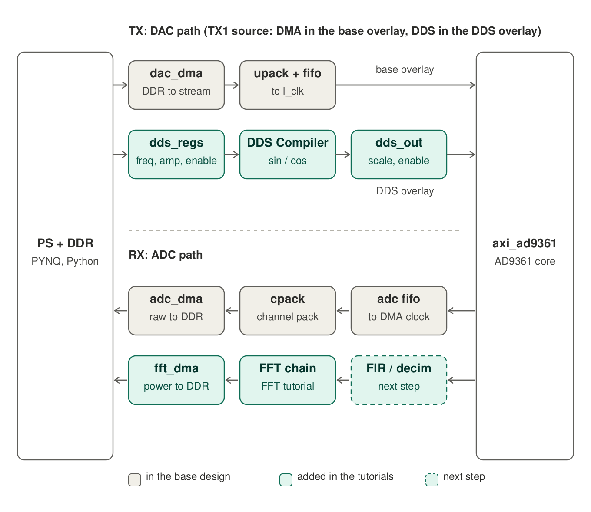
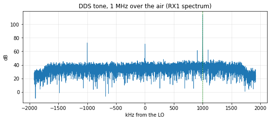
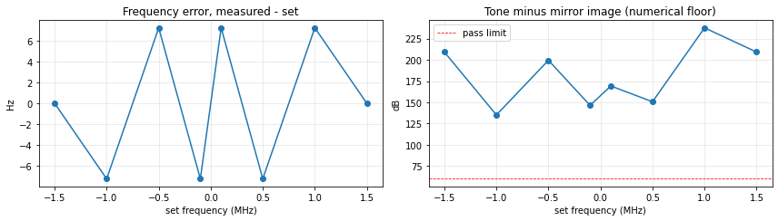
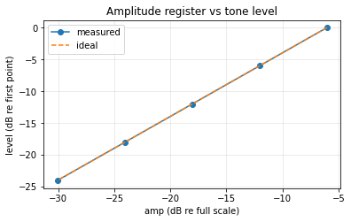
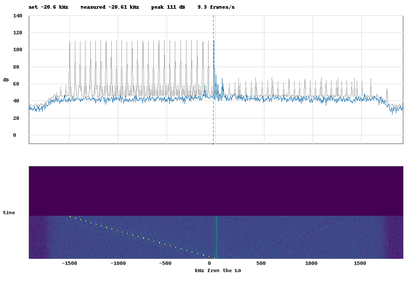

# Tutorial 2: replace the Python tone by a hardware DDS

In the base design the transmit tone is a buffer that Python computes with NumPy, copies to DDR, and a DMA streams to the AD9361 interface.
In this tutorial you build the same tone **inside the FPGA**: a Xilinx **DDS Compiler** generates the samples at the DAC sample rate,
and Python only writes a few registers (frequency, amplitude, on/off). No buffer, no DMA, and the frequency can change at any time without a glitch.



TX1 has one source per overlay: the DAC DMA in the base overlay, the DDS in the overlay you build here (no mux). To switch, load the other overlay.

| step | you do | result |
|---|---|---|
| 0 | create the starting project (the base design) | Vivado project, no DDS yet |
| 1 | add the AXI-Lite register block `dds_regs` | frequency word, amplitude, enable at `0x9C450000` |
| 2 | add the Xilinx DDS Compiler | sine/cosine generator, one sample per DAC request |
| 3 | add `dds_out` and connect it to the DAC input | the DDS drives TX1 instead of the DMA path |
| 4 | add the timing constraints for the hand-over | clean timing report |
| 5 | build, copy to the board | `p501_dds.bit` / `.hwh` |
| 6 | load the overlay, run the test notebook | eight checks, all `PASS` |

**You need:** the same as for [tutorial 1](TUTORIAL.md) (Vivado 2024.1, the ADI library, a board with the PYNQ image), and about 30 minutes plus the 12 minute build.
Tutorial 1 is not a prerequisite; the two can also be combined (see the end).

---

## 1. Background

**How `axi_ad9361` asks for samples.** The TX side of the core has two outputs per channel and two inputs: `dac_valid_i0` (output)
pulses when the core wants a new sample, and `dac_data_i0` / `dac_data_q0` (inputs) carry that sample: 16-bit signed, I and Q of TX1. The chip's
DAC has 12 bits, so the upper 12 bits count. In 1R1T mode `l_clk` = 2 x sample rate, so `dac_valid_i0` pulses every second `l_clk`
(3.84 MSPS: a pulse every 260 ns). In the base design the pins `dac_data_*` are driven by the DAC FIFO, which the DAC DMA fills.

The core can also generate samples itself (a built-in DDS and test patterns, chosen by a register); `core_enable()` in the Python code selects the
"DMA" input (value 2). Our DDS is connected where the DMA path was, so it **is** the "DMA" input from the core's point of view.

**The DDS.** A phase accumulator adds the *frequency word* FTW every sample; the top bits of the phase address a sine/cosine table.

```
f_out = FTW / 2^32 * f_sample          FTW = round(f_out / f_sample * 2^32)   (two's complement: negative f = other side of the LO)
```

With 32 phase bits the resolution is f_sample / 2^32 = 0.9 µHz at 3.84 MSPS. Example: 1 MHz needs FTW = 1e6 / 3.84e6 * 2^32 = 1 118 481 067 = `0x42AAAAAB`.
The IP outputs **cosine and sine** at the same time, so `I = cos`, `Q = sin` is a complex tone `e^{j2πft}`: a single line at +f (a real sine would also
show a mirror line at -f).

**One sample per DAC request.** The DDS Compiler advances once per clock. We want one new sample per `dac_valid`, not per `l_clk`, so `dac_valid_i0` is
connected to the IP's **clock enable** (`ACLKEN`). Everything behind the DDS (the scaler) uses the same enable. Between two valid pulses all values simply hold.

**Registers and two clock domains.** The registers are written by the PS (100 MHz AXI clock). The DDS runs on `l_clk` (7.68 MHz at 3.84 MSPS, from the AD9361 pins):
an unrelated clock. A 32-bit frequency word must not be read while it is half-updated, so `dds_regs` uses a **commit handshake**: Python writes FTW, amplitude and enable,
then writes COMMIT. COMMIT toggles a flag; the `l_clk` side sees the toggle through a two-flop synchroniser, loads the three parameters in one go (they stopped changing
long before), and toggles an acknowledge back. All three values go live on the same sample, and `STATUS` tells Python when that happened.

| offset | register | |
|---|---|---|
| `0x00` | ID (R) | `0xDD500001` |
| `0x04` | CONTROL (RW) | bit 0: enable (0 = the DAC gets zeros) |
| `0x08` | FTW (RW) | frequency word |
| `0x0C` | AMP (RW) | amplitude, Q15: `0x7FFF` = full scale |
| `0x10` | STATUS (R) | bit 0: last commit has reached the sample clock |
| `0x14` | COMMIT (W) | any write: parameters go live |

---

## 2. Step 0 - the starting point

```bash
cd p501_fft_example
vivado -mode batch -source create_project.tcl -tclargs FFT=0 NAME=p501_dds_tut      # base design only
vivado build/p501_dds_tut/p501_dds_tut.xpr
```

Open the block design `system` (as in tutorial 1). Find the pieces you will touch (zoom into the area around `axi_ad9361`):

* `axi_ad9361/dac_valid_i0` (output) and `axi_ad9361/dac_data_i0`, `dac_data_q0` (inputs), and `axi_ad9361/l_clk`;
* `axi_ad9361_dac_fifo/dout_data_0` and `dout_data_1`: the FIFO outputs that drive those two pins now. The DDS will take their place;
* `axi_cpu_interconnect` (control bus; the next free master port will be used) and `sys_ps8/pl_clk0`.

The RTL files `rtl/dds_regs.v` and `rtl/dds_scale.v` are project sources already. Open them: both are short and commented.

> **Checkpoint 0.** `validate_bd_design` succeeds (warnings of the base design only).

---

## 3. Step 1 - the register block (`dds_regs`)

**Tcl:** `source tutorial/dds_steps/step1_regs.tcl` - or by hand:

1. Right-click the canvas → **Add Module…** → `dds_regs` → OK. (The module has `X_INTERFACE_*` attributes, so `s_axi` appears as an AXI4-Lite interface and
   `aclk`/`aresetn`/`clk` as clock and reset pins.)
2. Double-click `axi_cpu_interconnect` → **Number of Master Interfaces** + 1 (4 → 5).
3. Connect:

| from | to |
|---|---|
| `axi_cpu_interconnect/M04_AXI` (the new port) | `dds_regs/s_axi` |
| `sys_ps8/pl_clk0` | `dds_regs/aclk` |
| `sys_rstgen/peripheral_aresetn` | `dds_regs/aresetn` |
| `axi_ad9361/l_clk` | `dds_regs/clk` |

4. **Address Editor**: assign `dds_regs/s_axi/reg0` offset **`0x9C450000`**, range **4K**. (If tutorial 1 is in the same design it uses `0x9C440000`, and the DDS lands on the next free
   master port automatically in the script.)

> **Checkpoint 1.** Validate. `dds_regs/ftw`, `amp`, `enable` outputs are still unconnected.

---

## 4. Step 2 - the DDS Compiler

**Tcl:** `source tutorial/dds_steps/step2_dds.tcl` - or by hand:

1. **Add IP…** → `DDS Compiler`, name `dds_core`. Double-click and set (tab names can vary; the Tcl property is in the last column):

| setting | value | Tcl property |
|---|---|---|
| Configuration options | Phase generator and SIN COS LUT | `PartsPresent` = `Phase_Generator_and_SIN_COS_LUT` |
| Parameter selection | Hardware parameters | `Parameter_Entry` = `Hardware_Parameters` |
| Phase width / output width | 32 / 16 | `Phase_Width`, `Output_Width` |
| Phase increment programmability | Streaming | `Phase_Increment` = `Streaming` |
| Phase offset programmability | None | `Phase_offset` = `None` |
| Output selection | Sine and cosine | `Output_Selection` = `Sine_and_Cosine` |
| Noise shaping | Taylor series corrected | `Noise_Shaping` = `Taylor_Series_Corrected` |
| System clock (MHz) | 122.88 (the fastest `l_clk`) | `DDS_Clock_Rate` |
| Optional pins | **ACLKEN**, **ARESETn** on | `Has_ACLKEN`, `Has_ARESETn` = `true` |

   "Streaming" phase increment means the frequency word arrives on the `S_AXIS_PHASE` stream with every sample: with `TVALID` held at 1 and the word from a register,
   it is simply "a register-controlled frequency". (The *programmable* mode with a configuration channel needs a valid pulse per change: a bit more logic, not needed here.)
2. Add `Utility Vector Logic` (`util_vector_logic`) named `dds_rstn_inv` (**C_OPERATION** `not`, **C_SIZE** 1) and a `Constant` (`xlconstant`) named `dds_pinc_valid` (width 1, value 1).
3. Connect:

| from | to |
|---|---|
| `axi_ad9361/rst` | `dds_rstn_inv/Op1` |
| `axi_ad9361/l_clk` | `dds_core/aclk` |
| `axi_ad9361/dac_valid_i0` | `dds_core/aclken` |
| `dds_rstn_inv/Res` | `dds_core/aresetn` |
| `dds_regs/ftw` | `dds_core/s_axis_phase_tdata` |
| `dds_pinc_valid/dout` | `dds_core/s_axis_phase_tvalid` |

> **Checkpoint 2.** Validate. `dds_core/m_axis_data_tdata` is 32 bits: **cosine in bits 15:0, sine in bits 31:16**.

---

## 5. Step 3 - amplitude, enable, and the DAC input (`dds_out`)

**Tcl:** `source tutorial/dds_steps/step3_dac.tcl` - or by hand:

1. **Add Module…** → `dds_scale`, name `dds_out`. It computes `dac_i = cos x amp`, `dac_q = sin x amp` (amp in Q15) or zeros if `enable` is low, advancing only when `ce` is high.
2. Connect:

| from | to |
|---|---|
| `axi_ad9361/l_clk` | `dds_out/clk` |
| `dds_rstn_inv/Res` | `dds_out/resetn` |
| `axi_ad9361/dac_valid_i0` | `dds_out/ce` |
| `dds_core/m_axis_data_tdata` | `dds_out/dds_tdata` |
| `dds_regs/amp` | `dds_out/amp` |
| `dds_regs/enable` | `dds_out/enable` |

3. **Replace the DMA path for TX1.** Select the two wires from `axi_ad9361_dac_fifo/dout_data_0` to `axi_ad9361/dac_data_i0` and from `dout_data_1` to `dac_data_q0`
   (click on the wire) and delete them. Then connect `dds_out/dac_i` → `axi_ad9361/dac_data_i0` and `dds_out/dac_q` → `axi_ad9361/dac_data_q0`.
   TX2 (`dac_data_i1`/`q1`) keeps its DMA connection.

> **Checkpoint 3.** Validate: "Validation successful". `axi_ad9361/dac_data_i0`/`q0` now have exactly one driver each. Save the block design.
> The exported design (`write_bd_tcl`) is identical to the one `create_project.tcl ... FFT=0 DDS=1` builds.

Why zeros when disabled, and not "hold"? A DAC that stops at a non-zero value would leave a DC offset on the transmitter; zeros are the neutral value.

---

## 6. Step 4 - timing constraints for the hand-over

The registers are in the AXI clock domain and are read by the `l_clk` domain: the tools see a path between two unrelated clocks and try to time it. The hand-over is made safe by the
handshake in `dds_regs.v`, so these paths are declared false paths in `src/dds_cdc.xdc` (the three parameter registers, and the first flop of the two toggle synchronisers).

**Tcl:** `source tutorial/dds_steps/step4_constraints.tcl`, or in the GUI: **Add Sources → Add or create constraints → Add Files…** → `src/dds_cdc.xdc`.

---

## 7. Step 5 - build and copy

```bash
vivado -mode batch -source build.tcl -tclargs RUN=bit NAME=p501_dds_tut JOBS=8        # about 12 minutes (close the GUI first)
python3 tools/fix_hwh.py build/overlay/p501_dds_tut.hwh
```

(Or in one go from nothing, without the manual steps: `vivado -mode batch -source create_project.tcl -tclargs FFT=0 DDS=1 NAME=p501_dds RUN=bit` gives `build/overlay/p501_dds.bit` and `.hwh`.)
The notebook expects the name `p501_dds`: either use that name, or change `BIT` in its first cell.

> **Checkpoint 5.** Timing summary: WNS ≥ 0, WHS ≥ 0. The reference build has WNS +0.42 ns, WHS +0.01 ns.

Copy to the board, with the Python driver and the notebook:

```bash
ssh xilinx@192.168.2.1 mkdir -p /home/xilinx/jupyter_notebooks/p501_dds
scp build/overlay/p501_dds.bit build/overlay/p501_dds.hwh notebook/p501_dds.py notebook/P501_DDS_Tutorial.ipynb \
    xilinx@192.168.2.1:/home/xilinx/jupyter_notebooks/p501_dds/
```

---

## 8. Step 6 - use it from Python

```python
from pynq import Overlay
from p501_dds import P501Dds

ol  = Overlay("/home/xilinx/jupyter_notebooks/p501_dds/p501_dds.bit")
dds = P501Dds(ol.dds_regs, fs_hz=3_840_000)
# ... AD9361 bring-up as in the base notebooks (the chip is configured over SPI) ...
dds.set(freq_hz=1e6, amp=0.5)       # +1 MHz tone from TX1, half scale
dds.set(freq_hz=-250e3)             # now at -250 kHz, same amplitude
dds.off()
```

`p501_dds.py` is a thin wrapper: it converts Hz to the frequency word, writes the registers, commits, and waits for the acknowledge (which only comes while the AD9361 clock
runs: bring the chip up first, otherwise you get a `TimeoutError` that says so). The base notebook's `tone_buffer`, `allocate()` and `transfer_from_memory` are gone: the tone does not exist in memory anywhere.

### The test notebook

Open `P501_DDS_Tutorial.ipynb` on the board and **Run All**. It brings the AD9361 up (the DDS is the test tone for the "settle" step) and runs:

| test | what it checks |
|---|---|
| 0 | the register block answers at `0x9C450000` with its ID |
| 1 | over the air: a 1 MHz tone comes back on RX1 at the right frequency, far above the noise |
| 2 | frequency accuracy: 8 frequencies from -1.5 to +1.5 MHz, in the AD9361's digital loopback (no antennas, no analog) |
| 3 | I/Q order: with the order wrong, the tone would appear at -f |
| 4 | amplitude: each halving of `amp` lowers the tone by 6.02 dB |
| 5 | `enable` off silences the DAC; a frequency change is taken over in about a tenth of a millisecond |

Expected output of a good run:

```
PASS  DDS registers found: dds_regs at 0x9C450000, ID 0xDD500001
product id 0x0A, ENSM 0xA, LO locks True/True, settled after 40 tries (40.8 dB image rejection)
PASS  AD9361 up: calibrations {'rx_bb_filter': True, 'tx_bb_filter': True, 'bb_dc': True, 'rf_dc': True, 'tx_quad': 3}
PASS  tone over the air: peak 1000.01 kHz, 78 dB over the floor, image rejection 41.1 dB
PASS  frequency accuracy: worst error 7 Hz over 8 frequencies from -1.5 to +1.5 MHz (bin = 469 Hz)
PASS  I/Q order, image rejection: mirror image at least 135 dB below the tone (digital loopback: no analog imbalance, so this is a numerical floor)
PASS  amplitude steps of 6 dB: level steps for amp halved: 6.02 dB, 6.02 dB, 6.02 dB, 6.02 dB
PASS  enable off silences the DAC: tone 132 dB -> -180 dB when off
PASS  update handshake: commit taken over after 0.54 ms (off), 0.10 ms per frequency change
ALL TESTS PASSED
```

|||
|---|---|
|  |  |
|  | |

How to read it: the frequency error stays within a few Hz over the whole range (that is the AD9361's reference clock accuracy and the peak-finding resolution, not the DDS: the
32-bit frequency word is far finer). The amplitude steps are exactly 6.02 dB because the register is a Q15 multiplier. The "mirror image" numbers in loopback are a numerical floor: there is no
analog imbalance in a digital loopback. The one over the air shows what the transmitter does: 40 to 50 dB image rejection (it varies from run to run with the AD9361's analog state, see the base bring-up report), from the chip's analog I/Q imbalance, not from the DDS.

---

## 9. Transmit continuously and watch it live

`notebook/P501_DDS_Live.ipynb` starts a tone and shows what the receiver sees **in real time**: the spectrum, a max-hold trace and a waterfall of the last 60 frames, about 10 frames per second.
Sliders set the frequency and amplitude, a checkbox switches the transmitter on and off, one runs a frequency sweep from -1.5 to +1.5 MHz, and one turns on the AD9361's digital loopback (no antennas needed).
Moving a slider changes the tone in the FPGA within a fraction of a millisecond; no Python loop generates the signal, the notebook only watches it.



How it works: a background thread runs `capture -> spectrum -> picture` and puts the PNG into an image widget, so the notebook stays responsive while the loop runs.
The picture is drawn with NumPy and Pillow instead of matplotlib: on the Zynq's ARM cores matplotlib needs about 0.4 s to draw one figure (2 frames/s); direct drawing takes tens of milliseconds.
The notebook runs a self-test first (frame rate, the thread with the sweep on, and every slider, checkbox and button driven from Python).

**The tone keeps transmitting until you turn it off**, also after the browser tab is closed or a cell fails: the generator is in the FPGA. The last cell of the notebook, *Stop and silence*,
turns the DDS off, the loopback off, and sets 80 dB of TX attenuation. The AD9361's transmit chain stays powered (a weak LO carrier remains); loading another overlay or powering down gives complete silence.

---

## 10. Design notes

* **Latency.** From the register write to the DAC: the commit takes two `l_clk` periods to cross, then the DDS pipeline and the scaler a few more *samples*. That is a few microseconds,
  and `STATUS` tells you when the new value is in. Phase is never reset by a change: frequency changes are phase-continuous.
* **Phase noise and spurs.** The DDS output is 16 bits, the chip's DAC takes the upper 12; those 12 bits are the limit for spurs, not the 32-bit phase accumulator.
  Keep the amplitude below full scale (0.5 is a good default) to leave headroom for the AD9361's digital filters.
* **Two independent clock domains.** `dds_regs` and the constraint file are the template for "software-controlled parameter in the `l_clk` domain": use the same pattern for the FFT
  scaling register mentioned in tutorial 1.
* **More tones.** A second DDS Compiler instance, a second register triplet, and an adder before `dds_out` gives two-tone tests (intermodulation). A sweep is a phase-increment ramp: put an accumulator
  that adds a step to the frequency word before `dds_core`, and write start, stop and step from Python.
* **TX2 and 2R2T.** This design drives TX1 only. For 2R2T duplicate the chain for `dac_data_i1`/`q1`, and mind that `l_clk` is then 4 x the sample rate (the DDS still advances once per `dac_valid`).
* **Together with the FFT.** `create_project.tcl -tclargs FFT=1 DDS=1` builds one overlay with both (the two blocks use separate control ports, `0x9C440000` and `0x9C450000`). It validates; it has not been run on the board.
  With the AD9361's digital loopback on, the chain "DDS tone → chip → ADC → FFT → DDR" then runs entirely inside the FPGA with no antenna.

## Verification

* The four step scripts were run in order on the base project (`FFT=0`) with `validate_bd_design` after each: all succeed with only the base design's own warnings. The exported block design is byte-for-byte
  identical to the one `create_project.tcl ... FFT=0 DDS=1` builds, and `FFT=1 DDS=1` validates.
* `rtl/dds_regs.v` and `rtl/dds_scale.v` were simulated with xsim (commit handshake across two unrelated clocks, scaling, enable).
* The overlay was built (timing met), copied to a P501 board and `P501_DDS_Tutorial.ipynb` run: all tests passed (output above).
* The GUI recipes follow the Tcl scripts one-to-one, but the mouse clicks themselves are not scripted; if a menu or tab is named differently in your Vivado, the Tcl property in the tables is authoritative.

## Files

| path | purpose |
|---|---|
| `tutorial/dds_steps/step1_regs.tcl` ... `step4_constraints.tcl` | the four steps as Tcl |
| `bd/dds_chain.tcl` | runs them in order (`create_project.tcl` with `DDS=1`) |
| `rtl/dds_regs.v`, `rtl/dds_scale.v` | register block with clock-domain hand-over, scaler |
| `src/dds_cdc.xdc` | false paths of the hand-over |
| `notebook/p501_dds.py` | Python driver |
| `notebook/P501_DDS_Tutorial.ipynb` | the test notebook |
| `notebook/P501_DDS_Live.ipynb` | continuous transmit with a live spectrum and waterfall |
