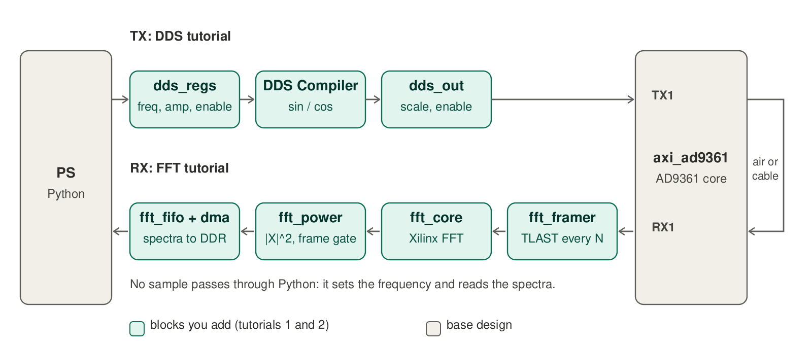
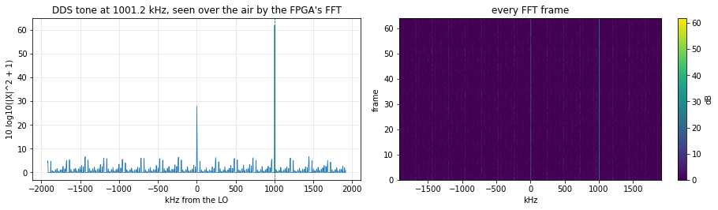
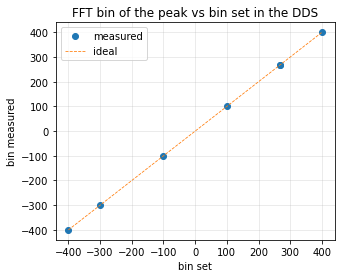
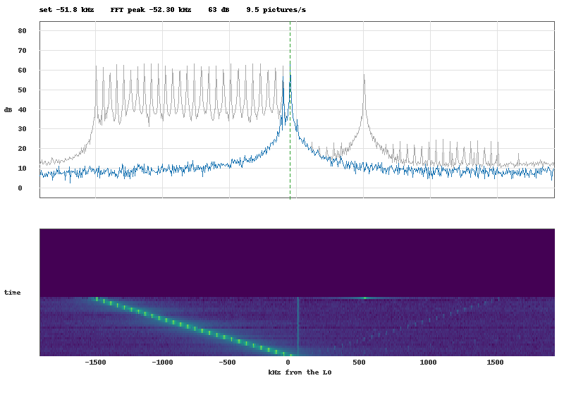

# Tutorial 3: tone in, spectrum out - DDS and FFT together, over the air

In tutorial 1 you added an FFT to the receive path, in tutorial 2 a DDS to the transmit path. Here both live in **one overlay**: the DDS generates a tone, the AD9361 transmits it,
the receiver picks it up over the air (or through a cable), and the FFT chain computes its spectrum. **No sample passes through Python**: it only sets the frequency and
amplitude of the DDS and reads finished power spectra.



| step | you do | result |
|---|---|---|
| 1 | build the overlay that contains both blocks | `p501_fft_dds.bit` / `.hwh` |
| 2 | check how the two blocks share the design | address map, clocks, ports |
| 3 | copy it to the board | overlay and three small Python modules |
| 4 | bring up the radio in one call, set a tone, read the spectrum | the whole radio in 10 lines |
| 5 | run the test notebook | six checks, all `PASS` |
| 6 | run the live notebook | transmit and watch, in real time |

**You need:** the board and tools of tutorials 1 and 2 (Vivado 2024.1, the ADI library). Doing tutorials 1 and 2 first helps to understand the blocks, but is not required:
step 1 builds everything in one command. TX1 and RX1 antennas near each other, or a cable with at least 40 dB attenuation: never connect them directly.

---

## 1. What "no driver" means here

The radio has two kinds of software, and tutorial 3 removes one of them completely:

| | before (base overlay) | in this overlay |
|---|---|---|
| **Signal path** | Python computes the tone with NumPy, a DMA moves it to the DAC; another DMA moves ADC samples to DDR and NumPy computes the FFT | DDS in the FPGA -> DAC; ADC -> FFT in the FPGA. Python never touches a sample |
| **Chip configuration** | the AD9361 is configured over SPI by Python (`ad9361_driver.py`) | the same: **this cannot be removed**, the chip produces no data clock until it is configured. It is reduced to one call, `p501_radio.bring_up(ol)` |
| **Control** | - | two registers worth of Python: `dds.set(freq_hz, amp)` and `fft.average(n)` |

So "without a driver" means: no software in the signal path, no DMA loops, no sample buffers. The SPI configuration of the chip stays, in one call.

---

## 2. Step 1 - build the overlay with both blocks

**One command** (about 15 minutes, 8 parallel jobs):

```bash
cd p501_fft_example
vivado -mode batch -source create_project.tcl -tclargs FFT=1 DDS=1 RUN=bit JOBS=8      # project and overlay name: p501_fft_dds
python3 tools/fix_hwh.py build/overlay/p501_fft_dds.hwh
```

**Or by hand**, continuing your project of tutorial 1: after its step 5, run the four steps of tutorial 2 (`tutorial/dds_steps/step1_regs.tcl` ... `step4_constraints.tcl`, or the same
steps in the GUI). Nothing has to be changed in the FFT part: the DDS register block takes the next free port of the CPU interconnect on its own.

> **Checkpoint 1.** `validate_bd_design` succeeds. Timing: WNS ≥ 0, WHS ≥ 0 (reference build: WNS +0.42 ns, WHS +0.01 ns).

---

## 3. Step 2 - how the two blocks share the design

Open the block design. Nothing is wired between the two chains: they meet only in `axi_ad9361`, on opposite sides, and in the shared infrastructure.

| shared | by whom |
|---|---|
| `axi_ad9361/l_clk` (the data clock, 2 x sample rate) | all FFT-side blocks (`fft_framer`, `fft_core`, `fft_power`, `fft_fifo`, `fft_dma` stream side) and all DDS-side blocks (`dds_regs/clk`, `dds_core`, `dds_out`) |
| `axi_ad9361/rst` | inverted twice (`fft_rstn_inv` and `dds_rstn_inv`), one per chain |
| `axi_cpu_interconnect` | 6 master ports: `M04` -> `fft_dma` at `0x9C440000`, `M05` -> `dds_regs` at `0x9C450000` |
| `axi_hp1_interconnect` | `S01`: the FFT DMA writes the spectra to DDR |

| `axi_ad9361` pins | used by |
|---|---|
| `dac_data_i0`, `dac_data_q0`, `dac_valid_i0` (TX1) | the DDS chain (`dds_out`, `dds_core/aclken`); the DAC DMA path is disconnected for TX1 |
| `adc_data_i0`, `adc_data_q0`, `adc_valid_i0` (RX1) | the FFT chain (`fft_framer`) **and** the original ADC FIFO and DMA, which stay as they were |

Because the two chains work on opposite sides of the chip, nothing needs a mux or arbitration, and each can be tested on its own (the test notebook does, in its first tests).

---

## 4. Step 3 - copy to the board

```bash
ssh xilinx@192.168.2.1 mkdir -p /home/xilinx/jupyter_notebooks/p501_fft_dds
scp build/overlay/p501_fft_dds.bit build/overlay/p501_fft_dds.hwh \
    notebook/p501_dds.py notebook/p501_fft.py notebook/p501_radio.py \
    notebook/P501_DDS_FFT_Tutorial.ipynb notebook/P501_DDS_FFT_Live.ipynb \
    xilinx@192.168.2.1:/home/xilinx/jupyter_notebooks/p501_fft_dds/
```

Three small Python modules sit next to the notebooks:

| module | what it does |
|---|---|
| `p501_radio.py` | `bring_up(ol)`: configures the AD9361 over SPI (clocks, LO, calibrations, filters), returns the chip object. `settle(...)` repeats the start until a test tone is clean (known AD9361 analog-state issue, see the bring-up report). `loopback`, `quiet` |
| `p501_dds.py` | `P501Dds(ol.dds_regs, fs)`: `set(freq_hz, amp)`, `off()`, from tutorial 2 |
| `p501_fft.py` | `P501Fft(ol.fft_dma, nfft_log2, fs)`: `average(n)` = mean power spectrum of `n` frames computed by the FPGA, `peak(...)`, `image_rejection_db(...)` |

---

## 5. Step 4 - the whole radio in ten lines

```python
from pynq import Overlay
import p501_radio
from p501_dds import P501Dds
from p501_fft import P501Fft

ol  = Overlay("/home/xilinx/jupyter_notebooks/p501_fft_dds/p501_fft_dds.bit")   # programs the PL
dds = P501Dds(ol.dds_regs, fs_hz=3_840_000)                                      # the transmit side
fft = P501Fft(ol.fft_dma, nfft_log2=10, fs_hz=3_840_000)                         # the receive side
ad  = p501_radio.bring_up(ol)                                                     # the AD9361, over SPI

dds.set(freq_hz=1e6, amp=0.5)            # TX1 sends a 1 MHz tone, generated in the FPGA
spectrum = fft.average(16)               # 16 spectra computed in the FPGA from what RX1 hears, averaged
print(fft.peak(spectrum))                # (frequency of the strongest line in Hz, level in dB)
```

Frequency resolution of the spectrum is `fs / N` = 3.84 MHz / 1024 = **3.75 kHz** per bin. A tone exactly on a bin (`k * fs / N`) gives one clean line; between two bins it spreads
over both (scalloping loss up to 3.9 dB with the rectangular window of this chain), which is why the tests use bin-centred frequencies.

---

## 6. Step 5 - the test notebook

Open `P501_DDS_FFT_Tutorial.ipynb` on the board and **Run All** (about two minutes, the AD9361 bring-up is most of it).

| test | what it checks |
|---|---|
| 0 | both blocks are in the overlay at `0x9C440000` and `0x9C450000` |
| 1 | `bring_up` and `settle` in one call each; the tone is seen over the air by the FPGA's FFT, with its image rejection (measured by the FPGA) |
| 2 | seven frequencies (bins -400 ... +400, including neighbours 267 and 268): the FFT peak is on the bin that was set. Swapped I/Q would put the peak at `-k` |
| 3 | the amplitude register halved four times: the FFT bin power falls by 6.02 dB each time |
| 4 | `dds.off()`: the tone disappears from the spectrum |
| 5 | speed: 256 frames in milliseconds; ten frequency changes, each one seen in the next spectrum |

Expected output of a good run:

```
PASS  both blocks in the overlay: fft_dma at 0x9C440000, dds_regs at 0x9C450000
settled after 30 tries, image rejection 59.7 dB
PASS  AD9361 up: LO locks True/True, ENSM 0xA, calibrations {'rx_bb_filter': True, 'tx_bb_filter': True, 'bb_dc': True, 'rf_dc': True, 'tx_quad': 3}
PASS  tone over the air: peak at 1001.25 kHz, 62 dB over the floor, image rejection 58.3 dB
PASS  tone in the right bin: set -400 -> bin -400 (62 dB); set -300 -> bin -300 (62 dB); set -100 -> bin -100 (62 dB); set +100 -> bin +100 (62 dB); set +267 -> bin +267 (62 dB); set +268 -> bin +268 (62 dB); set +400 -> bin +400 (61 dB)
PASS  amplitude steps of 6 dB: steps: 6.06 dB, 6.01 dB, 5.96 dB
PASS  off removes the tone: 62 dB with the tone, 0 dB when off
PASS  fast updates: 256 frames in 82.5 ms; 10/10 frequency changes seen in the next spectrum, 9.3 ms per change + 4-frame read
ALL TESTS PASSED
```

| | |
|---|---|
|  |  |

How to read it: the tone is in exactly the bin the DDS was told to produce, over the air, and the amplitude steps are 6.02 dB because the DDS multiplier is exact and the FFT chain is linear
at these levels. The image rejection (the mirror image of the tone at `-f`) comes from the analog I/Q imbalance of the AD9361 and changes from one start to the next; `settle` retries until it is
good enough.

---

## 7. Step 6 - the live notebook

`P501_DDS_FFT_Live.ipynb` shows what the receiver sees **in real time**: a live spectrum, a max-hold trace and a waterfall of the last 60 pictures, about 10 pictures per second.
Sliders set the frequency and amplitude of the DDS, a checkbox switches the transmitter, one runs a sweep from -1.5 to +1.5 MHz, and one turns on the AD9361 digital loopback (no antenna).



The pictures are built from spectra computed by the FPGA (compare with the DDS-only live notebook of tutorial 2, where Python computed the FFT of raw ADC samples): the notebook only reads 4 spectra
per picture and draws. Drawing (NumPy and Pillow, no matplotlib: it is too slow on the ARM cores) is the slow part, not the hardware, which delivers 3000 spectra per second.

**The tone keeps transmitting until you turn it off** (also if the tab is closed or a cell fails): the last cell, *Stop and silence*, turns the DDS and the loopback off and sets 80 dB of TX attenuation.

---

## 8. Design notes

* **Fresh frames.** After a change (new frequency, new amplitude, off) the next read must show the *new* signal. The FFT DMA admits a frame or two more than it reads, and a FIFO behind it would keep them: in our first
  on-board test the first two or three frames of every read were old, and an average over 16 frames was off by up to 4 dB. The fix is in the hardware: the gate in `rtl/fft_power_gate.v` holds the
  FIFO in reset while no transfer is pending (tutorial 1, step 4 explains it). With it, `dds.set(...)` followed by `fft.average(n)` shows only the new signal.
* **Latency of a change.** The first frame of a read taken right after `dds.set(...)` can still show the old signal, in the first test about one frame, after "off" up to two: the radio chain and the FFT
  pipeline hold the frame in progress (a frame is 267 µs long and a pipelined FFT outputs a frame after its input is complete). This is the *pipeline*, not the stale-frame problem above: after an idle period the
  first frame is already fresh. The notebook's `tone()` helper waits 3 ms after each change, which is more than enough; in your own code wait 1 to 3 ms, or drop the first frame or two of a read.
* **Levels.** The FFT chain is a 16-bit scaled FFT (scale shift 6 for N = 1024): the noise floor is a few dB and a tone of amplitude 0.5 at TX attenuation 10 dB reads about 60 dB over the air,
  far from saturation of the DDS, the DAC and the FFT, and well above the floor. If you raise the amplitude and the TX power until the receiver saturates, the amplitude steps stop being 6 dB: the
  non-linearity is then in the analog front end, not in the FPGA.
* **What the FPGA could do next.** Everything in this chain is still *read* by Python. Moving a decision into the FPGA closes the loop in hardware: a peak detector after `fft_power` that
  writes the peak bin into a register, and a small state machine that steers the DDS to follow a signal; or an averaging stage in BRAM so Python reads one spectrum per second instead of sixteen.
* **2R2T.** The design uses TX1/RX1 only. A second pair needs a second DDS chain and a second FFT chain, from `dac_data_i1`/`adc_data_i1`, and `l_clk` = 4 x the sample rate.

## Verification

* The overlay was built with `create_project.tcl -tclargs FFT=1 DDS=1` (timing met), copied to a P501 board and both notebooks run on it: all checks passed (output above).
* `rtl/fft_power_gate.v` (with the FIFO flush) was simulated with xsim against a model of the DMA and the FIFO: 60 transfers of random length and gap, every one starting on a frame boundary with complete
  frames, and the frames left over after each transfer flushed.
* The GUI recipes follow the Tcl scripts one-to-one, but the mouse clicks are not scripted; the Tcl is the tested path.

## Files

| path | purpose |
|---|---|
| `create_project.tcl` (`FFT=1 DDS=1`) | the combined overlay |
| `notebook/P501_DDS_FFT_Tutorial.ipynb` | the six tests |
| `notebook/P501_DDS_FFT_Live.ipynb` | live view and controls |
| `notebook/p501_radio.py`, `p501_dds.py`, `p501_fft.py` | bring-up, DDS registers, FFT frames |
| `tutorial/img/dds_fft.png` | the figure above (`make_figures.py`) |
