# Tutorial 6: 16-QAM OFDM with a Schmidl-and-Cox synchroniser in the FPGA, and a receiver in GNU Radio block by block

This tutorial builds on [tutorial 5 (16-QAM)](TUTORIAL_QAM16.md). It does not repeat what is there (the 16-QAM constellation and its Gray code, the PRBS-15 payload and the error counters, EVM, the register block and the capture RAM); it explains what changes when one fast carrier is replaced by 28 slow ones (OFDM), how the frame is found with a Schmidl-and-Cox symbol, why the receiver needs no timing loop and no phase loop, how the receiver was verified, how to run it on the board and in GNU Radio, and how to read the numbers. The engineering record behind it is [`ofdm/PLAN_OFDM.md`](ofdm/PLAN_OFDM.md) (design, studies, every RTL step) and [`ofdm/REPORT_OFDM.md`](ofdm/REPORT_OFDM.md) (the measurements, the problems found, the open items).

**What you need:** the P501 with the overlay `p501_ofdm_rx_sc` (build below), a PC with GNU Radio and a USRP B210 for the over-the-air part and for the GNU Radio receiver (the first two tests need only the P501; the GNU Radio receiver also runs on a recording), and tutorial 5 read.

**What you get:** a receiver that finds the frame, estimates the carrier and the channel from known symbols, equalises every subcarrier with one complex multiplication, tracks the rest with four pilots, decodes 16-QAM and counts errors against a known pattern, all in the FPGA with no software in the loop; and the same chain in GNU Radio, one block per step, with a plot after every stage.

| Part | Content |
|---|---|
| A | The concepts: OFDM, the frame, Schmidl and Cox, the idle slot and the guard, the carrier, the channel, the pilots, the receiver |
| B | How it was verified: model first, bit-exact, then the board |
| C | Run it: build, digital loopback, over the air, the B210, the GNU Radio receiver, the registers |
| D | Reading a link: SNR, EVM and the error rate, what limits the link, start-up, troubleshooting |
| E | Exercises and where next |

---

# Part A. The concepts

## A.1 Method

The same method as in tutorials 4 and 5: **every stage must reproduce the previous one to the last bit** before the next is built. New here: a second implementation of the algorithm in GNU Radio, in floating point, written as one block per step, which is the lab bench for the students.

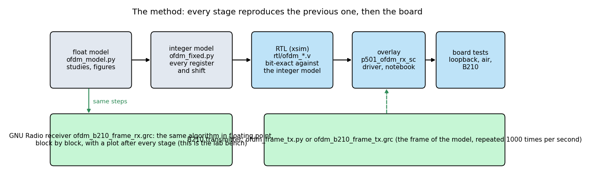

1. **Float model** (`ofdm/ofdm_model.py`, `ofdm_study.py`, `ofdm_sync_compare.py`): transmitter, channel (carrier offset, delay, clock error, echoes, noise) and receiver; used to choose the numbers (`results_ofdm.txt`, `results_sync_compare.txt`).
2. **Integer model** (`ofdm/ofdm_fixed.py`): every register and every shift of the RTL, in Python; within 0.1 to 0.3 dB of the float model (`results_ofdm_fixed.txt`).
3. **RTL** (`rtl/ofdm_detect.v`, `ofdm_derot.v`, `ofdm_fft.v`, `ofdm_chan.v`, `ofdm_data.v`, `ofdm_rx.v`) simulated with xsim on the same vectors, one block after the other: zero mismatches against the integer model (`ofdm/sim/run_*.sh`).
4. **Overlay** `p501_ofdm_rx_sc`, driver, notebook; **board** tests: digital loopback first, then over the air.
5. **GNU Radio** receiver `ofdm/ofdm_b210_frame_rx.grc`: the same steps with stock blocks and seven small Python blocks, for looking at the signal after every stage.

## A.2 Why OFDM, and what it costs

The single-carrier 16-QAM link of tutorial 5 sends 960 thousand symbols per second and needs a timing loop, a phase loop and a frequency loop to follow the symbols. **OFDM sends 24 independent 16-QAM streams (and 4 pilots) of 60 thousand symbols per second each**, side by side in frequency. A symbol that is 16 times longer (16.7 us against 1.04 us) is hardly disturbed by an echo or a timing error, and what is left of the channel is *one complex number per subcarrier*:

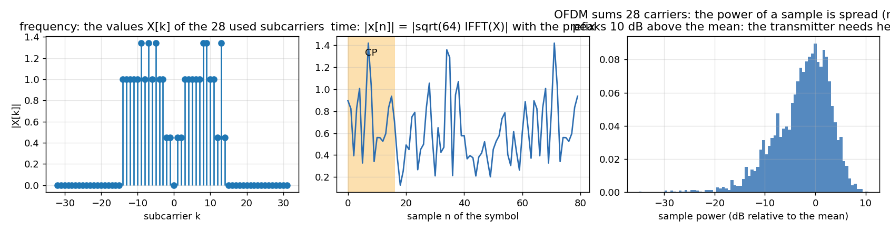

* **The transmitter** puts the 28 values X[k] on the used subcarriers and takes a 64-point inverse FFT: 64 samples. The **cyclic prefix** copies the last 16 of them in front (80 samples = 20.8 us at 3.84 MS/s). The receiver takes any 64 consecutive samples of the symbol (the FFT window): a delay inside the prefix only turns every subcarrier by a known angle, and an echo shorter than the prefix does the same per subcarrier, so **one complex multiplication per subcarrier equalises the channel** (A.7). There is no timing loop; the symbol timing only has to be right to within the prefix.
* **The carrier offset must be small against the subcarrier spacing** (60 kHz here). The natural offset between the P501 and the B210 is about 9 kHz = 0.15 of the spacing. A larger offset would leak each subcarrier into its neighbours; the receiver removes it before the FFT (A.6).
* **The price is the peak-to-average ratio.** 28 carriers add up: the right panel above shows samples 10 dB above the mean, and compared with the single-carrier signal (RRC 0.35) OFDM needs about 4 dB more headroom in the transmitter and the receiver's ADC. In the lab: the B210 at digital rms 0.25 has peaks of 0.85 of full scale.
* **The other price is the training.** The channel must be measured, and the frame carries two known symbols for it plus 4 pilot subcarriers in every data symbol; 4224 payload bits in 3840 samples (1.1 bit per sample), against 3528 bits in 3868 samples for the single carrier.


Left: the receiver costs about 2 to 2.5 dB against ideal knowledge of the channel (the channel is estimated from two noisy symbols and the pilots are noisy too). The 16-QAM mapping, the thresholds and the error measures are those of tutorial 5.

## A.3 The frame

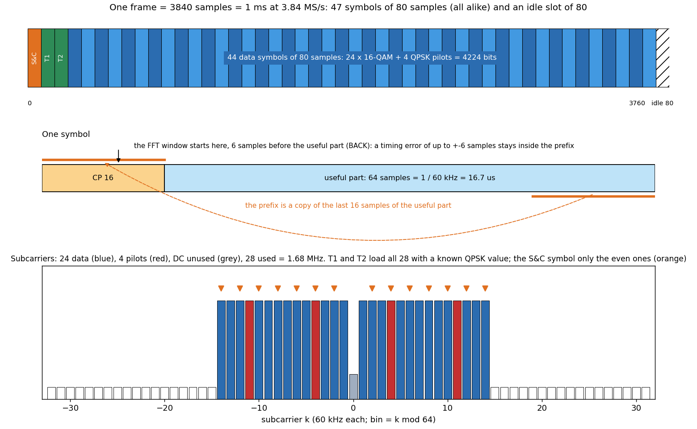

**Every symbol of the frame is the same size: 80 samples (16 prefix + 64).** `S&C | T1 | T2 | 44 data symbols | idle` = 47 symbols = 3760 samples, plus an idle slot of 80: **3840 samples = 1 ms**, 1000 frames per second, repeated back to back.

| | |
|---|---|
| Sample rate, FFT size, spacing | 3.84 MS/s, 64, 60 kHz |
| Used subcarriers | 28: k = -14 .. -1, +1 .. +14 (1.68 MHz); DC unused |
| Data | 24 subcarriers of 16-QAM (Gray, as in tutorial 5), 44 symbols per frame: **4224 bits per frame, 4.2 Mb/s**, PRBS-15 restarted in every frame |
| Pilots | 4 QPSK subcarriers (k = -11, -4, +4, +11) in every data symbol, polarity from a PRBS-7 as in IEEE 802.11 |
| S&C symbol | only the even subcarriers loaded: the 64 samples are two equal halves of 32 |
| T1, T2 | the same known QPSK value on all 28 used subcarriers, twice (the best of 4000 random sequences by peak-to-average ratio, 3.6 dB) |

The **idle slot** is there so that a host can send the frame as a repeated buffer of exactly 1 ms and the receiver has time to finish; it turns out to matter for the detector (A.5).

## A.4 Schmidl and Cox: finding the frame and the coarse carrier

Schmidl and Cox (1997) use one OFDM symbol whose two halves are identical. The receiver correlates the last 64 samples with themselves at a lag of 32:

`S[n] = sum over 32 products of x[n+32] conj x[n]`,  `E[n] = energy of the newer 32 samples`,  `M[n] = |S|^2 / E^2`.

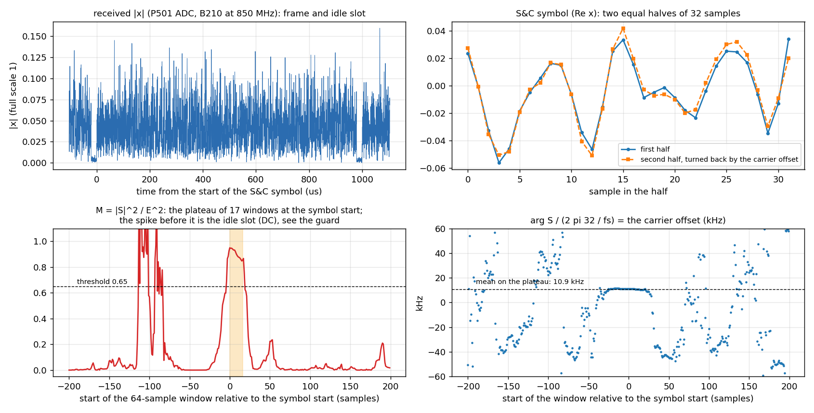

(The recording is the P501's ADC while the B210 transmitted, 850 MHz.) The four panels: the frame with its idle slot; the S&C symbol, whose second half equals the first after the small rotation of the carrier offset; **M**, which is close to 1 only while the window lies inside the symbol (the 64-sample window can start at 17 positions: 0 to 16 samples after the symbol start; the prefix makes the plateau as long as itself) and near 0.05 elsewhere; and the angle of S, which on the plateau is `32 w`, so **`w = arg(S) / 32` is the carrier offset** (here +10.9 kHz, unambiguous to +-60 kHz).

The decisions (the numbers are those of the FPGA and of the model, `ofdm_detect.v`):

* **Threshold 0.65** on M. The first window above it starts a search over the next 72 windows.
* **The plateau rule** (not the largest value): the windows with M above 29/32 of the largest form the plateau; the symbol starts at `window start + (first + last + 1) / 2 - 8`. The largest value alone is noisy and wrong by several samples; the middle of the plateau is robust (compared in `ofdm_sync_compare.py`: the plateau rule matches the 128-sample short-training-field detector of Wi-Fi at 22 dB and better, with a symbol that is 48 samples shorter; it needs a threshold of at least 0.6 and has half the carrier range).
* **The gain.** The energy at the peak sets a gain G so that the samples have 400 counts rms after it (the integer model's unit rms is 12,953 counts: the 16-QAM levels are +-4096 and +-12,288, the thresholds 0 and +-8192).
* **Every frame is found again** (no lock, no tracker): the detector is re-armed as soon as its last window has been read, so the next frame is found while the previous one is still being decoded. A *false* detection costs nothing but a rejected frame (A.6).

## A.5 The idle slot and the guard

The first version of the detector divided by E^2 only. In the idle slot the B210 sends nothing: what is received is a little noise and a **constant**, the leakage of its local oscillator (the spike at 0 Hz of every spectrum). A constant is two equal halves too: M reaches 1 *in the idle slot*, one symbol before the real S&C symbol; and when a strong frame ends and the older half of the window is signal and the newer half is receiver noise, `|S|^2 / E^2` is large (a ratio of the two energies divided by 32: 13 dB between them is enough). The detector fired too early, the frame was cut at the wrong place, and every frame failed the check of A.6: **nothing decoded at 850 MHz** although the signal was 22 dB above the noise (`ofdm/results_board_air.txt`, E; the recording of A.4 shows the spike before the plateau in its third panel).

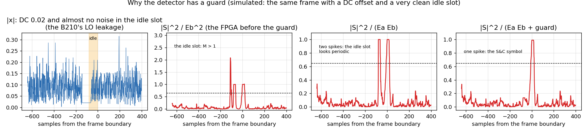

Three remedies, in the order they were found:

1. **`EA <= 2 E` in the FPGA** (commit `d2ea5e6`): a window counts only if the energy of its older half is at most twice that of the newer. The idle slot, followed by the symbol, no longer fires; the overlay was rebuilt and re-measured. With an energy minimum `EMIN` for the absolute level.
2. **Normalise by both halves**, `M = |S|^2 / (Ea Eb)` (Cauchy-Schwarz: M is at most 1): fixes the strong frame that ends in noise, but not the constant of the idle slot (second panel from the right above).
3. **An energy guard** as in the GNU Radio receiver: `M = |S|^2 / (Ea Eb + guard)` with the guard (0.1 x 32 x the average power)^2: a window with less than 10 % of the average energy cannot reach 1, whatever it contains. A slow low-pass estimates the DC and is subtracted at the input as well. This is the clean fix; it is on the list for the FPGA (report, open items).

The lesson: **a normalised correlator does not know how strong the signal is.** Whatever is perfectly correlated with itself, a constant, a tone, a carrier, looks like a preamble unless the detector also asks for energy.

## A.6 The carrier: coarse, then fine, then checked

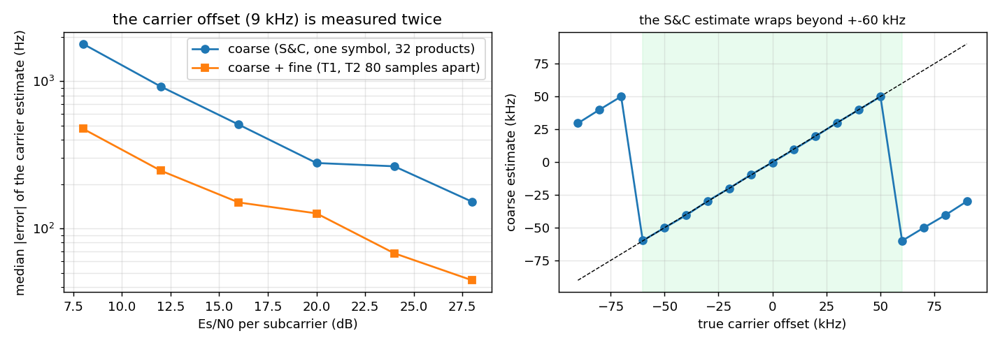

* **Coarse** (A.4): `arg S / 32`, unambiguous to +-60 kHz (right panel: beyond it the estimate wraps, as predicted). The CORDIC of `ofdm_detect.v` computes the angle; the NCO of `ofdm_derot.v` rotates the samples. The error is a few hundred hertz at 20 dB (left panel).
* **Fine**: T1 and T2 are the same 64 samples, 80 apart: `P = sum T2 conj T1`, `w_f = arg P / 80`: about a third of the error of the coarse estimate (left panel), because the lag is 80 samples against 32 and the sum has 64 products.
* **The check.** T1 and T2 must repeat: `2 |P|^2 >= E1 E2` (the normalised correlation above 0.71). A false detection in noise, or a frame found at the wrong place, fails it and is **rejected**; the counters `FOUND` and `REJ` of the receiver count them (`BAD` counts decoded frames with more than 20 % symbol errors). After the fine correction the remaining error is small enough that the pilots take care of the rest (A.8).

## A.7 The channel and the equaliser

The FFT window starts **6 samples early**, inside the cyclic prefix (`BACK`). T1 and T2 give two noisy measurements of the same thing: `H[k] = (T1[k] + T2[k]) / 2 * conj(TRAIN[k])` (the training values have unit power); their difference gives the noise estimate. The equaliser weight is `W[k] = conj(H[k]) * R / |H[k]|^2` (R = 12,953: the unit of the data), 28 divisions per frame done by a serial divider; the data of every symbol is `Z[k] = W[k] Y[k]`, one complex multiplication per subcarrier.

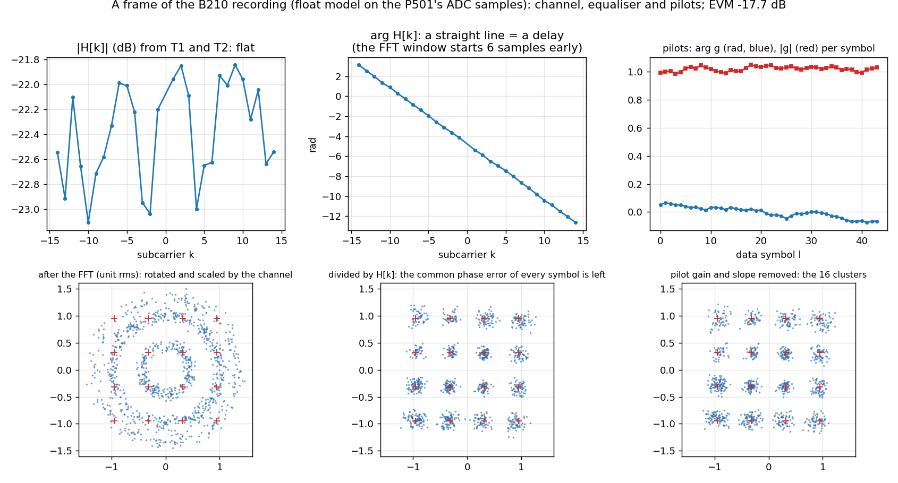

The B210 recording, one frame, by the float model: **|H| is flat** (within about 1 dB over the 28 subcarriers; the air is not selective at this distance) and **arg H is a straight line**: the slope is the delay between the start of the FFT window and the useful part of the symbol, here the 6 samples of `BACK` plus the timing error (a delay of d samples turns subcarrier k by `2 pi k d / 64`). The line is not an error: the equaliser removes it with the channel, and that is why the receiver needs no fine timing. A channel with an echo (`ofdm_fig_channel.png` of the design: two taps 8 samples apart, -6 dB) gives a |H| that is no longer flat and the same equaliser handles it:


## A.8 The pilots: what is left after the equaliser

After `Z = Y / H` every symbol has a **common complex gain `g`** (the small carrier offset that is left, the phase noise, a slow change of the level) and, because the sample clocks of the two radios differ by ppm, a **slope** of the phase against k (the window drifts by a fraction of a sample per symbol). The 4 pilots of every data symbol are known (`PIL_V` times the polarity of the symbol): the phase of `Z_pilot conj(reference)` against k gives the slope (a straight-line fit, CORDIC of `ofdm_data.v`), the mean of the corrected pilots gives g. The data are rotated by the slope and divided by g; **g and the slope are averaged over 5 symbols** (centred) to cut their noise.

The bottom row of the figure shows the three stages on the same frame: after the FFT the points lie on circles (the channel turns them and the carrier turns them differently on every subcarrier); after the division by H the 16 clusters are already there, because the common phase of this frame is small; the right-hand panel of the top row is g per symbol: |g| is 1 within a few per cent and arg g stays within +-0.07 rad over the frame. With a larger residual carrier offset the clusters of the middle panel would smear into arcs, and the pilots straighten them (right panel, EVM -17.7 dB).

## A.9 The receiver in the FPGA

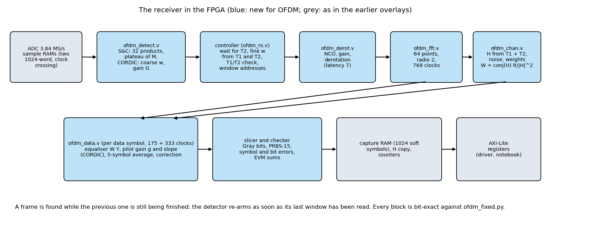

* **Sample RAMs:** two 1024-word RAMs written in the ADC clock domain (Gray-coded write pointer into the engine's clock); everything else runs at 100 MHz with 26 clocks per sample, so the detector sees every sample (it reports `late` if a sample comes sooner than its 25 clocks).
* **`ofdm_detect.v`:** A.4, A.5. **The controller** in `ofdm_rx.v`: waits until T2 is in the RAM, runs the fine-carrier pass (T1 and T2 by the complex MAC), checks them, then sends T1 and T2 and the 44 data symbols through the FFT in turn.
* **`ofdm_derot.v`:** NCO (1024-entry table), gain, rotation, latency 7 clocks. **`ofdm_fft.v`:** 64 points radix 2, unscaled 20 bits, twiddles rounded in Q15, 768 clocks after the last sample of a window.
* **`ofdm_chan.v`:** H, the noise sum, the weights with a rounded integer division (3108 clocks per frame). **`ofdm_data.v`:** the equaliser, the pilot gain and slope, the 5-symbol average, the slicer and the checker (175 clocks for the first phase of a symbol and 333 for the second).
* **Read-back:** counters, EVM and noise sums, a capture RAM of the first 1024 corrected symbols of a frame, the 28 values of H (C.6).

The engine is fast enough for every frame: 44 symbols x (768 + 175 + 333) clocks plus the channel estimate is about 60,000 of the 100,000 clocks of a frame; nothing is late at 2003 frames in 2 s.

## A.10 Bugs the comparison and the board caught

* **Two quotients of the same division** (`ofdm_data.v`): the second reciprocal was started from an uninitialised register and overwrote the first; found by the first xsim run against the integer model.
* **The fine-carrier pass was skipped in the second frame** of a record: a stale pair counter from the previous frame; found because the test feeds two frames back to back (`C_FINE0` and `pair_init` fix it).
* **A testbench that counted with one variable in two places** (the sample feeder and the logger): the frames "ran away". A test bench is code too.
* **The idle slot** (A.5): not found by any simulation, because the simulated idle slot was white noise; found on the air at 850 MHz. The simulation set now has the case `q` (a frame tail, the quiet slot, and the next frame).
* **The frozen constellation** in the live notebook: the receiver consumes the "arm the capture" request at the start of the next *detected* frame; if that frame is then rejected, no capture ever completes. The driver arms again after 0.25 s (`poll_capture`).

---

# Part B. How it was verified

| Stage | Tool | Result |
|---|---|---|
| Float model | `ofdm_study.py` | channel estimate error 1.58e-2 against the theory 1.57e-2; loss of the receiver 2 to 2.5 dB; carrier range +-110 kHz with the 16-sample STS |
| S&C against the STS detector | `ofdm_sync_compare.py` | equal at 22 dB and above, S&C 48 samples shorter, needs threshold 0.6 and more |
| Integer model | `test_ofdm_fixed.py` | within 0.1 to 0.3 dB of the float model; no false alarm in 2000 trials of noise |
| Step 1: detector, CORDIC, derotator | `sim/run_sync.sh` | 0 mismatches against `ofdm_fixed.py` on 7 vectors (noise only, 5 frames, the frame tail `q`) and 4000 random samples through the derotator |
| Step 2: FFT | `sim/run_fft.sh` | bit-exact |
| Step 3: channel estimate and weights | `sim/run_chan.sh` | 74 cases including deep fades, bit-exact |
| Step 4: data symbols | `sim/run_data.sh` | 10 frames, bit-exact |
| Step 5: the whole receiver from ADC samples | `sim/run_rx.sh` | eight frames at Es/N0 16 to 30 dB, ADC levels 60 to 800 counts, carriers -15 to +31 kHz, echoes, +-40 ppm; two frames per record; every register, 1056 symbols per frame, H and the capture RAM equal |
| Resources | Vivado | 31,426 LUT (26.8 %), 27,599 FF, 9 BRAM, 176 DSP (14.1 %); setup +0.417 ns, hold +0.011 ns at 100 MHz (one pulse-width endpoint at -0.002 ns, the base design's) |

---

# Part C. Run it

## C.1 Build

```bash
vivado -mode batch -source create_project.tcl -tclargs FFT=0 OFDMRXSC=1 RUN=bit JOBS=8   # about 11 minutes
python3 tools/fix_hwh.py build/overlay/p501_ofdm_rx_sc.hwh
```

`FFT=0 OFDMRXSC=1` builds the base design with the OFDM receiver at 0x9C470000; the transmitter is the base design's DAC DMA (the host sends the frame as a cyclic buffer). On the board put `p501_ofdm_rx_sc.bit/.hwh`, `notebook/p501_ofdm_rx.py`, `notebook/P501_OFDM_Live.ipynb` and `notebook/ofdm_frame.npy` in `/home/xilinx/jupyter_notebooks/p501_ofdm/` (`ofdm/make_ofdm_frame.py` makes the frame file).

## C.2 Test 1: the AD9361's digital loopback

No antennas, no B210, nothing radiated. The notebook `P501_OFDM_Live.ipynb` (or `ofdm/p501_ofdm_loopback.py`) runs a self-test of 22 checks. **Expected:** about 2003 frames in 2 s, all found, none rejected, **0 symbol errors in 2,115,168 symbols** at ADC levels of 65, 194 and 389 counts (EVM -38 to -47 dB), nothing late; with the transmitter off, no frame at all (no false alarm). If this does not work, nothing over the air will: check the overlay, the driver version (`poll_capture` must exist) and the status register.

## C.3 Test 2: over the air, P501 to P501

Antennas a few centimetres apart; in the notebook untick *Digital loopback*, *P501 transmits* = OFDM frame, *Level* 500, *TX atten* 20 dB, LO 850 MHz: **SER 4.5e-4 to 4.9e-4, EVM -18 to -19 dB, SNR 23 dB** (`results_board_air.txt`). The errors follow the model of white noise above about 19 dB SNR (at a TX attenuation of 22 dB the SER is 4.9e-3, at 24 dB 2.2e-2, at 26 dB 7.3e-2, at 28 dB 0.17); a cable and a step attenuator would make this a clean curve.

## C.4 Test 3: the B210 to the P501

The B210 transmits one of two ways: the script `python3 ofdm/ofdm_frame_tx.py --freq 850e6 --tx-gain 79 --rms 0.25 --seconds 600` (after `source tools/gnuradio_env.sh`) or the flowgraph `ofdm_b210_frame_tx.grc` (switch *Transmit* ON, gain and amplitude sliders). The P501 listens: the notebook, or `ofdm/p501_ofdm_b210.py 70 10 2 850e6` (RX gain index, windows, seconds, LO; the LO must be the B210's frequency). **Start the transmitter first**, wait 10 s, then start the receiver.

**The gain sweep** (`ofdm/results_gain_sweep.txt`): five B210 gains, three restarts each, 8 windows of 2 s per restart (2.1 million symbols per window):

| B210 gain | level at the ADC | SNR | EVM | SER (median) |
|---|---|---|---|---|
| 72 dB | 70 counts | 21 to 23 dB | -18 to -19 dB | 3.0e-3 |
| 76 dB | 110 | 24 to 25 dB | -22 dB | 6e-5 |
| 79 dB | 160 | 26 dB | -23.5 dB | 0 |
| 82 dB | 225 | 27.5 dB | -25 dB | 0 |
| 85 dB | 310 | 28 to 29 dB | -24 to -25 dB | 0 |


### A real run: the GNU Radio transmitter and the live notebook

The two windows of one session: the B210 transmitter flowgraph (TX gain 79 dB, digital rms 0.25, Transmit ON) and the live notebook of the P501 (RX gain 70, detector threshold 166 = 0.65).


The spectrum and the envelope are the *baseband signal that goes into the B210*: the 28 subcarriers (1.7 MHz, a notch at DC), the idle slot of 80 samples at the end of each frame, peaks of 0.84 at an rms of 0.25.


| Field | Value | Meaning |
|---|---|---|
| frames | 15,678 (997 per second of about 1000) | every frame the detector finds is decoded |
| found / rejected / bad frames | 81,158 / 65,476 / 915 | since *Start receiver*: the detections that the T1/T2 check threw away came from the start (the receiver listened to noise before the signal was stable) |
| SER | 9.8e-2 since start, **5.1e-5 in the last 2 s** | the cumulative figure includes the start-up; quote the last-2-s value with the EVM |
| EVM | -19.4 dB (last frame), -23.8 dB (this picture) | the quality of the link now |
| SNR | 25.1 dB | from the channel estimate and the noise sum |
| carrier | +8916 Hz (coarse +10,099 Hz) | the natural offset of the two radios; coarse and fine differ by the noise of the coarse estimate |
| level, gain | 188 counts rms, gain 2.12 | the gain brings the samples to 400 counts for the FFT |
| late, overflow | late 0, fft_ovf 0, overrun 0; `ovf` 1 | `ovf` is a sticky flag; the first frames of the start set it |
| graphs | frames per second climbing to 1000 over about 30 s, then flat; the SER strip at its floor | the start of the run and the steady state |

## C.5 The receiver in GNU Radio

`ofdm/ofdm_b210_frame_rx.grc` (open it with `gnuradio-companion` from the folder `tutorial/ofdm`; details in [`ofdm/GRC_OFDM.md`](ofdm/GRC_OFDM.md)) is the same receiver in floating point, **one block per step** and a tab of plots per stage. The B210 is the source; with a recording (`ofdm/make_ofdm_capture.py` makes one from the model) enable the File Source and disable the B210.

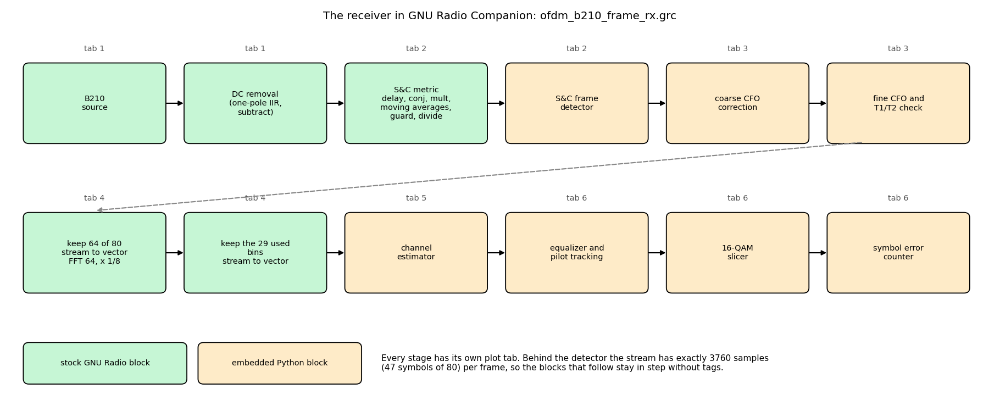

| Tab | Blocks | What to look at |
|---|---|---|
| 1 Received signal | B210 source, DC removal, `|x|`, spectrum | the 1.7 MHz band; the spike at 0 Hz is the DC; the idle slot in `|x|` |
| 2 Frame detection | delay, conjugate, multiply, moving averages (S and the energies), guard, divide; **S&C frame detector** | M against the red threshold: one spike per frame |
| 3 Frame and carrier | **coarse CFO**, **fine CFO and T1/T2 check**, `|frame|`, number sinks | the carrier offset in Hz; 1 = frame accepted, 0 = thrown away |
| 4 FFT | keep 64 of 80, FFT, keep the 29 used bins | the mean `|FFT|` of 64 symbols (28 bins up, the rest at the floor); the constellation of the used bins before the equaliser (circles) |
| 5 Channel estimate | **channel estimator** | `|H|` and arg H against k |
| 6 Equalizer and decisions | **equalizer and pilot tracking**, **slicer**, **symbol error counter** | the 16 clusters; arg g and |g| per symbol; SER, errors, frames decoded |

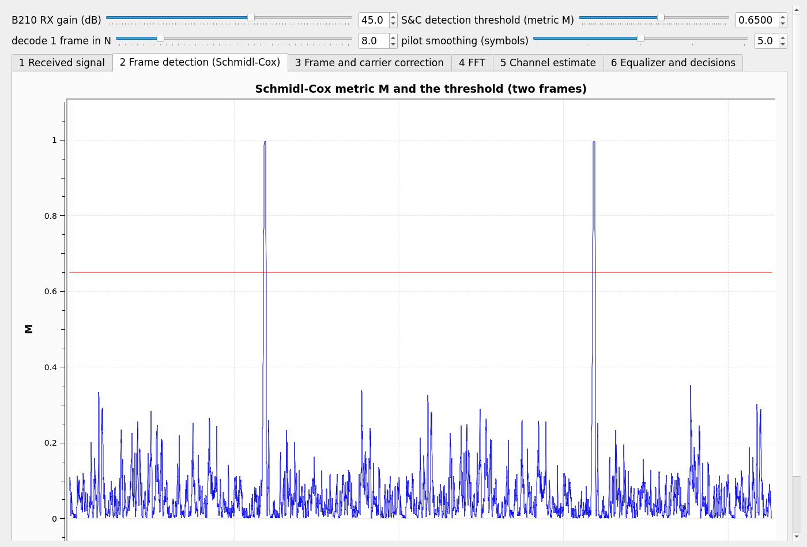

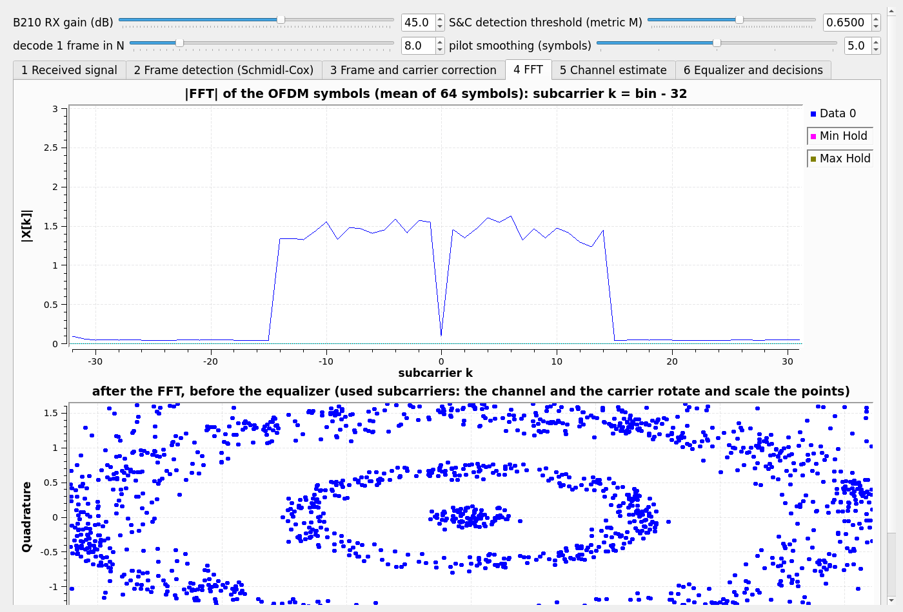

(Screenshots of the flowgraph on a recording made with the model, 30 dB SNR and a DC offset: one spike of M per frame, and the occupied band of 28 subcarriers with the unused DC.) The controls on top: **RX gain**, **S&C threshold**, **decode 1 frame in N** and **pilot smoothing**.

Two things that differ from the FPGA, on purpose:

* **Only 1 frame in N is decoded** (default 8: 125 frames per second). The transmitter repeats the same frame 1000 times per second and the Python blocks cannot decode them all in real time on an ordinary PC; the FPGA decodes every one. Raise N if the terminal prints `O` (the B210 overran).
* **The guard** of A.5 (3) and the DC removal are in the flowgraph (they were needed on the first B210 run: **every tab behind tab 2 stayed empty** because the detector fired in the idle slot), and the channel is estimated from T1 and T2 only, with a plain division `Y / H`.

A tip for writing such blocks: the Python objects of a GNU Radio block must stay referenced by the flowgraph (the generated code keeps them as attributes), otherwise the process crashes at start with a segmentation fault in a thread that has no Python frame.

## C.6 The registers and the driver

Byte offsets; the whole list is in the header of `rtl/ofdm_rx.v`.

| Offset | Name | Meaning |
|---|---|---|
| 0x00 / 0x04 | ID, CTRL | ID 0xDD520007; bit 0 run (0 resets the counters), bit 1 arm the capture (0 -> 1), bit 2 continuous (re-arm after every frame) |
| 0x08-0x14 | THR, EMIN, TARGET, GAIN_OVR | detector threshold (166 = 0.65), minimum energy (4), target rms after the gain (400), fixed gain (0 = from the detector) |
| 0x20 | STATUS | run, capture done, found, busy, late, `ovf`, `fft_ovf`, overrun |
| 0x24-0x3C | FRAMES, FOUND, REJ, BAD, TOT_SYM, TOT_ERR, TOT_BIT | frame counters and the totals of the payload check |
| 0x40-0x58 | SYM_CNT, SYM_ERR, BIT_ERR, EVM sums | the last frame |
| 0x60-0x70 | S0, W_C, W_F, W, GAIN | frame start, coarse, fine and total carrier (turns x 2^32), gain (Q8) |
| 0x74-0x80 | NOISE, WR_COUNT, LATE | noise sum of the channel estimate, samples written, late count |
| 0x1000 / 0x2000 | capture RAM, H copy | 1024 soft symbols `{zq, zi}`, 28 values of H |

The driver `notebook/p501_ofdm_rx.py` (`P501OfdmRx`) hides the numbers: `configure(thr, emin, target, gain_override)`, `start()`, `stop()`, `wait_frames(n)`, `stats()` (rates, EVM, SNR, carrier, level, flags), `poll_capture()` (a new frame's soft symbols and H, with the re-arm of A.10), `capture()`, `channel()`. The live notebook is built on it: the constellation, the channel, the EVM per subcarrier and the strips.

---

# Part D. Reading a link

## D.1 SNR, EVM and the error rate

The receiver reports the **SNR** it measures (the channel estimate over the noise sum of T1 and T2) and the **EVM** of the decided symbols; the EVM is about 3 dB worse than the SNR (the channel and the pilots are estimated from noisy symbols). From the gain sweep: **EVM -22 dB (SNR 25 dB) gives a SER of 6e-5; -25 dB gave none in 51 million symbols (82 dB gain); -18 dB gives 3e-3.** Rule of thumb for the uncoded link: below -22 dB comfortable, -18 to -20 dB usable, above -15 dB failing. The 16-QAM thresholds are as in tutorial 5.

## D.2 What limits the link

* **The SNR and nothing else**, in the tests of this tutorial: the level at the ADC rises 3 dB per 3 dB of B210 gain from 70 to 315 counts, the B210 does not compress up to 85 dB at rms 0.25, and the error rate falls with the level until it is zero (D.1).
* **The IQ image** (the mirror of every subcarrier at -k) is not the limit: a tone sent through TX1 and RX1 has its image at -48 dBc or lower (`p501_iq_image.py`, `results_iq_image.txt`), harmonics at the noise floor; the one spur is the **DC at -14 to -17 dBc** (LO leakage plus the ADC's offset), which OFDM tolerates (the DC subcarrier is unused) and the detector must be told about (A.5).


* **The antennas.** The level changed by 4 dB between two sessions at the same settings; the received level depends on the position of the antennas by more than the gain you can set. For lab work use the wired setups first: the digital loopback, then TX1 to RX1 through a cable and a fixed attenuator, and the B210 over the air last.

## D.3 Start-up

The counters since *Start receiver* include the first seconds, when the receiver listens to noise (every detection rejected) or to a transmitter that is not yet stable. **Start the transmitter, wait 10 s, then start the receiver**, or press *Stop receiver* and *Start receiver* once the link is up: the counters restart from zero. Quote the SER of the last 2 s together with the EVM and the length of the run.

## D.4 Troubleshooting

| Symptom | Likely cause and action |
|---|---|
| no frame found (FOUND does not grow) | no signal: check the transmitter, the LO against the B210's `--freq` (a wrong LO moves the signal by the difference), the RX gain, the detector threshold; the level at the ADC should be 50 to 400 counts |
| many rejected frames, few decoded | listening to noise or a weak signal (start order, D.3); a threshold below 0.5 adds false detections |
| everything rejected at a strong, clean signal | the idle-slot detection of A.5: update the overlay (`EA <= 2 E`) or, in GNU Radio, use the DC removal and the guard |
| frames found, SER 1e-3 to 1e-2, EVM -18 dB | low level (SNR): move the antennas, raise the transmit gain or lower the attenuation (D.2) |
| constellation of the live notebook frozen | a stale driver module (restart the kernel after copying `p501_ofdm_rx.py`); `poll_capture` must exist |
| `ovf` or `fft_ovf` set | a garbled frame (a change of the DMA buffer, a start-up); sticky until the overlay is loaded again; the counters are not affected |
| `late` not 0 | a sample came sooner than the engine's 25 clocks: the ADC clock is not 3.84 MS/s |
| GNU Radio: tabs 3 to 6 empty | the detector fires in the wrong place: tab 2 shows two spikes per frame (idle slot): DC removal and guard (A.5); or a false "accepted = 0" at a low SNR |
| GNU Radio: `O` in the terminal | the PC cannot keep up: raise *decode 1 frame in N*, close other programs |

---

# Part E. Exercises and where next

1. In `ofdm_model.py` change `BACK` to 0 and to 10 and plot the EVM against the timing error (`channel(..., tau=...)`): where does the prefix stop protecting the symbol?
2. Reproduce A.6's right panel for the single-symbol detector at 15 dB, and find the offset at which the fine estimate (80-sample lag) wraps.
3. Make the idle slot of the model noiseless with a DC offset and run `receive()` with the old metric and with the guard (the figure of A.5 and `ofdm_fixed.metric`).
4. Record 0.4 s of the ADC with `qam16/p501_adc_capture.py` while the B210 transmits, and find the frames in it with the figures' script `make_figures_ofdm_tutorial.py`; compare the EVM with the live notebook.
5. In `ofdm_b210_frame_rx.grc` set *pilot smoothing* to 1, 5 and 9 and watch tab 6 (arg g and the clusters): what does the averaging cost and gain?
6. Run the gain sweep of C.4 with the P501 attenuating its own transmitter instead (a cable and `TX atten`): draw the SER against the SNR and compare with the white-noise curve of A.2.
7. Lower the S&C threshold in the GNU Radio flowgraph to 0.3 and count the accepted flag of tab 3: how many false detections does the T1/T2 check throw away?

**Where next in the lab:** the **128-sample short-training-field detector** as a second overlay (the same blocks with another delay and window) and the comparison of the two synchronisers on the air; the **relative energy guard in the FPGA** and the re-arm of the capture in the reject path (one overlay rebuild); an **FPGA transmitter** (an inverse FFT and the prefix instead of the host's buffer); the **common soft-output interface** (a signed 8-bit soft value per coded bit and a frame flag: the equaliser's weights and the noise estimate are what the soft values need), and then **forward error correction**, which turns an uncoded link of -18 dB EVM into an error-free one (simulation in `qam16/results_fec.txt`). The roadmap is in the [README](../README.md).
