# Tutorial 6: 16-QAM OFDM in the FPGA with a Schmidl-and-Cox or a short-training-field synchroniser, and receivers in GNU Radio block by block

This tutorial builds on [tutorial 5 (16-QAM)](TUTORIAL_QAM16.md). It does not repeat what is there (the 16-QAM constellation and its Gray code, the PRBS-15 payload and the error counters, EVM, the register block and the capture RAM); it explains what changes when one fast carrier is replaced by 28 slow ones (OFDM), how the frame is found with a Schmidl-and-Cox symbol, why the receiver needs no timing loop and no phase loop, how the receiver was verified, how to run it on the board and in GNU Radio, and how to read the numbers. The engineering record behind it is [`ofdm/PLAN_OFDM.md`](ofdm/PLAN_OFDM.md) (design, studies, every RTL step) and [`ofdm/REPORT_OFDM.md`](ofdm/REPORT_OFDM.md) (the measurements, the problems found, the open items).

**What you need:** the P501 with the overlay `p501_ofdm_rx_sc` (or `p501_ofdm_rx_sts`, C.7; build below), a PC with GNU Radio and a USRP B210 for the over-the-air part and for the GNU Radio receiver (the first two tests need only the P501; the GNU Radio receiver also runs on a recording), and tutorial 5 read.

**What you get:** a receiver that finds the frame, estimates the carrier and the channel from known symbols, equalises every subcarrier with one complex multiplication, tracks the rest with four pilots, decodes 16-QAM and counts errors against a known pattern, all in the FPGA with no software in the loop; and the same chain in GNU Radio, one block per step, with a plot after every stage.

| Part | Content |
|---|---|
| A | The concepts: OFDM, the frame, **the IFFT and the cyclic prefix (A.3b)**, Schmidl and Cox, **the short training field (A.4b)**, the idle slot and the guard, the carrier, the channel, the pilots, the receiver |
| B | How it was verified: model first, bit-exact, then the board |
| C | Run it: build, digital loopback, over the air, the B210, the GNU Radio receiver, the registers, **the 128-sample STS overlay (C.7)** |
| D | Reading a link: SNR, EVM and the error rate, what limits the link, start-up, troubleshooting |
| E | Exercises and where next |

---

# Part A. The concepts

## A.1 Method

The same method as in tutorials 4 and 5: **every stage must reproduce the previous one to the last bit** before the next is built. New here: a second implementation of the algorithm in GNU Radio, in floating point, written as one block per step, which is the lab bench for the students.


1. **Float model** (`ofdm/ofdm_model.py`, `ofdm_study.py`, `ofdm_sync_compare.py`): transmitter, channel (carrier offset, delay, clock error, echoes, noise) and receiver; used to choose the numbers (`results_ofdm.txt`, `results_sync_compare.txt`).
2. **Integer model** (`ofdm/ofdm_fixed.py`): every register and every shift of the RTL, in Python; within 0.1 to 0.3 dB of the float model (`results_ofdm_fixed.txt`).
3. **RTL** (`rtl/ofdm_detect.v`, `ofdm_derot.v`, `ofdm_fft.v`, `ofdm_chan.v`, `ofdm_data.v`, `ofdm_rx.v`) simulated with xsim on the same vectors, one block after the other: zero mismatches against the integer model (`ofdm/sim/run_*.sh`).
4. **Overlay** `p501_ofdm_rx_sc`, driver, notebook; **board** tests: digital loopback first, then over the air.
5. **GNU Radio** receiver `ofdm/ofdm_b210_frame_rx.grc`: the same steps with stock blocks and seven small Python blocks, for looking at the signal after every stage. A second one, `ofdm/ofdm_b210_frame_rx_stock.grc`, uses the OFDM blocks that ship with GNU Radio (C.5).

## A.2 Why OFDM, and what it costs

The single-carrier 16-QAM link of tutorial 5 sends 960 thousand symbols per second and needs a timing loop, a phase loop and a frequency loop to follow the symbols. **OFDM sends 24 independent 16-QAM streams (and 4 pilots) of 60 thousand symbols per second each**, side by side in frequency. A symbol that is 16 times longer (16.7 us against 1.04 us) is hardly disturbed by an echo or a timing error, and what is left of the channel is *one complex number per subcarrier*:


* **The transmitter** puts the 28 values X[k] on the used subcarriers and takes a 64-point inverse FFT: 64 samples. The **cyclic prefix** copies the last 16 of them in front (80 samples = 20.8 us at 3.84 MS/s). The receiver takes any 64 consecutive samples of the symbol (the FFT window): a delay inside the prefix only turns every subcarrier by a known angle, and an echo shorter than the prefix does the same per subcarrier, so **one complex multiplication per subcarrier equalises the channel** (A.7). There is no timing loop; the symbol timing only has to be right to within the prefix.
* **The carrier offset must be small against the subcarrier spacing** (60 kHz here). The natural offset between the P501 and the B210 is about 9 kHz = 0.15 of the spacing. A larger offset would leak each subcarrier into its neighbours; the receiver removes it before the FFT (A.6).
* **The price is the peak-to-average ratio.** 28 carriers add up: the right panel above shows samples 10 dB above the mean, and compared with the single-carrier signal (RRC 0.35) OFDM needs about 4 dB more headroom in the transmitter and the receiver's ADC. In the lab: the B210 at digital rms 0.25 has peaks of 0.85 of full scale.
* **The other price is the training.** The channel must be measured, and the frame carries two known symbols for it plus 4 pilot subcarriers in every data symbol; 4224 payload bits in 3840 samples (1.1 bit per sample), against 3528 bits in 3868 samples for the single carrier.


Left: the receiver costs about 2 to 2.5 dB against ideal knowledge of the channel (the channel is estimated from two noisy symbols and the pilots are noisy too). The 16-QAM mapping, the thresholds and the error measures are those of tutorial 5.

## A.3 The frame


**Every symbol of the frame is the same size: 80 samples (16 prefix + 64).** `S&C | T1 | T2 | 44 data symbols | idle` = 47 symbols = 3760 samples, plus an idle slot of 80: **3840 samples = 1 ms**, 1000 frames per second, repeated back to back.

| | |
|---|---|
| Sample rate, FFT size, spacing | 3.84 MS/s, 64, 60 kHz |
| Used subcarriers | 28: k = -14 .. -1, +1 .. +14 (1.68 MHz); DC unused |
| Data | 24 subcarriers of 16-QAM (Gray, as in tutorial 5), 44 symbols per frame: **4224 bits per frame, 4.2 Mb/s**, PRBS-15 restarted in every frame |
| Pilots | 4 QPSK subcarriers (k = -11, -4, +4, +11) in every data symbol, polarity from a PRBS-7 as in IEEE 802.11 |
| S&C symbol | only the even subcarriers loaded: the 64 samples are two equal halves of 32 |
| T1, T2 | the same known QPSK value on all 28 used subcarriers, twice (the best of 4000 random sequences by peak-to-average ratio, 3.6 dB) |

The **idle slot** is there so that a host can send the frame as a repeated buffer of exactly 1 ms and the receiver has time to finish; it turns out to matter for the detector (A.5). How the 80 samples of a symbol are made is the subject of A.3b; the frame with the 128-sample short training field instead of the S&C symbol is in A.4b and C.7.

## A.3b From bits to samples: the IFFT and the cyclic prefix

The receiver of this tutorial is in the FPGA, the transmitter is not (yet): the frame is made once, on the PC, by the same steps that an FPGA transmitter would do, and the board's DAC DMA replays it. These steps are the heart of OFDM, so here they are one by one.

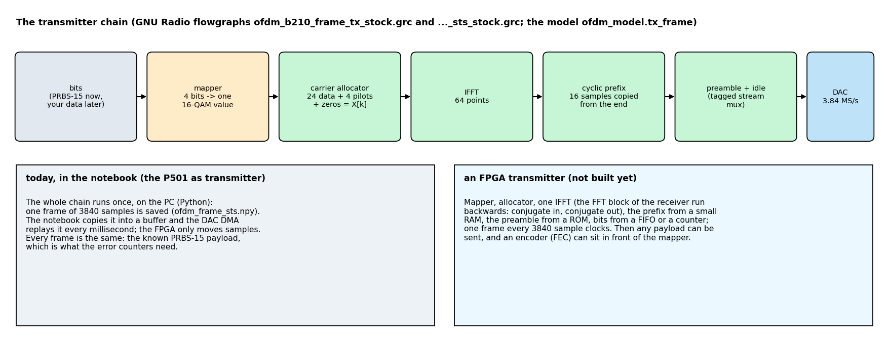

| Step | What it does | Where it is in the repository |
|---|---|---|
| bits | the known PRBS-15 payload, 4224 bits per frame (your own data, later) | `ofdm_model.payload_bits` |
| mapper | 4 bits -> one 16-QAM value (Gray code of tutorial 5), unit average power | `ofdm_model.qam_syms`; GNU Radio: *Chunks to Symbols* |
| carrier allocator | the 24 data values go to 24 subcarriers, 4 QPSK pilots to 4 more, zeros on the rest of the 64 bins, DC unused | `ofdm_model.tx_frame`; GNU Radio: *OFDM Carrier Allocator* |
| IFFT | 64 frequency values -> 64 time samples | `np.fft.ifft`; GNU Radio: *FFT* (inverse) |
| cyclic prefix | the last 16 samples are copied in front: 80 samples per symbol | `tx_frame`; GNU Radio: *OFDM Cyclic Prefixer* |
| preamble, idle slot | the training symbols in front, the empty slot behind (A.3, A.4b) | GNU Radio: *Tagged Stream Mux* |

**The IFFT is a bank of oscillators.** The value X[k] on subcarrier k becomes a complex oscillation with k whole periods in the 64 samples, and the signal sent is the sum of all of them:

`x[n] = (1 / sqrt N) * sum over k of X[k] exp(j 2 pi k n / N)`,   N = 64, n = 0 .. 63.

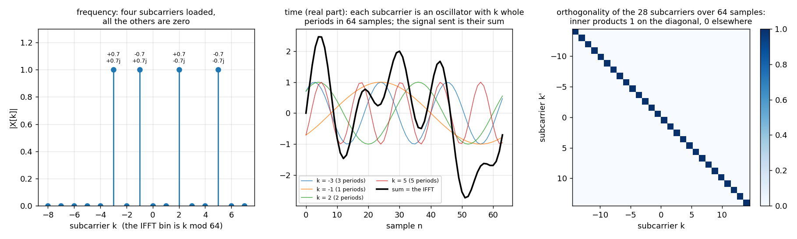

Two oscillators with different k are **orthogonal** over the 64 samples: `sum over n of exp(j 2 pi (k - k') n / N)` is N for k = k' and exactly 0 otherwise (right panel). That is why the 28 data streams do not disturb each other although their spectra overlap, and why the receiver's FFT gives back exactly the X[k] that were sent:
`X[k] = (1 / sqrt N) * sum over n of x[n] exp(-j 2 pi k n / N)`. The spacing of the subcarriers is `fs / N` = 3.84 MHz / 64 = **60 kHz = 1 / the symbol duration** (16.7 us): the smallest spacing that keeps them orthogonal. A direct bank of 28 oscillators would need N x 28 multiplications per symbol,
the FFT about (N / 2) log2 N = 192 butterflies; in the FPGA the same butterfly does it in 768 clocks (`ofdm_fft.v`, A.9). In code (this is `ofdm_model.tx_frame` for one data symbol):

```python
X = np.zeros(64, complex)
X[np.mod(DATA, 64)] = qam16_values              # 24 data subcarriers
X[np.mod(PIL, 64)]  = pilot_values              # 4 pilots; the negative k go to the upper bins (k mod 64)
x   = np.fft.ifft(X) * np.sqrt(64)              # unit power per loaded subcarrier: mean |x|^2 = 28 / 64
sym = np.concatenate([x[-16:], x])              # the cyclic prefix: the last 16 samples in front
# receiver: Y = np.fft.fft(rx[start:start + 64]) / np.sqrt(64)   ->  Y[k] = H[k] X[k]   (see below)
```

(GNU Radio's *FFT* block has no 1/N in the inverse direction: its output is 8 = sqrt 64 times the frame of the model. The transmitter flowgraphs multiply by 1/8 and by the amplitude.)

**The cyclic prefix turns the channel into one number per subcarrier.** A channel with echoes does a *linear convolution* of the sent samples with its impulse response, and a convolution mixes neighbouring samples; but the **FFT diagonalises a circular convolution**: if the output were the *circular* convolution of one symbol with the channel,
the FFT of the received 64 samples would be exactly `Y[k] = H[k] X[k]`, with H[k] the channel's value on subcarrier k. The prefix makes the linear convolution look circular: the 16 copied samples are the tail of the symbol, so a window of 64 samples that starts inside the prefix contains the symbol,
circularly shifted by the start offset, and the echoes of the *previous* symbol have died away if the delay spread D is shorter than the part of the prefix in front of the window.

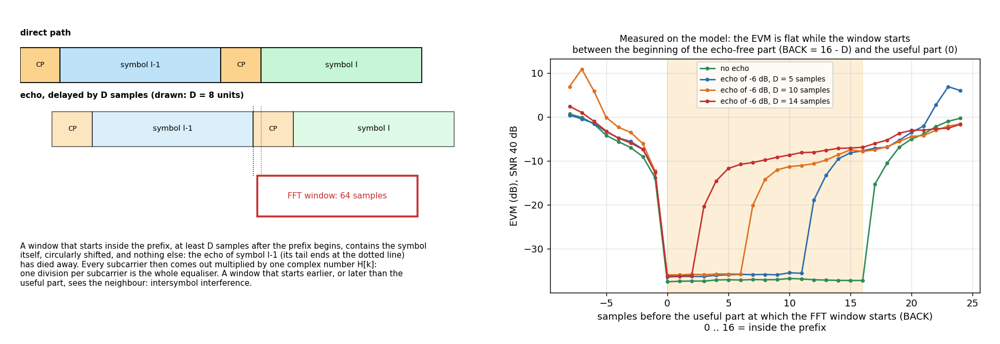

Right panel (measured on the model, an echo of -6 dB, 40 dB SNR, the one-tap equaliser of A.7): **the EVM is flat, at the noise floor, as long as the window starts between `16 - D` samples and 0 samples before the useful part**, and rises by 30 dB when the window leaves that range. That is the timing tolerance of the receiver and the reason for `BACK` = 6:
the FFT window starts 6 samples early, so the frame start may be estimated up to 6 samples late or (16 - 6 - D) early without a penalty; a window that starts later or earlier only turns every subcarrier by a known angle, which the channel estimate takes out (A.7). The same figure says how long an echo may be: D up to 16 samples = 4.2 us = 1.25 km of path difference.

**What it costs.** The prefix carries no data: 64 of every 80 samples are useful, so 20 % of the time (0.97 dB) is spent on it. A longer prefix tolerates longer echoes and costs more, a shorter one the reverse; Wi-Fi uses the same 16 of 64 (0.8 us at 20 MHz), the extended prefix of LTE is 25 % of the symbol.
A **pilot**, a known QPSK value on a few subcarriers of every symbol, follows what the prefix cannot (A.8). The price of the sum of oscillators is the peak-to-average ratio of A.2.

**Where the P501 transmits from.** In the notebook the P501 sends one frame of 3840 samples, made by the steps above on the PC and saved as `ofdm_frame.npy` (`ofdm_frame_sts.npy` for the STS frame); the DAC DMA replays the buffer every millisecond. Every frame is the same, which is what the error counters need (the payload is the known PRBS-15).
An **FPGA transmitter** would do the table above in the fabric: a mapper, the allocator as an address generator, one IFFT (the receiver's FFT block run backwards: swap the real and imaginary parts at the input and at the output), the prefix from a small RAM, the preamble from a ROM, bits from a FIFO, one frame every 3840 sample clocks;
it is on the list (E). It matters for the application stage, where every frame must carry other bits, and for forward error correction, whose encoder sits in front of the mapper. The two stock-block flowgraphs `ofdm_b210_frame_tx_stock.grc` and `ofdm_b210_frame_tx_sts_stock.grc` (C.5, C.7) are the same chain in GNU Radio, one block per step.

## A.4 Schmidl and Cox: finding the frame and the coarse carrier

Schmidl and Cox (1997) use one OFDM symbol whose two halves are identical. The receiver correlates the last 64 samples with themselves at a lag of 32:

`S[n] = sum over 32 products of x[n+32] conj x[n]`,  `E[n] = energy of the newer 32 samples`,  `M[n] = |S|^2 / E^2`.


(The recording is the P501's ADC while the B210 transmitted, 850 MHz.) The four panels: the frame with its idle slot; the S&C symbol, whose second half equals the first after the small rotation of the carrier offset; **M**, which is close to 1 only while the window lies inside the symbol (the 64-sample window can start at 17 positions: 0 to 16 samples after the symbol start; the prefix makes the plateau as long as itself) and near 0.05 elsewhere; and the angle of S, which on the plateau is `32 w`, so **`w = arg(S) / 32` is the carrier offset** (here +10.9 kHz, unambiguous to +-60 kHz).

The decisions (the numbers are those of the FPGA and of the model, `ofdm_detect.v`):

* **Threshold 0.65** on M. The first window above it starts a search over the next 72 windows.
* **The plateau rule** (not the largest value): the windows with M above 29/32 of the largest form the plateau; the symbol starts at `window start + (first + last + 1) / 2 - 8`. The largest value alone is noisy and wrong by several samples; the middle of the plateau is robust (compared in `ofdm_sync_compare.py`: the plateau rule matches the 128-sample short-training-field detector of Wi-Fi at 22 dB and better, with a symbol that is 48 samples shorter; it needs a threshold of at least 0.6 and has half the carrier range).
* **The gain.** The energy at the peak sets a gain G so that the samples have 400 counts rms after it (the integer model's unit rms is 12,953 counts: the 16-QAM levels are +-4096 and +-12,288, the thresholds 0 and +-8192).
* **Every frame is found again** (no lock, no tracker): the detector is re-armed as soon as its last window has been read, so the next frame is found while the previous one is still being decoded. A *false* detection costs nothing but a rejected frame (A.6).

## A.4b The short training field (STS): the same idea with a shorter period

Schmidl and Cox is one way to build a preamble that the receiver can recognise without knowing anything about the channel, the carrier or the timing. The **short training field of Wi-Fi (IEEE 802.11a)** is another (Wi-Fi loads 12 subcarriers and repeats the 16 samples ten times; the lab's has 6 and eight), and the second overlay `p501_ofdm_rx_sts` uses it. Both rest on one idea:
**a signal that repeats with the period L can be compared with itself, delayed by L**.

**1. How to make a signal that repeats: load only every m-th subcarrier.** If only the subcarriers k = m i (i whole) carry a value, then x[n + N / m] = x[n]: the exponentials `exp(j 2 pi m i n / N)` do not change when n grows by N / m (they turn by i whole periods). So m = 2 gives the Schmidl-and-Cox symbol (two halves of 32 samples, 14 loaded subcarriers),
**m = 4 gives the STS: only k = +-4, +-8, +-12 are loaded (6 QPSK values, scaled to the power of a data symbol), and the 64 samples are four copies of 16**. The STS of the frame is that IFFT output sent twice, without a prefix: 128 samples, eight copies of the same 16.

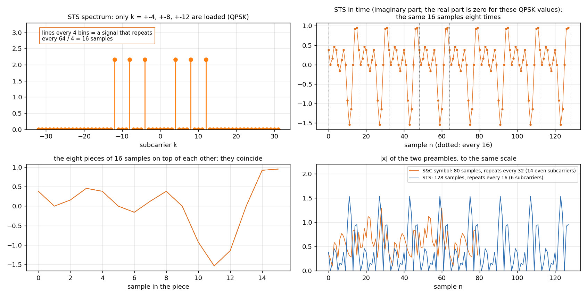

(The six QPSK values of the lab happen to give a purely imaginary signal; any other choice works the same way, only the shape of the 16-sample piece changes. A good choice also keeps the peaks low: the STS has a peak-to-average ratio of 7 dB.)

**2. The receiver correlates the signal with its copy L samples earlier.** The metric of A.4 with L = 16 and a window of 48 products:

`S[n] = sum over 48 products of x[n+16] conj x[n]`,   `E[n] = energy of the newer 48 samples`,   `M[n] = |S|^2 / E^2`.

Inside the STS every product is `|x|^2` rotated by the carrier offset, so |S| = E and M = 1; anywhere else the products have random phases and M is small. The window of 64 samples (48 + 16) fits inside the 128 periodic samples at **65 positions**, and M is on a plateau there
(Schmidl and Cox: 17 positions, the 80 samples of the symbol with its prefix). The detector takes the windows with M above 24/32 of the largest value, the start of the STS is the middle of the plateau minus 32 samples.

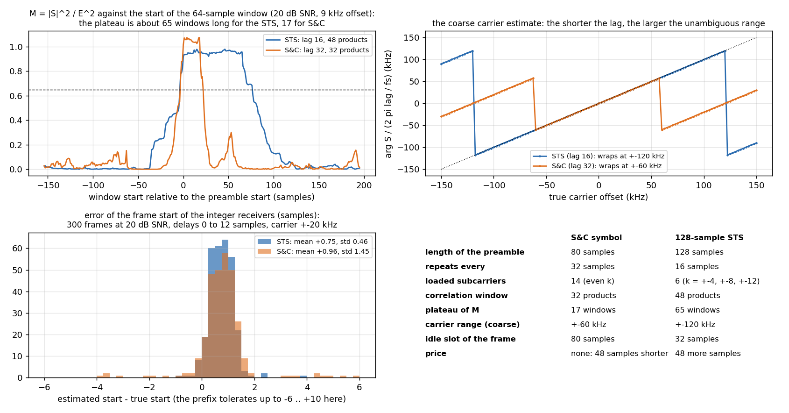

**3. The same sum gives the carrier.** Every product carries the rotation of the carrier offset f during L samples, `2 pi f L / fs`, so `f = arg S fs / (2 pi L)`. The angle is unambiguous up to plus or minus pi, that is for `|f| < fs / (2 L)`: **+-120 kHz for L = 16, +-60 kHz for L = 32** (top right: the estimate wraps at those offsets).
The STS covers four times the range of the natural 9 kHz of the P501 and the B210. The estimate of a short lag is the rougher one (the lag is 16 samples, the fine one's 64); the **fine** estimate comes from the two long training symbols T1 and T2, 64 samples apart (`arg P fs / (2 pi 64)`, range +-30 kHz, error about 100 Hz), applied after the coarse correction, and the check that T1 and T2 repeat throws false detections away (A.6).

**4. Why a longer plateau is better.** The plateau gives the receiver 65 windows instead of 17 to average over: the position of the middle and the angle of the sum are less noisy. In the integer model the error of the frame start at 20 dB SNR has a standard deviation of 0.4 samples against 1.3 for Schmidl and Cox (bottom left; `results_ofdm_fixed_sts.txt`),
and the detector found nothing in 2000 records of noise (Schmidl and Cox: two false detections, thrown away by the check). That precision matters when the signal is weak or small: **on the air, at an ADC level of 9 to 12 counts, the Schmidl-and-Cox overlay cut 13 to 16 % of the frames at the wrong place, the STS overlay none** (C.7).

**5. The LTS, the long training field.** After the STS come 160 samples: a prefix of 32 samples (GI2: the last 32 of the training symbol T) and the symbol T twice. The three pieces together repeat with 64 samples, so any 64 consecutive samples in it are T shifted circularly, and the receiver may take its FFT windows 6 samples early (A.3b) exactly as for the data.
T1 and T2 give the channel (A.7) and the fine carrier.

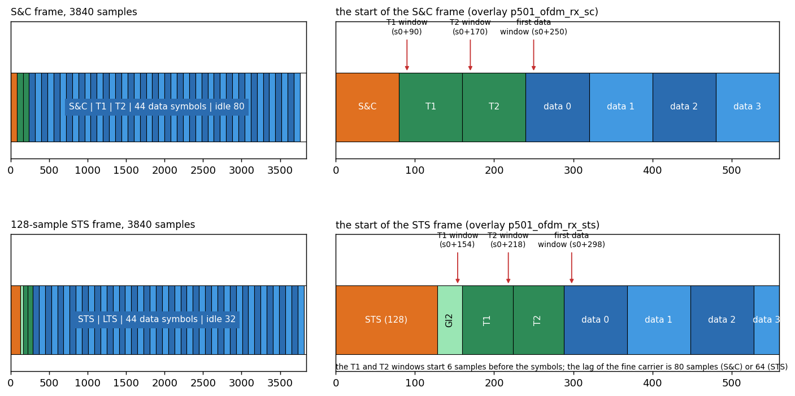

**What it costs.** The preamble is 128 samples instead of 80: 48 samples more of every 3840 (1.3 %). The frame keeps its length of 1 ms because the idle slot is 32 samples instead of 80 (the slot only gives the receiver time to re-arm the detector, A.3); 32 samples are enough: the simulation sends two frames back to back and finds both. In the FPGA nothing else changes: the same RTL with the parameter `STS = 1` (lag 16, 48 products, 144 stored windows, plateau at 24/32, start = middle - 32, carrier word times 2^8 instead of 2^7, the training windows at 154 and 218 samples after the start and the first data window at 298, `ofdm_rx.v`).

## A.5 The idle slot and the guard

The first version of the detector divided by E^2 only. In the idle slot the B210 sends nothing: what is received is a little noise and a **constant**, the leakage of its local oscillator (the spike at 0 Hz of every spectrum). A constant is two equal halves too: M reaches 1 *in the idle slot*, one symbol before the real S&C symbol; and when a strong frame ends and the older half of the window is signal and the newer half is receiver noise, `|S|^2 / E^2` is large (a ratio of the two energies divided by 32: 13 dB between them is enough). The detector fired too early, the frame was cut at the wrong place, and every frame failed the check of A.6: **nothing decoded at 850 MHz** although the signal was 22 dB above the noise (`ofdm/results_board_air.txt`, E; the recording of A.4 shows the spike before the plateau in its third panel).


Three remedies, in the order they were found:

1. **`EA <= 2 E` in the FPGA** (commit `d2ea5e6`): a window counts only if the energy of its older half is at most twice that of the newer. The idle slot, followed by the symbol, no longer fires; the overlay was rebuilt and re-measured. With an energy minimum `EMIN` for the absolute level.
2. **Normalise by both halves**, `M = |S|^2 / (Ea Eb)` (Cauchy-Schwarz: M is at most 1): fixes the strong frame that ends in noise, but not the constant of the idle slot (second panel from the right above).
3. **An energy guard** as in the GNU Radio receiver: `M = |S|^2 / (Ea Eb + guard)` with the guard (0.1 x 32 x the average power)^2: a window with less than 10 % of the average energy cannot reach 1, whatever it contains. A slow low-pass estimates the DC and is subtracted at the input as well. This is the clean fix; it is on the list for the FPGA (report, open items).

The lesson: **a normalised correlator does not know how strong the signal is.** Whatever is perfectly correlated with itself, a constant, a tone, a carrier, looks like a preamble unless the detector also asks for energy.

## A.6 The carrier: coarse, then fine, then checked


* **Coarse** (A.4): `arg S / 32`, unambiguous to +-60 kHz (right panel: beyond it the estimate wraps, as predicted). The CORDIC of `ofdm_detect.v` computes the angle; the NCO of `ofdm_derot.v` rotates the samples. The error is a few hundred hertz at 20 dB (left panel).
* **Fine**: T1 and T2 are the same 64 samples, 80 apart: `P = sum T2 conj T1`, `w_f = arg P / 80`: about a third of the error of the coarse estimate (left panel), because the lag is 80 samples against 32 and the sum has 64 products.
* **The check.** T1 and T2 must repeat: `2 |P|^2 >= E1 E2` (the normalised correlation above 0.71). A false detection in noise, or a frame found at the wrong place, fails it and is **rejected**; the counters `FOUND` and `REJ` of the receiver count them (`BAD` counts decoded frames with more than 20 % symbol errors). After the fine correction the remaining error is small enough that the pilots take care of the rest (A.8).

## A.7 The channel and the equaliser

The FFT window starts **6 samples early**, inside the cyclic prefix (`BACK`). T1 and T2 give two noisy measurements of the same thing: `H[k] = (T1[k] + T2[k]) / 2 * conj(TRAIN[k])` (the training values have unit power); their difference gives the noise estimate. The equaliser weight is `W[k] = conj(H[k]) * R / |H[k]|^2` (R = 12,953: the unit of the data), 28 divisions per frame done by a serial divider; the data of every symbol is `Z[k] = W[k] Y[k]`, one complex multiplication per subcarrier.


The B210 recording, one frame, by the float model: **|H| is flat** (within about 1 dB over the 28 subcarriers; the air is not selective at this distance) and **arg H is a straight line**: the slope is the delay between the start of the FFT window and the useful part of the symbol, here the 6 samples of `BACK` plus the timing error (a delay of d samples turns subcarrier k by `2 pi k d / 64`). The line is not an error: the equaliser removes it with the channel, and that is why the receiver needs no fine timing. A channel with an echo (`ofdm_fig_channel.png` of the design: two taps 8 samples apart, -6 dB) gives a |H| that is no longer flat and the same equaliser handles it:


## A.8 The pilots: what is left after the equaliser

After `Z = Y / H` every symbol has a **common complex gain `g`** (the small carrier offset that is left, the phase noise, a slow change of the level) and, because the sample clocks of the two radios differ by ppm, a **slope** of the phase against k (the window drifts by a fraction of a sample per symbol). The 4 pilots of every data symbol are known (`PIL_V` times the polarity of the symbol): the phase of `Z_pilot conj(reference)` against k gives the slope (a straight-line fit, CORDIC of `ofdm_data.v`), the mean of the corrected pilots gives g. The data are rotated by the slope and divided by g; **g and the slope are averaged over 5 symbols** (centred) to cut their noise.

The bottom row of the figure shows the three stages on the same frame: after the FFT the points lie on circles (the channel turns them and the carrier turns them differently on every subcarrier); after the division by H the 16 clusters are already there, because the common phase of this frame is small; the right-hand panel of the top row is g per symbol: |g| is 1 within a few per cent and arg g stays within +-0.07 rad over the frame. With a larger residual carrier offset the clusters of the middle panel would smear into arcs, and the pilots straighten them (right panel, EVM -17.7 dB).

## A.9 The receiver in the FPGA

(The same RTL builds the overlay with the short training field: the parameter `STS` of `ofdm_detect.v` and `ofdm_rx.v`, A.4b and C.7.)


* **Sample RAMs:** two 1024-word RAMs written in the ADC clock domain (Gray-coded write pointer into the engine's clock); everything else runs at 100 MHz with 26 clocks per sample, so the detector sees every sample (it reports `late` if a sample comes sooner than its 25 clocks).
* **`ofdm_detect.v`:** A.4, A.5. **The controller** in `ofdm_rx.v`: waits until T2 is in the RAM, runs the fine-carrier pass (T1 and T2 by the complex MAC), checks them, then sends T1 and T2 and the 44 data symbols through the FFT in turn.
* **`ofdm_derot.v`:** NCO (1024-entry table), gain, rotation, latency 7 clocks. **`ofdm_fft.v`:** 64 points radix 2, unscaled 20 bits, twiddles rounded in Q15, 768 clocks after the last sample of a window.
* **`ofdm_chan.v`:** H, the noise sum, the weights with a rounded integer division (3108 clocks per frame). **`ofdm_data.v`:** the equaliser, the pilot gain and slope, the 5-symbol average, the slicer and the checker (175 clocks for the first phase of a symbol and 333 for the second).
* **Read-back:** counters, EVM and noise sums, a capture RAM of the first 1024 corrected symbols of a frame, the 28 values of H (C.6).

The engine is fast enough for every frame: 44 symbols x (768 + 175 + 333) clocks plus the channel estimate is about 60,000 of the 100,000 clocks of a frame; nothing is late at 2003 frames in 2 s.

## A.10 Bugs the comparison and the board caught

* **Two quotients of the same division** (`ofdm_data.v`): the second reciprocal was started from an uninitialised register and overwrote the first; found by the first xsim run against the integer model.
* **The fine-carrier pass was skipped in the second frame** of a record: a stale pair counter from the previous frame; found because the test feeds two frames back to back (`C_FINE0` and `pair_init` fix it).
* **A testbench that counted with one variable in two places** (the sample feeder and the logger): the frames "ran away". A test bench is code too.
* **The idle slot** (A.5): not found by any simulation, because the simulated idle slot was white noise; found on the air at 850 MHz. The simulation set now has the case `q` (a frame tail, the quiet slot, and the next frame).
* **The frozen constellation** in the live notebook: the receiver consumes the "arm the capture" request at the start of the next *detected* frame; if that frame is then rejected, no capture ever completes. The driver arms again after 0.25 s (`poll_capture`).

---

# Part B. How it was verified

| Stage | Tool | Result |
|---|---|---|
| Float model | `ofdm_study.py` | channel estimate error 1.58e-2 against the theory 1.57e-2; loss of the receiver 2 to 2.5 dB; carrier range +-110 kHz with the 16-sample STS |
| S&C against the STS detector | `ofdm_sync_compare.py` | equal at 22 dB and above, S&C 48 samples shorter, needs threshold 0.6 and more |
| Integer model | `test_ofdm_fixed.py` | within 0.1 to 0.3 dB of the float model; no false alarm in 2000 trials of noise |
| Step 1: detector, CORDIC, derotator | `sim/run_sync.sh` | 0 mismatches against `ofdm_fixed.py` on 7 vectors (noise only, 5 frames, the frame tail `q`) and 4000 random samples through the derotator |
| Step 2: FFT | `sim/run_fft.sh` | bit-exact |
| Step 3: channel estimate and weights | `sim/run_chan.sh` | 74 cases including deep fades, bit-exact |
| Step 4: data symbols | `sim/run_data.sh` | 10 frames, bit-exact |
| Step 5: the whole receiver from ADC samples | `sim/run_rx.sh` | eight frames at Es/N0 16 to 30 dB, ADC levels 60 to 800 counts, carriers -15 to +31 kHz, echoes, +-40 ppm; two frames per record; every register, 1056 symbols per frame, H and the capture RAM equal |
| Resources | Vivado | 31,426 LUT (26.8 %), 27,599 FF, 9 BRAM, 176 DSP (14.1 %); setup +0.417 ns, hold +0.011 ns at 100 MHz (one pulse-width endpoint at -0.002 ns, the base design's) |
| The STS variant: model | `test_ofdm_fixed.py sts`, `test_ofdm_lowlevel.py` | the same accuracy as S&C (EVM -13.7 / -17.5 / -21.5 dB at 16 / 20 / 24 dB), start-error spread 0.4 samples against 1.3 at 20 dB, no false alarm in 2000 noise records (`results_ofdm_fixed_sts.txt`) |
| The STS variant: RTL | `sim/run_sync.sh all sts`, `sim/run_rx.sh all sts` | the detector on 7 records and 4 whole frames, each followed by a second frame (the 32-sample idle slot is enough), 0 mismatches; the S&C regressions pass with the same source; 31,664 LUT, 175 DSP, setup +0.417 ns |

---

# Part C. Run it

## C.1 Build

```bash
vivado -mode batch -source create_project.tcl -tclargs FFT=0 OFDMRXSC=1 RUN=bit JOBS=8   # about 11 minutes
python3 tools/fix_hwh.py build/overlay/p501_ofdm_rx_sc.hwh
```

`FFT=0 OFDMRXSC=1` builds the base design with the OFDM receiver at 0x9C470000; the transmitter is the base design's DAC DMA (the host sends the frame as a cyclic buffer). On the board put `p501_ofdm_rx_sc.bit/.hwh`, `notebook/p501_ofdm_rx.py`, `notebook/P501_OFDM_Live.ipynb` and `notebook/ofdm_frame.npy` in `/home/xilinx/jupyter_notebooks/p501_ofdm/` (`ofdm/make_ofdm_frame.py` makes the frame file).

## C.2 Test 1: the AD9361's digital loopback

No antennas, no B210, nothing radiated. The notebook `P501_OFDM_Live.ipynb` (or `ofdm/p501_ofdm_loopback.py`) runs a self-test of 22 checks. **Expected:** about 2003 frames in 2 s, all found, none rejected, **0 symbol errors in 2,115,168 symbols** at ADC levels of 65, 194 and 389 counts (EVM -38 to -47 dB), nothing late; with the transmitter off, no frame at all (no false alarm). If this does not work, nothing over the air will: check the overlay, the driver version (`poll_capture` must exist) and the status register.

## C.3 Test 2: over the air, P501 to P501

Antennas a few centimetres apart; in the notebook untick *Digital loopback*, *P501 transmits* = OFDM frame, *Level* 500, *TX atten* 20 dB, LO 850 MHz: **SER 4.5e-4 to 4.9e-4, EVM -18 to -19 dB, SNR 23 dB** (`results_board_air.txt`). The errors follow the model of white noise above about 19 dB SNR (at a TX attenuation of 22 dB the SER is 4.9e-3, at 24 dB 2.2e-2, at 26 dB 7.3e-2, at 28 dB 0.17); a cable and a step attenuator would make this a clean curve.

## C.4 Test 3: the B210 to the P501

The B210 transmits one of two ways: the script `python3 ofdm/ofdm_frame_tx.py --freq 850e6 --tx-gain 79 --rms 0.25 --seconds 600` (after `source tools/gnuradio_env.sh`) or the flowgraph `ofdm_b210_frame_tx.grc` (switch *Transmit* ON, gain and amplitude sliders). The P501 listens: the notebook, or `ofdm/p501_ofdm_b210.py 70 10 2 850e6` (RX gain index, windows, seconds, LO; the LO must be the B210's frequency). **Start the transmitter first**, wait 10 s, then start the receiver.

**The gain sweep** (`ofdm/results_gain_sweep.txt`): five B210 gains, three restarts each, 8 windows of 2 s per restart (2.1 million symbols per window):

| B210 gain | level at the ADC | SNR | EVM | SER (median) |
|---|---|---|---|---|
| 72 dB | 70 counts | 21 to 23 dB | -18 to -19 dB | 3.0e-3 |
| 76 dB | 110 | 24 to 25 dB | -22 dB | 6e-5 |
| 79 dB | 160 | 26 dB | -23.5 dB | 0 |
| 82 dB | 225 | 27.5 dB | -25 dB | 0 |
| 85 dB | 310 | 28 to 29 dB | -24 to -25 dB | 0 |


### A real run: the GNU Radio transmitter and the live notebook

The two windows of one session: the B210 transmitter flowgraph (TX gain 79 dB, digital rms 0.25, Transmit ON) and the live notebook of the P501 (RX gain 70, detector threshold 166 = 0.65).


The spectrum and the envelope are the *baseband signal that goes into the B210*: the 28 subcarriers (1.7 MHz, a notch at DC), the idle slot of 80 samples at the end of each frame, peaks of 0.84 at an rms of 0.25.


| Field | Value | Meaning |
|---|---|---|
| frames | 15,678 (997 per second of about 1000) | every frame the detector finds is decoded |
| found / rejected / bad frames | 81,158 / 65,476 / 915 | since *Start receiver*: the detections that the T1/T2 check threw away came from the start (the receiver listened to noise before the signal was stable) |
| SER | 9.8e-2 since start, **5.1e-5 in the last 2 s** | the cumulative figure includes the start-up; quote the last-2-s value with the EVM |
| EVM | -19.4 dB (last frame), -23.8 dB (this picture) | the quality of the link now |
| SNR | 25.1 dB | from the channel estimate and the noise sum |
| carrier | +8916 Hz (coarse +10,099 Hz) | the natural offset of the two radios; coarse and fine differ by the noise of the coarse estimate |
| level, gain | 188 counts rms, gain 2.12 | the gain brings the samples to 400 counts for the FFT |
| late, overflow | late 0, fft_ovf 0, overrun 0; `ovf` 1 | `ovf` is a sticky flag; the first frames of the start set it |
| graphs | frames per second climbing to 1000 over about 30 s, then flat; the SER strip at its floor | the start of the run and the steady state |

## C.5 The receiver in GNU Radio

`ofdm/ofdm_b210_frame_rx.grc` (open it with `gnuradio-companion` from the folder `tutorial/ofdm`; details in [`ofdm/GRC_OFDM.md`](ofdm/GRC_OFDM.md)) is the same receiver in floating point, **one block per step** and a tab of plots per stage. The B210 is the source; with a recording (`ofdm/make_ofdm_capture.py` makes one from the model) enable the File Source and disable the B210.


| Tab | Blocks | What to look at |
|---|---|---|
| 1 Received signal | B210 source, DC removal, `|x|`, spectrum | the 1.7 MHz band; the spike at 0 Hz is the DC; the idle slot in `|x|` |
| 2 Frame detection | delay, conjugate, multiply, moving averages (S and the energies), guard, divide; **S&C frame detector** | M against the red threshold: one spike per frame |
| 3 Frame and carrier | **coarse CFO**, **fine CFO and T1/T2 check**, `|frame|`, number sinks | the carrier offset in Hz; 1 = frame accepted, 0 = thrown away |
| 4 FFT | keep 64 of 80, FFT, keep the 29 used bins | the mean `|FFT|` of 64 symbols (28 bins up, the rest at the floor); the constellation of the used bins before the equaliser (circles) |
| 5 Channel estimate | **channel estimator** | `|H|` and arg H against k |
| 6 Equalizer and decisions | **equalizer and pilot tracking**, **slicer**, **symbol error counter** | the 16 clusters; arg g and |g| per symbol; SER, errors, frames decoded |

The controls on top of the window: **RX gain**, **S&C threshold**, **decode 1 frame in N** and **pilot smoothing**.

### A real run of the receiver: the P501 transmits, the B210 receives

The six tabs of one session: the P501 transmits the frame from its DAC through TX1 (the notebook, *Level* 500), the B210 receives it at 850 MHz with the RX gain at 45 dB, antennas a few centimetres apart, `ofdm_b210_frame_rx.grc` with its default controls (threshold 0.65, decode 1 frame in 8, pilot smoothing 5).

**Tab 1: the received signal.**

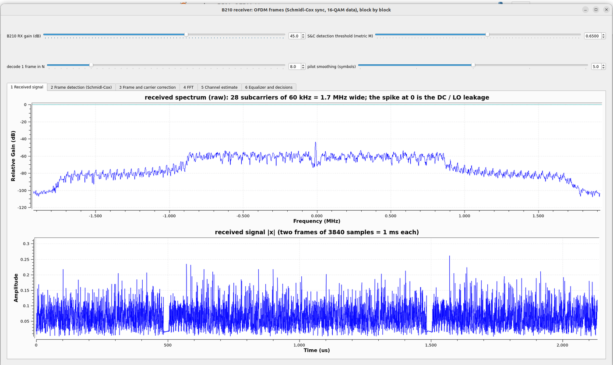

The spectrum (raw, before the DC removal) shows the band of the 28 subcarriers, 1.7 MHz wide and about 25 dB above the skirts, and the spike at 0 Hz: the DC and LO leakage, about 14 dB above the band (the reason for the DC removal). In `|x|` (after the DC removal) the idle slot is the short low stretch just before 500 us and 1500 us (the frames repeat every 1000 us).

**Tab 2: frame detection.**

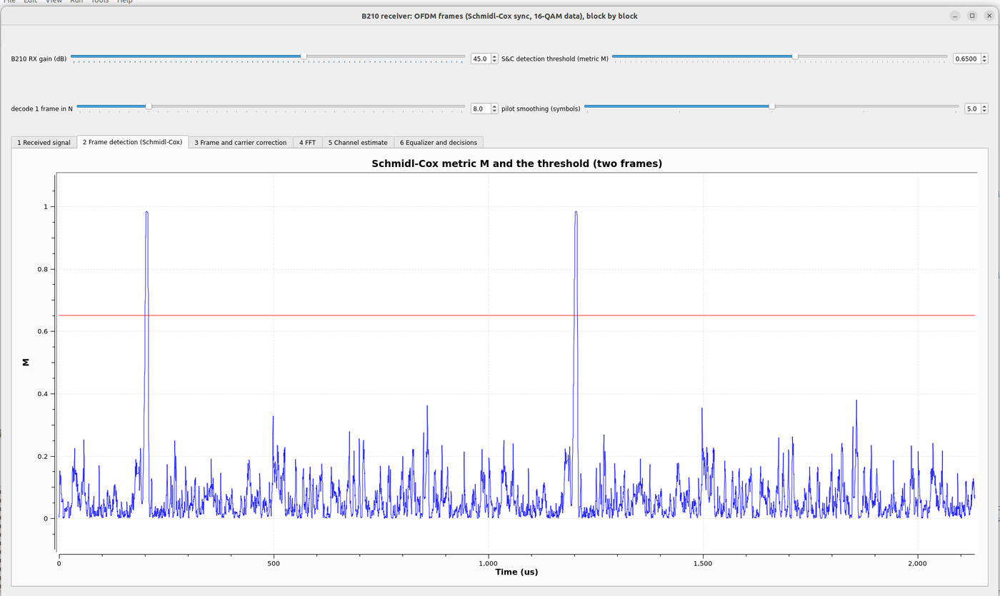

M is below 0.4 almost everywhere and reaches 0.98 once per frame, at the same place 1000 us later: **one spike per frame**, well above the red threshold (0.65). The spikes are 17 samples (4.4 us) wide. This is the picture that was *two spikes per frame* before the DC removal and the guard (A.5).

**Tab 3: the frame and the carrier correction.**

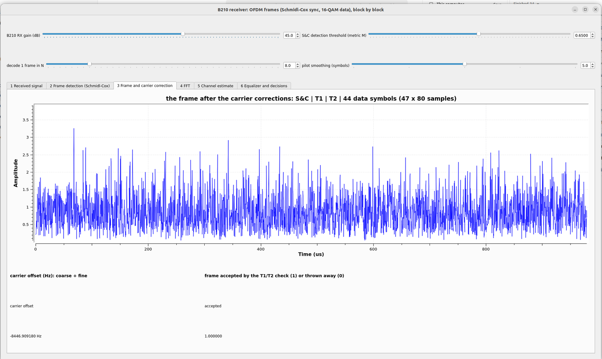

The 3760 samples of a frame after the corrections (unit rms: the gain of the detector's tag): no gap, no step at the training symbols (T1 and T2 have the same power as the data). The number sinks: the carrier offset **-8447 Hz** (the sign is the other way from the P501-as-receiver tests: here the B210 receives, and the offset is the difference of the two references seen from the other side) and **accepted = 1**: the frame passed the T1/T2 check.

**Tab 4: the FFT.**

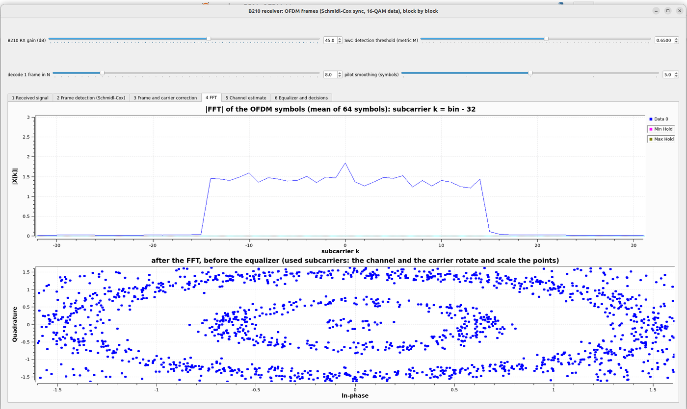

The mean `|FFT|` of 64 symbols: 28 bins at about 1.4, and nothing outside (k = -14 to +14); the bin k = 0 is higher, the DC of the front end, which carries no data. Below: the used bins of the data symbols *before* the equaliser, as a constellation: points on rings of three radii (the three distinct amplitudes of 16-QAM), turned by the channel and the carrier differently on every subcarrier, as in the left panel of the figure of A.8.

**Tab 5: the channel estimate.**

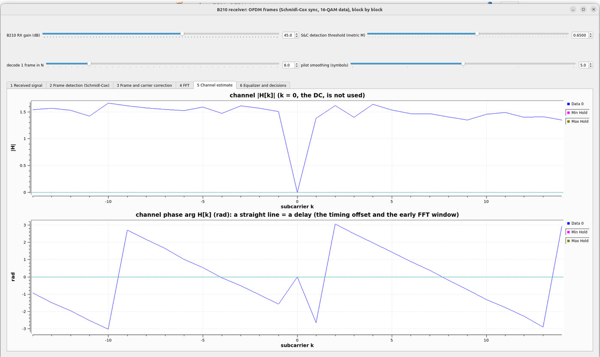

`|H|` is flat within about 10 % (the dip at k = 0 is the unused DC: no training value there), and arg H is a **straight line with wraps**: the delay of the FFT window (6 samples early) and the timing error; the equaliser removes it with the channel.

**Tab 6: the equaliser and the decisions.**

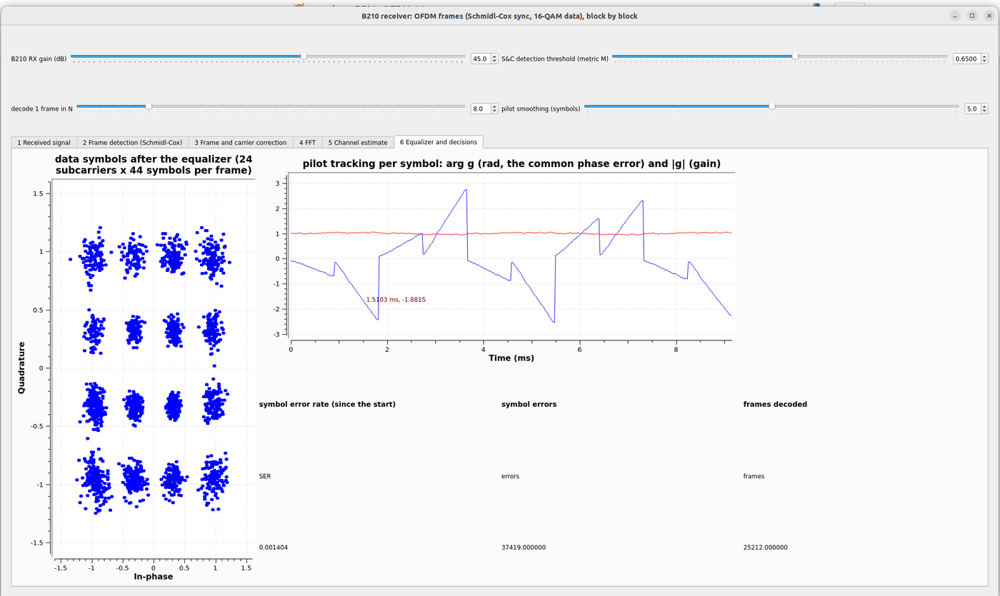

16 clusters; the spread and the error rate below correspond to an EVM of about -17 dB (estimated, the EVM is not displayed in this flowgraph). The right-hand plot is arg g and |g| of the pilots per symbol: **|g| stays at 1** (the gain), and **arg g is a sawtooth**: within each frame (each ramp is one decoded frame, the frames shown are 8 apart) the common phase drifts by up to 2.5 radians over the 44 symbols, a residual carrier offset of a few hundred hertz that the fine estimate of one frame leaves at this SNR, and it starts again near zero in the next frame. The pilots remove exactly this drift, which is why the clusters are not smeared into arcs. The counters at the bottom: **25,212 frames decoded, 37,419 symbol errors, SER 1.4e-3 since the start** (decode 1 in 8: about 200 s of reception; 26.6 million symbols). The error rate lies between those of the 72 and 76 dB rows of the B210 gain sweep (C.4) (the SNR was not measured in this session): the link works and makes errors; raising the P501's *Level* or lowering its *TX atten* should give the error-free case.

Two things that differ from the FPGA, on purpose:

* **Only 1 frame in N is decoded** (default 8: 125 frames per second). The transmitter repeats the same frame 1000 times per second and the Python blocks cannot decode them all in real time on an ordinary PC; the FPGA decodes every one. Raise N if the terminal prints `O` (the B210 overran).
* **The guard** of A.5 (3) and the DC removal are in the flowgraph (they were needed on the first B210 run: **every tab behind tab 2 stayed empty** because the detector fired in the idle slot), and the channel is estimated from T1 and T2 only, with a plain division `Y / H`.

A tip for writing such blocks: the Python objects of a GNU Radio block must stay referenced by the flowgraph (the generated code keeps them as attributes), otherwise the process crashes at start with a segmentation fault in a thread that has no Python frame.

### The same receiver with the OFDM blocks that ship with GNU Radio

GNU Radio has its own OFDM receiver blocks (`gr-digital`: *Schmidl & Cox OFDM synch.*, *Header/Payload Demux*, *OFDM Channel Estimation*, *OFDM Frame Equalizer*, *OFDM Serializer*; the example `rx_ofdm.grc`). `ofdm/ofdm_b210_frame_rx_stock.grc` builds the receiver of this chapter from them: the sync words are our S&C and T1 spectra, the equalizer gets our four pilots and their polarity, the decoder our Gray-coded 16-QAM. Details, numbers and the block table: [`ofdm/GRC_OFDM.md`](ofdm/GRC_OFDM.md) (*The same receiver with the stock OFDM blocks*).

It works on the B210 and decodes every frame (the blocks are C++), but **not with the stock settings**, and the three reasons are the lesson of this section:

1. **The stock detector has no guard** (A.5). With the P501 frame it fires in the idle slot too, two pulses per frame 80 samples apart, and every frame is cut one symbol early: symbol error rate **0.94**. The block cannot be changed, so noise at 0.12 of the signal level is added to **its input only**: the idle slot stops looking periodic, the S&C symbol (about 15 dB stronger) is nearly unchanged. Set the *detector dither* slider to 0 and watch tab 2 (two pulses) and tab 6 (errors) to see it.
2. **Its carrier estimate scatters by 1 to 2 kHz per frame** and the equalizer tolerates about 500 Hz. The estimate is averaged over 13 frames (tab 3 shows both curves); the first 30 to 60 frames after the start are wrong while it settles.
3. **Its equalizer is decision directed and slow by default** (`alpha` 0.1; 0.6 here), **and it outputs the decisions**: its constellation is 16 perfect dots whatever the noise. A small soft equalizer next to it gives the real clusters and the EVM against the known payload (about -28.6 dB in the live run of the report, at another antenna position than the -17 dB of the screenshots above).

On the live P501 to B210 link it makes no symbol error after the start-up. On the weaker recording of the B210 received by the P501 the Python receiver reaches 6.8e-4 and this one 3.6e-3 (report section 2c): the stock chain is not more accurate, it is **shorter to build and decodes every frame**, and its own constellation hides the noise that the other receiver shows.

**The transmitter from stock blocks, too.** `ofdm/ofdm_b210_frame_tx_stock.grc` builds the frame with the transmit blocks of `gr-digital` and no Python block: *OFDM Carrier Allocator* (the S&C symbol, T1 and T2 as sync words, 24 data carriers, 4 pilots), inverse *FFT*, *OFDM Cyclic Prefixer*, and a *Tagged Stream Mux* that appends the 80-sample idle slot. Its output equals the frame of `ofdm_b210_frame_tx.grc` to 3e-7, so every receiver of this chapter decodes it; the P501 decoded it on the air at 1000 frames per second, with a symbol error rate of 1e-3 at an SNR of 25.5 dB (EVM -20 dB) and none at 28 dB (EVM -25 dB) with the antenna closer ([`ofdm/GRC_OFDM.md`](ofdm/GRC_OFDM.md) has the table and two pitfalls: the prefix length parameter and the output buffer of the prefixer). Compare the tabs of this transmitter (symbols, subcarriers before the IFFT, frame in time, spectrum) with section A.3.

## C.6 The registers and the driver

Byte offsets; the whole list is in the header of `rtl/ofdm_rx.v`.

| Offset | Name | Meaning |
|---|---|---|
| 0x00 / 0x04 | ID, CTRL | ID 0xDD520007; bit 0 run (0 resets the counters), bit 1 arm the capture (0 -> 1), bit 2 continuous (re-arm after every frame) |
| 0x08-0x14 | THR, EMIN, TARGET, GAIN_OVR | detector threshold (166 = 0.65), minimum energy (4), target rms after the gain (400), fixed gain (0 = from the detector) |
| 0x20 | STATUS | run, capture done, found, busy, late, `ovf`, `fft_ovf`, overrun |
| 0x24-0x3C | FRAMES, FOUND, REJ, BAD, TOT_SYM, TOT_ERR, TOT_BIT | frame counters and the totals of the payload check |
| 0x40-0x58 | SYM_CNT, SYM_ERR, BIT_ERR, EVM sums | the last frame |
| 0x60-0x70 | S0, W_C, W_F, W, GAIN | frame start, coarse, fine and total carrier (turns x 2^32), gain (Q8) |
| 0x74-0x80 | NOISE, WR_COUNT, LATE | noise sum of the channel estimate, samples written, late count |
| 0x1000 / 0x2000 | capture RAM, H copy | 1024 soft symbols `{zq, zi}`, 28 values of H |

The driver `notebook/p501_ofdm_rx.py` (`P501OfdmRx`) hides the numbers: `configure(thr, emin, target, gain_override)`, `start()`, `stop()`, `wait_frames(n)`, `stats()` (rates, EVM, SNR, carrier, level, flags), `poll_capture()` (a new frame's soft symbols and H, with the re-arm of A.10), `capture()`, `channel()`. The live notebook is built on it: the constellation, the channel, the EVM per subcarrier and the strips.

## C.7 The 128-sample STS overlay

**Build and run** are the same with other names (A.4b has the principle; `ofdm_fixed.py` the model, the table `STS`):

```bash
vivado -mode batch -source create_project.tcl -tclargs FFT=0 OFDMRXSTS=1 RUN=bit JOBS=8   # about 11 minutes: p501_ofdm_rx_sts, ID 0xDD520008
python3 tools/fix_hwh.py build/overlay/p501_ofdm_rx_sts.hwh
python3 tutorial/ofdm/make_ofdm_frame.py tutorial/ofdm/ofdm_frame_sts.npy sts            # the frame with the STS (3840 samples)
OFDM_VARIANT=sts python3 /tmp/p501_ofdm_loopback.py /tmp/ofdm_frame_sts.npy 300,100,600   # on the board: the digital loopback
```

The notebook is `notebook/P501_OFDM_STS_Live.ipynb` (the live notebook of C.2 to C.4 for this overlay, plus a cell that sweeps the RX gain). **The two overlays do not find each other's frames:** the host must send the frame that belongs to the overlay
(`ofdm_frame_tx.py --sts` for the B210, `ofdm_frame_sts.npy` for the DAC); a P501 with the STS overlay listening to a Schmidl-and-Cox frame finds nothing, and the reverse. The board scripts take `OFDM_VARIANT=sts`.

**Digital loopback:** 2003 frames in 2 s at three levels, none rejected, none bad, **0 symbol errors in 2,115,168 symbols** each, EVM -43 to -46 dB (as with Schmidl and Cox, `results_board_loopback.txt`).

**Over the air, P501 to P501** (alternating the two overlays on the same antennas, `results_board_air.txt` I; each point 4.2 M symbols; the levels at the ADC of the two runs agree within 0.5 dB). *Bad* = a frame with more than 20 % symbol errors, in 4 s of about 4000 frames:

| TX attenuation | SNR (S&C / STS) | S&C: SER (bad) | STS: SER (bad) |
|---|---|---|---|
| 20 dB | 25.0 / 24.7 dB | 0 (0) | 7.1e-7 (0) |
| 22 dB | 20.9 / 23.1 | 4.4e-4 (3) | 5.9e-5 (0) |
| 24 dB | 20.3 / 22.3 | 3.1e-3 (18) | 1.3e-3 (0) |
| 26 dB | 19.4 / 18.2 | 1.7e-2 (68) | 1.0e-2 (0) |
| 28 dB | 16.4 / 15.8 | 5.8e-2 (167) | 4.3e-2 (0) |

At the same SNR and EVM the STS decodes more symbols correctly, and **never loses a whole frame**: the frame start of Schmidl and Cox sometimes lands where the prefix cannot absorb it, the plateau of the STS is long enough to average that out (A.4b).

**With the B210 and an amplifier at 65 dB, the P501's RX gain stepped down** (`p501_ofdm_rxsweep.py`, the transmitter stays on; the ADC level and the SNR fall together; two runs of each overlay, `results_board_air.txt` J):

| RX gain index | level at the ADC | SNR | S&C: SER (bad frames), 2 runs | STS: SER (bad frames), 2 runs |
|---|---|---|---|---|
| 40 | 25 counts | 33 dB | 0 / 0 | 0 / 0 |
| 36 | 16 | 29 to 31 | 6.8e-4 (7) / 5.7e-4 (6) | 0 / 0 |
| 32 | 12 | 25 to 26 | 6.0e-2 (576) / 5.7e-2 (541) | 9.5e-7 / 4.7e-7 (0) |
| 30 | 9 | 25 | 6.5e-2 (626) / 6.4e-2 (624) | 3.8e-5 / 7.6e-6 (0) |
| 28 | 7 | 21 to 22 | 1.2e-1 (1025) / 1.1e-1 (1000) | 5.6e-3 / 3.2e-3 (0 and 1) |

Both are error-free above 25 counts. Below that **Schmidl and Cox loses 13 to 16 % of its frames** (index 34 to 30) at an SNR of 25 dB, where the STS has none: **an effect of the ADC level, not of the SNR**. The integer model reproduces it (`test_ofdm_lowlevel.py`, Es/N0 26 dB: at 12 counts 45 of 300 Schmidl-and-Cox frames are bad, none of the STS;
at 6 counts the STS fails too, 5 of 300). The cause inside the S&C detector is not proven; a likely one is that the sums are shifted right by 8 bits before they are compared, which leaves the 32-product sum with few bits when the signal is a few counts strong. In practice: **keep the ADC level above about 25 counts** (the *level* line of the notebook; RX gain index 40 and up with the amplifier of the lab).

**In GNU Radio** (`GRC_OFDM.md`): `ofdm_b210_frame_tx_sts_stock.grc` is the transmitter chain of A.3b with the preamble from a vector source (the STS and the LTS are not OFDM symbols with the usual prefix) and a mux of three inputs; `ofdm_b210_frame_rx_sts_stock.grc` is the stock receiver with one block of its own,
`sts_sync.py`, which does what the stock Schmidl-and-Cox block cannot: find a preamble that repeats every 16 samples, measure the carrier (coarse from the STS, fine from T1 and T2) and trigger the stock Header/Payload Demux. Both were tried with the B210 and the P501 and work.

### A real run of the STS overlay: B210 to P501, and P501 to B210

The B210 transmits the frame from `ofdm_b210_frame_tx_sts_stock.grc` (Transmit ON, 60 dB with the lab's amplifier, digital amplitude 0.25); the spectrum tab is what goes into the B210: 28 subcarriers, 1.7 MHz, the notch at DC.

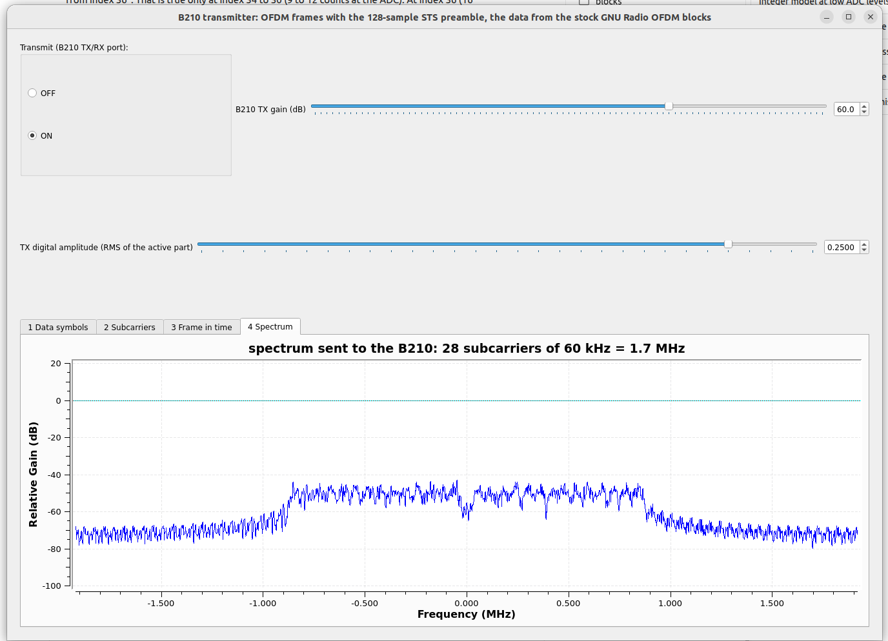

The P501 receives it with the notebook `P501_OFDM_STS_Live.ipynb` (RX gain 70, threshold 166):

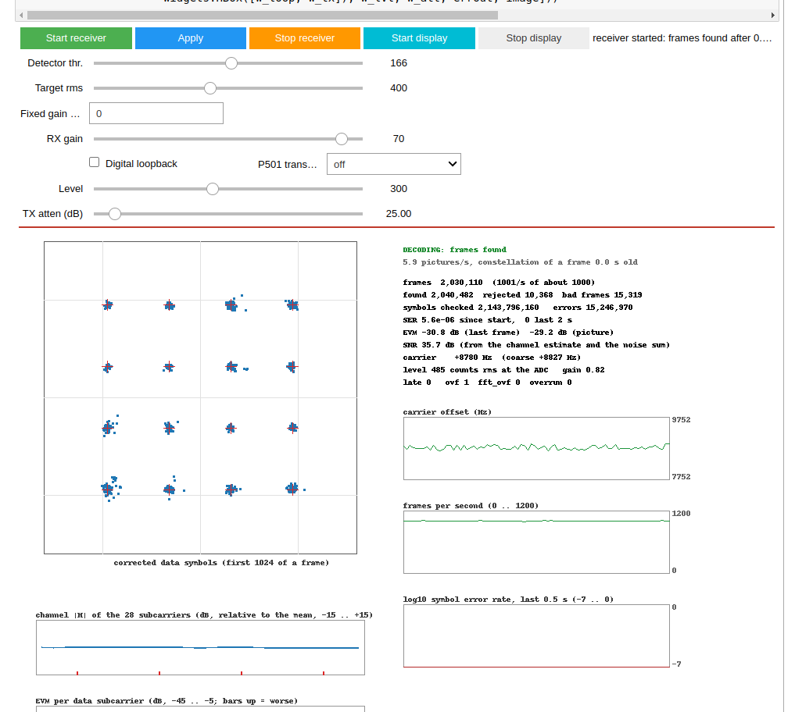

Read the status block from the top: **2,030,110 frames at 1001 per second** (about 34 minutes of reception), SNR **35.7 dB**, EVM **-30.8 dB**, symbol error rate **0 in the last 2 s** and 5.6e-6 since the display was started, carrier **+8780 Hz** (the natural offset), level **485 counts** at the ADC, nothing late.
The sixteen clusters are tight. Under *found / rejected / bad frames* the cumulative counts are 2,040,482 / 10,368 / 15,319: **0.75 % of the frames were bad** (more than 20 % symbol errors, a frame found at a wrong place or lost) and they account for nearly all of the 15 million errors counted since the receiver was started (7.1e-3);
the picture's own "since start" starts at *Start display*. In the other direction (the P501 transmits, the B210 receives with the flowgraph `ofdm_b210_frame_rx_sts_stock.grc`, tab 6):

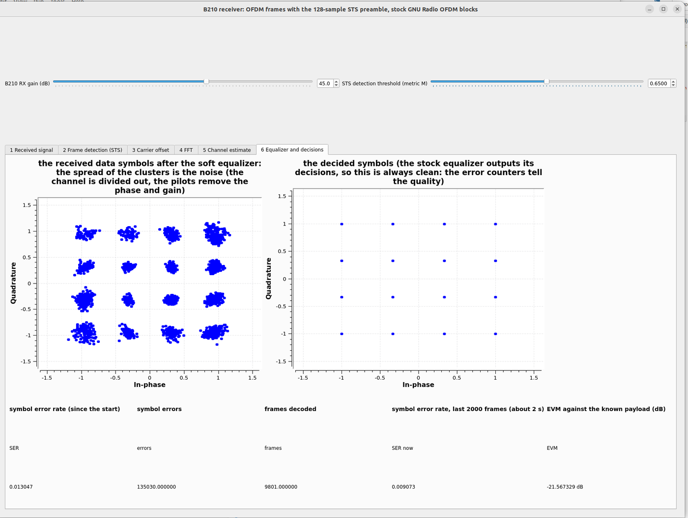

the soft clusters have more spread (EVM **-21.6 dB**, the weaker link), the decided symbols are perfect whatever the noise, and the counters read **0.0130 since the start and 0.0091 over the last 2000 frames**. That error rate is larger than an EVM of -21.6 dB alone would give (about 1e-7 for white noise): the EVM leaves out frames with a gross error, so a small share of whole frames cut or lost would explain it, and the terminal of a later run showed what cuts them: **`O`, UHD overflows**. The Python blocks of that flowgraph could process only about 1.6 to 1.9 million samples per second, the B210 delivers 3.84 million, so the flowgraph fell behind and the driver dropped blocks of samples (one frame lasts 1 ms; a dropped block takes whole frames with it).
Watch the terminal: *an O is not an error rate, it is a missing piece of signal.* The flowgraph in the repository has since been made faster (5.8 million per second on a recording; no overflow in 45 s on the B210) by counting 1 frame in 8 instead of all of them; the decisions are still made on every frame. With the repaired flowgraph and no `O` the same link reads 0.0030 since the start and 0.0017 over the last 2000 checked frames (EVM -22.7 dB): five times fewer errors, but still more than the EVM explains, so overflows were a large part of the errors and not all of them. A recording of this link run through the Python model receiver gives no symbol error in 2800 frames (EVM -25.5 dB): the rest is made by the decision-directed update of the stock equalizer (a wrong decision corrupts the channel estimate of its subcarrier), not by the radio link. The repository has the same receiver with an equalizer of our own, `ofdm_b210_frame_rx_sts_pilot.grc` (channel from the training symbol, common phase and gain of every symbol from the four pilots, no feedback from the decisions); on the same link it reads **3.0e-5 since the start and 4.8e-5 over the last 2000 checked frames** with the same EVM (-22.7 dB): use it for your measurements; the stock-block flowgraph stays to show what the stock equalizer does. Compare with the same flowgraph on a synthetic recording at 24 dB SNR, 2.2e-4 (`GRC_OFDM.md`).

---

# Part D. Reading a link

## D.1 SNR, EVM and the error rate

The receiver reports the **SNR** it measures (the channel estimate over the noise sum of T1 and T2) and the **EVM** of the decided symbols; the EVM is about 3 dB worse than the SNR (the channel and the pilots are estimated from noisy symbols). From the gain sweep: **EVM -22 dB (SNR 25 dB) gives a SER of 6e-5; -25 dB gave none in 51 million symbols (82 dB gain); -18 dB gives 3e-3.** Rule of thumb for the uncoded link: below -22 dB comfortable, -18 to -20 dB usable, above -15 dB failing. The 16-QAM thresholds are as in tutorial 5.

## D.2 What limits the link

* **The SNR and nothing else**, in the tests of this tutorial: the level at the ADC rises 3 dB per 3 dB of B210 gain from 70 to 315 counts, the B210 does not compress up to 85 dB at rms 0.25, and the error rate falls with the level until it is zero (D.1).
* **The IQ image** (the mirror of every subcarrier at -k) is not the limit: a tone sent through TX1 and RX1 has its image at -48 dBc or lower (`p501_iq_image.py`, `results_iq_image.txt`), harmonics at the noise floor; the one spur is the **DC at -14 to -17 dBc** (LO leakage plus the ADC's offset), which OFDM tolerates (the DC subcarrier is unused) and the detector must be told about (A.5).


* **The ADC level**, for the Schmidl-and-Cox overlay: below about 25 counts at the ADC it cuts frames at the wrong place even at a good SNR (C.7); lower the RX gain only as far as the level stays above that, or use the STS overlay.
* **The antennas.** The level changed by 4 dB between two sessions at the same settings; the received level depends on the position of the antennas by more than the gain you can set. For lab work use the wired setups first: the digital loopback, then TX1 to RX1 through a cable and a fixed attenuator, and the B210 over the air last.

## D.3 Start-up

The counters since *Start receiver* include the first seconds, when the receiver listens to noise (every detection rejected) or to a transmitter that is not yet stable. **Start the transmitter, wait 10 s, then start the receiver**, or press *Stop receiver* and *Start receiver* once the link is up: the counters restart from zero. Quote the SER of the last 2 s together with the EVM and the length of the run.

## D.4 Troubleshooting

| Symptom | Likely cause and action |
|---|---|
| no frame found (FOUND does not grow) | no signal: check the transmitter, the LO against the B210's `--freq` (a wrong LO moves the signal by the difference), the RX gain, the detector threshold; the level at the ADC should be 50 to 400 counts |
| many rejected frames, few decoded | listening to noise or a weak signal (start order, D.3); a threshold below 0.5 adds false detections |
| everything rejected at a strong, clean signal | the idle-slot detection of A.5: update the overlay (`EA <= 2 E`) or, in GNU Radio, use the DC removal and the guard |
| S&C overlay: *bad frames* grow, the SNR looks fine, the level is below 25 counts | the ADC level is too low (D.2): raise the RX gain, or the transmit power, or use the STS overlay |
| frames found, SER 1e-3 to 1e-2, EVM -18 dB | low level (SNR): move the antennas, raise the transmit gain or lower the attenuation (D.2) |
| constellation of the live notebook frozen | a stale driver module (restart the kernel after copying `p501_ofdm_rx.py`); `poll_capture` must exist |
| `ovf` or `fft_ovf` set | a garbled frame (a change of the DMA buffer, a start-up); sticky until the overlay is loaded again; the counters are not affected |
| STS overlay finds nothing, the S&C one worked | the host sends the wrong frame: the overlays do not find each other's frames (`--sts`, `ofdm_frame_sts.npy`, C.7) |
| `late` not 0 | a sample came sooner than the engine's 25 clocks: the ADC clock is not 3.84 MS/s |
| GNU Radio: tabs 3 to 6 empty | the detector fires in the wrong place: tab 2 shows two spikes per frame (idle slot): DC removal and guard (A.5); or a false "accepted = 0" at a low SNR |
| GNU Radio: `O` in the terminal | the PC cannot keep up: raise *decode 1 frame in N*, close other programs |
| GNU Radio stock receiver: error rate near 0.9, tab 2 shows two pulses per frame | the detector fires in the idle slot: raise the *detector dither* (C.5) |
| GNU Radio stock receiver: a few thousand errors right after the start | the carrier-offset average is settling (30 to 60 frames); read *SER now*, not the value since the start |

---

# Part E. Exercises and where next

1. In `ofdm_model.py` change `BACK` to 0 and to 10 and plot the EVM against the timing error (`channel(..., tau=...)`): where does the prefix stop protecting the symbol?
2. Reproduce A.6's right panel for the single-symbol detector at 15 dB, and find the offset at which the fine estimate (80-sample lag) wraps.
3. Make the idle slot of the model noiseless with a DC offset and run `receive()` with the old metric and with the guard (the figure of A.5 and `ofdm_fixed.metric`).
4. Record 0.4 s of the ADC with `qam16/p501_adc_capture.py` while the B210 transmits, and find the frames in it with the figures' script `make_figures_ofdm_tutorial.py`; compare the EVM with the live notebook.
5. In `ofdm_b210_frame_rx.grc` set *pilot smoothing* to 1, 5 and 9 and watch tab 6 (arg g and the clusters): what does the averaging cost and gain?
6. Run the gain sweep of C.4 with the P501 attenuating its own transmitter instead (a cable and `TX atten`): draw the SER against the SNR and compare with the white-noise curve of A.2.
7. Lower the S&C threshold in the GNU Radio flowgraph to 0.3 and count the accepted flag of tab 3: how many false detections does the T1/T2 check throw away?
8. In `ofdm_b210_frame_rx_stock.grc` set the *detector dither* to 0, then to 0.05, 0.12 and 0.4, and *carrier offset averaging* to 1 and 60: for each, note tab 2 (pulses per frame), tab 3 and *SER now*. Which of the two matters more? What does a large dither do to M of the real S&C symbol?

9. **The IFFT.** Load only k = 3 in a 64-point symbol and plot Re and Im of the IFFT: how many periods in 64 samples? Shift the 64-sample window by 5 samples (circularly) and compare the FFT before and after: the magnitude is the same, the phase has turned by `2 pi k 5 / 64`. Why is that useful for the receiver (A.7)?
10. **The prefix.** Reproduce the right panel of `ofdm_t_cp.png` with your own echo (`make_figures_ofdm_tutorial.py`, `fig_cp`): predict the range of BACK in which the EVM is flat for D = 8, then measure it. Set CP = 0 in the model (frame and receiver) and compare the EVM with an echo of 5 samples: what does the one-tap equaliser do now?
11. **The STS.** Load only every 8th subcarrier (inside the used band k = +-8: two subcarriers) instead of every 4th: what is the period, the plateau length for a window of 64 samples, and the carrier range? What do you lose (fewer loaded subcarriers: how much energy does the correlator get at the same peak power)? Check your answers with `Fm.timing_metric(x, lag, win)` on the modified frame.
12. **Low level.** Run `test_ofdm_lowlevel.py` and explain the 15 % bad frames of Schmidl and Cox at 12 counts: print `ofdm_fixed.metric` for one frame at 12 and at 60 counts (the values of `S` after the shift by 8 bits) and look at the start estimate frame by frame (`detect_info`). Is the STS affected at 6 counts, and why later?
13. **Both overlays on the air.** With the B210 and the sweep cell of `P501_OFDM_STS_Live.ipynb`, repeat the table of C.7 with your own transmit level; compare the ADC level at which the first bad frame appears for the two overlays.

**Where next in the lab:** the **relative energy guard in the FPGA** (and, with it, a look at why the Schmidl-and-Cox detector is weak at a low ADC level) and the re-arm of the capture in the reject path (one overlay rebuild); an **FPGA transmitter** (the chain of A.3b in the fabric: mapper, allocator, the receiver's FFT run as an IFFT, the prefix from a RAM, the preamble from a ROM, instead of the host's buffer); the **common soft-output interface** (a signed 8-bit soft value per coded bit and a frame flag: the equaliser's weights and the noise estimate are what the soft values need), and then **forward error correction**, which turns an uncoded link of -18 dB EVM into an error-free one (simulation in `qam16/results_fec.txt`). The roadmap is in the [README](../README.md).
