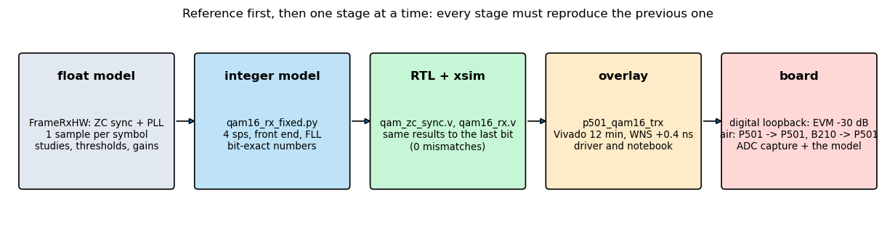
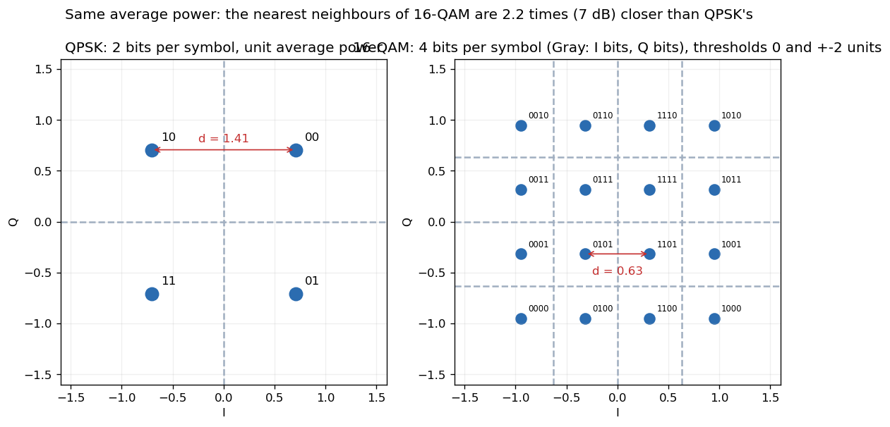
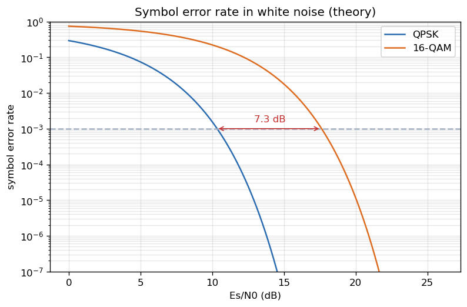
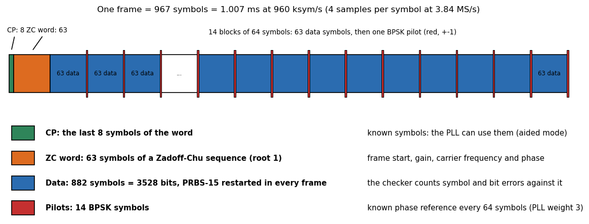
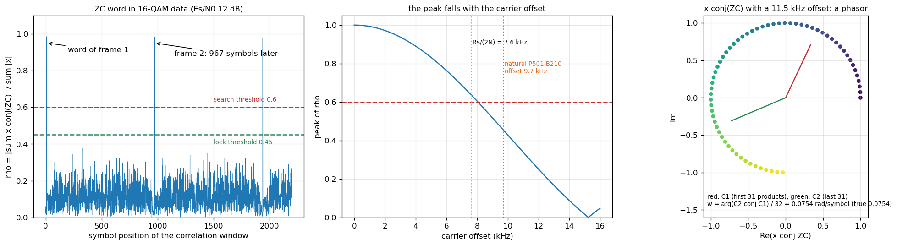
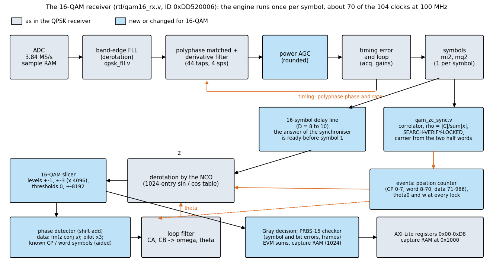
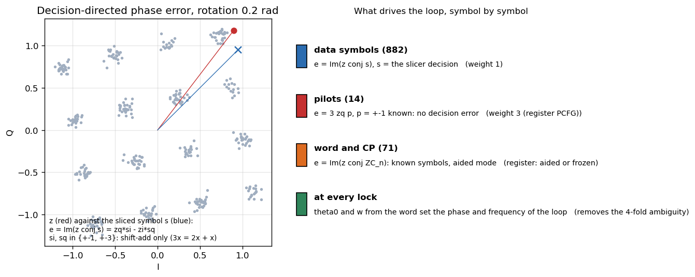
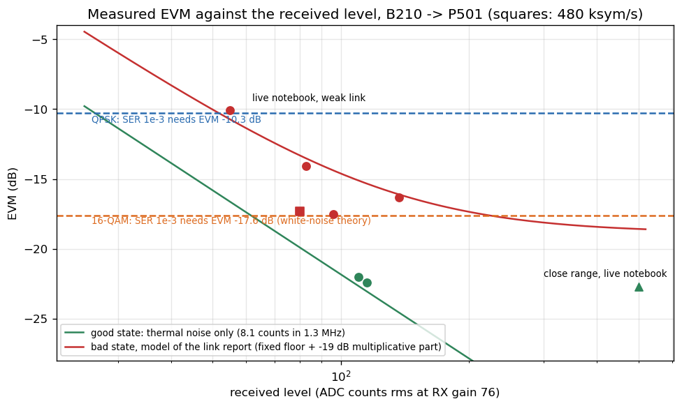

# Tutorial 5: a 16-QAM modem with a Zadoff-Chu frame synchroniser in the FPGA

This tutorial builds on [tutorial 4 (QPSK)](TUTORIAL_QPSK.md). It does not repeat what is there (the polyphase matched filter, the timing loop, the Costas loop, the register block, the capture RAM); it explains what changes when the constellation grows from 4 to 16 points and the frame start is found with a Zadoff-Chu word, how the new receiver was verified, how to run it on the board, and how to read the numbers it gives. The engineering record behind it is [`qam16/PLAN_QAM16.md`](qam16/PLAN_QAM16.md) (design, studies, every step with its results) and [`qam16/LINK_REPORT_QAM16.md`](qam16/LINK_REPORT_QAM16.md) (the over-the-air investigation, the power budget, the FEC study).

**What you need:** the P501 with the overlay `p501_qam16_trx` (build below), a PC with GNU Radio and a USRP B210 for the over-the-air part (optional: the first two tests need only the P501), and tutorial 4 read.

**What you get:** a receiver that finds the frame, estimates the carrier from the sync word, tracks it with a pilot-aided loop, decodes 16-QAM, and counts errors against a known pattern, all in the FPGA with no software in the loop; and the habits that make a 16-QAM link measurable.

| Part | Content |
|---|---|
| A | The concepts: why 16-QAM is harder, the frame, the Zadoff-Chu word, the receiver, the phase detector |
| B | How it was verified: model first, bit-exact, then the board |
| C | Run it: build, digital loopback, over the air, the registers and the driver |
| D | Reading a link: EVM, the power budget against QPSK, good and bad states |
| E | Exercises and where next |

---

# Part A. The concepts

## A.1 Method

The same method as in tutorial 4, one level stricter: **every stage must reproduce the previous one to the last bit** before the next is built.



1. **Float model** (`qam16/framerx_hw.py`, `framerx_ref.py`): the algorithm at one sample per symbol, used to decide thresholds, loop gains and the PD variants with numbers (`study_*.py`, `results_*.txt`).
2. **Integer model** (`qam_zc_fixed.py`, `qam16_rx_fixed.py`, `make_signal16.py` for 4-samples-per-symbol test signals with carrier offset, clock offset and noise): every register and every shift of the RTL, in Python.
3. **RTL** (`rtl/qam_zc_sync.v`, `rtl/qam16_rx.v`) simulated with xsim on the same vectors: zero mismatches against the integer model (`qam16/sim/run_zc.sh`, `run_rx.sh`).
4. **Overlay** `p501_qam16_trx`, driver, notebook; **board** tests: digital loopback first, then over the air.

A bug found at stage 2 costs minutes; the same bug found on the board costs hours. Two examples are in A.7.

## A.2 What changes from QPSK to 16-QAM



* **4 bits per symbol instead of 2**, in Gray code per axis (levels -3, -1, +1, +3 map to 00, 01, 11, 10), so that a neighbour error costs one bit. The data of a symbol is two bits for I and two for Q.
* **The points are closer.** At the same average power the nearest neighbours are 0.63 apart against 1.41 for QPSK: 7 dB less distance, and with more neighbours the receiver needs **7.3 dB more signal-to-noise ratio** for the same error rate (figure below). The same transmitter power therefore reaches a much shorter range.



* **The decision thresholds sit at 0 and +-2 units** (inner level 4096, thresholds 0 and +-8192 in the integer model; unit RMS is 12,953 counts). The amplitude must be right: a 0.6 dB gain error moves the points 7 % and the outer points cross a threshold much earlier than with QPSK. That is why the receiver has an AGC with a **power detector** and a rounded update (A.7).
* **The phase error is measured differently.** QPSK uses the sign of I and Q; 16-QAM compares the received symbol with the sliced one, `e = Im(z conj s) = zq*si - zi*sq`, with `si, sq` in {+-1, +-3}: a shift-add (3x = 2x + x), no multiplier. Decision-directed loops of this kind are noisier and, at low SNR, can slip by 90 degrees; the frame carries **pilots and a known word** to bound that (A.6).
* **The quality measure changes.** With QPSK we counted bit errors. With 16-QAM the error rate is a steep function of the noise, so we also report the **EVM** (rms distance of the received points from the ideal ones, relative to the signal; -20 dB means 10 % rms error): it is measurable with a million times fewer symbols and tells you how far from the cliff you are. D.1 relates the two.

## A.3 The frame



`CP 8 | ZC word 63 | 14 x (63 data + 1 pilot)` = **967 symbols = 1.007 ms** at 960 ksym/s, back to back (994 frames per second). The cyclic prefix is the end of the word (known, used by the loop); the word is a **Zadoff-Chu sequence** (root 1, length 63, amplitude 1); the data are 882 symbols = 3528 bits of a **PRBS-15 restarted at the first symbol of every frame**, so the receiver knows the expected pattern without a link to the transmitter and can count errors; the pilots are +-1.

## A.4 The Zadoff-Chu word: finding the frame, the gain and the carrier

The QPSK frame sync of tutorial 4 used an m-sequence. A **Zadoff-Chu (ZC)** sequence has constant amplitude and an ideal periodic autocorrelation: correlation with the reference gives one sharp peak and sidelobes near zero for *any* data around it, and the phase of the correlation carries the channel gain.



* **The metric** is `rho = |sum x conj(ZC)| / sum |x|` over 63 symbols: it is 1 for the word, about 0.1 (at most 0.46) for random 16-QAM data, and does not depend on the signal level (the energy normalisation: no AGC dependence, no square root: `|.|` is approximated by max + min/2). The tracker is **SEARCH** (a peak above 0.6), **VERIFY** (a second peak 967 +-3 symbols later above 0.45), **LOCKED** (the correlation runs only in a +-4 window around the expected position, 3 misses in a row go back to SEARCH). A 10-bit frame counter then gives every symbol its position (CP 0-7, word 8-70, data and pilots 71-966).
* **The carrier comes from the word itself.** Two half-word sums C1 (31 products) and C2 (31 products) rotate by `32 w` against each other, so `w = arg(C2 conj C1) / 32` is the frequency (right panel; unambiguous to +-15 kHz) and `theta0 = arg(C1 e^{j16w} + C2 e^{-j16w}) + 32 w` the phase of the first data symbol. The estimator is unbiased (std 86 Hz at 20 dB, 220 Hz at 12 dB). The loop therefore **starts every frame coherent**: the 4-fold phase ambiguity of a QAM loop never reaches the data.
* **The weakness: the carrier offset.** The peak falls with the offset (middle panel: 0.64 at 7.6 kHz = Rs/(2N), 0.46 at 9.7 kHz), and a ZC sequence turns a frequency offset into a *timing* shift, so beyond about 6 kHz the lock can land one symbol off. The natural offset between the P501 and the B210 is **9.7 kHz** (different reference oscillators). So the receiver has the **band-edge FLL of tutorial 4 in front** (`qpsk_fll.v`): it pulls the offset to within a few kHz before the word is searched.

## A.5 The receiver



Grey blocks are the QPSK receiver's; blue ones are new or changed:

* **Power AGC:** `P = mi2^2 + mq2^2`, `g += (MU * (Pref - P) + 2^23) >> 24`. The detector is exact for any constellation; the update is *rounded* (A.7). In the **acquisition mode** the timing and AGC gains are wide for the first symbols and until the synchroniser has locked and 4 frames (register NSW) have passed; a lost lock starts it again. The one-time gain kick from the word is a possible refinement; it is not used.
* **Delay line:** the synchroniser needs about 1.5 to 3 symbols after the correlation peak to deliver `theta0` and `w`; the data must not be derotated before they are known, so `(mi2, mq2)` pass through a 16-symbol delay (D = 8 to 10). The engine runs once per symbol, about 70 of the 104 clocks, so the synchroniser (about 71 clocks, its own state machine and its own 4-DSP complex MAC) does not compete with it.
* **Derotation, slicer, PD, loop filter:** A.6.
* **Checker and read-back:** Gray decision, symbol and bit errors against the PRBS-15 (counted only in complete frames), EVM sums for the last frame, a capture RAM of 1024 soft symbols for the constellation, counters of every event of the synchroniser (`N_PEAK`, `N_LOCK`, `N_HIT`, `N_MISS`, `N_LOST`), all behind the AXI-Lite registers (C.4).

## A.6 The phase detector with pilots and known symbols



The loop has the QPSK form (`omega += CB*e`, `theta += omega + CA*e`, a 1024-entry sine table) with three kinds of error input, chosen by the position counter:

* **Data:** `e = Im(z conj s)` against the sliced symbol.
* **Pilots (weight 3):** the symbol is known (+-1), so there is no decision error and the error can be trusted three times as much (`PCFG` bits 11:8).
* **Word and CP (aided):** known symbols `e = Im(z conj ZC_n)`; without the aid the loop would run open over 71 symbols (`PCFG` bit 0).

The loop bandwidth is 0.02 (rad per symbol, damping 0.707). **A lesson of this project:** at low SNR the carrier was first lost below 14 dB and the PLL was blamed; the cause was the **FLL's tracking gain** (0.0003 jittered the frequency by 1 to 4 kHz). With 0.0001 the same PLL works down to about 12 dB. Check the front-end loops for noise before redesigning the back end.

## A.7 Two bugs the models caught

* **AGC floor bias.** The QPSK AGC rounds the gain update with a floor (`>> 16`), -0.5 LSB per symbol; on 16-QAM it leaves the level 0.6 dB low, a 7 % amplitude error against fixed thresholds: **an EVM floor of -23 dB even at 60 dB SNR.** The 16-QAM AGC rounds (`+ 2^23`) and the level is within 0.02 dB. The same class of bug as the integrator rounding of the Costas loop in tutorial 4. It was found with the integer model, not on the board, because the model prints the EVM at 40 dB SNR.
* **The multiplier chain.** The first build of the 24-multiplier transmitter FIR summed 12 products in one clock: 10.09 ns for a 10 ns clock (slack -0.011 ns). Registering the products fixed it (slack +0.417 ns); the output is unchanged because the sum is captured on the same clock enable.

---

# Part B. How it was verified

| Stage | Tool | Result |
|---|---|---|
| Float model | `qam16/study_qam16_rx.py` | the hardware-style model is at least as good as the handoff's reference receiver; locks up to 6 kHz offset at every SNR from 8 to 20 dB |
| Integer model with the real front end | `study_integer16.py`, `study_fll16.py` | AGC bias found and fixed; the FLL is mandatory (without it +9.7 kHz fails in 99 of 99 frames; with it the residual is +-0.4 kHz mean, 1 kHz std) |
| Synchroniser RTL | `sim/run_zc.sh` | 0 mismatches against `qam_zc_fixed.py` on 4 vectors |
| Receiver RTL including the FLL | `sim/run_rx.sh` | 0 mismatches against `qam16_rx_fixed.py` on 4 vectors |
| Transmitter RTL | `sim/tb_qam16_tx_fr.v`, `compare_tx.py` | 14,000 samples, 0 mismatches against `qam16_tx_model.py` |
| Resources | Vivado | receiver 5,822 LUT, 49 DSP (out of context); overlay 20.0 k LUT (17 %), 123 DSP (10 %), 8.5 BRAM; slack +0.417 ns at 100 MHz |

The synchroniser is the part that is easiest to get subtly wrong (an event applied one symbol late looks like a noisy link). The rule that fixed it: an event of the synchroniser with decision index `known` is applied at engine step `known + 2`, and the position counter runs from the events, not from a free-running count.

---

# Part C. Run it

## C.1 Build

```bash
vivado -mode batch -source create_project.tcl -tclargs FFT=0 QPSK=1 QAM16RX=1 RUN=bit JOBS=8   # about 12 minutes
python3 tools/fix_hwh.py build/overlay/p501_qam16_trx.hwh
```

`QAM16RX=1` replaces the QPSK receiver chains and the QPSK transmitter by the 16-QAM frame transmitter (`rtl/qam16_tx_fr.v`). Copy `p501_qam16_trx.bit/.hwh`, `notebook/p501_qam16_rx.py` and `notebook/P501_QAM16_Live.ipynb` to `/home/xilinx/jupyter_notebooks/p501_qam16/` on the board.

## C.2 Test 1: the AD9361's digital loopback

No antennas, no B210. The notebook `P501_QAM16_Live.ipynb` (or `qam16/p501_qam16_loopback.py`) transmits frames into the receiver through the chip and runs 29 self-tests. **Expected:** lock in about 23 ms (including the FLL's 20 ms acquisition), 994 frames per second, **0 symbol errors in 1.75 million symbols**, EVM -29 to -31 dB, 16 tight clusters:


If this does not work, nothing over the air will: check the overlay, the driver version, and `STATUS` bit 3 (synchroniser locked).

## C.3 Test 2: over the air, P501 to P501

Antennas a few centimetres apart, the transmitter's attenuation as the knob (`P501Qam16Tx`, `ad.set_tx_atten_db`): **SER 0 and EVM -22.8 dB at 20 dB attenuation**, 5.7e-6 at 22 dB, 6e-3 at 26 dB; the loop loses the carrier from about 32 dB; the synchroniser still finds frames to 44-46 dB. This is the reference for what the receiver can do.

## C.4 Test 3: the B210 to the P501

The B210 transmitter without GNU Radio Companion (one process owns the B210; keep the gain at 76 dB or less, above about 78 dB it compresses):

```bash
source tools/gnuradio_env.sh
python3 tutorial/qam16/qam16_frame_tx.py --tx-gain 76 --rms 0.5 --freq 914.995e6 --seconds 600
```

(`--freq 914.995e6` leaves an offset of about +4.7 kHz instead of the natural +9.7 kHz; the receiver handles either.) On the board `rx.acquire()` starts from cold. **Expected in a good link state: EVM -22 dB, SER about 1e-6** at a received level of about 110 counts rms; the live picture:


In a bad state the EVM is -10 to -17 dB; D.3 explains how to tell the two apart and what to do. The GNU Radio flowgraphs `qam16/qam16_b210_frame_tx.grc` and `qam16_b210_frame_rx.grc` do the same in GNU Radio (the receiver block embeds the model of the FPGA receiver).

## C.5 The registers and the driver

Byte offsets; the complete list is in the header of `rtl/qam16_rx.v`.

| Offset | Name | Meaning |
|---|---|---|
| 0x00 / 0x04 | ID, CTRL | ID 0xDD520006; bit 0 run (0 resets), bit 1 capture arm (0 -> 1) |
| 0x08-0x14 | TA, TB, CA, CB | timing gains, PLL gains |
| 0x18-0x20, 0x34, 0x38, 0xB8 | MU, PREF, G0, MUA, ACQ, NSW | AGC speed and reference, initial gain, acquisition mode |
| 0x3C | PCFG | bit 0 aided, bits 11:8 pilot weight |
| 0x40-0x4C | SY_THR, SY_TOL, SY_WIN, SY_MISSMAX | synchroniser: thresholds 154 / 115 (0.60 / 0.45), tolerance 3, window 4, misses 3 |
| 0x50 | STATUS | running, capture done, overrun, **locked**, run active |
| 0x54-0x78 | SYMBOLS, FRAMES, SYM_ERR, BIT_ERR, SYM_CNT, BAD_FRAMES, EVM sums, FRAME_ERR | the checker |
| 0x7C-0xB4 | GAIN, RATE, OMEGA, counters, LOCK_W, POS | AGC gain (Q10), clock offset, PLL frequency, synchroniser events |
| 0xBC-0xD8 | FLL_CTRL, FLL_GI, FLL_GP, FLL_F0, FLL_FREQ, ... | the band-edge FLL |
| 0x1000 | capture RAM | 1024 soft symbols `{zq, zi}` |

The driver `notebook/p501_qam16_rx.py` (`P501Qam16Rx`, `P501Qam16Tx`) hides the numbers: `acquire(acq_gi=0.002, trk_gi=0.0001, fll_acq_s=0.02)` (FLL acquiring gain for 20 ms, then tracking), `stats()`, `capture()`, `set_pll`, `set_timing`, `set_sync`, `hold_fll`. The notebook builder is `qam16/make_notebook_qam16.py`.

---

# Part D. Reading a link

## D.1 EVM and the error rate

EVM is the noise-to-signal ratio measured on the soft symbols. In white noise the error rate follows from it with the curve of A.2; on a real link it is better than that when the error is not Gaussian. Measured: EVM -16.1 dB gave SER 1.2e-3, -13.5 dB gave 4.9e-2, -10.1 dB gave 0.18. Rule of thumb: **below -17 dB the uncoded 16-QAM link is usable, below -20 dB it is comfortable, above -14 dB it is failing.**

## D.2 The power budget against QPSK

In theory 16-QAM needs 7.3 dB more received power than QPSK (A.2). In levels (the P501's ADC counts rms at RX gain 76, thermal noise 8.1 counts in the 1.3 MHz of the signal): QPSK at SER 1e-3 needs 27 counts, 16-QAM at SER 1e-3 needs 61 counts, EVM -20 dB needs 81 counts. In free space 7.3 dB is 0.43 times the range. A power amplifier on the transmitter, an LNA on the receiver, better antennas, or forward error correction (the next stage of the lab) each buy back part of it; the numbers are in the link report.

## D.3 Good and bad states



With the B210 as the transmitter the same settings give very different EVM: **-22 dB in a good state, -10 to -17 dB in a bad one**, at the same received level (the red and green points). The receiver was checked (a clean ADC capture, the model on it, the P501 bring-up, the TX frequency, IQ imbalance, interferers): the variation is in the transmitter's output or the air path, and a restart of the B210 changes it. What a student should do:

1. Read the **level** (AGC gain, or counts) and the **EVM** together. A low EVM at a low level is noise (move the antennas closer, raise the transmitter's gain up to 76 dB); a high EVM at a good level is the bad state.
2. Restart the transmitter and look again before drawing conclusions; do not touch cables and antennas during a measurement.
3. For lab work use the **wired setups first**: the digital loopback (always works), then the P501's TX to its own RX through a cable and a fixed attenuator; the B210 over the air is the optional last step.

## D.4 Troubleshooting

| Symptom | Likely cause and action |
|---|---|
| never locks (STATUS bit 3 = 0, N_PEAK = 0) | no signal: check the transmitter and the level; the FLL acquiring gain; B210 gain at or below 76 dB; RX gain index 70 to 76 |
| N_PEAK counts but no lock | the verify peak fails: carrier offset too large after the FLL, or SNR below about 8 dB; lower the synchroniser threshold only as an experiment |
| locks, SER high, EVM -10 to -14 dB | low level (SNR) or a bad B210 state: D.3 |
| locks, then loses the carrier often | the FLL tracking gain too high (use 0.0001); SNR below 12 dB |
| `N_LOST` grows, bad frames after gaps | normal for 3 to 4 frames after a gap in the signal |
| FLL reports +25 to +780 Hz in the digital loopback | its measurement noise and bias: there is no offset in the loopback |
| EVM -23 dB at 60 dB SNR in your own model | the AGC rounding of A.7 is missing |

---

# Part E. Exercises and where next

1. In `framerx_hw.py` set the pilot weight to 1 and to 5 and measure the SER against SNR at 12, 14 and 16 dB (`study_pll_variants.py`): why does 3 win?
2. Reproduce A.4's middle panel from the model: find the carrier offset at which the lock lands one symbol off at 15 dB.
3. In the integer model replace the rounded AGC update by a floor and measure the EVM at 40 dB SNR (the bug of A.7).
4. Record 0.4 s of the P501's ADC with `qam16/p501_adc_capture.py`, run `analyse_rec.py` on it and compare with the EVM of the live notebook.
5. Compute from `link_budget_qam16.py` how many dB of antenna gain make the QPSK range possible with 16-QAM.
6. Transmit with TX gain 70, 76 and 80 dB and watch the spectrum with the FFT overlay: where does the B210 start to compress?
7. Run the P501-to-P501 test at 20, 26 and 32 dB attenuation and explain each result with the figures of this tutorial.

**Where next in the lab:** chirp spread spectrum (a very different trade of rate against sensitivity), OFDM, and then forward error correction, which turns a 16-QAM link of -10 to -17 dB EVM into an error-free one at half the rate (simulation in `qam16/results_fec.txt`, section 10 of the link report). The roadmap is in the [README](../README.md).
