# Tutorial 4: a QPSK modem in the FPGA, tested against GNU Radio

*This file is generated: `tutorial/qpsk/doc/TUTORIAL_QPSK.src.md` is the text, `build_doc.py` pastes the code excerpts from the real source files into it
(`python3 tutorial/qpsk/doc/build_doc.py`), so the code shown here is always the code of the repository. Figures are drawn by `make_diagrams.py`.*

In tutorials 1 to 3 the FPGA did **measurements** (a spectrum) and **generated tones**. Here it does what a real radio modem does: it **transmits data**
as differential QPSK and it **receives** it, including everything that a receiver has to recover on its own (signal level, symbol timing, carrier
frequency and phase). Python only starts and stops it, sets the loop gains, and reads the results. No sample passes through Python or a DMA.

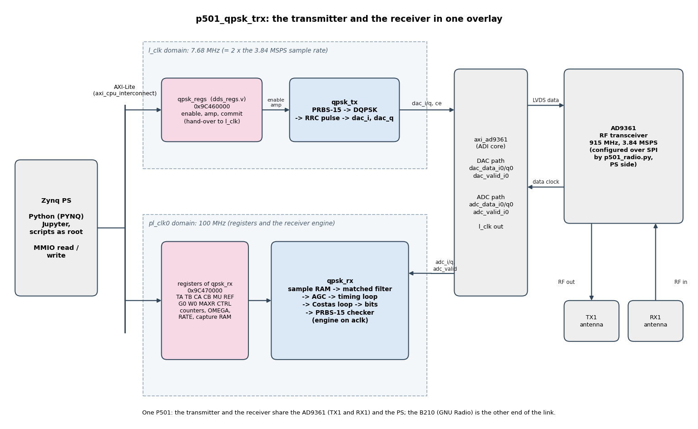

| part | content |
|---|---|
| **A** | the concepts: what is sent, what the receiver has to recover, and why the FPGA design looks the way it does; **A.5: functional block diagrams** (what every block does and why it is needed); **A.6: the GNU Radio flowgraph blocks side by side with the Verilog** |
| **B** | the transmitter: block diagram, and every block with its Verilog |
| **C** | the receiver: block diagram, and every block with its Verilog |
| **D** | integration into the block design, the register interface, and the verification method (model, simulation, hardware) |
| **E** | the test code, in detail: the Python drivers on the board, the host scripts, the GNU Radio flowgraphs, the analysis |
| **F** | results, lessons, and how to run everything |

**Parameters of the link** (everything below follows from these):

| quantity | value |
|---|---|
| carrier | 915.0 MHz |
| sample rate | 3.84 MSPS (AD9361 in 1R1T mode; the FPGA clock `l_clk` is 2 x this = 7.68 MHz) |
| modulation | differential QPSK, 2 bits per symbol, Gray-like pre-differential code |
| symbol rate | 960 ksym/s = **1.92 Mbit/s**, 4 samples per symbol |
| pulse shape | root-raised-cosine, roll-off 0.35, span 11 symbols |
| test pattern | PRBS-15 ( x^15 + x^14 + 1 ), period 32767 bits |
| other end | USRP B210 + GNU Radio 3.10 (radioconda), the *trusted reference* |

---

# Part A. The concepts

## A.1 Method: reference first, then one block at a time

The tutorial follows the same method as tutorials 1 to 3, and the order matters more than any single block:

1. **A trusted reference first.** GNU Radio's standard QPSK transmitter and receiver (`digital.generic_mod`, AGC, FLL band-edge, polyphase clock sync, Costas loop) run on the B210. They tell us whether the radios, the antennas and the levels work *before* we write any Verilog (chapter 4a).
2. **A software model of every FPGA block.** NumPy models in *float* (the algorithm), then in *integers with the hardware's widths* (**bit-exact**: every shift, every clip). The integer model is what the Verilog is checked against.
3. **Simulation with the real data.** The RTL runs in `xsim` on 60,000 samples of a real recording; every symbol (soft values, loop states, bits) is compared with the integer model: **0 mismatches**.
4. **Hardware, against the reference.** The FPGA transmitter is decoded by GNU Radio; GNU Radio's transmitter is decoded by the FPGA receiver; the FPGA transmitter is decoded by the FPGA receiver (digital loopback and over the air). Bit errors are counted *inside the FPGA*.

Why the integer model is worth its effort: it is also how a **bug that no simulation shows** was found (see F.3): the model, run on a recording, disagreed with an independent measurement.

## A.2 What is transmitted: bits -> symbols -> samples

```
bits (PRBS-15) --2 bits--> chunk c --pre-diff map--> p --differential encoder--> d --> point (I, Q) = (+-1, +-1) --> RRC pulse shaping --> samples (4 per symbol)
```

**Differential QPSK.** Four phases carry two bits. A coherent receiver recovers the carrier phase with a Costas loop, but the loop has a **4-fold ambiguity**
(it can lock with the constellation rotated by 0, 90, 180 or 270 degrees: the error detector of QPSK looks identical). If the data are encoded as the *change*
of phase between symbols, the receiver does not need to know which of the four it locked to: **the bits come out right whatever the rotation**. The price is that one
symbol error makes two adjacent decisions wrong (about 2 dB). The encoder is a modulo-4 accumulator:

```
d[n] = (d[n-1] + p[n]) mod 4          p = pre-differential map of the two data bits: [0,1,3,2]  (a Gray-like code: 00,01,11,10)
point  d = 0,1,2,3  ->  (+,+)  (-,+)  (-,-)  (+,-)       (GNU Radio constellation_dqpsk)
```

The receiver does the inverse: `dd = (point[n] - point[n-1]) mod 4`, then the map `[0,1,3,2]` again (it is its own inverse).

**Pulse shaping.** A stream of +-1 impulses has an infinite bandwidth; each symbol is replaced by a *root-raised-cosine* (RRC) pulse. The receiver filters with the same RRC
(the **matched filter**): the cascade is a raised cosine, which has *no inter-symbol interference at the symbol instants* and maximum SNR. Roll-off 0.35 means the
occupied bandwidth is 960 kHz x 1.35 = 1.3 MHz. With 4 samples per symbol the filter has 45 taps (11 symbols x 4 + 1).

**A trick for the FPGA transmitter.** The symbols are only **+-1**, so the 45-tap FIR needs **no multiplier**: the output is the sum of 12 coefficients with signs.
Per output sample only 12 of the 45 taps matter (the other 33 meet zero-stuffed positions): the filter is a **polyphase** FIR with 4 phases of 12 taps (`ph` = the position of the sample inside the symbol).
Only the final amplitude scaling uses two multipliers.

## A.3 What the receiver has to recover

Two radios have independent clocks and independent phases: the receiver gets samples with unknown **level**, unknown **instant** (which of the 4 samples per symbol, and a fractional part),
unknown **phase** and, because the two crystals differ by a few ppm, an unknown **frequency** and a slightly different **sample rate**. We measured both (chapters 4.0 and 4b):
**+9.7 kHz carrier offset** (10.4 ppm of 915 MHz) and **10.4 ppm sample-clock offset** (about 10 symbols of slip per second at 960 ksym/s). Nothing can be fixed with a fixed filter or a lookup: the receiver
needs **feedback loops**.

| problem | recovered by | how |
|---|---|---|
| signal level | **AGC** | a gain `g` follows the amplitude of the decisions towards a reference: the loops downstream need a known amplitude |
| symbol instant, and its drift | **timing loop** on a **polyphase matched filter** | the matched filter is computed at 16 fractional delays ("arms") of 1/16 sample; a *derivative* filter gives the slope; their product tells *early or late*; a 2nd-order loop moves the sampling position |
| carrier frequency and phase | **Costas loop** (order 4) | the symbols are rotated back by an NCO; a decision-directed phase detector measures the remaining angle; a 2nd-order loop corrects phase and frequency |
| 4-fold rotation ambiguity | **differential decoding** | see A.2 |

**Timing recovery with a polyphase matched filter** (the idea of GNU Radio's `pfb_clock_sync_ccf`, rebuilt for the FPGA). Let `x[n]` be the samples. We want
`y(t) = (x * h)(t)` at the instants `t = kT + tau`, where `tau` is unknown. A bank of NF = 16 filters `h_k[i] = h(i + k/16)` gives `y` at the sample *plus* k/16 of a sample.
The *derivative* bank `h'_k` gives `y'(t)`. At the right instant `y` has its maximum, so `y' = 0`; the **timing error** is `e = Re{ y * conj(y') }`: negative or positive depending on early or late.
The loop filter turns `e` into a position: `rate += beta*e; position += nominal + rate + alpha*e`. The integral part `rate` converges to the **sample-clock offset** (a register you can read), and the position
index splits into a sample index and an arm: `t = position >> 20`, `arm = (position >> 16) & 15`.

**Costas loop for QPSK.** After the matched filter and sampling, `z = y * exp(-j*theta)`. For a QPSK point at 45 degrees (+-1+-1j) the angle error is proportional to
`e = sgn(Re z) * Im z - sgn(Im z) * Re z` (it is zero for all four points when `theta` is right, and the sign is the same in all quadrants: that is why the loop cannot tell the quadrants apart).
The loop filter is again second order: `omega += beta*e` (the frequency, a register you can read: **the carrier offset**), `theta += omega + alpha*e`.

**Loop gains from a bandwidth.** Both loops are second-order with damping `zeta = 0.707`. For a bandwidth `bw` (radians per symbol; `2*pi/400` = 2.4 kHz at 960 ksym/s) the proportional and integral gains are

```
alpha = 4 zeta bw / (1 + 2 zeta bw + bw^2)        beta = 4 bw^2 / (1 + 2 zeta bw + bw^2)        (the formulas of GNU Radio's blocks)
```

In the FPGA they are **registers** (TA, TB for timing, CA, CB for the Costas loop), written from Python, and the receiver reads them on every symbol: **you can change them while it runs**.
This is what makes the design useful for experiments: a wide loop acquires quickly, a narrow loop has less noise (E.3).
The loop gains are proportional to the *square of the symbol amplitude* (the detector output grows with the product of two amplitudes), so the AGC reference is part of the loop design: `REF = 16384` means a symbol magnitude 2.0 (unit 8192), as in GNU Radio.

## A.4 Architecture decisions

| decision | why |
|---|---|
| **Transmitter at the sample rate, receiver engine at 100 MHz.** The transmitter produces one sample per `ce` (= `dac_valid_i0`, every second `l_clk`), so it must keep up with the sample rate. The receiver works **once per symbol** (every 104 cycles at 100 MHz), so one set of multipliers can be reused. | A receiver with a 44-tap, 4-bank filter and two loops, built as a pipeline at the sample rate, would use many times more DSP slices; time multiplexing needs 4 multipliers. The engine needs about 65 of the 104 cycles available: **no overruns**. |
| **Dual-clock sample RAM + Gray-coded write counter** between `l_clk` (writes) and the 100 MHz engine (reads). | The two clocks are unrelated; a Gray counter changes one bit at a time, so two flip-flops are enough to cross it safely. The RAM is only read for samples the (synchronised) counter says are complete. |
| **AXI-Lite registers on the 100 MHz PS clock** for the receiver; the transmitter's registers hand their values to `l_clk` through a commit/acknowledge toggle. | the receiver's registers are only read by the engine on the same clock (no crossing); the transmitter's parameters must change *at one sample* (a half-updated amplitude is a glitch). |
| **A self-synchronising PRBS-15 checker in the FPGA** with counters, instead of a DMA that moves bits to Python. | bit-error counting at 1.92 Mbit/s runs for hours without any CPU load; no buffer, no DMA, no software that could be the cause of an error. |
| **A capture RAM of 1024 soft symbols.** | the constellation can be looked at without a DMA: one read of 1024 words. |
| **The loops report what they measured** (`OMEGA`, `RATE` registers). | the receiver is also a measuring instrument for the carrier offset and sample-clock offset. |

## A.5 Functional block diagrams: what every block does, and why it is needed

Parts B and C show the *implementation*: the Verilog, state by state. This section shows the *function*: the same blocks drawn as a communications engineer thinks of them, each with the reason it exists. Every block is there because of one thing that goes wrong on a real link.

### A.5.1 The link, and what goes wrong in it

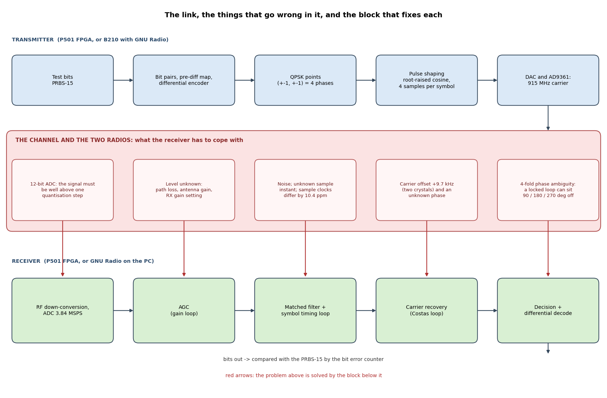

| what goes wrong | size in our link | the block that fixes it |
|---|---|---|
| the ADC has a finite step (12 bit) | the received signal is a few tens of counts rms: the RX gain must put it well above one step | RF/ADC gain setting (RX gain index) |
| the level is unknown | changes by tens of dB with distance and gains | **AGC** |
| noise, and an unknown sampling instant that also drifts | the transmitter's sample clock differs from ours by **10.4 ppm**: the best instant moves by one sample in about 24,000 symbols | **matched filter** (best SNR) and **timing loop** |
| the carrier is not at the frequency we expect, and its phase is unknown | the two crystals differ by **10.4 ppm of 915 MHz = +9.7 kHz** = 3.6 degrees of rotation per symbol | **Costas loop** |
| after the loop has locked, the constellation may sit rotated by 0, 90, 180 or 270 degrees | the loop cannot tell | **differential encoding** at the transmitter, **differential decoding** at the receiver |

The rest of the design follows from this table. A transmitter has little to do (it knows everything); the receiver is a chain of loops, each removing one unknown, in an order that matters (A.5.3).

### A.5.2 The transmitter, block by block

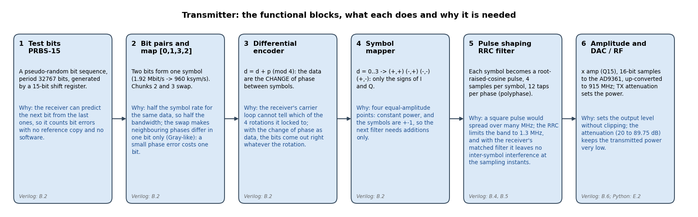

The rates along the chain: **1.92 Mbit/s** of data -> **960 ksym/s** (two bits per symbol) -> **3.84 MSPS** (four samples per symbol after the pulse shaping) -> a 3.84 MSPS complex stream to the AD9361, which converts it to a signal around 915.0 MHz about **1.3 MHz wide** (960 kHz x 1.35).
Blocks 1 to 4 work at the symbol rate and need only a handful of gates: they are *bookkeeping*. Block 5 is the only one that works at the sample rate, and because the symbols are +-1 it needs additions, not multiplications (B.5).

### A.5.3 The receiver, block by block

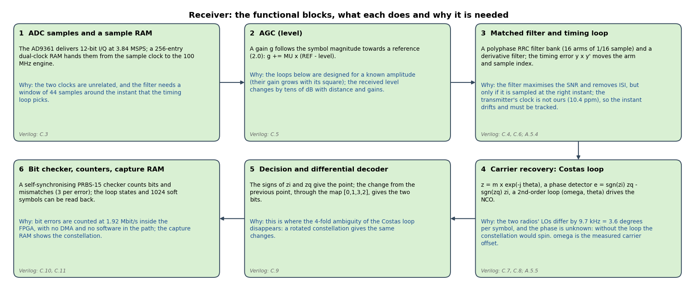

**Why this order.**
* **AGC first**, because the gains of both loops depend on the signal amplitude (the detectors multiply amplitudes: the gain goes with the square).
* **The matched filter before everything else at the symbol rate**: it gives the best SNR, and the timing and phase detectors work on its output.
* **Timing before carrier**: the timing detector `e = Re{ y x conj(y') }` is a product of the filter output and its own derivative, so a rotation of the constellation cancels out of it (both rotate together; even a steady rotation only adds a term `j x omega x |y|^2` whose real part is zero). It works while the carrier loop has not locked yet.
  The Costas loop, on the other hand, needs one sample per symbol at the *right instant*, which only the timing loop delivers.
* **Carrier recovery before the decision**, and the **differential decoder after it**: the decision needs an un-rotated constellation; the decoder turns the 4-fold ambiguity into nothing.
* The **checker** sits at the end because it only looks at bits.

### A.5.4 Symbol timing in pictures

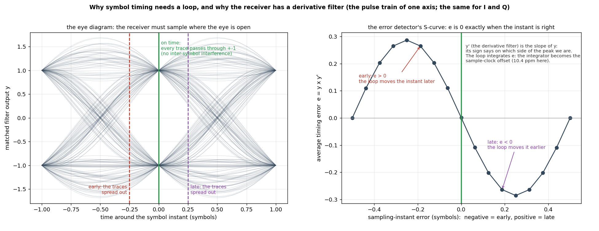

*Left, the eye diagram.* If the received pulses are laid on top of each other, a gap opens where every trace passes through +1 or -1: that is the instant to sample, and the matched filter was designed to leave no inter-symbol interference there. Early or late, the traces scatter: noise and neighbouring symbols leak into the decision.
The transmitter and the receiver have independent crystals, so *that instant moves*: by 10.4 ppm, one symbol of drift every 100,000 symbols, which is why the sampling instant cannot be fixed once and for all.

*Right, how the loop knows.* A **derivative filter** (a second FIR next to the matched filter) gives the slope y' of the output. Before the peak y and y' have the same sign, after the peak opposite signs, at the peak y' = 0.
The product `e = y x y'` is therefore positive when we sample **early** and negative when we sample **late**, whatever the sign of the symbol (a negative symbol has a negative peak and a negative rising slope: the same product). Averaged over the data, `e` is the S-curve of the plot: **zero exactly at the right instant**, with the sign that pushes towards it on both sides: negative feedback.
The loop filter turns `e` into the position: the *integral* path learns the clock offset (the `RATE` register: +10 ppm here), the *proportional* path follows the jitter. The position has a fractional part, which is why the filter exists in 16 versions ("arms") of 1/16 sample.

### A.5.5 The Costas loop in pictures

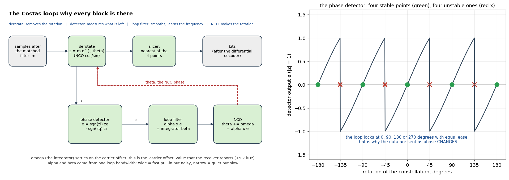

*Left, the loop.* The matched-filter output `m` is rotated back by the NCO's angle `theta` (**derotate**: `z = m x e^(-j theta)`); the **slicer** takes the nearest of the four points; the **phase detector** measures the angle left between `z` and that point, `e = sgn(zi) zq - sgn(zq) zi`
(about `|z| x sqrt(2) x sin(error)`, positive for a positive error); the **loop filter** adds a proportional term (`alpha x e`, follows the phase) and an integral term (`beta x e` accumulated into `omega`, learns the frequency); the **NCO** produces the next `theta`. A rotation of 3.6 degrees per symbol (9.7 kHz) is a constant frequency error:
the integrator settles on it, and `omega` *is* the carrier offset that the receiver reports.

*Right, the detector.* The curve shows `e` against the rotation of the constellation: it is zero at 0, 90, 180 and 270 degrees, and each is a stable point (the slope pushes back). **The loop cannot tell them apart**: any of the four is a perfect lock. That is the 4-fold ambiguity, and the reason for the differential code. An example (chunks c = 1, 3, 0, 2):

| step | 1 | 2 | 3 | 4 | how it was obtained |
|---|---|---|---|---|---|
| data chunk c | 1 | 3 | 0 | 2 | the data |
| pre-differential map p | 1 | 2 | 0 | 3 | `[0,1,3,2]` |
| transmitted point d | 1 | 3 | 3 | 2 | `d = d + p (mod 4)` |
| received point, constellation locked **+90 degrees off** | 2 | 0 | 0 | 3 | every point moves by +1 |
| receiver: `dd = d' - d'(previous)` | - | 2 | 0 | 3 | the +1 cancels in the difference |
| after the map `[0,1,3,2]` again | - | 3 | 0 | 2 | **the data again** (chunks 2 to 4) |

The only price: one symbol error disturbs two differences, so errors come in pairs (about 2 dB at the same BER).

**Pull-in.** The loop can only pull in a frequency error of about `960 kHz / N` for a loop bandwidth of `2 pi / N` (9.6 kHz for N = 100): the B210's +9.7 kHz is at the edge, which is why the notebook's `acquire()` tries frequency hints (E.3) and why GNU Radio's receiver has a separate FLL in front of its Costas loop.

### A.5.6 From the functional blocks to the Verilog

| functional block | why (short) | Verilog | what the Verilog looks like |
|---|---|---|---|
| TX 1 test bits | countable errors | B.2 | 15-bit LFSR, two steps per symbol |
| TX 2 to 4 pairs, map, differential encoder, mapper | 2 bits/symbol, Gray-like, rotation-proof | B.2 | a 2-bit adder and two sign bits |
| TX 5 pulse shaping | 1.3 MHz band, no ISI | B.4, B.5 | ROM of 12 taps per phase + 12 adders/subtractors |
| TX 6 scale and DAC | level | B.6 | one multiplier per axis, pipeline register |
| RX 1 samples and RAM | two clocks | C.3 | dual-clock RAM + Gray-coded counter |
| RX 2 AGC | known amplitude | C.5 (S0 to S3) | multiply by `g`, a level estimate, `g += MU x error` |
| RX 3 matched filter + timing loop | best SNR, right instant | C.4, C.6 (MAC, S2 to S4) | 4 DSP multiplies reused 44 times, rate and position update |
| RX 4 Costas loop | carrier offset and phase | C.7, C.8 (S5 to S8) | 1024-entry sine/cosine table, 4 multiplies, two accumulators |
| RX 5 decision + differential decoder | bits | C.9 (S6) | signs, a 2-bit subtraction, the map |
| RX 6 checker, counters, capture RAM | measure without software | C.10, C.11 | 15-bit predictor, counters, 1024-word RAM |

The Verilog diagrams in B and C show the same blocks as hardware: registers, ROMs, DSP slices, the state machine.

## A.6 The GNU Radio flowgraphs and the Verilog, side by side

The B210 side of the tests is two GNU Radio flowgraphs (`qpsk_b210_tx.grc`, `qpsk_b210_rx.grc`, E.13). They contain the same functions as the FPGA, built from GNU Radio's stock blocks. If you know one side, the other follows: each row below pairs a block **as it is named in Companion** with the Verilog that does the same job.
(Blue = a stock GNU Radio block, yellow = an embedded Python block, orange = the B210 radio, grey = a viewer. On the right: the colours of the Verilog diagrams in B and C.)

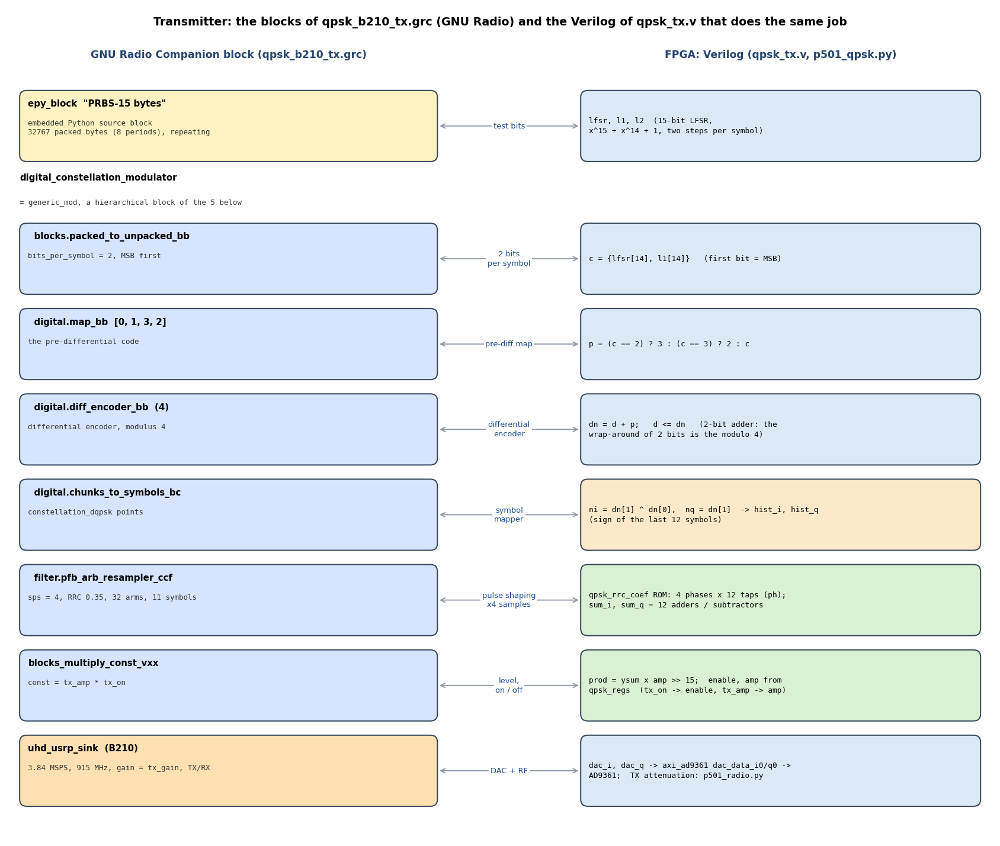

The transmitter's `digital_constellation_modulator` is one block in Companion, but it is a *hierarchical* block (`generic_mod`) made of the five blocks inside the frame: bits to chunks, the pre-differential map, the differential encoder, the symbol mapper and the RRC pulse shaper.
In `qpsk_tx.v` the same five steps are a few lines each (B.2), and the pulse shaper is the ROM plus twelve adders (B.4, B.5).

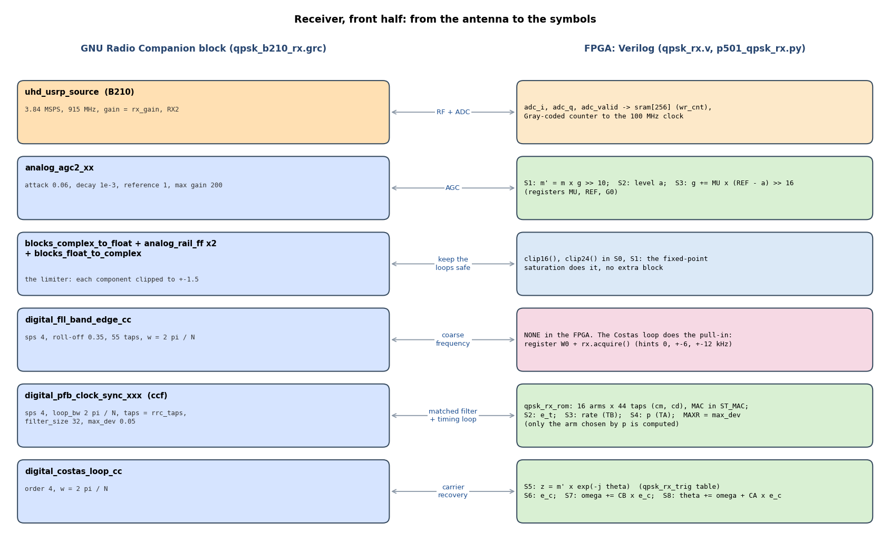

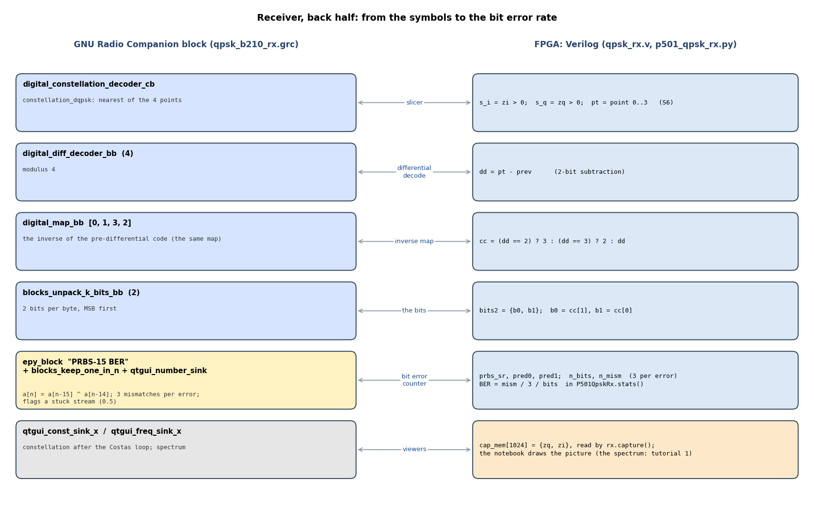

**The knobs, side by side.** The same experiment can be done on either end; this is how the controls correspond:

| GNU Radio flowgraph | what it sets | the P501 notebook | what it sets |
|---|---|---|---|
| `tx_on` (Transmit ON/OFF) | `multiply_const` = `tx_amp x tx_on` | *P501 transmits* | `enable` of `qpsk_regs` |
| `tx_amp` | `multiply_const` | *TX amplitude* | `amp` of `qpsk_regs` (Q15) |
| `tx_gain` (UHD gain, 0 to 80 dB) | the B210's TX gain | *TX atten* (89.75 to 20 dB) | the AD9361's TX attenuation (`p501_radio`) |
| `rx_gain` (UHD gain) | the B210's RX gain | *RX gain* (index 0 to 76) | the AD9361's RX gain index |
| `bw_div` = N: `w = 2 pi / N` into the FLL, `pfb_clock_sync` (`loop_bw`) and `costas_loop_cc` | the three loop bandwidths | *Live loop N* | the four gain registers TA, TB, CA, CB (the same formulas, `regs_from_bw`) |
| BER box (`epy_block` + `qtgui_number_sink`) | bit errors / bits | the picture's *BER estimate*, `MISMATCH / 3 / BITS` | the FPGA's checker counters |
| `qtgui_const_sink_x` | 1024 symbols after the Costas loop | the live constellation | the capture RAM (`rx.capture()`) |

**What is different, and why.**

| | GNU Radio | FPGA | why |
|---|---|---|---|
| structure | one block per function, each running continuously on the PC | one engine that runs a short program once per symbol (S0 to S9), sharing 4 multipliers | the symbol rate is 100 times slower than the clock |
| arithmetic | 32-bit floating point | integers with chosen widths, shifts and clips (C.1), rounded integrators (F.3) | DSP slices, and bit-exact checking against the model |
| polyphase arms | 32 (`filter_size`), the derivative bank included | 16 arms of 44 taps, only the arm selected by the timing loop is computed per symbol | 1/16 of a sample is enough resolution; 4 multipliers instead of 32 filters |
| coarse frequency | `digital_fll_band_edge_cc` in front of the clock sync | none: the Costas loop pulls in, helped by `W0` and `acquire()` | an FLL costs a band-edge filter pair; `acquire()` costs a few lines of Python |
| protection against bursts | the limiter (`rail_ff`) | saturating arithmetic (`clip16`, `clip24`) | fixed-point saturates by itself |
| loop gains | `loop_bw`, `w` (floating point) | registers TA, TB, CA, CB, written from Python | live adjustable, no re-synthesis |
| bit error counting | Python block (`epy_block`) on the PC | 15-bit predictor and counters in the FPGA | no bit leaves the FPGA, at 1.92 Mbit/s |
| signal level after the AGC | reference 1.0: the symbols come out with |z| of about 1.03 | reference `REF` = 16384, a level estimate of 2.0 (8192 = 1.0): the decision points sit near 1.24 on each axis, |z| about 1.75 | the loop-gain registers are scaled for this level, which is why `REF` matters (A.3, C.1) |

One flowgraph detail worth knowing: GNU Radio's `pfb_clock_sync_ccf` is the same *kind* of block as the FPGA's timing section, and the two behave alike on the same signals; the difference that bit us was not in the algorithm but in the surroundings: the GNU Radio block stalls the whole flowgraph if a burst reaches it, which the limiter prevents (E.13), where the fixed-point FPGA just saturates.

---

# Part B. The transmitter (`rtl/qpsk_tx.v`)

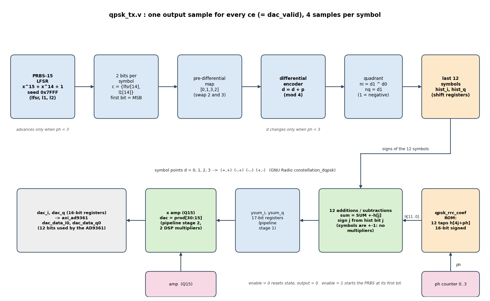

*This is the implementation view; what each block does and why it is needed is in A.5.2.*

The transmitter replaces the DAC DMA path for TX1, exactly as the DDS of tutorial 2 does: its outputs go to `dac_data_i0` / `dac_data_q0` of `axi_ad9361`, and its sample clock enable is `dac_valid_i0`.
Everything below happens only on a `ce`; between the `ce`s the module holds its state.

## B.1 Interface and the two pipeline stages

```verilog
module qpsk_tx (
  (* X_INTERFACE_PARAMETER = "ASSOCIATED_RESET resetn" *)
  (* X_INTERFACE_INFO = "xilinx.com:signal:clock:1.0 clk CLK" *)
  input  wire        clk,
  (* X_INTERFACE_INFO = "xilinx.com:signal:reset:1.0 resetn RST" *)
  (* X_INTERFACE_PARAMETER = "POLARITY ACTIVE_LOW" *)
  input  wire        resetn,
  input  wire        ce,
  input  wire        enable,
  input  wire [15:0] amp,                 // Q15, 0..32767
  output reg  [15:0] dac_i,
  output reg  [15:0] dac_q
);
```
*`rtl/qpsk_tx.v`, lines 11-23 - module interface*


* `ce` is `dac_valid_i0`: one pulse per DAC sample.
* `enable` and `amp` come from the register block `qpsk_regs` (the same `dds_regs.v` as in tutorial 2, see B.7).
* `amp` is Q15 (0 to 32767); `dac_i` / `dac_q` are 16-bit signed; the AD9361's DAC uses the top 12 bits.
* The module has **two pipeline stages** (`ysum_*`, then `dac_*`): the sum of the taps is registered, then scaled. The output is one sample late; the NumPy model includes this (the first sample is 0).

## B.2 The pseudo-random source: PRBS-15

A 15-bit linear-feedback shift register, polynomial x^15 + x^14 + 1, seed `0x7FFF` (all ones). The output bit is the most significant bit `lfsr[14]`; the next state shifts left and feeds
back `lfsr[14] ^ lfsr[13]`. The sequence repeats every 32767 bits and contains every non-zero 15-bit pattern once, which makes it a good test of the whole chain (a stuck bit, a missing
pulse or an inversion shows up as errors).

A symbol needs **two bits**, so the register is advanced **two** steps per symbol. The code computes the next two states combinatorially (`l1`, `l2`) so that the two bits `lfsr[14]`, `l1[14]` are
available at the same time:

```verilog
// next symbol
wire [14:0] l1 = {lfsr[13:0], lfsr[14] ^ lfsr[13]};
wire [14:0] l2 = {l1[13:0], l1[14] ^ l1[13]};
wire [1:0]  c  = {lfsr[14], l1[14]};
wire [1:0]  p  = (c == 2'd2) ? 2'd3 : (c == 2'd3) ? 2'd2 : c;
wire [1:0]  dn = d + p;
wire        ni = dn[1] ^ dn[0];
wire        nq = dn[1];
```
*`rtl/qpsk_tx.v`, lines 55-62 - the next symbol: two LFSR steps, the 2-bit chunk, the map [0,1,3,2], the differential encoder, the quadrant*


* `c = {lfsr[14], l1[14]}`: the first bit is the **MSB** (what GNU Radio's `unpack`/`pack` convention expects).
* `p` = the pre-differential map `[0,1,3,2]`: chunks 2 and 3 swap.
* `dn = d + p` : a 2-bit adder; **the wrap-around of 2 bits is the modulo 4**.
* `ni`, `nq` are the *signs* of the next symbol, from `dn`: point 0 = (+,+), 1 = (-,+), 2 = (-,-), 3 = (+,-); so `ni = dn[1] ^ dn[0]` (negative I for points 1 and 2) and `nq = dn[1]` (negative Q for points 2 and 3).

Only the sign bits are kept: the symbols are +-1.

## B.3 Start state: the first symbol is already "in the pipe"

With `enable = 0` the module sits in a defined state so that `enable = 1` starts the pattern *from its first bit* (the receiver, and `qpsk_model.py`, rely on this):

```verilog
// ---- state after the first symbol has been prepared (constants) ----
localparam [14:0] S0 = 15'h7FFF;
localparam        B0 = S0[14];
localparam [14:0] S1 = {S0[13:0], S0[14] ^ S0[13]};
localparam        B1 = S1[14];
localparam [14:0] S2 = {S1[13:0], S1[14] ^ S1[13]};
localparam [1:0]  C0 = {B0, B1};
localparam [1:0]  P0 = (C0 == 2'd2) ? 2'd3 : (C0 == 2'd3) ? 2'd2 : C0;       // pre-differential map [0,1,3,2]
localparam [1:0]  D0 = P0;                                                    // differential encoder, previous output 0
localparam        NI0 = D0[1] ^ D0[0];                                        // 1 = negative I
localparam        NQ0 = D0[1];                                                // 1 = negative Q
```
*`rtl/qpsk_tx.v`, lines 24-34 - constants: the state after the first symbol has been prepared (computed by the synthesis tool)*


The first symbol is made from the seed's first two bits; at reset the LFSR already points to the *third* bit (`S2`), `d` holds the differential state after symbol 0 (`D0`), and the history holds
that first symbol (`NI0`, `NQ0`). The register `hist_*` initially has 11 zeros = +1 (positive) symbols before it, as if the transmitter had sent +1 symbols forever.

## B.4 History of symbols and the polyphase coefficient ROM

```verilog
reg  [1:0]  ph;                          // sample within the symbol, 0..3
reg  [14:0] lfsr;
reg  [1:0]  d;
reg  [11:0] hist_i, hist_q;              // sign of the last 12 symbols, bit 0 = newest, 1 = negative
reg  signed [16:0] ysum_i, ysum_q;       // stage 1
wire [191:0] h;
qpsk_rrc_coef u_coef (.ph(ph), .h(h));
```
*`rtl/qpsk_tx.v`, lines 36-42 - state registers and the ROM instance*


`hist_i[j]` is the sign of the symbol sent `j` symbols ago (bit 0 = newest, 1 = negative). The 45-tap RRC filter gets one **phase** `ph` (0..3) per output sample and uses 12 taps:
`h[4j + ph]`, j = 0..11. The ROM `qpsk_rrc_coef` returns those 12 coefficients, as one 192-bit vector, for the current `ph`. It is **generated** by `qpsk_model.py` from the same function that the model uses
(so the model and the RTL cannot disagree):

```python
def rrc_taps(beta=BETA, sps=SPS, ntaps=NT):
    k = (np.arange(ntaps) - (ntaps - 1) / 2) / sps          # time in symbols
    h = np.zeros(ntaps)
    for n, t in enumerate(k):
        if abs(t) < 1e-12: h[n] = 1 + beta * (4 / np.pi - 1)
        elif abs(abs(t) - 1 / (4 * beta)) < 1e-9: h[n] = beta / np.sqrt(2) * ((1 + 2 / np.pi) * np.sin(np.pi / (4 * beta)) + (1 - 2 / np.pi) * np.cos(np.pi / (4 * beta)))
        else: h[n] = (np.sin(np.pi * t * (1 - beta)) + 4 * beta * t * np.cos(np.pi * t * (1 + beta))) / (np.pi * t * (1 - (4 * beta * t) ** 2))
    return h / h.max()


def coef_int():
    return np.round(rrc_taps() * COEF_SCALE).astype(int)       # 45 integers, peak 4096
```
*`tutorial/qpsk/p501_tx/qpsk_model.py`, lines 21-32 - the RRC taps (closed form) and their integer version, peak = 12288*

```verilog
// Generated by tutorial/qpsk/p501_tx/qpsk_model.py - do not edit.
// RRC pulse, roll-off 0.35, 4 samples per symbol, 45 taps, peak tap = 12288. Output: the 12 taps h[4j+ph] of a polyphase phase (0 where 4j+ph >= 45).
`timescale 1ns/1ps
module qpsk_rrc_coef (
  input  wire [1:0]     ph,
  output reg  [191:0]   h       // 12 coefficients, 16 bit signed each, j = 0 in the lowest bits
);
  always @* begin
    case (ph)
      2'd0: h = {16'sd31 , -16'sd130 , 16'sd107 , 16'sd287 , -16'sd1516 , 16'sd6816 , 16'sd6816 , -16'sd1516 , 16'sd287 , 16'sd107 , -16'sd130 , 16'sd31};
      2'd1: h = {16'sd0 , -16'sd27 , 16'sd149 , -16'sd166 , -16'sd248 , 16'sd2320 , 16'sd10735 , -16'sd2116 , 16'sd733 , -16'sd107 , -16'sd115 , 16'sd103};
      2'd2: h = {16'sd0 , 16'sd84 , 16'sd23 , -16'sd285 , 16'sd641 , -16'sd950 , 16'sd12288 , -16'sd950 , 16'sd641 , -16'sd285 , 16'sd23 , 16'sd84};
```
*`rtl/qpsk_rrc_coef.v`, lines 1-12 - the generated ROM (first phases)*


The scale 12288 for the peak tap is chosen so that the largest sum of absolute values of 12 taps (about 17,800) still fits 17 signed bits (`ysum`), and with `amp` < 2^15 the scaled
product's bits [30:15] cannot overflow.

## B.5 The FIR: twelve additions with signs, no multiplier

```verilog
// sum of the 12 taps, sign by the symbol
reg signed [16:0] sum_i, sum_q;
integer j;
always @* begin
  sum_i = 17'sd0; sum_q = 17'sd0;
  for (j = 0; j < 12; j = j + 1) begin
    sum_i = sum_i + (hist_i[j] ? -$signed(h[16*j +: 16]) : $signed(h[16*j +: 16]));
    sum_q = sum_q + (hist_q[j] ? -$signed(h[16*j +: 16]) : $signed(h[16*j +: 16]));
  end
end
```
*`rtl/qpsk_tx.v`, lines 44-53 - the sum of the taps, sign chosen by the symbol*


An `always @*` loop with a constant bound unrolls into 12 adders/subtractors in parallel: for tap `j` the sign comes from `hist_i[j]` (and `hist_q[j]` for the quadrature branch).
The I and Q branches are independent: the same coefficients, different symbol signs.

## B.6 Clocked part: the pipeline, the amplitude and the symbol clock

```verilog
wire signed [32:0] prod_i = ysum_i * $signed({1'b0, amp[14:0]});
wire signed [32:0] prod_q = ysum_q * $signed({1'b0, amp[14:0]});

always @(posedge clk) begin
  if (!resetn || !enable) begin
    ph <= 2'd0; lfsr <= S2; d <= D0;
    hist_i <= {11'd0, NI0}; hist_q <= {11'd0, NQ0};
    ysum_i <= 17'sd0; ysum_q <= 17'sd0; dac_i <= 16'd0; dac_q <= 16'd0;
  end else if (ce) begin
    ysum_i <= sum_i; ysum_q <= sum_q;
    dac_i <= prod_i[30:15]; dac_q <= prod_q[30:15];                          // |y| < 2^15 and amp < 2^15: no overflow
    ph <= ph + 2'd1;
    if (ph == 2'd3) begin
      lfsr <= l2; d <= dn;
      hist_i <= {hist_i[10:0], ni}; hist_q <= {hist_q[10:0], nq};
    end
  end
end
```
*`rtl/qpsk_tx.v`, lines 64-81 - amplitude scaling, pipeline registers and the symbol clock (ph counts the samples within a symbol)*


* On every `ce`: `ysum_*` registers the sum (stage 1); `dac_*` registers `ysum x amp` (stage 2). `prod[30:15]` is the product shifted right by 15 (Q15).
* `ph` counts 0,1,2,3. At `ph == 3` the *next* symbol is taken over: the LFSR advances, `d` advances, and the sign bits are shifted into the history. So during the four samples of symbol *m* the history holds
  symbol *m* as the newest.
* `if (!resetn || !enable)`: reset state and **zero output**. This is what makes `enable` a clean start/stop: when it is low the DAC gets zeros.

The model in `qpsk_model.py` is bit-exact with this block, including the latency:

```python
def symbol_indices(bits):
    """bits -> DQPSK point indices (GNU Radio generic_mod order)."""
    chunks = bits[0::2].astype(int) * 2 + bits[1::2].astype(int)
    d, out = 0, np.zeros(len(chunks), dtype=int)
    for n, c in enumerate(chunks):
        d = (d + PRE_DIFF[c]) % 4; out[n] = d
    return out


def model(n_samples, amp=0x4000, bits=None):
    """The transmitter's output at the sample rate (ce rate): two int arrays (I, Q) of n_samples, including the one-sample pipeline latency
    (the first sample is 0) and the initial history of +1 symbols that the hardware starts with."""
    h = coef_int(); nsym = n_samples // SPS + SPAN + 2
    if bits is None: bits = prbs15_bits(2 * nsym)
    idx = symbol_indices(bits)
    si = np.array([SIGN_I[i] for i in idx]); sq = np.array([SIGN_Q[i] for i in idx])
    hi = np.concatenate([np.ones(SPAN), si]); hq = np.concatenate([np.ones(SPAN), sq])     # history starts as all +1
    ysum_i = np.zeros(n_samples, dtype=np.int64); ysum_q = np.zeros(n_samples, dtype=np.int64)
    for n in range(n_samples):
        m, p = divmod(n, SPS)                          # symbol m enters the history before its first sample (p = 0)
        for j in range(SPAN + 1):
            t = SPS * j + p
            if t < NT:
                ysum_i[n] += h[t] * hi[SPAN + m - j]; ysum_q[n] += h[t] * hq[SPAN + m - j]
    def stage(y):
        v = (y * int(amp)) >> 15                       # arithmetic shift (floor), as in the RTL
        return np.clip(v, -32768, 32767)
    oi, oq = stage(ysum_i), stage(ysum_q)
    # the output register after sample k holds the scaled sum of sample k-1 (stage 1: sum, stage 2: scale): one sample of latency
    return np.concatenate([[0], oi[:-1]]).astype(int), np.concatenate([[0], oq[:-1]]).astype(int)
```
*`tutorial/qpsk/p501_tx/qpsk_model.py`, lines 43-72 - the NumPy model of the transmitter (symbol indices and the sample-by-sample output, floor shift as in the RTL)*


## B.7 Register block and start/stop: why `commit`

The transmitter uses the **same register block as the DDS** (`dds_regs.v`, instance name `qpsk_regs`, address `0x9C460000`): `CONTROL` bit 0 = enable, `AMP` (Q15), `COMMIT`. The frequency word is unused.
The values are written on the 100 MHz AXI clock but used on `l_clk`; they must change **together**, and never half-written. The hand-over:

```verilog
// ---------------- hand-over to clk ----------------
(* ASYNC_REG = "TRUE" *) reg [1:0] commit_sync = 2'b00;   // clk domain
reg ack_tog = 1'b0;                                         // clk domain
(* ASYNC_REG = "TRUE" *) reg [1:0] ack_sync = 2'b00;      // aclk domain
assign applied = (ack_sync[1] == commit_tog);

always @(posedge aclk) ack_sync <= {ack_sync[0], ack_tog};

always @(posedge clk) begin
  commit_sync <= {commit_sync[0], commit_tog};
  if (commit_sync[1] != ack_tog) begin       // a new COMMIT: take over the parameters
    ftw    <= ftw_a;
    amp    <= {1'b0, amp_a[14:0]};
    enable <= ctrl_a[0];
    ack_tog <= commit_sync[1];
  end
end
```
*`rtl/dds_regs.v`, lines 97-113 - hand-over: COMMIT toggles a flag; the l_clk side sees the toggle through two flops and only then takes the (long stable) parameters*


Software writes `AMP`, `CONTROL`, then `COMMIT`; the register block toggles `commit_tog`; `l_clk` sees it two cycles later, loads `enable` and `amp` in one clock, and toggles `ack_tog`;
software waits for `STATUS` bit 0 (`applied`). If the AD9361 clock is not running the wait times out (see `P501Dds.set`, E.2).

---

# Part C. The receiver (`rtl/qpsk_rx.v`)

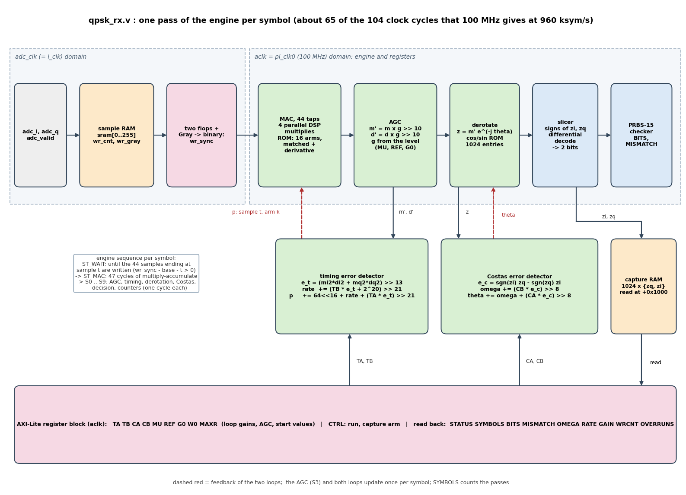

*This is the implementation view; what each block does and why it is needed is in A.5.3 to A.5.5.*

The receiver is a **small processor with a fixed program**: one *engine* that, for every symbol, runs a sequence of states (`ST_WAIT`, `ST_MAC`, `S0`..`S9`). Each state is one clock cycle at 100 MHz; the DSP products are
formed combinationally in a state and registered at its end. The numbers in every line come from the integer model `qpsk_rx_fixed.py`, which is why that file is the best way to read this one.

## C.1 Number formats (read this once)

| signal | format | meaning |
|---|---|---|
| `x` (ADC sample) | signed 12 bit in 16 (+-2047 counts) | what the AD9361 delivers |
| `cm`, `cd` (coefficients) | int16, x 2^15 | matched filter and derivative filter, 16 arms x 44 taps (`qpsk_rx_rom`) |
| `m`, `d` (MAC result) | 24-bit, `acc >> 11` | Q4: **16 = one ADC count** |
| `g` (AGC gain) | 17-bit unsigned, Q10 | 1024 = gain 1.0 |
| `m'`, `d'` (after AGC) | int16, `(m*g) >> 10` | symbols: 8192 = amplitude 1.0 |
| `p` (timing position) | 52 bit: `[51:20]` sample index, `[19:16]` arm (of 16), `[15:0]` fraction | Q16 in arms; one symbol = 64 << 16 |
| `rate` | signed 32, Q16 arms per symbol | the sample-clock offset: `ppm = -rate / 2^22 x 10^6` |
| `theta`, `omega` | 32-bit, turns x 2^32 | NCO phase and frequency: `Hz = omega / 2^32 x 960000` |
| `e_t`, `e_c` | signed 14 bit, clipped to +-8191 | detector outputs |
| TA, TB | gain x 2^24 (then `>> 21`) | timing loop |
| CA, CB | rad x 2^27 / 2 pi (then `>> 8`) | Costas loop |

## C.2 Registers (AXI-Lite)

```verilog
// ======================= registers =======================
reg [31:0] r_ctrl, r_ta, r_tb, r_ca, r_cb, r_mu, r_ref, r_g0, r_w0, r_maxr;
wire do_write = s_axi_awvalid & s_axi_wvalid & ~s_axi_bvalid;
assign s_axi_awready = do_write;
assign s_axi_wready  = do_write;
always @(posedge aclk) begin
  if (!aresetn) begin
    r_ctrl <= 32'd0; r_ta <= 32'd729017; r_tb <= 32'd16195; r_ca <= 32'd928214; r_cb <= 32'd20620;
    r_mu <= 32'd40; r_ref <= 32'd16384; r_g0 <= 32'd1024; r_w0 <= 32'd0; r_maxr <= 32'd52429;
    s_axi_bvalid <= 1'b0; s_axi_bresp <= 2'b00;
  end else begin
    if (do_write) begin
      case (s_axi_awaddr[7:2])
        6'h01: r_ctrl <= s_axi_wdata;
        6'h02: r_ta   <= s_axi_wdata;
        6'h03: r_tb   <= s_axi_wdata;
        6'h04: r_ca   <= s_axi_wdata;
        6'h05: r_cb   <= s_axi_wdata;
        6'h06: r_mu   <= s_axi_wdata;
        6'h07: r_ref  <= s_axi_wdata;
        6'h08: r_g0   <= s_axi_wdata;
        6'h09: r_w0   <= s_axi_wdata;
        6'h0A: r_maxr <= s_axi_wdata;
        default: ;
      endcase
      s_axi_bvalid <= 1'b1;
    end else if (s_axi_bvalid & s_axi_bready) s_axi_bvalid <= 1'b0;
  end
end
```
*`rtl/qpsk_rx.v`, lines 53-81 - the control registers (reset values = loops 2 pi/400, REF 16384, G0 1.0, W0 0, rate limit 5 %)*


A write is accepted when address and data are both valid (`do_write`) and the previous response has been taken; the registers are plain flops on the AXI clock. The engine reads them directly: **a write acts on the next symbol**. Reads:
see C.11.

## C.3 The sample RAM and the clock crossing

```verilog
// ======================= sample RAM, adc_clk side =======================
reg [31:0] sram [0:255];
reg [31:0] wr_cnt = 32'd0;
reg [31:0] wr_gray = 32'd0;
always @(posedge adc_clk) begin
  if (adc_valid) begin
    sram[wr_cnt[7:0]] <= {adc_q, adc_i};
    wr_cnt <= wr_cnt + 32'd1;
  end
  wr_gray <= wr_cnt ^ (wr_cnt >> 1);
end
// Gray counter -> aclk (two flops), binary again
(* ASYNC_REG = "TRUE" *) reg [31:0] g_s1 = 32'd0, g_s2 = 32'd0;
always @(posedge aclk) begin g_s1 <= wr_gray; g_s2 <= g_s1; end
function [31:0] gray2bin(input [31:0] gg);
  integer gi;
  begin
    gray2bin[31] = gg[31];
    for (gi = 30; gi >= 0; gi = gi - 1) gray2bin[gi] = gray2bin[gi + 1] ^ gg[gi];
  end
endfunction
wire [31:0] wr_sync = gray2bin(g_s2);
```
*`rtl/qpsk_rx.v`, lines 83-104 - samples written on adc_clk into a 256-entry RAM; the write counter crosses as Gray code through two flops*


* The RAM holds the last 256 samples (the filter window is 44).
* `wr_gray` changes **one bit per count**, so the two-flop synchroniser (`g_s1`, `g_s2`) delivers either the old or the new value, never a wrong one. `gray2bin` converts back.
* The false-path constraints in `src/qpsk_rx_cdc.xdc` tell Vivado that these two crossings are intentional (D.3).

The engine knows how many samples are complete (`wr_sync`) and which window it wants (`base + t`). `avail = wr_sync - base - t > 0` starts a symbol when the newest sample of the window has been written:

```verilog
// ======================= engine =======================
localparam [4:0] ST_IDLE = 5'd0, ST_WAIT = 5'd1, ST_MAC = 5'd2, S0 = 5'd3, S1 = 5'd4, S2 = 5'd5, S3 = 5'd6, S4 = 5'd7, S5 = 5'd8, S6 = 5'd9, S7 = 5'd10, S8 = 5'd11, S9 = 5'd12;
reg [4:0]  st;
reg [31:0] base;
reg [51:0] p;                                   // [51:20] sample index t, [19:16] arm, [15:0] fraction
reg [6:0]  ic;
reg signed [31:0] rate, omega;
reg [31:0] theta;
reg [16:0] g;
reg [1:0]  prev;
wire [31:0] t32 = p[51:20];
wire [3:0]  arm = p[19:16];
wire [31:0] diff = wr_sync - base - t32;
wire        avail = (diff != 32'd0) && !diff[31];
```
*`rtl/qpsk_rx.v`, lines 106-119 - engine state: p (the position), rate, omega, theta, the AGC gain g*


## C.4 Matched filter and derivative filter: the MAC

```verilog
// memories and the MAC pipeline
reg  [31:0] x_word;
wire [7:0]  ram_raddr = base[7:0] + t32[7:0] - {1'b0, ic};
always @(posedge aclk) x_word <= sram[ram_raddr];
wire signed [15:0] cm, cd;
qpsk_rx_rom u_rom (.clk(aclk), .addr({arm, ic[5:0]}), .cm(cm), .cd(cd));
wire signed [15:0] xi = x_word[15:0], xq = x_word[31:16];
reg v1, v2;
reg signed [31:0] pmi, pmq, pdi, pdq;
reg signed [39:0] a_mi, a_mq, a_di, a_dq;
always @(posedge aclk) begin
  v1 <= (st == ST_MAC) && (ic < 7'd44);
  v2 <= v1;
  pmi <= xi * cm; pmq <= xq * cm; pdi <= xi * cd; pdq <= xq * cd;
  if (st != ST_MAC) begin a_mi <= 40'sd0; a_mq <= 40'sd0; a_di <= 40'sd0; a_dq <= 40'sd0; end
  else if (v2) begin a_mi <= a_mi + pmi; a_mq <= a_mq + pmq; a_di <= a_di + pdi; a_dq <= a_dq + pdq; end
end
```
*`rtl/qpsk_rx.v`, lines 121-137 - the multiply-accumulate pipeline: sample RAM read, ROM, four products, four accumulators*


For tap `ic` = 0..43 the engine reads the sample `x[t - ic]` (`ram_raddr = base + t - ic`) and the coefficients of the current arm (`{arm, ic[5:0]}`) from the ROM. **Four DSP multipliers work in parallel**:
`xi*cm`, `xq*cm` (matched filter I and Q) and `xi*cd`, `xq*cd` (derivative filter). The pipeline (RAM read, product, accumulate) adds 3 cycles, so `ST_MAC` lasts 47 cycles (`ic` 0..46).
The ROM is generated from the same NumPy arrays as the model:

```python
def filter_banks(nf):
    """(matched, derivative) banks: arrays (nf, 44). Arm k holds proto[k + i*nf]; the derivative is the central difference of the prototype."""
    p = rrc_proto(nf); p = p / np.sqrt(np.sum(p ** 2) / nf)                       # unit gain per arm (energy)
    d = np.zeros_like(p); d[1:-1] = (p[2:] - p[:-2]) / 2 * nf                      # derivative in units of 1/sample
    ta = (len(p) - 1) // nf                                                        # taps per arm: span * SPS = 44
    mf = np.array([p[k:k + nf * ta:nf] for k in range(nf)]); dmf = np.array([d[k:k + nf * ta:nf] for k in range(nf)])
    return mf, dmf
```
*`tutorial/qpsk/p501_rx/qpsk_rx_model.py`, lines 28-34 - the filter banks: arm k holds the prototype's samples k, k+16, k+32 ...; the derivative bank is the central difference of the prototype*

```verilog
// Generated by tutorial/qpsk/p501_rx/gen_rx_rom.py - do not edit.
// Polyphase matched filter (cm) and derivative filter (cd): 16 arms x 44 taps, int16 (x 2^15). Address = {arm[3:0], tap[5:0]}; taps 44..63 are 0.
`timescale 1ns/1ps
module qpsk_rx_rom (
  input  wire        clk,
  input  wire [9:0]  addr,
  output reg  [15:0] cm,
```
*`rtl/qpsk_rx_rom.v`, lines 1-7 - the generated ROM (first lines)*


## C.5 AGC: S0 and S1

```verilog
S0: begin
      mi_r <= clip24(a_mi >>> 11); mq_r <= clip24(a_mq >>> 11); di_r <= clip24(a_di >>> 11); dq_r <= clip24(a_dq >>> 11);
      st <= S1;
    end
S1: begin
      mi2 <= clip16(mpi >>> 10); mq2 <= clip16(mpq >>> 10); di2 <= clip16(dpi >>> 10); dq2 <= clip16(dpq >>> 10);
      st <= S2;
    end
```
*`rtl/qpsk_rx.v`, lines 228-235 - S0: accumulators >> 11 (clipped to 24 bit); S1: x gain >> 10 (clipped to 16 bit)*


The four MAC results are scaled by the same gain `g` (Q10), so the matched and the derivative outputs keep their ratio. A level estimate and the gain update follow in `S2` and `S3`:

```verilog
// intermediate products (combinational, registered where used)
wire signed [41:0] mpi = mi_r * $signed({1'b0, g}), mpq = mq_r * $signed({1'b0, g}), dpi = di_r * $signed({1'b0, g}), dpq = dq_r * $signed({1'b0, g});
wire signed [32:0] tp = mi2 * di2 + mq2 * dq2;
wire signed [17:0] err_a = $signed({1'b0, r_ref[16:0]}) - $signed({1'b0, a_est});
wire signed [34:0] mu_prod = $signed({1'b0, r_mu[15:0]}) * err_a;
wire signed [46:0] tb_prod = $signed({1'b0, r_tb[30:0]}) * e_t;
wire signed [46:0] ta_prod = $signed({1'b0, r_ta[30:0]}) * e_t;
wire signed [46:0] ta_sh = ta_prod >>> 21;
wire        [51:0] ta_ext = {{5{ta_sh[46]}}, ta_sh};
wire signed [47:0] cb_prod = $signed({1'b0, r_cb[30:0]}) * e_c;
wire signed [47:0] ca_prod = $signed({1'b0, r_ca[30:0]}) * e_c;
wire signed [47:0] ca_sh = ca_prod >>> 8;
wire signed [32:0] zi_full = mi2 * trig_c + mq2 * trig_s;
wire signed [32:0] zq_full = mq2 * trig_c - mi2 * trig_s;
wire signed [16:0] ai = (mi2[15] ? -{mi2[15], mi2} : {mi2[15], mi2}), aq = (mq2[15] ? -{mq2[15], mq2} : {mq2[15], mq2});
wire [16:0] amax = (ai > aq) ? ai : aq, amin = (ai > aq) ? aq : ai;
wire signed [47:0] g_new = $signed({1'b0, g}) + (mu_prod >>> 16);
wire signed [47:0] rate_new_w = rate + ((tb_prod + 47'sd1048576) >>> 21);      // rounded: a plain shift floors, which is -0.5 LSB per symbol and runs a narrow timing loop's integrator into its limit
wire signed [47:0] maxr_s = $signed({1'b0, r_maxr[30:0]});
wire signed [47:0] ec_raw = (s_i ? $signed({{32{zq[15]}}, zq}) : -$signed({{32{zq[15]}}, zq})) - (s_q ? $signed({{32{zi[15]}}, zi}) : -$signed({{32{zi[15]}}, zi}));
wire signed [47:0] omega_new_w = omega + (cb_prod >>> 8);
```
*`rtl/qpsk_rx.v`, lines 184-204 - the combinational products used by the states (level error, gain update, both loops)*


* **level** `a = max(|mi2|,|mq2|) + min(|mi2|,|mq2|)/2` (an approximation of the magnitude without a square root; error < 12 %), `err = REF - a`, `g += (MU * err) >> 16`, clipped to 16..131071.
* With `REF = 16384` the loop drives the **symbol magnitude to 2.0** (8192 = 1.0, so about 11585 per axis): the value that the loop gains were designed for.
* `MU` is the speed (default 40); `G0` the initial gain (1.0).

## C.6 Timing loop: S2, S3, S4

```verilog
S2: begin
      a_est <= amax + (amin >> 1);
      e_t   <= clip13(tp >>> 13);
      st <= S3;
    end
S3: begin
      g <= (g_new < 48'sd16) ? 17'd16 : (g_new > 48'sd131071) ? 17'd131071 : g_new[16:0];
      rate <= (rate_new_w > maxr_s) ? maxr_s[31:0] : (rate_new_w < -maxr_s) ? -maxr_s[31:0] : rate_new_w[31:0];
      st <= S4;
    end
S4: begin
      p <= p + 52'd4194304 + {{20{rate[31]}}, rate} + ta_ext;          // + (NF*SPS) << 16 arms
      st <= S5;
    end
```
*`rtl/qpsk_rx.v`, lines 236-249 - S2: the level and the timing error; S3: AGC gain and rate integrator; S4: the new sampling position*


* `e_t = (mi2*di2 + mq2*dq2) >> 13`: **the product of the matched and the derivative filter output** (summed over I and Q): positive or negative depending on early or late (the sign of `e_t` is the *direction*).
* `rate_new = rate + ((TB * e_t + 2^20) >> 21)`: the **integral** part. It is **rounded**, not truncated: see F.3. The result is limited to +-`MAXR` (default 5 % of a sample per symbol).
* `p = p + 64<<16 + rate + ((TA * e_t) >> 21)`: the **proportional** part and the nominal advance of **4 samples = 64 arms** (`4194304 = 64 << 16`).
  The arithmetic is in a wide register because `p` counts all samples since the start.
* The next window is `t = p[51:20]`, `arm = p[19:16]`. The loop makes `arm` change slowly with the clock offset; a whole sample slips when the arm index wraps.

The same equations in the integer model (the *specification* of this block):

```python
while True:
    t = p >> 20; k = (p >> 16) & (NF - 1)
    if t >= len(xi) or (max_symbols is not None and n >= max_symbols): break
    wi = xi[t - NTAPS + 1:t + 1][::-1]; wq = xq[t - NTAPS + 1:t + 1][::-1]          # w[i] = x[t - i]
    mi = clip(int(np.dot(wi, cm[k])) >> 11, -2 ** 23, 2 ** 23 - 1); mq = clip(int(np.dot(wq, cm[k])) >> 11, -2 ** 23, 2 ** 23 - 1)
    di = clip(int(np.dot(wi, cd[k])) >> 11, -2 ** 23, 2 ** 23 - 1); dq = clip(int(np.dot(wq, cd[k])) >> 11, -2 ** 23, 2 ** 23 - 1)
    # AGC
    mi2 = clip((mi * g) >> 10, -32768, 32767); mq2 = clip((mq * g) >> 10, -32768, 32767)
    di2 = clip((di * g) >> 10, -32768, 32767); dq2 = clip((dq * g) >> 10, -32768, 32767)
    ai, aq = abs(mi2), abs(mq2); a = max(ai, aq) + (min(ai, aq) >> 1)
    g = clip(g + ((R["MU"] * (R["REF"] - a)) >> 16), 16, 2 ** 17 - 1)
    # timing loop
    e_t = clip((mi2 * di2 + mq2 * dq2) >> 13, -8191, 8191)
    rate = clip(rate + ((R["TB"] * e_t + (1 << (F_T - 4))) >> (F_T - 3)), -R["MAXR"], R["MAXR"])      # rounded, not floored: a floor is -0.5 LSB per symbol, which runs a narrow loop into its limit
    p += ((NF * SPS) << 16) + rate + ((R["TA"] * e_t) >> (F_T - 3))
```
*`tutorial/qpsk/p501_rx/qpsk_rx_fixed.py`, lines 53-67 - the engine in NumPy: window, MAC, AGC, timing loop (compare with C.4 to C.6)*


## C.7 Derotation: S5 and the 1024-entry sine/cosine table

```verilog
S5: begin
      zi <= clip16(zi_full >>> 15); zq <= clip16(zq_full >>> 15);
      st <= S6;
    end
```
*`rtl/qpsk_rx.v`, lines 250-253 - S5: z = m' * exp(-j theta): four multiplies, shifted right by 15*


```verilog
wire signed [15:0] trig_c, trig_s;
qpsk_rx_trig u_trig (.clk(aclk), .a(theta[31:22]), .c(trig_c), .s(trig_s));
```
*`rtl/qpsk_rx.v`, lines 155-156 - the table instance: address = the top 10 bits of theta*

```verilog
// Generated by tutorial/qpsk/p501_rx/gen_rx_rom.py - do not edit.
// cos / sin of 2*pi*a/1024, Q15 (+-32767).
`timescale 1ns/1ps
module qpsk_rx_trig (
  input  wire        clk,
  input  wire [9:0]  a,
  output reg  [15:0] c,
  output reg  [15:0] s
```
*`rtl/qpsk_rx_trig.v`, lines 1-8 - the generated table: cos and sin of 2 pi a / 1024, Q15*


`theta` is a 32-bit phase in turns x 2^32; its top 10 bits address the table (resolution 0.35 degrees). `zi = mi2*cos + mq2*sin`, `zq = mq2*cos - mi2*sin`: a complex multiplication by `exp(-j theta)`.
The table is generated with the ROM (`gen_rx_rom.py`).

## C.8 Costas loop: S6, S7, S8

```verilog
S6: begin
      e_c <= clip13(ec_raw);
      bits2 <= {b0, b1};
      prev <= pt;
      prbs_sr <= {sr1[13:0], b1};
      prbs_n <= (prbs_n >= 5'd13) ? 5'd15 : prbs_n + 5'd2;
      n_bits <= n_bits + nch; n_mism <= n_mism + mm;
      if (cap_active) begin
        cap_mem[cap_cnt[9:0]] <= {zq, zi};
        cap_cnt <= cap_cnt + 11'd1;
        if (cap_cnt == 11'd1023) begin cap_active <= 1'b0; cap_done <= 1'b1; end
      end
      st <= S7;
    end
S7: begin
      omega <= (omega_new_w > 48'sd2147483647) ? 32'sh7FFFFFFF : (omega_new_w < -48'sd2147483648) ? 32'sh80000000 : omega_new_w[31:0];
      st <= S8;
    end
S8: begin
      theta <= theta + omega + ca_sh[31:0];
      st <= S9;
    end
```
*`rtl/qpsk_rx.v`, lines 254-275 - S6: Costas error, decision, differential decode, PRBS checker, counters, capture; S7: frequency; S8: phase*


* `e_c = sgn(zi)*zq - sgn(zq)*zi` (`ec_raw` in the listing of C.5) clipped to +-8191: the angle between the symbol and its quadrant's 45-degree point, times the amplitude.
* `omega += (CB * e_c) >> 8` (S7): the frequency integrator. `OMEGA` is the offset in turns/symbol x 2^32: this is what is read as the **carrier offset**.
* `theta += omega + ((CA * e_c) >> 8)` (S8): the phase advances by the frequency plus the proportional correction.
* The register scale `CA = alpha_rad x 2^27 / 2 pi`: `theta` is in turns x 2^32 and the error has a unit of 2^13, so `>> 8` leaves exactly `alpha / 2 pi x 2^32` per unit error / 2^13.

## C.9 Decision, differential decoding and bits

```verilog
// decision logic for the current z
wire        s_i = ~zi[15] & (zi != 16'sd0);         // z.real > 0
wire        s_q = ~zq[15] & (zq != 16'sd0);
wire [1:0]  pt  = ( s_i &  s_q) ? 2'd0 : (~s_i &  s_q) ? 2'd1 : (~s_i & ~s_q) ? 2'd2 : 2'd3;
wire [1:0]  dd  = pt - prev;
wire [1:0]  cc  = (dd == 2'd2) ? 2'd3 : (dd == 2'd3) ? 2'd2 : dd;       // [0,1,3,2]
wire        b0  = cc[1], b1 = cc[0];
```
*`rtl/qpsk_rx.v`, lines 170-176 - the slicer: signs of zi and zq -> point 0..3; difference to the previous point; the map [0,1,3,2]*


`pt` is the quadrant of `z`; `dd = pt - prev` (2-bit subtraction = modulo 4); the 2-bit map gives the two data bits `b0` (MSB) and `b1`. Everything is combinational from `zi`, `zq`; `S6` registers the result (`bits2`, `prev`).
The NumPy side of the same step:

```python
# Costas
idx = (theta >> 22) & 1023; c, s = cos_l[idx], sin_l[idx]
zi = clip((mi2 * c + mq2 * s) >> 15, -32768, 32767); zq = clip((mq2 * c - mi2 * s) >> 15, -32768, 32767)
si = 1 if zi > 0 else -1; sq = 1 if zq > 0 else -1
e_c = clip(si * zq - sq * zi, -8191, 8191)
omega = clip(omega + ((R["CB"] * e_c) >> 8), -2 ** 31, 2 ** 31 - 1)
theta = (theta + omega + ((R["CA"] * e_c) >> 8)) & 0xFFFFFFFF
# decision and decoding
pt = {(1, 1): 0, (-1, 1): 1, (-1, -1): 2, (1, -1): 3}[(si, sq)]
cc = [0, 1, 3, 2][(pt - prev) % 4]; prev = pt
out["bits"] += [(cc >> 1) & 1, cc & 1]
for key, val in (("zi", zi), ("zq", zq), ("omega", omega), ("rate", rate), ("g", g), ("e_t", e_t), ("e_c", e_c)): out[key].append(val)
n += 1
```
*`tutorial/qpsk/p501_rx/qpsk_rx_fixed.py`, lines 68-80 - the integer model of S5..S8 and the decision*


## C.10 The PRBS-15 checker: counting bit errors without a reference

The checker does not need to know *where* in the PRBS period the data are. A maximal-length sequence satisfies `a[n] = a[n-15] ^ a[n-14]`; the checker keeps the **last 15 received bits** in `prbs_sr`, predicts the next bit
from two of them, and counts a mismatch when the next bit differs from the prediction. After 15 bits it is synchronised, whatever the starting point; if a bit is received wrong, it is wrong **in the prediction register too**,
which causes the next two predictions (when the wrong bit passes the two tap positions) to fail as well: **an isolated bit error produces 3 mismatches**. That is why `BER ~ MISMATCH / 3 / BITS` in the Python driver.

```verilog
wire        pred0 = prbs_sr[14] ^ prbs_sr[13];
wire [14:0] sr1 = {prbs_sr[13:0], b0};
wire        pred1 = sr1[14] ^ sr1[13];
wire        pr0 = (prbs_n >= 5'd15), pr1 = (prbs_n >= 5'd14);
wire [1:0]  mm  = {1'b0, (pr0 & (b0 != pred0))} + {1'b0, (pr1 & (b1 != pred1))};
wire [1:0]  nch = {1'b0, pr0} + {1'b0, pr1};
```
*`rtl/qpsk_rx.v`, lines 177-182 - the prediction for the first and the second bit of a symbol, mismatch and checked-bit counts*


(`pr0`, `pr1` are the "register is full" flags: no counting during the first 15 bits after `run` rises.) An unlocked receiver delivers random bits, which mismatch the prediction on every second bit: the counters then give a BER estimate of about 0.17 (= 0.5 / 3), which is what the unlocked runs show; a locked receiver gives exactly 0.
estimate saturates at about 0.5; a locked receiver gives exactly 0.

## C.11 Counters, capture RAM and read-back

The decision stage also drives the statistics and the capture RAM in `S6` (code in C.8):

* `n_bits`, `n_mism`, `n_sym`: 32-bit counters, reset when `run` (`CTRL[0]`) goes low. A write of `CTRL = 3` after `CTRL = 1` (bit 1 rising) **arms the capture**: the next 1024 values of `{zq, zi}` are stored in `cap_mem`, `STATUS[1]` = done.
* `n_over` counts passes that started late (more than 200 samples behind): must stay 0.

```verilog
// ======================= AXI-Lite read =======================
reg [31:0] cap_rd;
reg [13:0] araddr_q;
reg        ar_cap, ar_pending;
wire [31:0] status = {29'd0, (n_over != 32'd0), cap_done, (st != ST_IDLE)};
assign s_axi_arready = s_axi_arvalid & ~s_axi_rvalid & ~ar_pending;
always @(posedge aclk) begin
  cap_rd <= cap_mem[s_axi_araddr[11:2]];
  if (!aresetn) begin s_axi_rvalid <= 1'b0; s_axi_rdata <= 32'd0; s_axi_rresp <= 2'b00; ar_pending <= 1'b0; ar_cap <= 1'b0; end
  else begin
    if (s_axi_arready) begin
      ar_cap <= s_axi_araddr[12];
      ar_pending <= 1'b1;
    end else if (ar_pending) begin
      ar_pending <= 1'b0; s_axi_rvalid <= 1'b1;
      if (ar_cap) s_axi_rdata <= cap_rd;
      else case (araddr_q[7:2])
        6'h00: s_axi_rdata <= 32'hDD520001;
        6'h01: s_axi_rdata <= r_ctrl;   6'h02: s_axi_rdata <= r_ta;   6'h03: s_axi_rdata <= r_tb;   6'h04: s_axi_rdata <= r_ca;   6'h05: s_axi_rdata <= r_cb;
        6'h06: s_axi_rdata <= r_mu;     6'h07: s_axi_rdata <= r_ref;  6'h08: s_axi_rdata <= r_g0;   6'h09: s_axi_rdata <= r_w0;   6'h0A: s_axi_rdata <= r_maxr;
        6'h0C: s_axi_rdata <= status;   6'h0D: s_axi_rdata <= n_sym;  6'h0E: s_axi_rdata <= n_bits; 6'h0F: s_axi_rdata <= n_mism;
        6'h10: s_axi_rdata <= omega;    6'h11: s_axi_rdata <= rate;   6'h12: s_axi_rdata <= {15'd0, g};  6'h13: s_axi_rdata <= wr_sync;  6'h14: s_axi_rdata <= n_over;
        default: s_axi_rdata <= 32'd0;
      endcase
    end else if (s_axi_rvalid & s_axi_rready) s_axi_rvalid <= 1'b0;
  end
end
always @(posedge aclk) if (s_axi_arready) araddr_q <= s_axi_araddr;
```
*`rtl/qpsk_rx.v`, lines 285-312 - the read side: STATUS, counters, OMEGA, RATE, GAIN, the capture RAM at +0x1000*


## C.12 Timing and why the loops do not depend on the FPGA clock

The engine performs **one** loop update per symbol (960 kHz); the loop dynamics are those of the NumPy model and do not depend on the 100 MHz clock. Each state is one multiplication (or a few in parallel) followed by a shift and a clip,
with nothing pipelined across states, and the design closes timing at 100 MHz (**WNS +0.417 ns, WHS +0.011 ns**). In simulation the engine needs about 65 of the 104 cycles of a symbol; `OVERRUNS` stays 0.

---

# Part D. Integration, register interface and verification

## D.1 Adding the blocks to the block design (Tcl)

Each part is a *module reference* (Verilog added to the project as a block). The Tcl scripts are the "steps" of the earlier tutorials, one idea per file:

```tcl
# QPSK step 2 - the transmitter (rtl/qpsk_tx.v with rtl/qpsk_rrc_coef.v): PRBS-15 -> differential QPSK -> RRC pulse, one sample per dac_valid.
current_bd_design system

create_bd_cell -type ip -vlnv xilinx.com:ip:util_vector_logic:2.0 qpsk_rstn_inv
set_property -dict [list CONFIG.C_OPERATION {not} CONFIG.C_SIZE {1}] [get_bd_cells qpsk_rstn_inv]
connect_bd_net [get_bd_pins axi_ad9361/rst] [get_bd_pins qpsk_rstn_inv/Op1]

create_bd_cell -type module -reference qpsk_tx qpsk_tx
connect_bd_net [get_bd_pins axi_ad9361/l_clk]        [get_bd_pins qpsk_tx/clk]
connect_bd_net [get_bd_pins qpsk_rstn_inv/Res]       [get_bd_pins qpsk_tx/resetn]
connect_bd_net [get_bd_pins axi_ad9361/dac_valid_i0] [get_bd_pins qpsk_tx/ce]
connect_bd_net [get_bd_pins qpsk_regs/enable]        [get_bd_pins qpsk_tx/enable]
connect_bd_net [get_bd_pins qpsk_regs/amp]           [get_bd_pins qpsk_tx/amp]
```
*`tutorial/qpsk/p501_tx/steps/step2_tx.tcl`*

```tcl
# QPSK step 3 - the transmitter replaces the DAC DMA path for TX1 (I0/Q0), as the DDS does in tutorial 2 (the two cannot be in one design).
current_bd_design system

delete_bd_objs [get_bd_nets -of_objects [get_bd_pins axi_ad9361/dac_data_i0]] \
               [get_bd_nets -of_objects [get_bd_pins axi_ad9361/dac_data_q0]]
connect_bd_net [get_bd_pins qpsk_tx/dac_i] [get_bd_pins axi_ad9361/dac_data_i0]
connect_bd_net [get_bd_pins qpsk_tx/dac_q] [get_bd_pins axi_ad9361/dac_data_q0]
```
*`tutorial/qpsk/p501_tx/steps/step3_dac.tcl`*

```tcl
# QPSK receiver step 1 - rtl/qpsk_rx.v on the ADC samples of axi_ad9361 (RX1) and on the AXI-Lite bus, registers at 0x9C470000 (16 KB: the capture RAM is at +0x1000).
#   engine and registers run on the PS clock (pl_clk0, 100 MHz); the samples cross from l_clk through a dual-clock RAM and a Gray-coded write counter.
current_bd_design system

create_bd_cell -type module -reference qpsk_rx qpsk_rx
connect_bd_net [get_bd_pins sys_ps8/pl_clk0]                [get_bd_pins qpsk_rx/aclk]
connect_bd_net [get_bd_pins sys_rstgen/peripheral_aresetn]  [get_bd_pins qpsk_rx/aresetn]
connect_bd_net [get_bd_pins axi_ad9361/l_clk]               [get_bd_pins qpsk_rx/adc_clk]
connect_bd_net [get_bd_pins axi_ad9361/adc_valid_i0]        [get_bd_pins qpsk_rx/adc_valid]
connect_bd_net [get_bd_pins axi_ad9361/adc_data_i0]         [get_bd_pins qpsk_rx/adc_i]
connect_bd_net [get_bd_pins axi_ad9361/adc_data_q0]         [get_bd_pins qpsk_rx/adc_q]

set cpu [get_bd_cells axi_cpu_interconnect]
set mi [get_property CONFIG.NUM_MI $cpu]
set_property CONFIG.NUM_MI [expr {$mi + 1}] $cpu
connect_bd_intf_net [get_bd_intf_pins $cpu/[format M%02d_AXI $mi]] [get_bd_intf_pins qpsk_rx/s_axi]

assign_bd_address -offset 0x9C470000 -range 0x00004000 -with_name SEG_qpsk_rx \
  -target_address_space [get_bd_addr_spaces sys_ps8/Data] \
  [get_bd_addr_segs qpsk_rx/s_axi/*] -force
```
*`tutorial/qpsk/p501_rx/steps/step1_rx.tcl`*


Transmitter: `step1_regs.tcl` (register block at `0x9C460000`), `step2_tx.tcl` (instance; `ce` = `dac_valid_i0`, reset from `axi_ad9361/rst` inverted), `step3_dac.tcl` (**delete the old nets on `dac_data_i0/q0`** and connect the transmitter,
exactly as the DDS does), `step4_constraints.tcl`.
Receiver: `step1_rx.tcl` (instance on `l_clk`, `adc_valid_i0`, `adc_data_i0/q0` and the 100 MHz clock; address `0x9C470000`, 16 KB because the capture RAM is at +0x1000), `step2_constraints.tcl`.

`create_project.tcl` builds any combination with options:

```bash
vivado -mode batch -source create_project.tcl -tclargs FFT=0 QPSK=1 QPSKRX=1 RUN=bit JOBS=8     # transmitter + receiver: p501_qpsk_trx.bit/.hwh, about 10 minutes
python3 tools/fix_hwh.py build/overlay/p501_qpsk_trx.hwh                                        # PYNQ-loadable hardware handoff
```

(`QPSK=1` replaces the DAC DMA path, so it cannot be combined with `DDS=1`; `QPSKRX=1` is independent of the others.)

## D.2 Resources and timing

The complete design (including the AD9361 interface and the processor system) uses 14.1 k LUTs (12 %), 20.6 k flip-flops, 6.5 BRAM tiles and **53 DSP slices** (4 % of the XCZU5EV).
Setup slack +0.417 ns, hold +0.011 ns at 100 MHz.

## D.3 Clock-domain crossing constraints

```tcl
# Clock crossings of rtl/qpsk_rx.v (l_clk -> the 100 MHz engine clock). Add only to a design that contains qpsk_rx.
# 1. the Gray-coded sample counter: one bit changes per count, the two-flop synchroniser takes care of the rest
set_false_path -to [get_cells -hier -filter {NAME =~ *qpsk_rx*/g_s1_reg[*]}]
# 2. the sample RAM: written on l_clk, read on the engine clock only for samples that the (synchronised) counter says are complete
set_false_path -from [get_cells -hier -filter {NAME =~ *qpsk_rx*/sram_reg*}] -to [get_cells -hier -filter {NAME =~ *qpsk_rx*/x_word_reg[*]}]
```
*`src/qpsk_rx_cdc.xdc`*


The write counter's first flop (`g_s1`) can be set at any moment: not a timing path. The RAM's output is only read for samples that the counter says are complete: the path from the RAM to the read register is not checked either.
The transmitter's hand-over is constrained by `src/dds_cdc.xdc` (which matches the instance names `dds_regs` and `qpsk_regs`).

## D.4 Verification: model, simulation, hardware

| level | what is compared | where | result |
|---|---|---|---|
| float model vs GNU Radio | bit errors on recordings of the B210's signal | `qpsk_rx_model.py` | as good as GNU Radio's receiver |
| integer model vs float model | bit errors on the same recordings | `qpsk_rx_fixed.py` | the same |
| RTL vs integer model | **every symbol**: bits, `zi`, `zq`, `omega`, `rate`, `g`, `e_t`, `e_c` | `sim/tb_qpsk_rx.v` + `sim/compare_rx.py` | **0 mismatches** in 14,990 symbols |
| transmitter RTL vs NumPy model | every DAC sample | `sim/tb_qpsk_tx.v` | bit-exact |
| hardware vs GNU Radio | bit errors counted by the receiver on the other end | E.6 | see F |

The testbench feeds a real recording to the RTL (60,000 samples) with `adc_valid` every second `adc_clk` cycle (as in the AD9361's 1R1T mode), writes a line for every symbol, and the Python script compares the columns:

```verilog
localparam NS = 60000;                          // samples fed
reg aclk = 0, adc_clk = 0, aresetn = 0;
always #5 aclk = ~aclk;                         // 100 MHz
always #65 adc_clk = ~adc_clk;                  // 7.69 MHz = l_clk at 3.84 MSPS (dac/adc valid every second clock)
```
*`tutorial/qpsk/p501_rx/sim/tb_qpsk_rx.v`, lines 3-6 - the clocks: 100 MHz engine, 7.69 MHz adc_clk (= l_clk at 3.84 MSPS)*

```verilog
  reg [31:0] v; integer tbv;
  initial begin
    $readmemh("samples.hex", samples);
    f = $fopen("rtl_rx_out.txt", "w");
    #200 aresetn = 1; #100;
    rd(14'h000, v); $display("ID = %h", v);
    if ($value$plusargs("tb=%d", tbv)) wr(14'h00C, tbv);       // optional: another timing integral gain (the narrow-loop test)
    wr(14'h004, 32'h1);                           // run
    #1000;
    for (k = 0; k < NS; k = k + 1) begin
      @(posedge adc_clk); #1 adc_valid = 1; adc_i = samples[k][15:0]; adc_q = samples[k][31:16];
      @(posedge adc_clk); #1 adc_valid = 0;
    end
    #20000;
    rd(14'h034, v); $display("symbols = %0d", v); rd(14'h038, v); $display("bits checked = %0d", v); rd(14'h03C, v); $display("mismatches = %0d", v); rd(14'h050, v); $display("overruns = %0d", v);
    $fclose(f); $display("logged %0d symbols", nlog); $finish;
  end
endmodule
```
*`tutorial/qpsk/p501_rx/sim/tb_qpsk_rx.v`, lines 26-43 - the stimulus: reset, read the ID, optional TB override, run, one sample per two adc_clk cycles, read the counters*

```python
"""Compare the RTL log (rtl_rx_out.txt: bits2 zi zq omega rate g e_t e_c per symbol) with the integer model, for a timing integral gain TB (default: the 2 pi/400 value).
    python3 compare_rx.py [TB]"""
import sys
sys.path.insert(0, "..")
import numpy as np, qpsk_rx_fixed as F
regs = F.regs_from_bw()
if len(sys.argv) > 1: regs["TB"] = int(sys.argv[1])
xi, xq = np.load("xi.npy"), np.load("xq.npy")
m = F.receive_fixed(xi, xq, regs)
m["bits"] = m["bits"].reshape(-1, 2) @ np.array([2, 1])          # the model has one entry per bit, the RTL log the two bits of a symbol (MSB first)
d = np.loadtxt("rtl_rx_out.txt", dtype=np.int64)
n = min(len(d), len(m["bits"]))
print("RTL symbols %d, model symbols %d, compared %d" % (len(d), len(m["bits"]), n))
bad = 0
for j, k in enumerate(("bits", "zi", "zq", "omega", "rate", "g", "e_t", "e_c")):
    mism = int(np.sum(d[:n, j] != m[k][:n])); bad += mism; print("  %-6s mismatches %d" % (k, mism))
print("RATE range (model) %d .. %d, MATCH" % (m["rate"].min(), m["rate"].max()) if bad == 0 else "MISMATCH")
```
*`tutorial/qpsk/p501_rx/sim/compare_rx.py`, lines 1-17 - the comparison with the integer model*


---

# Part E. The test code, in detail

## E.0 How the pieces fit

```
 host PC (this machine)                                              P501 board (PYNQ, Linux, Python as root)
 ------------------------------------------------                    ----------------------------------------------
 run_rx_test_4d.py  --ssh-->  p501_qpsk_link.py rx ...  -------->    loads overlay, brings up the AD9361, waits for /tmp/go
        |                                                            then: rx.start(), polls the counters, prints the statistics
        |  (GNU Radio flowgraph: Tx class of qpsk_b210_loop.py)
        v                                                            <--- the radio link, 915 MHz, a few cm of air --->
   USRP B210 transmits PRBS-15 DQPSK at 3.84 MSPS
```

Three kinds of code, from the inside out:

| layer | files | runs on | job |
|---|---|---|---|
| **drivers** (the Python API of the FPGA blocks) | `p501_radio.py`, `p501_dds.py`, `p501_qpsk.py`, `p501_qpsk_rx.py` | the board (and in Jupyter) | bring the AD9361 up; write and read the registers |
| **board scripts** | `p501_qpsk_tx.py`, `p501_qpsk_link.py`, `p501_capture.py` | the board, as root | one experiment each, with a start handshake and a safe end state |
| **host scripts** | `run_tx_test_4c.py`, `run_rx_test_4d.py`, `run_capture_4b.py`; GNU Radio: `qpsk_b210_loop.py`, `qpsk_analyze.py`, `qpsk_decode_file.py` | the PC | start both ends in the right order, collect, analyse |
| **models** | `qpsk_model.py`, `qpsk_rx_model.py`, `qpsk_rx_fixed.py`, `gen_rx_rom.py` | the PC | specifications of the FPGA blocks; ROM generators |

Two rules that every script follows (because the AD9361 is a real radio):

1. **Start quiet, end quiet.** The TX attenuation is set to the maximum (89.75 dB) *before* the calibrations, raised only when the experiment starts, and set back in a `finally:` block whatever happens.
2. **The transmitter starts first, the receiver 2 s later.** The loops must not see the start-up transient of the other radio. Hand-over between processes is a **file**: the board script waits for `/tmp/go`, the host script creates it with `ssh ... touch /tmp/go`.

## E.1 `p501_radio.py`: bring the AD9361 up

The AD9361 is configured over SPI by software; the FPGA cannot produce a data clock until this has run. `bring_up()` is the only mandatory Python in the data path:

```python
def bring_up(ol, lo_hz=700_000_000, rf_bw_hz=4_000_000, tx_atten_db=10, rx_gain_index=45):
    """Configure the AD9361 for 3.84 MSPS, 1R1T (TX1/RX1) at the given LO and enable the axi_ad9361 core.

    The TX attenuation is held at its maximum (89.75 dB) until the calibrations have run, then set to `tx_atten_db`.
    Returns the AD9361 object; `ad.info` holds the lock flags and calibration results."""
    ad = AD9361()
    ad.power_up_clocks()
    ad.set_tx_atten_db(89.75)          # quietest before anything is switched on: the calibrations below run with the TX path active
    if not ad.set_bbpll_rate(983_040_000):
        raise RuntimeError("BBPLL did not lock")
    ad.set_clock_chain()                                                     # 3.84 MSPS
    ad.synth_cp_calib(False)
    ad.synth_cp_calib(True)
    rx_ok = ad.set_rx_lo_freq(lo_hz)
    tx_ok = ad.set_tx_lo_freq(lo_hz)
    ad.enable_rx1_tx1()
    fb.axi_ad9361_core_enable(ol.axi_ad9361, num_channels=2)
    ad.reg_write(fb.REG_PARALLEL_PORT_CONF_1, fb.PP_CONF_1)
    ad.reg_write(fb.REG_PARALLEL_PORT_CONF_2, fb.PP_CONF_2)
    ad.reg_write(fb.REG_PARALLEL_PORT_CONF_3, fb.PP_CONF_3_LVDS_MODE)
    ad.reg_write(fb.REG_RX_CLOCK_DATA_DELAY, fb.RX_CLOCK_DATA_DELAY)
    ad.reg_write(fb.REG_TX_CLOCK_DATA_DELAY, fb.TX_CLOCK_DATA_DELAY)
    ad.reg_write(fb.REG_LVDS_BIAS_CTRL, fb.LVDS_BIAS_CTRL)
    cal = ad.analog_init(rf_rx_bw_hz=rf_bw_hz, rf_tx_bw_hz=rf_bw_hz, rx_freq_hz=lo_hz)
    ad.set_rx_manual_gain(rx_gain_index)
    ad.set_tx_atten_db(tx_atten_db)    # the requested level, only now that the calibrations are done
    ad.enable_fdd()
    coef = make_fir_coef()
    ad.load_fir_filter_coef(FIR_RX1, 0, coef)
    ad.load_fir_filter_coef(FIR_TX1, 0, coef)
    fb.axi_ad9361_core_enable(ol.axi_ad9361, num_channels=2)
    ad.rf_bw_hz = rf_bw_hz
    ad.info = {"product_id_ok": ad.product_id_ok(), "rx_lock": rx_ok, "tx_lock": tx_ok,
               "ensm": ad.ensm_state(), "calibrations": cal}
    ad.info["ok"] = bool(ad.info["product_id_ok"] and rx_ok and tx_ok and ad.info["ensm"] == 0xA)
    return ad
```
*`notebook/p501_radio.py`, lines 24-59 - bring_up(): clocks, LO, calibrations, gain, FDD*


Points to note:

* `tx_atten_db=89.75` first: the TX is calibrated with the attenuation at its maximum. Only after `analog_init` the requested level is set.
* `rx_gain_index`: manual gain index of the AD9361; **45** is enough for loopback tests; **70** is needed to receive the B210's weak signal through the air (index 45 leaves the receiver at the quantisation floor).
* `axi_ad9361_core_enable` is called twice: before and after the filter loading.
* `ad.info["ok"]`: the product ID read back, both PLLs locked and the ENSM state FDD.

```python
def loopback(ad, on):
    """AD9361 digital loopback: the TX data goes back to the RX data port inside the chip (no antennas needed)."""
    v = ad.reg_read(OBS)
    ad.reg_write(OBS, (v | 1) if on else (v & ~1))


def quiet(ad, atten_db=80):
    """Put the transmitter at a high attenuation (call after dds.off())."""
    ad.set_tx_atten_db(atten_db)
```
*`notebook/p501_radio.py`, lines 78-86 - loopback() and quiet()*


`loopback(ad, True)` sets bit 0 of register `0x3F5`: the AD9361 routes the TX digital data back to its RX port inside the chip (no antenna). `quiet()` is `set_tx_atten_db` with a name that says what you mean.

## E.2 `p501_dds.py` and `p501_qpsk.py`: the transmitter's driver

```python
def set(self, freq_hz=None, amp=None, enable=None, timeout_s=1.0):
    """Change any of frequency (Hz), amplitude (0..1 of full scale) and enable; unspecified values stay as they are."""
    if freq_hz is not None:
        self.ip.write(REG_FTW, self.freq_to_ftw(freq_hz))
    if amp is not None:
        if not 0.0 <= amp <= 1.0:
            raise ValueError("amp must be between 0 and 1")
        self.ip.write(REG_AMP, int(round(amp * AMP_FULL)))
    if enable is not None:
        self.ip.write(REG_CONTROL, 1 if enable else 0)
    elif freq_hz is not None or amp is not None:
        if not self.ip.read(REG_CONTROL) & 1:
            self.ip.write(REG_CONTROL, 1)      # setting a tone switches the output on
    self.ip.write(REG_COMMIT, 1)
    t0 = time.time()
    while not self.applied:
        if time.time() - t0 > timeout_s:
            raise TimeoutError("DDS update not taken over: is the AD9361 clock (l_clk) running? "
                               "Run the bring-up first (axi_ad9361_core_enable).")
        time.sleep(0.001)

def off(self, timeout_s=1.0):
    self.set(enable=False, timeout_s=timeout_s)
```
*`notebook/p501_dds.py`, lines 58-80 - set(): write the parameters, COMMIT, wait for the l_clk side to take them over*

```python
"""Python side of the FPGA QPSK transmitter (rtl/qpsk_tx.v, chapter 4c): the register block is the one of the DDS, so P501Dds does the work.

    from p501_qpsk import P501QpskTx
    tx = P501QpskTx(ol.qpsk_regs, fs_hz=3_840_000)
    tx.start(amp=0.5)       # the PRBS-15 QPSK signal starts from its first bit, 960 ksym/s, 1.92 Mbit/s
    tx.stop()               # zeros to the DAC
"""
from p501_dds import P501Dds


class P501QpskTx(P501Dds):
    def start(self, amp=0.5, timeout_s=1.0):
        self.set(amp=amp, enable=True, timeout_s=timeout_s)

    def stop(self, timeout_s=1.0):
        self.off(timeout_s=timeout_s)
```
*`notebook/p501_qpsk.py`, lines 1-16 - the QPSK transmitter is a thin subclass: start / stop*


The pattern of every driver in this series: **write the parameters, then COMMIT, then poll STATUS** with a timeout whose error message names the most likely cause (the AD9361 clock is not running).
`P501QpskTx.start(amp=0.5)` = `set(amp, enable=True)`: the PRBS starts from its first bit. `stop()` = `off()`: the DAC gets zeros.

## E.3 `p501_qpsk_rx.py`: the receiver's driver

**Register map and conversion helpers:**

```python
REG = dict(ID=0x00, CTRL=0x04, TA=0x08, TB=0x0C, CA=0x10, CB=0x14, MU=0x18, REF=0x1C, G0=0x20, W0=0x24, MAXR=0x28,
           STATUS=0x30, SYMBOLS=0x34, BITS=0x38, MISMATCH=0x3C, OMEGA=0x40, RATE=0x44, GAIN=0x48, WRCNT=0x4C, OVERRUNS=0x50)
CAPTURE = 0x1000
NF, SPS, SYMBOL_RATE = 16, 4, 960e3


def loop_gains(bw, damping=np.sqrt(2) / 2):
    """alpha, beta of a second-order loop of bandwidth bw (rad per symbol): the formulas of GNU Radio's blocks."""
    den = 1 + 2 * damping * bw + bw * bw
    return 4 * damping * bw / den, 4 * bw * bw / den


def regs_from_bw(timing_bw, phase_bw, ref=16384, mu=40, g0=1024, init_freq_hz=0.0, max_rate=0.05):
    ta, tb = loop_gains(timing_bw); ca, cb = loop_gains(phase_bw)
    return dict(TA=int(round(ta * 2 ** 24)), TB=int(round(tb * 2 ** 24)), CA=int(round(ca * 2 ** 27 / (2 * np.pi))), CB=int(round(cb * 2 ** 27 / (2 * np.pi))),
                MU=int(mu), REF=int(ref), G0=int(g0), W0=int(round(init_freq_hz / SYMBOL_RATE * 2 ** 32)) & 0xFFFFFFFF, MAXR=int(round(max_rate * NF * 2 ** 16)))


UNIT = 8192.0                                       # soft symbols: the AGC makes the decision points about +-1.24 +-1.24j in these units
```
*`notebook/p501_qpsk_rx.py`, lines 18-36 - the register offsets, loop_gains() and regs_from_bw(): from a bandwidth in rad/symbol to the register values*


`loop_gains` are the formulas of A.3. `regs_from_bw` applies the fixed-point scale of each register (the same numbers as in the integer model; the two functions must stay identical):

| register | value written | why that scale |
|---|---|---|
| `TA`, `TB` | `round(alpha_or_beta x 2^24)` | `e_t` = 8192 means 1.0; `(TB * e_t) >> 21` = beta x (e_t / 8192) x 2^16: the update in Q16 arms |
| `CA`, `CB` | `round(alpha_or_beta x 2^27 / 2 pi)` | `theta` in turns x 2^32: 2^32 / 2 pi x 2^-13 (error unit) x 2^8 (shift) = 2^27 / 2 pi |
| `W0` | `round(f_hz / 960000 x 2^32)` | initial Costas frequency, turns per symbol x 2^32, masked to 32 bits (two's complement) |
| `MAXR` | `round(max_rate x 16 x 2^16)` | the rate limit in Q16 arms per symbol (0.05 sample = 0.8 arm) |
| `REF`, `MU`, `G0` | integers | AGC level (16384 = 2.0), speed, initial gain Q10 |

**The class:**

```python
class P501QpskRx:
    def __init__(self, ip):
        self.ip = ip
        if self.ip.read(REG["ID"]) != 0xDD520001:
            raise RuntimeError("not the QPSK receiver (ID 0x%08X)" % self.ip.read(REG["ID"]))

    def configure(self, timing_bw=2 * np.pi / 400, phase_bw=2 * np.pi / 400, **kw):
        """Write the loop gains (and AGC settings) from loop bandwidths; effective at the next start (the gains TA..CB, MU, REF act live)."""
        for name, v in regs_from_bw(timing_bw, phase_bw, **kw).items():
            self.ip.write(REG[name], v)

    def set_loops(self, timing_bw, phase_bw):
        """Change only the four loop gains, while the receiver runs (the registers act on the next symbol): wide loops to acquire, narrow loops to track."""
        r = regs_from_bw(timing_bw, phase_bw)
        for name in ("TA", "TB", "CA", "CB"):
            self.ip.write(REG[name], r[name])

    def start(self):
        self.ip.write(REG["CTRL"], 1)

```
*`notebook/p501_qpsk_rx.py`, lines 56-75 - configure() writes everything; set_loops() writes only the four loop gains (while running); start() = CTRL bit 0*


* `configure()` before `start()`: the start values (`G0`, `W0`) are loaded when `run` rises.
* `set_loops()` can be called **while the receiver runs**: the RTL reads `TA..CB` on every symbol. This is the "acquire wide, track narrow" mechanism (E.5).

**Starting reliably: `acquire()`.** The Costas loop has no frequency detector in front of it (GNU Radio's receiver has the FLL), and the pull-in range of a loop of bandwidth `2 pi / N` is about
960 kHz / N: **9.6 kHz for N = 100, exactly where the B210's 9.7 kHz offset is**. Started cold, the receiver sometimes pulls in and sometimes ends at 0 Hz with a smeared constellation and 2 % errors.
`acquire()` therefore tries initial-frequency hints in turn (0, +6, -6, +12, -12 kHz, the `W0` register), and accepts a try only when the receiver is **locked** (no new mismatch in 50 ms *and* a sane constellation from the capture RAM) and its
frequency estimate has **stopped moving**; then it narrows both loops live and checks the lock once more:

```python
UNIT = 8192.0                                       # soft symbols: the AGC makes the decision points about +-1.24 +-1.24j in these units


def soft_quality(z):
    """(mean |z|, angular spread in degrees) of soft symbols (complex, ADC units): the spread is the standard deviation of the angle to the nearest of the four ideal directions."""
    zn = np.asarray(z) / UNIT
    ang = np.angle(zn * np.exp(-1j * np.pi / 4)); dev = (ang + np.pi / 4) % (np.pi / 2) - np.pi / 4
    return float(np.abs(zn).mean()), float(np.degrees(np.std(dev)))


def constellation_ok(z):
    """Four sane clusters: mean magnitude near 1.75 and an angular spread below 25 degrees (a stuck or rotating receiver fails this, which the PRBS counters alone would not show)."""
    m, sp = soft_quality(z)
    return (1.2 < m < 2.4) and sp < 25.0


```
*`notebook/p501_qpsk_rx.py`, lines 36-51 - the lock criterion: the PRBS counters alone are not enough (a receiver that outputs only zeros has no mismatches), so the constellation must be sane too*

```python
def locked(self, settle_s=0.05):
    """True when the receiver runs, no new mismatch appeared in the last settle_s seconds, and the soft symbols form a sane constellation."""
    m0 = self.ip.read(REG["MISMATCH"]); time.sleep(settle_s)
    if self.ip.read(REG["MISMATCH"]) != m0 or not (self.ip.read(REG["STATUS"]) & 1):
        return False
    try:
        return constellation_ok(self.capture())
    except TimeoutError:
        return False

def _omega_hz(self, n=10, dt=0.002):
    v = []
    for _ in range(n):
        v.append(_signed(self.ip.read(REG["OMEGA"])) / 2 ** 32 * SYMBOL_RATE); time.sleep(dt)
    return float(np.mean(v))

def acquire(self, track_div=400, acq_div=100, hints_hz=(0.0, 6000.0, -6000.0, 12000.0, -12000.0), settle_s=0.08, check_s=0.05):
    """Start the receiver so that it locks reliably. The Costas loop has no frequency detector in front of it, and the pull-in range of a loop of bandwidth 2 pi/acq_div is
    about 960 kHz / acq_div (9.6 kHz for 100): the 9.7 kHz offset between the P501 and the B210 is at the edge. So the loops start wide with an initial-frequency hint, in turn
    0, +6, -6, +12, -12 kHz. A try counts when, after settle_s, the receiver is locked (no new mismatch, sane constellation) *and* the frequency estimate has stopped moving
    (two averages 40 ms apart within 1500 Hz); then both loops are narrowed live to 2 pi / track_div and the lock is checked once more. Returns {locked, hint_hz, tries, seconds}."""
    t0 = time.time()
    for i, h in enumerate(hints_hz):
        self.stop()
        self.configure(timing_bw=2 * np.pi / acq_div, phase_bw=2 * np.pi / acq_div, init_freq_hz=h)
        self.start(); time.sleep(settle_s)
        f1 = self._omega_hz(); time.sleep(0.04); f2 = self._omega_hz()
        if abs(f2 - f1) > 1500 or not self.locked(check_s):
            continue
        if track_div:
            self.set_loops(2 * np.pi / track_div, 2 * np.pi / track_div); time.sleep(0.1)
            if not self.locked(0.1):
                continue
        return dict(locked=True, hint_hz=h, tries=i + 1, seconds=time.time() - t0)
    return dict(locked=False, hint_hz=None, tries=len(hints_hz), seconds=time.time() - t0)

```
*`notebook/p501_qpsk_rx.py`, lines 76-111 - locked() and acquire()*


On the hardware (B210 at 80 dB TX gain): **20 of 20 acquisitions locked at +9.7 kHz** (first try in 14 of 19 logged cases, otherwise the +6 kHz or -6 kHz hint), taking 0.45 to 1.3 s; three of them had 2 to 57 isolated bit errors in the next 1.5 s, the rest none.

**Reading the results:**

```python
def stats(self):
    r = lambda k: self.ip.read(REG[k])
    sym, bits, mism = r("SYMBOLS"), r("BITS"), r("MISMATCH")
    omega, rate = _signed(r("OMEGA")), _signed(r("RATE"))
    return dict(symbols=sym, bits=bits, mismatches=mism, ber_estimate=(mism / 3.0 / bits if bits else float("nan")),   # one bit error gives three mismatches
                carrier_offset_hz=omega / 2 ** 32 * SYMBOL_RATE,                                                     # the Costas frequency: the signal's offset to the receiver's LO
                clock_offset_ppm=-rate / 2 ** 16 / NF / SPS * 1e6,                                                   # transmitter's symbol clock relative to the receiver's sample clock
                agc_gain=r("GAIN") / 1024.0, overruns=r("OVERRUNS"), running=bool(r("STATUS") & 1))

def offsets(self, n=100, period_s=0.005):
    """Carrier offset (Hz) and clock offset (ppm) averaged over n readings: the loops' values jitter from symbol to symbol, the mean is the offset."""
    om, ra = [], []
    for _ in range(n):
        om.append(_signed(self.ip.read(REG["OMEGA"]))); ra.append(_signed(self.ip.read(REG["RATE"]))); time.sleep(period_s)
    return (np.mean(om) / 2 ** 32 * SYMBOL_RATE, -np.mean(ra) / 2 ** 16 / NF / SPS * 1e6)

```
*`notebook/p501_qpsk_rx.py`, lines 115-130 - stats() and offsets(): conversion of the raw register values to engineering units*


* `OMEGA` is a signed 32-bit number: `omega / 2^32 x 960000` = the **carrier offset in Hz** (the frequency the Costas loop had to add).
* `RATE` (signed, Q16 arms per symbol): `-rate / 2^16 / 16 / 4 x 10^6` = the **sample-clock offset in ppm** (16 arms per sample, 4 samples per symbol; the sign is chosen so that a faster transmitter reads positive).
* `ber_estimate = mismatches / 3 / bits` (A mismatch count of 3 per isolated error, C.10).
* `offsets()` averages many readings, because the instantaneous values jitter by tens of ppm from symbol to symbol (the timing loop's own noise); the mean is the offset.

**The constellation:**

```python
def capture(self, timeout_s=2.0):
    """1024 soft symbols after the Costas loop, as complex numbers (full scale 32768; |z| is about 2.0 * 8192 = 16384 with the default AGC reference)."""
    self.ip.write(REG["CTRL"], 1); self.ip.write(REG["CTRL"], 3)             # arm: bit 1 from 0 to 1
    t0 = time.time()
    while not (self.ip.read(REG["STATUS"]) & 2):
        if time.time() - t0 > timeout_s: raise TimeoutError("capture did not complete: is the receiver running and the AD9361 clock on?")
        time.sleep(0.005)
    w = np.array([self.ip.read(CAPTURE + 4 * i) for i in range(1024)], dtype=np.uint32)
    self.ip.write(REG["CTRL"], 1)
    zi = (w & 0xFFFF).astype(np.uint16).view(np.int16).astype(float); zq = (w >> 16).astype(np.uint16).view(np.int16).astype(float)
    return zi + 1j * zq
```
*`notebook/p501_qpsk_rx.py`, lines 131-141 - capture(): arm, wait, read 1024 words, split {zq, zi}*


Arming needs `CTRL` bit 1 to **rise**, hence the two writes (1, then 3); then `STATUS[1]`; then 1024 reads at `0x1000 + 4 i`. The 32-bit word holds `zq` in the top half and `zi` in the bottom half, both signed 16-bit
(`view(np.int16)` reinterprets the bits as signed).

## E.4 `p501_qpsk_tx.py` (chapter 4c): the board side of the transmitter test

```python
from pynq import Overlay
import p501_radio
from p501_dds import P501Dds            # the QPSK transmitter uses the same register block: enable, amplitude, commit

ATTEN = float(sys.argv[1]) if len(sys.argv) > 1 else 60.0
AMP = float(sys.argv[2]) if len(sys.argv) > 2 else 0.5
HOLD = float(sys.argv[3]) if len(sys.argv) > 3 else 12.0
FS = 3_840_000
ol = Overlay('/home/xilinx/jupyter_notebooks/p501_qpsk/p501_qpsk.bit')
tx = P501Dds(ol.qpsk_regs, FS)
ad = p501_radio.bring_up(ol, lo_hz=915_000_000, tx_atten_db=89.75)          # starts fully attenuated; the calibrations run quiet
tx.off()
print("READY bring_up_ok=%s" % ad.info["ok"], flush=True)
t0 = time.time()
while not os.path.exists('/tmp/go'):
    if time.time() - t0 > 300: print("TIMEOUT", flush=True); sys.exit(1)
    time.sleep(0.01)
os.remove('/tmp/go')
try:
    ad.set_tx_atten_db(ATTEN)
    tx.set(amp=AMP, enable=True)
    print("TX_ON atten %.1f dB amp %.2f" % (ATTEN, AMP), flush=True)
    time.sleep(HOLD)
finally:
    tx.off(); p501_radio.quiet(ad, 89.75)
    print("DONE (transmitter off, TX attenuation 89.75 dB)", flush=True)
```
*`tutorial/qpsk/p501_tx/p501_qpsk_tx.py`, lines 9-34 - load the overlay, bring up quiet, wait for /tmp/go, transmit, end quiet*


Structure shared by all board scripts:

1. Load the overlay and construct the drivers (the constructor reads the **ID register**: a wrong overlay is caught at once).
2. `bring_up(... tx_atten_db=89.75)`, then `tx.off()` and print `READY`; the host script waits for that word.
3. Wait for `/tmp/go` (with a time-out, so that a forgotten board script ends by itself).
4. `try:` set the attenuation, `tx.set(...)`, print `TX_ON`, hold; `finally:` `tx.off(); quiet(...)`: **the end state is the same whatever happens**.

## E.5 `p501_qpsk_link.py` (chapter 4d): the FPGA receiver test

This script has three modes: `loopback` (digital loopback inside the AD9361), `air` (the FPGA transmitter into its own receiver through the antennas) and `rx` (only the receiver; the B210 transmits).

**Setup and the three modes:**

```python
MODE = sys.argv[1] if len(sys.argv) > 1 else "loopback"
ATTEN = float(sys.argv[2]) if len(sys.argv) > 2 else 30.0
SECONDS = float(sys.argv[3]) if len(sys.argv) > 3 else 6.0
RX_GAIN = int(sys.argv[4]) if len(sys.argv) > 4 else 45
DIV = float(sys.argv[5]) if len(sys.argv) > 5 else 400.0
FINIT = float(sys.argv[6]) if len(sys.argv) > 6 else 0.0
TRACK = float(sys.argv[7]) if len(sys.argv) > 7 else 0.0
ACQ_MS = float(sys.argv[8]) if len(sys.argv) > 8 else 30.0
FS = 3_840_000
ol = Overlay('/home/xilinx/jupyter_notebooks/p501_qpsk_trx/p501_qpsk_trx.bit')
tx = P501QpskTx(ol.qpsk_regs, FS); rx = P501QpskRx(ol.qpsk_rx)
ad = p501_radio.bring_up(ol, lo_hz=915_000_000, tx_atten_db=89.75, rx_gain_index=RX_GAIN)
tx.off(); rx.stop()
print("READY bring_up_ok=%s mode=%s" % (ad.info["ok"], MODE), flush=True)
try:
    if MODE == "loopback":
        p501_radio.loopback(ad, True); ad.set_tx_atten_db(ATTEN)
    else:
        ad.set_tx_atten_db(ATTEN if MODE == "air" else 89.75)
    rx.configure(timing_bw=2 * np.pi / DIV, phase_bw=2 * np.pi / DIV, init_freq_hz=FINIT)
    if MODE == "rx":
        print("WAITING for /tmp/go", flush=True)
        while not os.path.exists('/tmp/go'): time.sleep(0.01)
        os.remove('/tmp/go'); rx.start()
        print("RX_ON bandwidth 2pi/%g, initial frequency %.0f Hz, tracking 2pi/%g after %g ms" % (DIV, FINIT, TRACK, ACQ_MS), flush=True)
    else:
        rx.start(); tx.start(amp=0.5)
        print("TX_ON mode %s atten %.1f dB, bandwidth 2pi/%g" % (MODE, ATTEN, DIV), flush=True)
```
*`tutorial/qpsk/p501_rx/p501_qpsk_link.py`, lines 19-46 - arguments, overlay, bring-up, mode-dependent start*


* Arguments: `mode atten seconds rx_gain divisor init_freq track_divisor acq_ms` (all but the first optional).
* `rx.configure(timing_bw=2*pi/DIV, ...)`: **the loop bandwidth is specified as a divisor**: 2 pi / 400 is the default, 2 pi / 100 a wide loop, 2 pi / 1600 a very narrow one.
* In `rx` mode the script prints `WAITING`, then blocks on `/tmp/go`: the host starts the B210 first.
* In the other modes the receiver starts first (`rx.start()`) and then the transmitter.

**The measurement loop: how the pull-in time is found.**

```python
t0 = time.time(); last_t, last_m, tsec, switched = 0.0, 0, 0, TRACK <= 0
while time.time() - t0 < SECONDS:
    if not switched and time.time() - t0 >= ACQ_MS * 1e-3:
        rx.set_loops(2 * np.pi / TRACK, 2 * np.pi / TRACK); switched = True
    if time.time() - t0 > 0.3: time.sleep(0.005)               # the first 0.3 s are polled without a pause (about 20 us per reading): the time of the last mismatch is the pull-in time
    m = rx.ip.read(0x3C); now = time.time() - t0
    if m != last_m: last_m, last_t = m, now
    if now >= tsec:
        tsec += 1.0
        s = rx.stats()
        print("t=%4.1f s symbols %9d bits %9d mismatches %7d  BER~%.1e  carrier %+8.1f Hz  clock %+6.2f ppm  agc %.2f  overruns %d" % (now, s["symbols"], s["bits"], s["mismatches"], s["ber_estimate"], s["carrier_offset_hz"], s["clock_offset_ppm"], s["agc_gain"], s["overruns"]), flush=True)
s = rx.stats()
if last_t < 0.5 * SECONDS:
    print("PULLIN last mismatch at %.2f ms; %d mismatches (about %d bit errors) up to then, none in the remaining %.1f s (%d bits, BER after pull-in < %.1e)" % (1e3 * last_t, last_m, last_m // 3, now - last_t, s["bits"], 1.0 / max(1, s["bits"] * (now - last_t) / now)), flush=True)
else:
    print("PULLIN errors continue to the end: %d mismatches (about %d bit errors) in %d bits, BER about %.1e" % (last_m, last_m // 3, s["bits"], last_m / 3.0 / max(1, s["bits"])), flush=True)
f_hz, ppm = rx.offsets(n=400); print("averaged over 2 s: carrier offset %+.1f Hz, clock offset %+.2f ppm" % (f_hz, ppm), flush=True)
z = rx.capture(); np.save('/tmp/p501_link_soft.npy', z)
print("soft symbols saved; rms |z| %.0f" % np.sqrt(np.mean(np.abs(z) ** 2)), flush=True)
```
*`tutorial/qpsk/p501_rx/p501_qpsk_link.py`, lines 47-65 - polling, loop switching, results*


* `last_m` = the last `MISMATCH` value seen; `last_t` = when it last **changed**. During the first 0.3 s the loop reads the counter without a pause (each AXI read is about 20 microseconds), so `last_t` resolves a pull-in of well under a millisecond; later it sleeps 5 ms.
* **If `last_t` is in the first half of the run**, the receiver had **pulled in**: everything after `last_t` is error-free. The script prints how many bit errors the pull-in cost (`mismatches / 3`) and a **BER upper bound** for the rest: `1 / (number of bits after the pull-in)`.
* Otherwise errors continue to the end: the receiver is marginal or not locked, and the script prints the BER over the whole run.
* **Acquire wide, track narrow:** at `ACQ_MS` after the start `rx.set_loops(2 pi / TRACK, ...)` narrows both loops, live.
* `rx.offsets(n=400)` (about 2 s) gives the averaged carrier and clock offset; `rx.capture()` the constellation (saved as `.npy`).

```python
finally:
    tx.off(); rx.stop(); p501_radio.loopback(ad, False); p501_radio.quiet(ad, 89.75)
```

Transmitter off, receiver stopped, loopback off, TX attenuation at its maximum: the board is quiet at the end whatever happened.

## E.6 `run_rx_test_4d.py`: the host script (B210 -> P501)

```python
a.samp_rate, a.sps, a.excess_bw, a.pattern = 3.84e6, 4, 0.35, "prbs15"
a.dev_args = "num_send_frames=128,num_recv_frames=128,send_frame_size=16360,recv_frame_size=16360"
subprocess.run(SSH + ["rm -f /tmp/go"])
logf = os.path.join(a.out, "p501.log"); log = open(logf, "w")
board = subprocess.Popen(SSH + ["echo xilinx | sudo -S bash -c 'source /etc/profile.d/xrt_setup.sh; source /etc/profile.d/pynq_venv.sh 2>/dev/null; python3 /tmp/p501_qpsk_link.py rx 89.75 %g %d %g %g %g %g'" % (a.seconds, a.rx_gain, a.div, a.init_freq, a.track_div, a.acq_ms)], stdout=log, stderr=subprocess.STDOUT)
t0 = time.time()
while "WAITING" not in open(logf).read():
    if time.time() - t0 > 240 or board.poll() is not None: print("the P501 did not get ready:\n" + open(logf).read()); sys.exit(1)
    time.sleep(0.5)
tx = Tx(a); tx.start(); print("B210 transmitting (gain %g dB)" % a.tx_gain, flush=True); time.sleep(a.tx_delay)
subprocess.run(SSH + ["touch /tmp/go"])
board.wait(timeout=a.seconds + 90)
tx.stop(); tx.wait()
print("\n".join(l for l in open(logf).read().splitlines() if l.startswith(("RX_ON", "PULLIN", "averaged", "soft", "DONE"))))
```
*`tutorial/qpsk/p501_rx/run_rx_test_4d.py`, lines 23-36 - start the board script over ssh, wait for WAITING, start the B210, release the board, collect*


The order of events (this is the experiment's protocol):

1. `ssh ... rm -f /tmp/go`: remove a stale go-file from an earlier run.
2. `ssh ... python3 /tmp/p501_qpsk_link.py rx ...` is started with `Popen`, its output goes to `p501.log`.
3. Poll `p501.log` for **`WAITING`**: the bring-up (clocks, PLLs, calibrations) takes tens of seconds; the time-out (240 s) and `board.poll()` catch a board script that crashed.
4. `Tx(a); tx.start()`: the B210's flowgraph (E.7) starts transmitting; after `--tx-delay` (2 s) its start-up transient is over.
5. `ssh ... touch /tmp/go`: the receiver starts. `board.wait(...)` blocks until the board script ends.
6. `tx.stop()`, then the lines of the board's log that carry results (`PULLIN`, `averaged`, ...) are printed.

The host script needs the radioconda environment: `source tools/gnuradio_env.sh` (it puts GNU Radio and UHD in the path and points UHD at the B210 images).

## E.7 GNU Radio: the transmitter and the reference receiver (`qpsk_b210_loop.py`)

**The transmitter** is `digital.generic_mod` with the same pre-differential code, differential encoding, RRC and 4 samples per symbol that the FPGA implements. The data are a
repeating bit pattern; for the FPGA receiver the pattern is the PRBS-15 repeated 8 times (8 x 32767 bits = 32767 whole bytes: a **seamless** repeat, because `generic_mod` takes *packed* bytes):

```python
def tx_bits(seed=1, pattern="random"):
    if pattern == "prbs15":                       # the PRBS-15 of the FPGA (chapter 4c/4d): 8 periods = 262136 bits = 32767 whole bytes, so the repeat is seamless
        sys.path.insert(0, os.path.join(os.path.dirname(os.path.abspath(__file__)), "..", "p501_tx")); from qpsk_model import prbs15_bits
        return np.tile(prbs15_bits(32767), 8)
    return np.random.RandomState(seed).randint(0, 2, 2 * SYMBOLS_PER_PERIOD).astype(np.uint8)
```
*`tutorial/qpsk/gnuradio/qpsk_b210_loop.py`, lines 23-27 - the bit source: random, or PRBS-15 x 8 (the pattern the FPGA checker expects)*

```python
class Tx(gr.top_block):
    def __init__(self, a):
        gr.top_block.__init__(self, "qpsk_tx")
        fs, sps, bw = a.samp_rate, a.sps, a.excess_bw
        const = digital.constellation_dqpsk().base()          # differential QPSK constellation: with it the loops may lock to any of the 4 rotations
        arity, nfilts = 4, 32
        os.makedirs(a.out, exist_ok=True)
        f = lambda n: os.path.join(a.out, n)

        # ---- transmitter ----
        if getattr(a, "signal", "qpsk") == "twotone":                          # two pure tones at +-1.5 MHz: measures the sample-clock offset between two radios
            t1 = analog.sig_source_c(fs, analog.GR_COS_WAVE, 1.5e6, 1.0, 0); t2 = analog.sig_source_c(fs, analog.GR_COS_WAVE, -1.5e6, 1.0, 0)
            add = blocks.add_cc(); self.connect(t1, (add, 0)); self.connect(t2, (add, 1)); src, mod = add, blocks.multiply_const_cc(1.0)
            self.connect(src, mod)
        else:
            src = blocks.vector_source_b(np.packbits(tx_bits(pattern=getattr(a, "pattern", "random"))).tolist(), True)        # generic_mod takes PACKED bytes (8 bits per byte)
            mod = digital.generic_mod(const, differential=True, samples_per_symbol=sps, pre_diff_code=True, excess_bw=bw)
            self.connect(src, mod)
        amp = blocks.multiply_const_cc(a.tx_amp)
        sink = uhd.usrp_sink(a.dev_args, uhd.stream_args(cpu_format="fc32", args="", channels=[0]), "")
        sink.set_samp_rate(fs); sink.set_center_freq(uhd.tune_request(a.freq), 0); sink.set_gain(a.tx_gain, 0); sink.set_antenna("TX/RX", 0)
        self.connect(mod, amp, sink)
```
*`tutorial/qpsk/gnuradio/qpsk_b210_loop.py`, lines 30-51 - the transmit flowgraph: bytes -> generic_mod -> amplitude -> USRP sink*


* `constellation_dqpsk()` is *not* the same as the plain QPSK constellation: it is rotation-proof (the loops may lock to any of the 4 rotations), as the FPGA design assumes.
* `tx_amp` (0.25) keeps the B210's DAC out of clipping; the B210's **TX gain** (the knob used in the tests: 60 to 80 dB) sets the power. Very low power only; check the rules where you are.
* The UHD arguments (`num_send_frames=128, send_frame_size=16360`...) enlarge the USB buffers: without them, host-side underruns look like symbol-timing errors.

**The receiver** (the reference) is written out block by block instead of using `generic_demod`, so that its internal signals can be recorded:

```python
def connect_rx_chain(tb, src, a):
    """The receiver chain of chapter 4a on any complex source block (the B210 live, or a file): AGC -> FLL band-edge -> polyphase clock sync
    -> Costas loop (order 4) -> constellation decoder -> differential decoder -> symbol map -> unpack to bits, plus the taps for the analysis
    (all of them in a.out). Returns nothing."""
    fs, sps, bw = a.samp_rate, a.sps, a.excess_bw
    const = digital.constellation_dqpsk().base(); arity, nfilts = 4, 32
    f = lambda n: os.path.join(a.out, n)
    per = float(getattr(a, 'tap_every_s', 1.0))                              # the analysis taps keep a short piece every `per` seconds
    agc = analog.agc2_cc(0.6e-1, 1e-3, 1, 1)
    fll = digital.fll_band_edge_cc(sps, bw, 55, a.freq_bw)
    taps = filter.firdes.root_raised_cosine(nfilts, nfilts * sps, 1.0, bw, 11 * int(sps * nfilts))
    clk = digital.pfb_clock_sync_ccf(sps, a.timing_bw, taps, nfilts, nfilts // 2, a.max_rate_dev)
    costas = digital.costas_loop_cc(a.phase_bw, 4, False)             # carrier phase / fine frequency loop (order 4 for QPSK)
    dec = digital.constellation_decoder_cb(const)                       # nearest constellation point
    dif = digital.diff_decoder_bb(arity)
    mapper = digital.map_bb(mod_codes.invert_code(const.pre_diff_code()))        # undoes the pre-differential (Gray-like) code of the DQPSK constellation
    unp = blocks.unpack_k_bits_bb(2)
    bits = blocks.file_sink(gr.sizeof_char, f("rx_bits.u8"))
    tb.connect(src, agc, fll, clk, costas, dec, dif, mapper, unp, bits)
```
*`tutorial/qpsk/gnuradio/qpsk_b210_loop.py`, lines 57-75 - AGC -> FLL band-edge -> polyphase clock sync -> Costas -> decoder -> differential decoder -> map -> unpack*


| GNU Radio block | corresponding FPGA part |
|---|---|
| `agc2_cc` | AGC (S1, S3) |
| `fll_band_edge_cc` | *(none: the FPGA's Costas loop pulls in the offset; this is why a wide acquisition bandwidth is needed)* |
| `pfb_clock_sync_ccf` (32 arms, `max_rate_dev` limit) | matched/derivative MAC (16 arms), timing loop (S2-S4), `MAXR` |
| `costas_loop_cc(bw, 4)` | derotation, Costas loop (S5-S8) |
| `constellation_decoder_cb`, `diff_decoder_bb`, `map_bb(invert_code)` | slicer, differential decoder, map (S6) |
| `unpack_k_bits_bb(2)` | `{b0, b1}` MSB first |

(The FLL is the main structural difference: the FPGA receiver relies on the Costas loop's pull-in, supported by a wider loop at the start or by the `W0` initial frequency.)

## E.8 `qpsk_analyze.py`: bit errors against a known pattern (GNU Radio side)

When GNU Radio is the *receiver* (chapters 4a to 4c) the errors are counted offline against the known repeating pattern. The unknown starting point in the pattern is found by **circular cross-correlation** with an FFT:

```python
# bit error rate: align with the repeating pattern by circular cross-correlation (on a stretch after the loops have locked), then count over the whole recording
start = int(0.35 * len(rx)) if len(rx) > 4_000_000 else 40000
seg = rx[start:start + (min(len(rx) - start, 2_000_000) // P) * P]
a = 2.0 * seg.reshape(-1, P).mean(axis=0) - 1.0                                    # average over the periods, +-1
cc = np.fft.ifft(np.fft.fft(2.0 * tx - 1.0) * np.conj(np.fft.fft(a))).real
shift = int(np.argmax(np.abs(cc))); inv = cc[shift] < 0
ref = np.roll(tx, -shift) if not inv else 1 - np.roll(tx, -shift)
# rx[start:] was aligned with ref, so the pattern position of rx[i] is (i - start) mod P
ref_full = ref[(np.arange(len(rx)) - start) % P]
err = (rx != ref_full).astype(np.int8)
nerr = int(err.sum()); where = np.where(err)[0]
print(f"alignment shift {shift} bits{' (inverted)' if inv else ''}; {nerr} bit errors in {len(err)} bits")
```
*`tutorial/qpsk/gnuradio/qpsk_analyze.py`, lines 22-33 - alignment by cross-correlation, then the error count*


* The received bits of an interval after lock are folded into one period and averaged (`reshape(-1, P).mean`) to suppress the errors; the correlation peak gives the **shift** (and an inversion, in case the loop locked with the bits inverted).
* With the alignment known, every received bit is compared with its expected value: `nerr` bit errors.
* The script then reports **time to lock** (the first block with fewer than 0.1 % errors) and **BER after lock**, and prints the match and alignment of consecutive blocks: a *changing shift with a match of 1.0* means cycle slips, *a match of 0.5 to 0.75 everywhere* means never locked.

The FPGA receiver does this alignment in hardware (the self-synchronising checker, C.10), so no correlation is needed on the board.

## E.9 `measure_offsets.py` (chapter 4b): the two offsets from two tones

To measure the carrier offset **and** the sample-clock offset between the radios, the B210 sends two tones at +-1.5 MHz and the P501 records them (`p501_capture.py`, `run_capture_4b.py --signal twotone`):

```python
#!/usr/bin/env python3
"""Carrier and sample-clock offset between the B210 and the P501 from a capture of two tones at +-1.5 MHz (run_capture_4b.py --signal twotone).

A tone of nominal frequency f_k sent by the B210 arrives in the P501's samples at  f_k*(1+d) + dLO, where d = fs_B210/fs_P501 - 1 is the
sample-clock offset and dLO the offset of the two LOs. The two tones therefore give   dLO = (f+ + f-)/2   and   d = (f+ - f-)/3 MHz - 1."""
import sys
import numpy as np
x = np.fromfile(sys.argv[1], dtype=np.complex64); fs = 3.84e6
N = 1 << 21; seg = x[100000:100000 + N]; w = np.hanning(N)
X = np.abs(np.fft.fftshift(np.fft.fft(seg * w)))**2; f = np.fft.fftshift(np.fft.fftfreq(N, 1/fs))
def peak(lo, hi):
    m = (f > lo) & (f < hi); i = np.where(m)[0][np.argmax(X[m])]; a, b, c = np.log(X[i-1]), np.log(X[i]), np.log(X[i+1]); return f[i] + 0.5*(a - c)/(a - 2*b + c)*(fs/N), 10*np.log10(X[i]/np.median(X))
fp, sp = peak(1.40e6, 1.60e6); fm, sm = peak(-1.60e6, -1.40e6)
print(f"tone near +1.5 MHz: {fp:.2f} Hz ({sp:.0f} dB over the median);  tone near -1.5 MHz: {fm:.2f} Hz ({sm:.0f} dB)")
dlo = (fp + fm) / 2; d = (fp - fm) / 3.0e6 - 1
print(f"LO offset (B210 - P501): {dlo:+.1f} Hz = {dlo/915e6*1e6:+.2f} ppm at 915 MHz")
print(f"sample-clock offset (B210 / P501 - 1): {d*1e6:+.2f} ppm  ->  {d*3.84e6:+.1f} Hz of 3.84 MSPS, {d*960e3:+.2f} symbols/s of timing slip at 960 ksym/s")
```
*`tutorial/qpsk/p501_capture/measure_offsets.py`, lines 1-17 - the two-tone measurement*


A tone of nominal frequency `f` arrives at `f (1 + d) + dLO`: the **sum** of the two measured frequencies gives the LO offset `dLO`, the **difference** gives the sample-clock offset `d`. Both were found to be **+10.4 ppm**
(9.5 kHz at 915 MHz): the number the FPGA receiver's `OMEGA` and `RATE` registers must reproduce (they do, after the fix of F.3: `RATE` reads 10.0 to 10.8 ppm with narrow loops).

## E.10 `p501_capture.py` and the offline decode (chapter 4b)

`p501_capture.py` records raw I/Q (receive only, TX fully attenuated) with the ADC DMA of tutorial 1's overlay:

```python
ol = Overlay('/home/xilinx/jupyter_notebooks/p501_fft_dds/p501_fft_dds.bit')
dds = P501Dds(ol.dds_regs, FS); rxd = AxiDmac(ol.axi_ad9361_adc_dma)
ad = p501_radio.bring_up(ol, lo_hz=915_000_000, tx_atten_db=89.75, rx_gain_index=RX_GAIN)       # receive only
dds.off()
buf = allocate(shape=(n * 2,), dtype=np.int16)
print("READY bring_up_ok=%s" % ad.info["ok"], flush=True)
t0 = time.time()
while not os.path.exists('/tmp/go'):
    if time.time() - t0 > 300: print("TIMEOUT", flush=True); sys.exit(1)
    time.sleep(0.01)
os.remove('/tmp/go')
ok = rxd.transfer_to_memory(buf.physical_address, buf.nbytes, timeout_s=10.0)
buf.invalidate()
a = np.array(buf)
a.tofile('/tmp/p501_cap.i16')
x = a[0::2].astype(float) + 1j * a[1::2].astype(float)
print("CAPTURED ok=%s samples=%d rms=%.1f peak=%d (full scale 2047)" % (ok, n, np.sqrt(np.mean(np.abs(x) ** 2)), int(np.max(np.abs(a)))), flush=True)
print("DONE", flush=True)
```
*`tutorial/qpsk/p501_capture/p501_capture.py`, lines 17-34 - one DMA transfer of up to 16 MiB (1.09 s) into a contiguous buffer, saved as int16 I/Q*


`run_capture_4b.py` copies the file to the PC and converts it to `complex64` (divide by 2048 = full scale of the 12-bit samples); `qpsk_decode_file.py` pushes it through the receiver chain of E.7 (as a
`file_source`), and `qpsk_analyze.py` evaluates the result. The same recordings are used to test the NumPy models: **the offline decode is the bridge between GNU Radio and the FPGA design**.

## E.11 The models and the ROM generators

| file | role |
|---|---|
| `qpsk_model.py` | transmitter: PRBS-15, symbols, the RRC taps, the **bit-exact** sample-by-sample model, writes `rtl/qpsk_rrc_coef.v` |
| `qpsk_rx_model.py` | receiver, float: the algorithm (filter banks, loops, decision) |
| `qpsk_rx_fixed.py` | receiver, integers: **the specification of `qpsk_rx.v`**; `regs_from_bw`, `receive_fixed` |
| `gen_rx_rom.py` | writes `rtl/qpsk_rx_rom.v` (matched/derivative banks) and `rtl/qpsk_rx_trig.v` (sine/cosine) from `qpsk_rx_fixed.py` |
| `sim/compare_rx.py` | compares the RTL's per-symbol log with the integer model |

Typical use: change something in `qpsk_rx_fixed.py` (a shift, a clip), see the effect on the bit errors of a recording **in seconds**, then change the Verilog and prove with `compare_rx.py` that the two still agree.

## E.12 Running everything

```bash
source tools/gnuradio_env.sh                                      # GNU Radio + UHD from radioconda

# 4c: the P501's FPGA transmitter, decoded by GNU Radio on the B210
scp tutorial/qpsk/p501_tx/p501_qpsk_tx.py xilinx@192.168.2.1:/tmp/
python3 tutorial/qpsk/p501_tx/run_tx_test_4c.py --out /tmp/p501_tx_run --p501-atten 30 --seconds 6
python3 tutorial/qpsk/gnuradio/qpsk_analyze.py /tmp/p501_tx_run prbs15

# 4d: the B210's PRBS-15 into the P501's FPGA receiver; copy the overlay and drivers first
D=/home/xilinx/jupyter_notebooks/p501_qpsk_trx
ssh xilinx@192.168.2.1 mkdir -p $D
python3 tools/fix_hwh.py build/overlay/p501_qpsk_trx.hwh /tmp/p501_qpsk_trx.hwh             # the PYNQ-loadable hardware handoff
scp build/overlay/p501_qpsk_trx.bit /tmp/p501_qpsk_trx.hwh notebook/p501_qpsk.py notebook/p501_qpsk_rx.py xilinx@192.168.2.1:$D/
scp tutorial/qpsk/p501_rx/p501_qpsk_link.py xilinx@192.168.2.1:/tmp/
python3 tutorial/qpsk/p501_rx/run_rx_test_4d.py --out /tmp/rx_run --tx-gain 75 --seconds 6 --div 100 --track-div 1600

# the FPGA transmitter into the FPGA receiver, no B210 involved (on the board): loopback, then over the air
sudo python3 /tmp/p501_qpsk_link.py loopback 89.75 5 45 400
sudo python3 /tmp/p501_qpsk_link.py air 30 5 70 400
```

## E.13 The interactive demo: two GNU Radio flowgraphs and a notebook

For hands-on experiments (instead of the scripted tests above) there is a GUI on each side. **One direction at a time** (both radios use 915.0 MHz):

| direction | B210 side (GNU Radio) | P501 side |
|---|---|---|
| **A: B210 -> P501** | `qpsk_b210_tx.grc`: PRBS-15 DQPSK source, controls *Transmit* (OFF at start), *TX gain* (0 to 80 dB, default 80), *amplitude*; spectrum of what is sent | `P501_QPSK_Link_Live.ipynb`: *Start receiver* (`acquire()`), live constellation from the capture RAM, locked / not locked, bit errors and offsets from the FPGA counters, sliders for the loop bandwidths |
| **B: P501 -> B210** | `qpsk_b210_rx.grc`: the receiver chain of E.7 with a **PRBS-15 BER box**, constellation after the Costas loop, spectrum, sliders for *RX gain* and the loop bandwidth | the same notebook: checkbox *P501 transmits*, *TX attenuation* (20 to 89.75 dB), *amplitude* |

The flowgraphs are generated with GNU Radio Companion's own Python API by `make_flowgraph.py` (so every block has all its default parameters and the file is validated), and open in `gnuradio-companion` like any other `.grc`; `run_flowgraph_headless.py tx|rx` runs them without a screen. The notebook is generated by `p501_rx/make_notebook.py`
and tested by executing it on the board with `jupyter nbconvert --execute` (15 checks: the overlay, the loopback self-test, the live pictures, every control, and an experiment table against the real B210).

Three things went wrong on the way, and the flowgraphs contain the fixes:

1. **A receiver that runs on noise before the signal appears can stall the whole flowgraph.** The AGC (gain up to 200) turns the noise floor into a burst of tens of units when the signal starts, the polyphase clock sync runs away (it emits ten times too many symbols, with a constant output) and its work function stops the flowgraph. A hard limiter of +-1.5 on each component between the AGC and the FLL prevents it (late start, and signal dropout and return, both re-lock). The first version of the flowgraph looked fine in the first test because the transmitter was already on when the receiver started.
2. **A stuck bit stream passes the PRBS rule.** `a[n] = a[n-15] ^ a[n-14]` also holds for all zeros, so a runaway receiver showed a BER of 1e-41 in the first test. The BER block therefore reports 0.5 when the fraction of ones leaves 0.35 to 0.65, and the notebook's *locked* needs a sane constellation as well as zero new mismatches.
3. **One flowgraph with both the transmit and the receive chain** loads the host enough to underflow the transmit stream, and what the P501 then sees is degraded. Hence two flowgraphs.

And one hardware observation: **the B210 at 75 dB TX gain gave poor and irregular results through the air (several runs ended at 0 Hz carrier and 2 % errors), while 70 dB and 80 dB were fine**; the default is 80 dB (the highest value allowed so far).

## E.14 Test procedure: the flowgraphs and the notebook, step by step

What you need: the P501 with the overlay `p501_qpsk_trx` (copied to `/home/xilinx/jupyter_notebooks/p501_qpsk_trx/` together with `p501_qpsk.py` and `p501_qpsk_rx.py`) and the notebooks of `p501_fft_dds` (for `p501_radio.py`); the B210 on a USB 3 port; the PC with the radioconda environment;
antennas on TX1 and RX1 of the P501 and on the TX/RX and RX2 ports of the B210, **a few centimetres apart**. Very low power; check the rules where you are before radiating. **Only one direction at a time**: both radios use 915.0 MHz, and only one program can hold the B210.

<!-- FIGURE: the set-up: the two antenna pairs a few centimetres apart (photo) - tutorial/img/qpsk_setup_photo.png -->

**0. Prepare**

1. On the PC: `source tools/gnuradio_env.sh` (it puts `~/radioconda/bin` on the PATH and points UHD at the B210 images); `uhd_find_devices` must list the B210. Without sourcing the script, `gnuradio-companion` is not found.
2. In Jupyter on the board open `P501_QPSK_Link_Live.ipynb` and run the cells down to **Self-test** (the digital loopback). Every line must say PASS: the overlay, the AD9361 bring-up, the FPGA transmitter into the FPGA receiver inside the chip, the live pictures. Then run the **Controls** cell.

<!-- FIGURE: the notebook after the self-test (the PASS lines) and the Controls cell with the live picture in the loopback - tutorial/img/qpsk_nb_selftest.png -->

**Direction A: the B210 transmits, the P501's FPGA receiver decodes**

1. `gnuradio-companion tutorial/qpsk/gnuradio/qpsk_b210_tx.grc`, press the run button (the first time it asks to save the flowgraph). The controls: *Transmit* (starts **OFF**), *TX gain* (default 80 dB, maximum 80), *TX digital amplitude* (0.25); the plot shows the spectrum of what is sent.
2. Set *Transmit* to **ON** (TX gain 80). In the notebook leave *P501 transmits* and *Digital loopback* **unticked**, *RX gain* at 70, *Acquisition N* at 100, *Tracking M* at 400, *Search for the carrier* ticked.
3. Press **Start receiver**, then **Start display**. The status line says *locked after N try(ies), hint ... Hz*, taking about half a second to a second; the picture says **LOCKED** in green.

<!-- FIGURE: qpsk_b210_tx.grc running (Companion window with the controls and the spectrum) - tutorial/img/qpsk_grc_tx.png -->

What a good result looks like (numbers from our runs, B210 at 80 dB):

| item | good | what it tells you |
|---|---|---|
| constellation | four tight clusters, angular spread 7 to 11 degrees | the loops are locked and the SNR is good |
| carrier offset | +9.5 to +9.8 kHz, steady | the offset between the two radios (10.4 ppm of 915 MHz) |
| clock offset | about +10 ppm (instantaneous values jitter by tens of ppm) | the sample-clock offset, from the timing loop |
| mismatches per second | flat at 0 | no bit errors now (the counters keep the errors of the pull-in; **Start receiver** resets them) |
| AGC gain | about 5 to 10 | the signal level; **about 100 means nothing arrives** (the AGC has turned the noise floor up as far as it goes) |

<!-- FIGURE: the notebook locked on the B210: LOCKED, carrier +9.6 kHz, spread 7 degrees - tutorial/img/qpsk_nb_locked.png -->

4. Experiments while it is locked: slide **Live loop N** (50 to 1600). Wide loops (small N) are noisy, narrow loops (1600) average the phase noise: in our run the arcs of the clusters at N = 400 (spread 15 degrees, with a weaker signal) turned into round clusters at N = 1600 (7 degrees, with a stronger signal). Lower the B210 *TX gain* in steps (80, 75, 70, 65): the AGC gain rises, the spread grows, and below about 65 dB the receiver stops locking.
   Press **Start receiver** again after each big change of level: it re-runs the carrier search. The table in the **Experiment** cell shows why the search exists: cold starts with narrow loops end at 0 Hz carrier with about 2 % errors, `acquire()` locks every time.
5. **Stop** the flowgraph (window closed or the stop button); the transmitter is switched off with it.

**Direction B: the P501's FPGA transmitter, GNU Radio decodes**

1. Close `qpsk_b210_tx.grc` (only one program can hold the B210) and run `qpsk_b210_rx.grc`. Set *B210 RX gain* to about 45 and leave the loop bandwidth at 400.
2. In the notebook set **TX atten** to 40 dB, tick **P501 transmits (direction B)**, make sure *Digital loopback* is unticked, and lower the attenuation in steps (40, 35, 30 dB; 20 dB is the strongest the slider allows).
3. In the flowgraph window: the **BER box** reads 0.17 while the receiver is not locked, and falls to about 0 (a few 1e-5 at worst) when it locks; the constellation shows four clusters; the received spectrum shows the 1.3 MHz wide bump about 25 dB above the noise, with a narrow spike at the centre (the P501's LO leakage, harmless).
4. Untick **P501 transmits**: the BER box goes back to 0.17 within a second (and to 0.5 if the decoded stream is stuck).

<!-- FIGURE: qpsk_b210_rx.grc running while the P501 transmits (BER box, constellation, spectrum) - tutorial/img/qpsk_grc_rx.png -->

**If it does not lock**

| what you see | what to do |
|---|---|
| A: AGC gain about 100, random bits (BER estimate 0.17, mismatches at half the bit rate) | nothing arrives: *Transmit* is still OFF in the B210 window, the TX gain is low, the antennas are on the wrong ports (the transmitter uses TX/RX, the receiver RX2) or too far apart, or *Digital loopback* is ticked in the notebook |
| A: *NOT locked after 5 tries*, but the AGC gain is 5 to 10 | the carrier search did not find the offset: check that *Acquisition N* is 100 (a narrow acquisition only pulls in a few kHz), press **Start receiver** again; if it keeps failing, raise the B210 TX gain |
| A: locked, but the display says *NOT LOCKED* in red | the constellation is too noisy or errors continue: narrow *Live loop N*, raise the signal, or press **Start receiver** |
| A: the status line still says *NOT locked...* although the picture says LOCKED | the status line is only written when **Start receiver** is pressed; the picture is the truth |
| B: BER box at 0.17 and the spectrum bump is hardly above the noise | lower the P501 *TX atten*, raise the B210 *RX gain* |
| B: BER box at 0.5 | the decoded stream is stuck (all zeros or ones): there is no valid signal, or the P501 is not transmitting |
| the flowgraph does not start: *No devices found* | another program holds the B210 (the other flowgraph, a script), or the USB 3 link reset: close the other one, replug if needed |

<!-- FIGURE: the Experiment cell output table: cold starts failing, acquire() locking - tutorial/img/qpsk_nb_experiment.png -->

**6. Finish: always.** In the notebook run the last cell, **Stop and silence**: it stops the display, the receiver and the transmitter, switches the digital loopback off and sets the TX attenuation back to 89.75 dB. Close the flowgraph. Both ends are then quiet.

---

# Part F. Results, lessons, troubleshooting

## F.1 Results

| test | result |
|---|---|
| FPGA TX -> B210 / GNU Radio, TX attenuation 30 dB | no errors |
| FPGA TX -> FPGA RX, AD9361 digital loopback | 8 bit errors in the first 30 microseconds, then none in 7.7 million bits |
| FPGA TX -> FPGA RX over the air, 30 dB / 20 dB | 19 / 52 bit errors during pull-in (1.2 ms at most), then none in 9.6 million bits |
| B210 (TX gain 75 dB) -> FPGA RX, 2 pi/100 for 30 ms, then 2 pi/1600 | pull-in 0.6 to 48 ms, **no error in the following 11.5 million bits** (3 of 3 runs) |
| B210 (TX gain 80 dB) -> FPGA RX, 2 pi/100 for 30 ms, then 2 pi/400 or 2 pi/1600 | no error after the pull-in (5 of 5 runs); a cold start with 2 pi/400 locked in 1 of 2 runs |
| measured offsets (B210 -> P501) | carrier **+9.68 to +9.71 kHz**, clock **+9.9 to +10.8 ppm** (chapter 4.0: 9.5 kHz, 10.4 ppm) |
| B210 TX gain 70 / 65 / 60 dB | marginal (BER 2e-6 to 2e-2), poor (6e-4 to 6e-3), not locked |

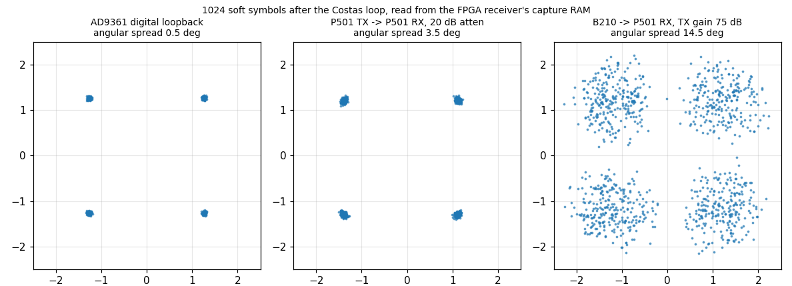
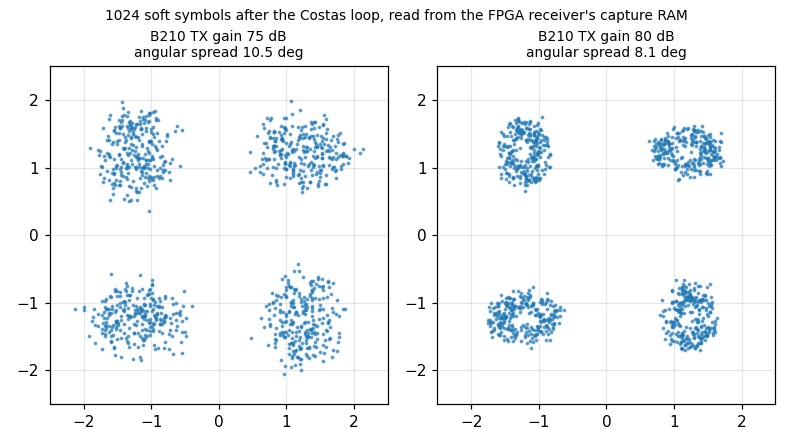

The extra 5 dB of B210 TX gain narrows the clusters from 10.5 to 8.1 degrees of angular spread (one capture each), in line with the expectation for a signal-to-noise gain of that size.

## F.2 What to try

* **Loop bandwidths:** `rx.set_loops(2*np.pi/d, 2*np.pi/d)` for d = 100, 200, 400, 800, 1600 while the link is up; watch `stats()` and the constellation. Wider = faster acquisition, more noise.
* **Acquisition:** cold start with 2 pi/1600 does not lock; give the receiver the offset with `init_freq_hz=9700` (register `W0`) and try again. How close must the guess be?
* **AGC:** change `REF` to 8192 (symbol magnitude 1.0) with the same loop bandwidths: the loops are four times slower (gain ~ amplitude squared).
* **Levels:** B210 TX gain 60, 65, 70, 75, 80 dB: how does the BER depend on the SNR? Compare with GNU Radio's receiver on a recording of the same level.
* **A preamble and CRC:** the PRBS checker needs no framing; a real link needs frame synchronisation: a correlator for a known word and a CRC (chapter 4e).

## F.3 Lessons from the hardware

1. **A floor in a loop integrator is a bias.** The rate integrator first read `rate += (TB*e) >> 21`. An arithmetic shift in two's complement rounds towards minus infinity: for a narrow loop (small `TB*e`) every update is 0 or -1,
   a drift of **-0.5 LSB per symbol** which the loop cannot balance. It ran the timing integrator into its limit (+-12,500 ppm) within 0.1 s for 2 pi/1600, and even with 2 pi/400 it shifted the reported clock offset to 16 ppm instead of 10.4.
   The bit-exact simulation matched the model perfectly - the model had the same bug. It was found by **sweeping the register-set bandwidths on the hardware**, and confirmed by running the NumPy integer model on a recording (rate 12,499 ppm with the floor, 10.4 ppm with rounding).
   The fix is one constant in the RTL and the model: `(TB*e + 2^20) >> 21`. *Bit-exact against a model proves agreement, not correctness: check the model against an independent measurement (here the two-tone result).*
2. **Pull-in is a different problem from tracking.** A Costas loop with a bandwidth of 0.4 % of the symbol rate (2 pi/1600) cannot pull in a 1 % offset; a wide loop can, but is noisy. Adjustable gains allow both: wide for 30 ms, then narrow.
3. **Gains scale with the square of the amplitude.** The AGC reference is part of the loop design.
4. **Count errors where the data are.** Bit errors counted inside the FPGA at 1.92 Mbit/s remove the question "is it the radio, or the DMA, or the software?".
5. **Start quiet, end quiet** - every script ends with the transmitter off and the TX attenuation at its maximum, even after an error.

## F.4 Troubleshooting

| symptom | likely cause |
|---|---|
| `TimeoutError: DDS update not taken over` | the AD9361 clock `l_clk` is not running: the bring-up did not run or failed (`ad.info["ok"]` is False) |
| `not the QPSK receiver (ID 0x...)` | the wrong overlay is loaded (the receiver is at `0x9C470000` in `p501_qpsk_trx` only) |
| `capture did not complete` | the receiver is not running (`rx.start()`), or `adc_valid` is not toggling |
| the receiver reads 0 Hz carrier and about 2 % errors | the Costas loop did not pull in the 9.7 kHz offset (cold start with narrow loops, or at the edge of the wide loop's range): press *Start receiver* again, or `rx.acquire()` |
| B210: `No devices found` | another program holds the B210 (a second test script, an old flowgraph), or the USB 3 port reset: run one test at a time |
| the BER estimate is about 0.17 and stays there (mismatches on every second bit) | not locked: the signal is too weak (look at `agc_gain`: above about 20 means weak), the offset is out of the loop's pull-in range, or the transmitter is not on |
| `carrier_offset_hz` = 0 and errors continue | the loops are too narrow for the offset (cold start with 2 pi/1600): acquire wide, or set `init_freq_hz` |
| `clock_offset_ppm` = +-12,500 | the timing integrator is at its limit (`MAXR`): the pre-fix RTL with a narrow loop, or no signal |
| `UU` on the host console | B210 underruns: the host cannot keep up; use a USB 3 port and the enlarged buffers |
| the B210 flowgraph's BER box shows 0.17 or 0.5 | 0.17: not locked (signal too weak or off, or the loops did not pull in); 0.5: the decoded stream is stuck (no valid signal) |
| `overruns` > 0 | the engine started more than 200 samples late: the engine clock is too slow or stalled |

## F.5 File index

| path | content |
|---|---|
| `rtl/qpsk_tx.v`, `rtl/qpsk_rrc_coef.v` | transmitter, generated coefficient ROM |
| `rtl/qpsk_rx.v`, `rtl/qpsk_rx_rom.v`, `rtl/qpsk_rx_trig.v` | receiver, generated ROMs |
| `rtl/dds_regs.v` | AXI-Lite register block with the commit hand-over (shared with the DDS) |
| `bd/qpsk_chain.tcl`, `bd/qpsk_rx_chain.tcl`, `tutorial/qpsk/p501_{tx,rx}/steps/*.tcl` | block-design integration |
| `src/dds_cdc.xdc`, `src/qpsk_rx_cdc.xdc` | clock-crossing constraints |
| `notebook/p501_radio.py`, `p501_dds.py`, `p501_qpsk.py`, `p501_qpsk_rx.py` | drivers |
| `tutorial/qpsk/p501_tx/`, `p501_rx/`, `p501_capture/`, `gnuradio/`, `link_up/` | per chapter: models, board and host scripts, simulation, README with the measured numbers |
| `tutorial/PLAN_QPSK.md` | the plan of the chapters 4.0 to 4e |
