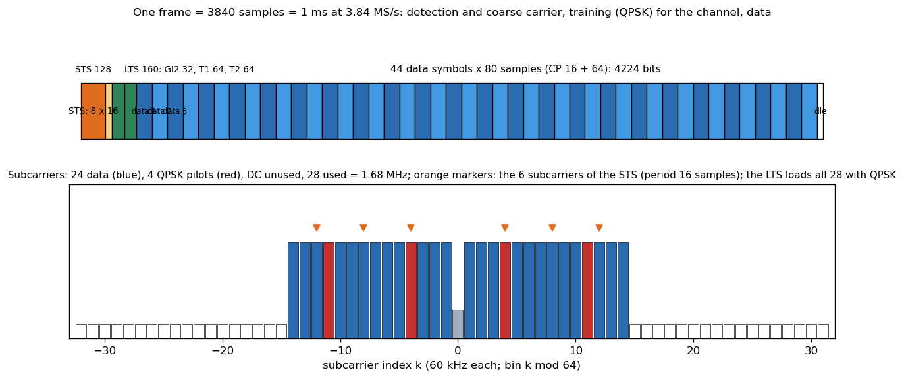
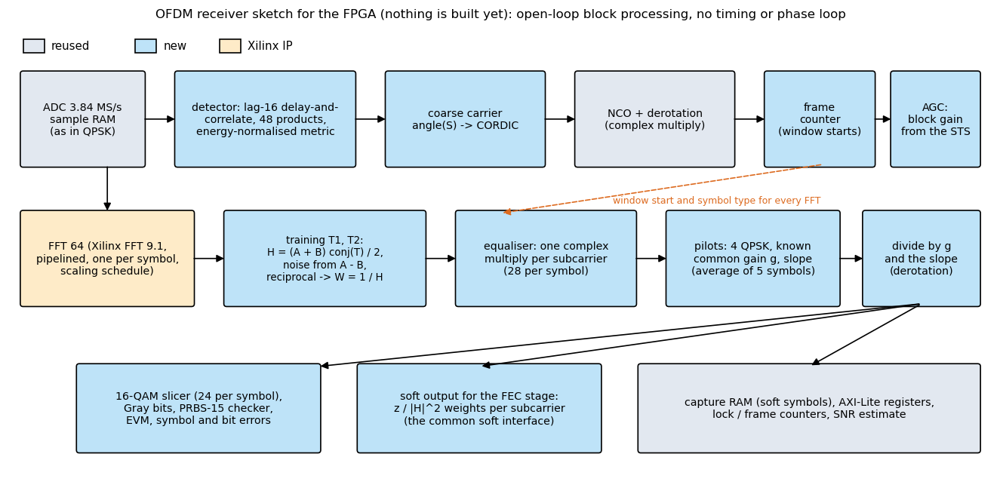
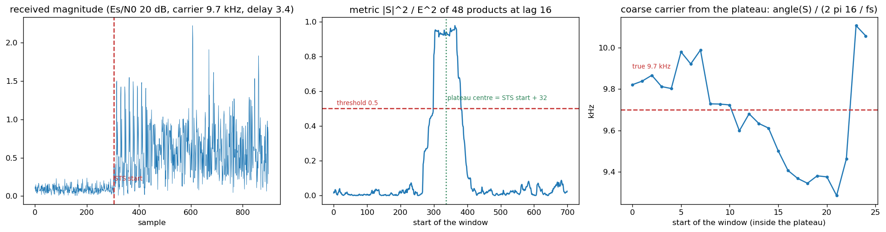
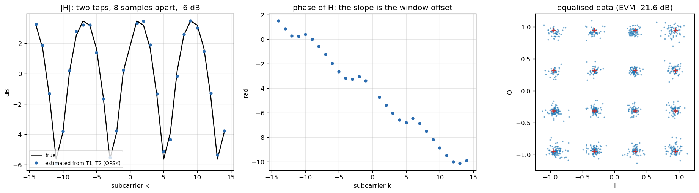
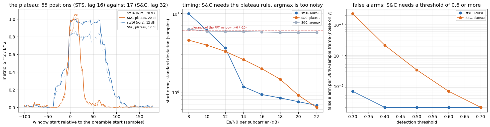
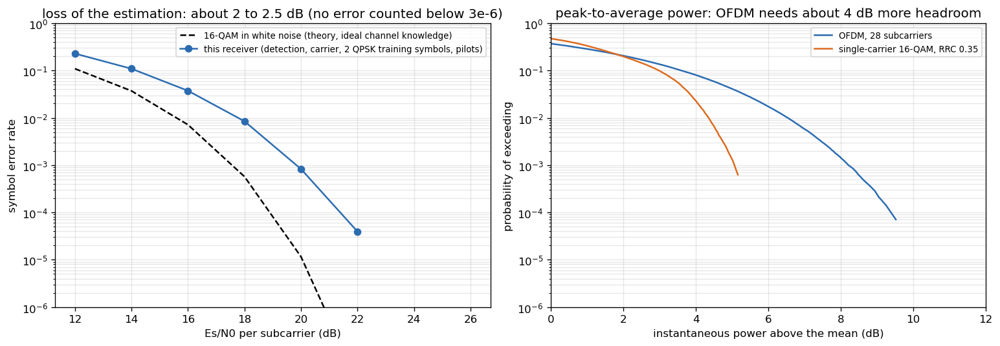
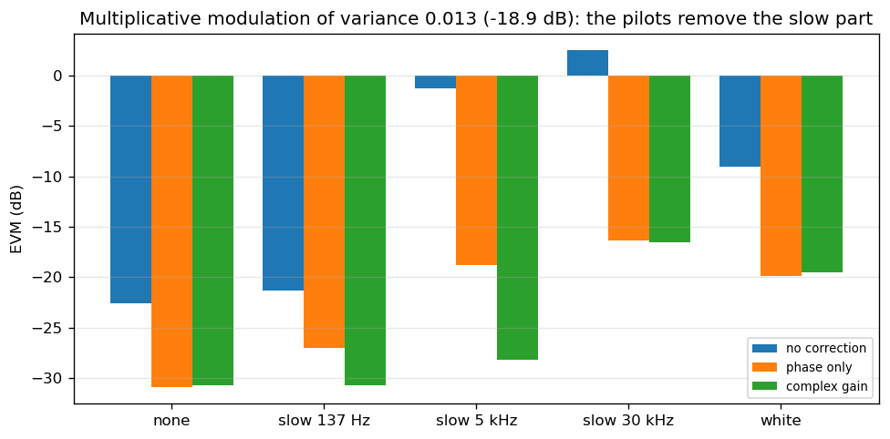

# Plan: a 16-QAM OFDM link on the P501, with QPSK training and pilot symbols

Stage 4 of the lab roadmap (README). **Decision (2026-10-24): both detectors will be implemented, as the QPSK lab has several synchronisation overlays; Schmidl and Cox comes first (section 12).** This document is the design, written before any RTL, with a float model that checks every choice: `ofdm_model.py` (transmitter, channel, receiver), `ofdm_study.py` (the studies, results in `results_ofdm.txt`), `make_figures_ofdm.py` (the figures). Nothing here has run on the board yet. Method as in the 16-QAM project: float model, then a bit-exact integer model, then RTL checked against it in simulation, then the overlay and the board (digital loopback first, then a cable, then the B210).

## 1. What was asked, and the answer in one table

*16-QAM OFDM with pilot symbols in QPSK for the channel estimation.*

| | |
|---|---|
| Sample rate | 3.84 MS/s (the AD9361 setting of every overlay of this repository) |
| FFT size N, subcarrier spacing | 64, 60 kHz |
| Cyclic prefix | 16 samples (4.17 us); symbol 80 samples = 20.83 us |
| Used subcarriers | 28: k = -14 .. -1 and +1 .. +14 (1.68 MHz); DC unused |
| Data | 24 subcarriers of 16-QAM (Gray, the same mapping as the single-carrier link) |
| Pilots in every data symbol | 4 QPSK subcarriers at k = -11, -4, +4, +11, polarity from a PRBS-7 (as in IEEE 802.11) |
| **Training (channel estimation)** | **2 OFDM symbols T1 and T2 with a known QPSK value on every one of the 28 used subcarriers**, preceded by a 32-sample guard (GI2) |
| Detection and coarse carrier | a short training field (STS) of 128 samples, period 16 (6 QPSK subcarriers, k = +-4, +-8, +-12) |
| Frame | STS 128, LTS 160 (GI2 32 + T1 64 + T2 64), 44 data symbols (3520), idle 32 = **3840 samples = 1 ms** |
| Payload | 44 x 24 x 4 = **4224 bits per frame** (4.2 Mb/s; the single-carrier link carries 3528 bits per 1.007 ms) |
| Receiver | no timing loop and no phase loop: detection, carrier from the STS and the LTS, one-tap equaliser per subcarrier from the LTS, per-symbol correction from the 4 pilots |

## 2. Why these numbers

* **N = 64 at 3.84 MS/s (60 kHz spacing).** The natural carrier offset between the P501 and the B210 (9.7 kHz, from the references) is 0.16 of a subcarrier: no integer-spacing ambiguity, so the receiver needs no search over subcarrier shifts. A 64-point FFT is tiny for the Xilinx core and for the clock budget (A below). The structure is that of IEEE 802.11a scaled to this sample rate, so students can compare with what they know.
* **28 used subcarriers (1.68 MHz), not 52.** The receiver's noise grows with the bandwidth that is used: 52 subcarriers (3.12 MHz) would cost 2.7 dB of signal-to-noise ratio at the same received power for a bit rate that the link cannot yet use. 28 subcarriers occupy about the same band as the single-carrier 16-QAM link (1.3 MHz), keep the signal inside the flat part of the AD9361's filters (+-0.84 MHz of +-1.9 MHz), and leave the DC bin to the receiver's own DC line (about 3 counts). `HALF` in `ofdm_model.py` changes it (HALF = 26 gives the 802.11 numerology).
* **Cyclic prefix 16 samples.** The lab channel (cable, a few metres of air) has an echo of far less than 1 us; 4.17 us leaves a large margin and absorbs the timing error of the detector. The overhead is 20 %. The FFT window starts `BACK` = 6 samples *inside* the prefix, so the window position can be wrong by up to +6 or -(10 - delay spread) samples without inter-symbol interference. The channel estimate absorbs the fixed offset as a phase slope across the subcarriers (figure below).
* **44 data symbols.** A frame of exactly 1 ms (3840 samples), which also lets a host transmit it as a repeated buffer exactly like `qam16_frame_tx.py`.

## 3. The signal

Unit average power per loaded subcarrier (the data, the pilots and the training all have mean |X|^2 = 1): `x = sqrt(N) IFFT(X)`, so a time sample has power 28/64 on average. A data symbol is `X[k] = d_k` (16-QAM, unit power) for the 24 data subcarriers, `X[k] = p_k s_l` for the pilots with `p_k` in {(+-1 +-j)/sqrt 2} and the polarity `s_l` = +-1 of symbol l, zero elsewhere; the cyclic prefix is the last 16 samples of the 64.

* **Training (the QPSK pilot symbol).** `T[k]` = a known QPSK value on all 28 used subcarriers, the same in T1 and T2. The sequence is the best of 4000 random QPSK sequences by the peak-to-average power ratio of the 64-sample symbol (3.6 dB, a random one has 6.5 dB on average); it is a constant of the design (`TRAIN` in the model, a ROM in the FPGA). With two identical symbols the receiver has *two independent noisy copies of the channel*: their average is the estimate (noise variance sigma^2/2) and their difference measures the noise (sigma^2 per bin, used for the SNR display and later for the soft values).
* **STS.** Subcarriers k = +-4, +-8, +-12 (QPSK) give a waveform that repeats every 16 samples; 8 repetitions (128 samples), power equal to a data symbol's.
* **Why QPSK for the training and the pilots (an honest note).** The estimation accuracy with QPSK training is the same as with BPSK (measured: the error of the channel estimate is 1.58e-2 against 1.57e-2 at 15 dB, theory sigma^2/2), because both have the same energy per subcarrier; and the best 64-sample symbols have about the same PAPR (best of 4000: QPSK 4.0 dB, BPSK 2.8 dB, the chosen QPSK sequence 3.6 dB). What QPSK adds: more sequences to choose from, constellation points of the same average power as the data (so the channel is probed at the level the data will have), pilots that are decoded with the same two-bit mapper as everything else, and a phase measurement that is unambiguous over the full circle.

## 4. The receiver, step by step

1. **Detection.** `S[n] = sum_{k<48} x[n+k+16] conj x[n+k]`, `E[n] = sum |x[n+k+16]|^2`, metric `M = |S|^2/E^2`. Inside the 128-sample STS the 48-product window fits for 65 start positions: a plateau of M near 1 (measured: 0.76 at 12 dB, 0.89 at 16 dB, 0.96 at 20 dB); outside it M is about 0.02 (noise only: 0.020) or low (the LTS and the data are not periodic with 16). Threshold 0.5; the plateau (the positions above 0.8 of its maximum) gives the STS start as its centre minus 32. One complex multiply per sample plus two running sums; no reference, no square root.
2. **Coarse carrier.** `f_c = angle(S) / (2 pi 16 / fs)`, unambiguous to +-120 kHz (the model finds frames with offsets up to +-110 kHz; at 130 kHz it fails as predicted). The samples are derotated by an NCO from the STS start on.
3. **Fine carrier and timing slack.** T1 and T2 are 64 samples apart: `f_f = angle(sum T2 conj T1) / (2 pi 64 / fs)`; after the coarse step it is only a small correction.
4. **Channel.** FFT of T1 and T2 (window `BACK` samples early): `H_k = (A_k + B_k)/2 * conj(T_k)`, `sigma^2 = mean |A - B|^2 / 2`. The equaliser weight is `1/H_k` (28 reciprocals once per frame).
5. **Per data symbol:** FFT; `Z = Y / H`; the 4 pilots give the common complex gain `g = mean(Z_p conj(p s))` (amplitude and phase of the whole symbol, which includes the residual carrier, the phase noise and any slow gain change) and, with a straight-line fit of the pilot phases against k, the **slope** (the sampling clock drift moves the window and tilts the phase); the data are divided by `g` and rotated by the slope; the 16-QAM slicer decides.
6. **Outputs for the later stages:** the equalised soft symbols, the per-subcarrier `|H_k|^2` and the noise variance (the LLR of a bit is proportional to `|H_k|^2/sigma^2` times the distance difference: the *common soft-output interface* of the roadmap), EVM and SNR estimates, frame counters.

### 4b. The detector against Schmidl and Cox (`ofdm_sync_compare.py`, `results_sync_compare.txt`)

Schmidl and Cox (1997) use **one** OFDM symbol whose two halves are identical (only the even subcarriers are loaded), the correlation `P(d)` of the two halves (lag N/2 = 32, 32 products), the same energy normalisation `M = |P|^2/R^2`, and a plateau of the length of the cyclic prefix. The detector of section 4 is the Wi-Fi form of the same idea (a training field repeating every 16 samples, 48 products). Both were simulated in the same frame, channel (carrier +-20 kHz, delay 0 to 12 samples, 10 ppm) and receiver, with 80 samples (S&C) or 128 samples (STS) of preamble; the model option is `sync="sc_plateau"` (their 90 %-of-maximum plateau rule) or `"sc_argmax"` (the largest M); the frame stays 3840 samples.

| | STS, lag 16 (this plan) | Schmidl and Cox, plateau rule | S&C, argmax |
|---|---|---|---|
| Preamble length | 128 samples | **80 samples** (48 less) | 80 |
| Plateau (positions with M near 1) | 65 | 17 (the cyclic prefix + 1) | - |
| Start error std at 14 / 18 / 22 dB | 1.4 / 0.8 / 0.65 samples | 2.6 / 1.5 / 0.66 | 5.8 / 5.6 / 5.5 |
| Frames outside the FFT-window tolerance (-10, +6) at 14 / 18 dB | 1.0 % / 0 | 3.6 % / 0.2 % | 26 % / 25 % |
| EVM and SER at 22 dB (the receiver after it is the same) | -19.6 dB, 4e-5 | -19.6 dB, 4e-5 | -17.8 dB, 3e-2 |
| False alarms on noise only (3000 frames), threshold 0.4 / 0.5 / 0.6 | 0 / 0 / 0 | 85 / 14 / 1 | 81 / 8 / 0 |
| Carrier offset range (coarse estimate) | **+-120 kHz** (found and decoded to +115 kHz) | +-60 kHz = one subcarrier spacing (fails at +65 kHz and beyond: the estimate wraps) | same |
| Detection at 14 dB and above | 100 % | 100 % | 100 % |
| Timing bias with an echo of 0.5 / 0.7 at 8 samples | +1.8 / +3.5 samples | +2.6 / +3.0 | +3.5 / +3.8 |
| First threshold crossing seen after | 59 samples | 58 samples | 58 |

What it says:

* **Schmidl and Cox works for this link and is as good as the STS at 22 dB and above** (identical EVM and SER), **if the plateau rule is used**: taking the largest M gives a start error of +-5.6 samples, a quarter of the frames fall outside the window tolerance and the link is lost (3e-2 SER). This is the "plateau problem" of the original paper: with a cyclic prefix the metric is flat over the prefix, and the position of the maximum is random inside it.
* **Its advantage is the short preamble**: 48 samples fewer (1.3 % of the frame, 0.6 symbols), and one preamble symbol that is itself an OFDM symbol, which is neat to teach.
* **The STS is more robust**: the longer plateau and the 48-product window give a smaller timing spread at 14 to 20 dB (0.8 to 1.4 against 1.5 to 2.6 samples; both far inside the 16-sample prefix), **no false alarm even at threshold 0.4** (S&C needs 0.6 to 0.7: 32 products give a noisier metric), and **twice the carrier range**. None of these matters for the natural offset of 9.7 kHz; the range matters if a transmitter is not locked to a good reference.
* **The plan keeps the STS** for the first implementation and makes S&C the first alternative (`HALF`-style switch: `sync`/`preamble` in the model; a register selecting the lag, 16 or 32, and the window, 48 or 32, in the RTL costs nothing: the same detector with a different delay). Teach both: the lab compares them on the same recordings.
* Both estimate the start about 0.3 samples late on average; the window offset `BACK` = 6 absorbs it.

## 5. What the float model says (`results_ofdm.txt`)

| Study | Result |
|---|---|
| **Estimation loss** | the receiver needs about **2 to 2.5 dB more** Es/N0 than ideal 16-QAM: SER 1.6e-3 at 20 dB (theory 1.2e-5), 8.5e-5 at 22 dB, SER 1e-3 at about 19.8 dB. Part is the two-symbol channel estimate (1.76 dB), the rest the 4-pilot gain estimate. Averaging the pilot gain over 3 to 5 symbols recovers 0.4 to 0.5 dB; four training symbols would recover 0.8 dB more. |
| Detection | 100 % at 12 dB and above, 0 false alarms in 3000 noise-only frames; STS start error 0.4 +- 0.9 samples at 16 dB (+-2.7 at 12 dB); carrier error 314 Hz at 16 dB, 125 Hz at 24 dB. The 16-QAM link works above 18 dB anyway. |
| Carrier offset | no change in EVM from 0 to +110 kHz (the natural 9.7 kHz is far inside). No FLL is needed, unlike the single-carrier link. |
| Multipath | a second tap of -6 dB up to 10 samples after the first (2.6 us) costs 1.5 dB (the faded subcarriers), up to 12 samples 2.5 dB; 16 samples (beyond the window) breaks the link (-13.7 dB). The prefix works as designed: `CP - BACK = 10` samples of tolerance. |
| Sample-clock offset | up to +-30 ppm is harmless only with the **slope** correction (EVM -30.2 dB with it, -25 dB without); at 100 ppm: -25.9 dB against -15.3 dB; the B210-P501 offset seen so far is -42 to +26 ppm. The slope tracking is part of the design. |
| **Peak-to-average power** | the power exceeded with probability 1e-4 is **9.4 dB above the mean for OFDM against 5.6 dB for the single-carrier 16-QAM**: about **3.8 dB more headroom**. |
| Training sequence | the chosen QPSK sequence has a PAPR of 3.6 dB (random: 6.5 dB). |
| **Multiplicative modulation** (variance 0.013 = -18.9 dB, the "bad state" of the 16-QAM link report) | a slow modulation (137 Hz) and even a 5 kHz one is **removed by the per-symbol pilot gain** (EVM -30.7 dB and -28.2 dB, thermal limit -31 dB); one faster than the symbol rate (30 kHz) or white is not (-16.5 and -19.5 dB): it behaves as noise. |

The last row matters for the project: in the single-carrier link the PLL cannot correct an amplitude modulation, and we measured an unexplained multiplicative error whose slow part (21-symbol blocks) is only about 6 % of its variance. **The OFDM link will tell us whether the rest is white (then OFDM does not help: the figure shows -19.5 dB) or slow in a way we could not see.** It is a measurement, not a promise.

## 6. Link budget (estimates; the thermal floor is the one measured at RX gain 76: 50 counts^2 per MHz)

* Noise in the 1.68 MHz of the used subcarriers: 9.2 counts rms. SER 1e-3 needs Es/N0 of about 19.8 dB per subcarrier, so a received **signal of about 90 counts rms**. The single-carrier 16-QAM link needs 61 counts (17.6 dB in 1.3 MHz): **OFDM costs 3.4 dB more received level** (1.1 dB from the wider band, 2.2 dB from the estimation loss).
* The transmitter has to stay linear: with the same peak amplitude (the B210's compression limit) the OFDM RMS is **3.8 dB lower** than the single-carrier RMS (0.32 against 0.5 at digital amplitude peaks of 0.9), so the B210 at 76 dB gain gives about 71 counts at the distance where the single-carrier link gives 110. That is 2 dB short of the 90 counts; antennas closer, 78 dB gain, or the P501's transmitter (PA, 15 to 20 dB more) make it.
* **Consequence for the lab:** OFDM needs more link than the single-carrier link at the same data rate. It runs in the digital loopback and over a cable with an attenuator without any problem; the B210 over the air works in a good state at short range. Use EVM and level together, as for 16-QAM.

## 7. FPGA architecture (an estimate, to be refined by the integer model)

Clock budget: 100 MHz / 3.84 MS/s = 26 clocks per sample, **2083 clocks per OFDM symbol**. All the per-symbol work is small compared with that, so everything can share a few multipliers.

| Block | Work | Cost (estimate, +-50 %) |
|---|---|---|
| sample RAM, ADC interface | as in the QPSK receiver | reused |
| detector | one complex product per sample (lag 16), running sums over 48, energy, threshold | 4 DSP, 300 LUT |
| coarse and fine carrier | CORDIC angle (the one of `qam_zc_sync.v`), NCO and derotation | 4 DSP, 600 LUT |
| FFT 64 | Xilinx FFT 9.1, burst I/O is enough (a few hundred clocks per symbol), runtime scaling schedule | 3 to 12 DSP, 1.5 k LUT, 2 BRAM |
| training, channel, weights | accumulate T1 and T2 spectra (28 x 2 x 32 bit), reciprocal by LUT and a normalising shift or a 20-clock serial divider | 1 BRAM, 500 LUT, 1 DSP |
| equaliser and pilot gain | 28 complex products per symbol on one shared multiplier; the pilot sums; the slope fit (4 points: closed form) | 4 DSP, 600 LUT |
| slicer, checker, EVM, capture | as in the 16-QAM receiver (the PRBS-15 per frame) | 800 LUT |
| AXI registers | as in the other overlays | 600 LUT |
| **Total** | | **about 20 to 30 DSP, 6 to 8 k LUT, 4 BRAM**: smaller than the 16-QAM receiver (49 DSP, 5.8 k LUT) |

Points the integer model must settle: the FFT scaling (a 64-point FFT grows noise-like data by 18 dB and a tone by 36 dB; the ADC data are 12 bits, 8 to 10 bits of signal after the AGC), the word length of `1/H` for deep fades, the block AGC (one gain per frame from the STS energy, with 11 dB of headroom for the peaks: at 250 counts rms the peaks reach 850 of 2047), the pilot-gain division, and the frame counter that tells the FFT stage which symbol it is.

**Transmitter.** First step: the host generates the frame (`ofdm_model.tx_frame`) and the B210 transmits it as a repeated buffer, as `qam16_frame_tx.py` does. Second: an FPGA transmitter (`qpsk_tx_fr.v`'s role): a preamble ROM, the PRBS-15 mapper into a symbol buffer, the Xilinx FFT in inverse mode, the cyclic prefix from a 16-sample buffer. A digital loopback test with the P501 transmitter and receiver closes the loop on the board with no B210.

## 8. Steps, in the order of the 16-QAM project

1. **Done here:** the float model and the studies (`ofdm_model.py`, `ofdm_study.py`).
2. Integer (bit-exact) model: FFT with the same scaling as the Xilinx core, fixed-point detector and weights; the 4-sps-style test signals from the float model's channel (carrier, delay, ppm, noise, 12-bit quantisation).
3. RTL (`ofdm_rx.v`, with the FFT core as a block-design IP) checked against the integer model in xsim.
4. Transmitter: host frames over the B210 first; FPGA transmitter second.
5. Overlay `p501_ofdm_trx` (`OFDMRX=1` in `create_project.tcl`), driver, live notebook (constellation per subcarrier, |H| and phase, EVM per subcarrier, pilot gain against time).
6. Board: digital loopback, then the cable with an attenuator, then the B210; ADC captures analysed with the same model.

## 9. The lab (what a student does)

1. In Python: build one OFDM symbol (IFFT, cyclic prefix), take it through a two-tap channel, FFT it back: why one tap per subcarrier is enough (`ofdm_model.py`, section 5 of the study).
2. Estimate the channel from the QPSK training symbols; plot |H| and the phase; change the delay and see the slope.
3. Detection: plot M(n); change the threshold; false alarms against detection.
4. Carrier offset: see what happens to the constellation with and without the correction (ICI); find the limit.
5. Pilots: switch the per-symbol correction off, on, averaged; add the slow modulation and the sample-clock offset.
6. Link budget: measure the PAPR, compute the backoff, compare with the single-carrier link of tutorial 5.
7. On the board: digital loopback, cable, B210; read the level and the EVM together.
8. Then forward error correction on the soft values of the equaliser (the common interface).

## 10. Open points and risks

* **The signal-proportional error of the B210 link** (see the 16-QAM link report): if its fast part is white, OFDM will show -19.5 dB EVM like the single-carrier link does, not -30 dB (section 5).
* **The AD9361's filters at +-0.84 MHz** are not measured; the channel estimate absorbs a smooth ripple, a sharp edge would show in |H|. The ADC captures already taken (flat floor to +-1.7 MHz) suggest no problem.
* **Block AGC.** The existing AGC of the single-carrier receivers is a symbol-rate loop; OFDM needs one gain per frame.
* **The DC line** of the receiver falls on the unused DC bin; at +-60 kHz spacing a carrier offset of 9.7 kHz moves it to bin 0.16, near the first subcarrier: the first subcarriers k = +-1 will show it (about 3 counts against 90): check in the first captures.
* **Integer ambiguity** does not occur (offset 0.16 of the spacing), but a transmitter with a larger offset (an untuned B210) up to +-110 kHz is handled by the detector alone; beyond +-120 kHz the STS metric aliases.
* The frame is 1 ms like the single-carrier one so the same B210 transmit buffer approach works; a longer frame needs the sample-clock slope tracking over more symbols (it is in the design).

## 11. Files

| File | Content |
|---|---|
| `ofdm_model.py` | transmitter, channel, receiver (float); run it for a self test |
| `ofdm_study.py` | the studies E1 to E8, writes `results_ofdm.txt` |
| `ofdm_sync_compare.py` | the detector of this plan against Schmidl and Cox (section 4b), writes `results_sync_compare.txt` |
| `make_figures_ofdm.py` | the figures in `tutorial/img/ofdm_fig_*.png` |

## 12. Implementation: Schmidl and Cox first (decided 2026-10-24)

**Frame of the first overlay (uniform variant, `preamble="scu"` in the model):** S&C symbol (even subcarriers, 80 samples), T1 and T2 (the QPSK training symbol twice, each with its own 16-sample prefix), 44 data symbols, one idle slot of 80 samples: 47 symbols of 80 samples + 80 = 3840 samples = 1 ms. Every symbol goes through the same IFFT and cyclic-prefix path in the transmitter. Compared with the 128-sample STS frame the uniform frame costs nothing in accuracy (EVM -19.6 dB at 22 dB for all three frames; the carrier estimate is better, 111 Hz against 143 Hz, because the fine estimate uses lag 80).

**Overlays, like the QPSK lab:** the receiver options of `create_project.tcl` get two new names that cannot be combined (they share the address 0x9C470000): `OFDMRXSC=1` -> `p501_ofdm_trx_sc` (this step) and later `OFDMRXSTS=1` -> `p501_ofdm_trx_sts` (the 128-sample STS detector, lag 16, 48 products: the same blocks with another delay, window and preamble). Common to both: the FFT, the channel estimate, the equaliser, the pilot tracker, the checker and the registers.

**The integer model is done** (`ofdm_fixed.py`, the specification of the RTL; `test_ofdm_fixed.py`, `results_ofdm_fixed.txt`): every stage is integer arithmetic. Against the float receiver on the same frames (120 per point, carrier +-20 kHz, delay 0 to 12, 10 ppm, the frames quantised to 12 bits):

| Es/N0 | float EVM / SER | integer EVM / SER |
|---|---|---|
| 16 dB | -13.5 dB / 4.8e-2 | -13.5 dB / 6.8e-2 |
| 20 dB | -17.6 dB / 2.6e-3 | -17.3 dB / 5.6e-3 |
| 24 dB | -21.6 dB / 7.9e-6 | -21.4 dB / 0 |
| 28 dB | -25.4 dB / 0 | -25.4 dB / 0 |

The loss of the integer chain is 0.1 to 0.3 dB. The ADC level from 40 to 900 counts rms makes no difference (the block gain `G` from the energy of the S&C symbol brings every frame to 400 counts rms: G = 2612 at 40 counts, 114 at 900, Q8). Noise only, 2000 frames: the detector alone triggers twice at threshold 0.65, **the check that T1 and T2 repeat removes both: 0 false alarms**. The start of the preamble is estimated 0.8 to 1.3 samples late with a spread of 0.3 to 2.5 samples; the carrier to 62 Hz at 28 dB.

**Numeric choices** (all in the model, all asserted there): 12-bit input; gain in Q8, samples 15 bits after the gain and the rotation (cos / sin table of 1024 entries, Q15, phase 32 bit); detector sums in 29 bits, compared after a shift of 8 bits (`256 S'^2 >= THR E'^2`, THR = 166 = 0.65), 16-bit fraction of `M` for the plateau (31 of 32 ... 29/32 of the maximum); CORDIC of the ZC receiver (turns x 2^20); FFT 64 radix-2, **no scaling, 20-bit data path** (the model asserts that it never overflows over the tests), twiddles Q15 with rounding; training: sign operations and 181/256 for 1/sqrt 2; weights `W = conj(H) R 2^14 / |H|^2` by an integer division (28 per frame); equalised values in the 16-QAM units of the single-carrier receiver (unit RMS R = 12953, levels +-4096 and +-12288, thresholds 0 and +-8192, so the slicer and the checker are the ones already built); pilot gain and slope from the four QPSK pilots, averaged over 5 symbols (a window of 2 symbols of latency).

**Open decisions for the RTL:**
1. **The FFT.** The model has its own radix-2 FFT with rounding after each butterfly multiply. Writing this FFT in Verilog (one butterfly, a few hundred clocks per symbol out of 2083) keeps the RTL bit-exact against the model, shows students the butterfly, and needs about 4 DSP; the Xilinx FFT 9.1 (used in the FFT overlay) would need a model of its rounding. Recommendation: **own FFT for the first overlay**; the IP stays as the alternative.
2. **Gain.** The model computes `G` from the energy at the plateau (an integer square root and a divide: a serial unit, about 60 clocks); the alternative is a gain register written by the processor.
3. **Transmitter.** The host (the B210, as `qam16_frame_tx.py`) first; the FPGA transmitter (IFFT = the same FFT with conjugated input, prefix buffer, symbol ROM) second.

**RTL steps:** (1) `ofdm_sync.v`: detector, plateau, CORDIC, gain, NCO; xsim against the model on the same frames. (2) `ofdm_fft.v`. (3) channel estimate, weights (serial divider), equaliser. (4) pilot gain and slope, per-subcarrier correction, slicer, checker, EVM. (5) AXI registers and capture RAM (soft symbols and `|H|`). (6) overlay `OFDMRXSC=1`, driver, notebook. (7) transmitter. (8) board: digital loopback, cable, B210. Each step is checked against `ofdm_fixed.py`.

**RTL step 1 done (2026-10-24): `rtl/ofdm_detect.v`, `rtl/ofdm_cordic.v`, `rtl/ofdm_derot.v`, bit-exact against `ofdm_fixed.py`** (`sim/run_sync.sh`, vectors `sim/gen_sync_vectors.py`, testbenches `tb_ofdm_sync.v`, `tb_ofdm_derot.v`):

* **Detector, plateau, coarse carrier, gain** (`ofdm_detect.v` with the CORDIC): five frames (Es/N0 16 to 28 dB, carrier -15 kHz to +31 kHz, delay 0.2 to 11 samples, ADC level 60 to 1200 counts rms) and a noise-only record: **every window agrees (373 to 380 windows per frame: the running sums S and E and the decision), and the results agree to the last bit**: n0, first and last of the plateau, the position of the maximum, s0, the coarse carrier word w_c, the gain G, the energy at the maximum, the sums of S, the peak. The noise-only record gives no detection in both (1437 windows compared). **No late sample at 26 clocks per sample** (9 clocks per window, 25 when collecting).
* **Derotator** (`ofdm_derot.v`, gain, 32-bit phase, the 1024-entry table of the QPSK receiver, rounding): 4000 random vectors (all signs, gains from 0 to 65535 including the clip, carriers over the whole range), 0 mismatches. Latency 7 clocks, one sample per clock.
* Changes of the model made for the RTL: the 10-bit fraction of the metric (two 20-bit operands, 11 division steps), 30-bit sums; the performance of the receiver is unchanged (`results_ofdm_fixed.txt`).
* Next: step 2, the FFT (`ofdm_fft.v`: one radix-2 butterfly, about 900 clocks per 64 points, rounding as in `fft64`), then the channel estimate (step 3).

**RTL step 2 done (2026-10-24): `rtl/ofdm_fft.v`, bit-exact against `fft64` of `ofdm_fixed.py`** (`sim/run_fft.sh`, `gen_fft_vectors.py`, `tb_ofdm_fft.v`): a 64-point radix-2 FFT with one butterfly (4 multipliers of 20 x 16 bits, 4 clocks per butterfly), in place in a 64 x 2 x 20-bit RAM, no scaling, rounding of the twiddle product (Q15) at every butterfly, an overflow flag. **194 transforms (random inputs of five amplitudes, constants, a tone, and 40 real derotated OFDM windows), 12,416 bins, 0 mismatches, the overflow flag never set.** The transform takes 768 clocks after the 64th sample (192 butterflies x 4), so with the samples arriving at 26 clocks each (2408 clocks from the first sample, with the input dominating) it needs 37 % of the 2083 clocks of an OFDM symbol once the input is in; the same result with the samples 1 or 26 clocks apart. Next: step 3, the channel estimate: the sums of the two training spectra, the sign operations with the QPSK sequence, the noise, and the weights `W = conj(H) R 2^14 / |H|^2` with a serial divider.

**RTL step 3 done (2026-10-24): `rtl/ofdm_chan.v`, bit-exact against the channel block of `receive_fixed`** (`sim/run_chan.sh`, `gen_chan_vectors.py`, `tb_ofdm_chan.v`, with `ofdm_fft.v` in front): copy of the 28 used bins of T1, then T2: the sums and differences, the sign operations with the QPSK training sequence (a 2-bit ROM per subcarrier), `H = ((u 181 + 128) >> 8 + 1) >> 1`, the noise sum of `|A - B|^2`, the weights `W = conj(H) R 2^14 / |H|^2` by a restoring divider (50 clocks per quotient, rounding half away from zero, W = 0 where H = 0). **74 cases, 2146 values, 0 mismatches:** realistic frames (Es/N0 12 to 34 dB, ADC level 50 to 900 counts, the line of sight and three echoes of -6 to -0.1 dB that put deep fades into the spectrum), an all-zero input (H = 0, W = 0) and a record of +-1 counts (|H| as small as 1: **the weight reaches 212,221,952 = 2^27.7**, the limit, which fits the 32-bit weight word). The sum takes **3108 clocks** after the second transform (28 x 6 for H, 28 x 105 for W): 1.5 OFDM symbols, once per frame; the data symbols wait in the sample RAM. Next: step 4, the data symbols: the per-bin equaliser, the pilot gain and the slope (CORDIC), the averaging over 5 symbols, the per-subcarrier correction, the slicer and the checker.

**RTL step 4 done (2026-10-24): `rtl/ofdm_data.v` and `rtl/ofdm_div.v`, bit-exact against the data-symbol part of `receive_fixed`** (`sim/run_data.sh`, `gen_data_vectors.py`, `tb_ofdm_data.v`, with `ofdm_fft.v` in front and the weights loaded as the channel module delivers them): per data symbol the equaliser `Z = (Y W + 2^13) >> 14` for the 28 bins, the four QPSK pilots (the references from the PRBS-7 polarity ROM), the pilot gain, the slope from `d4 d11` through the shared CORDIC, then for the symbol two places before the newest: the averages over 5 symbols (3 and 4 at the ends of the frame), the reciprocal `conj(gs) K / |gs|^2` through the divider, the per-subcarrier rotation from the 1024-entry table, the 24 corrected data values, the slicer, the PRBS-15 checker and the EVM sums (the last two symbols are finished by the 44th `sym_go`). **10 frames (Es/N0 12 to 34 dB, ADC level 60 to 900 counts, echoes of -10 to -2 dB, sample-clock offsets from -40 to +60 ppm, carrier +-20 kHz): all 10,560 corrected symbols and the 5 counters of each frame (symbols, symbol errors, bit errors, the two EVM sums) agree with the model, 0 mismatches, no overflow flag.** Cost: **175 clocks** for phase 1 of a symbol, **333** for phase 2, so with the FFT (64 + 768) **about 1340 clocks per symbol of the 2083 available**; the three sequential steps fit in one symbol time. Two bugs found by the comparison and fixed: an uninitialised flag of the two-quotient sequence (it left both reciprocals equal), and the first quotient overwritten by the second. Word lengths fixed by the model's assertions: Z 24 bits, correction 20 bits, weights 32 bits. Next: step 5, the register block (AXI-Lite), the sample RAM and its controller (the window addresses, the symbol sequence of a frame, the training windows, the gain and the NCO values), the capture RAM, the counters of the detector; then the overlay (step 6).

**RTL step 5 done (2026-10-24): `rtl/ofdm_rx.v`, the whole receiver, bit-exact against `receive_fixed` from ADC samples** (`sim/run_rx.sh`, `gen_frame_vectors.py`, `tb_ofdm_rx.v`, `compare_rx.py`): the top level with two 1024-sample RAMs written in the ADC clock domain (Gray-coded write pointer into the engine clock, as in the 16-QAM receiver), a stream reader that feeds the detector at its pace, the window reader (one read per clock, T1 and T2 interleaved for the fine carrier) with the derotator, the controller (found -> wait for T2 -> fine carrier and the training check -> T1 and T2 through the FFT into the channel module -> a copy of H -> 44 data symbols, each FFT then `ofdm_data`), the detector re-armed as soon as the last window has been read (so the next frame is found while the last symbols are still finished), the AXI-Lite registers (frames, found, rejected, bad frames, totals, the counters and EVM sums of the last frame, s0, w_c, w_f, gain, noise, samples written, late flags), the capture RAM (the first 1024 corrected symbols, saturated to 16 bits, as in the 16-QAM receiver) and a 28-word copy of H. **Four frames of different quality (Es/N0 16 to 30 dB, ADC level 60 to 800 counts, carrier -15 to +31 kHz, echoes, +-40 ppm), each followed by a second frame in the same record (continuous mode), driven by the ADC samples at the real rate of one per 26 clocks and read back over AXI: both frames of every record agree with the model in every register (s0, w_c, w_f, gain, noise, symbol count, symbol and bit errors, the two EVM sums) and in all 1056 corrected symbols (16,896 values over the eight frames), H and the capture RAM read over AXI are equal, nothing late, nothing rejected, nothing missed.** Two bugs found by the comparison: the accumulators of the fine carrier were cleared one clock after the controller looked at their counter (the second frame skipped the fine pass), and a loop variable of the testbench shared between the sample feeder and the logger. A noise-only record gives no frame. Next: step 6, the Vivado integration: `OFDMRXSC=1` in `create_project.tcl`, `bd/ofdm_rx_chain.tcl`, the clock-crossing constraints, the FPGA transmitter or the host transmitter, the driver `notebook/p501_ofdm_rx.py` and the live notebook.

