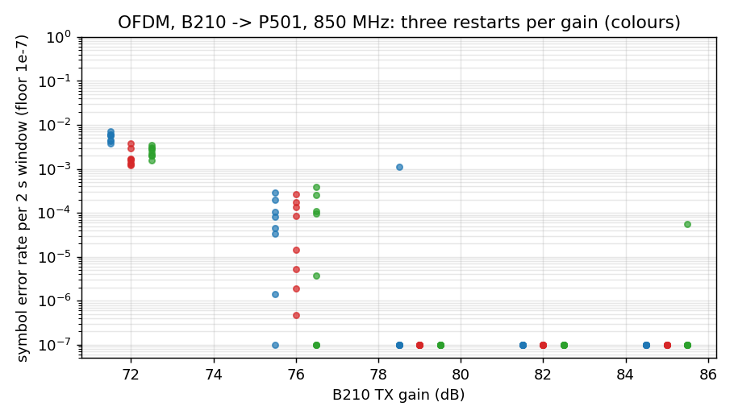
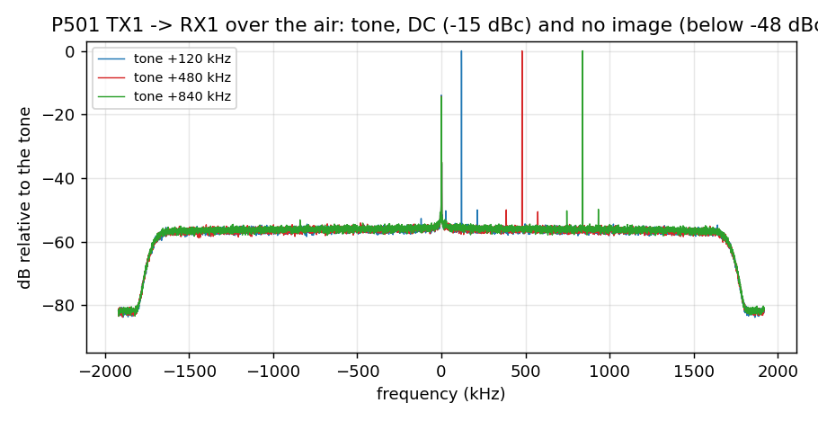
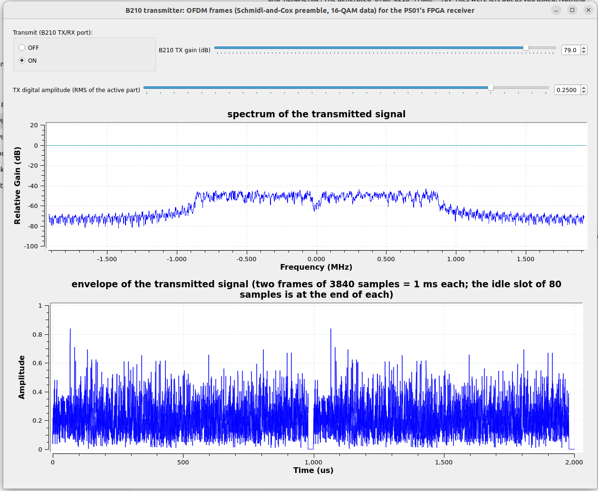
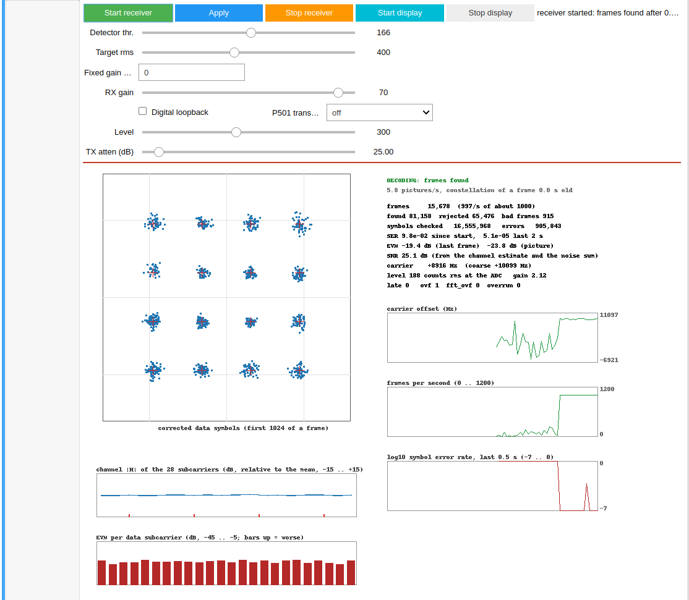

# OFDM on the P501: status report (2026-10-25)

16-QAM OFDM with QPSK training and pilots, Schmidl-and-Cox synchronisation, in the P501 FPGA (overlay `p501_ofdm_rx_sc`), tested against its own DAC, against a USRP B210 and in GNU Radio.
Design and every step: `PLAN_OFDM.md`; raw results: `results_board_loopback.txt`, `results_board_air.txt`, `results_gain_sweep.txt`, `results_iq_image.txt`; GNU Radio: `GRC_OFDM.md`.

## 1. What exists

| part | file | state |
|---|---|---|
| frame and receiver design, float model | `PLAN_OFDM.md`, `ofdm_model.py`, `ofdm_study.py`, `ofdm_sync_compare.py` | done (S&C and the 128-sample STS compared: equal at 22 dB and more, S&C 48 samples shorter) |
| integer model (the specification of the RTL) | `ofdm_fixed.py`, `test_ofdm_fixed.py` | done; within 0.1 to 0.3 dB of the float model |
| RTL: detector, derotator, FFT, channel estimate, data symbols, top level | `rtl/ofdm_detect.v`, `ofdm_derot.v`, `ofdm_fft.v`, `ofdm_chan.v`, `ofdm_data.v`, `ofdm_rx.v` | done, every block bit-exact against the integer model in xsim (`sim/run_*.sh`) |
| overlay | `create_project.tcl ... FFT=0 OFDMRXSC=1` | built twice (before and after the detector guard): 31,426 LUT (26.8 %), 27,599 FF, 9 BRAM, 176 DSP, setup +0.417 ns, hold +0.011 ns, one pulse-width endpoint -0.002 ns as in the base design |
| board driver and live notebook | `notebook/p501_ofdm_rx.py`, `notebook/P501_OFDM_Live.ipynb` | done; 22 self-test checks pass headless on the board |
| B210 transmitter | `ofdm_frame_tx.py`, `ofdm_b210_frame_tx.grc` | done |
| B210 receiver in GNU Radio, block by block | `ofdm_b210_frame_rx.grc`, `GRC_OFDM.md` | done; works on the B210 (checked by you) |
| B210 receiver from the stock gr-digital OFDM blocks | `ofdm_b210_frame_rx_stock.grc`, `GRC_OFDM.md` | done; works on the B210 after three changes (section 2c); you ran it in the GUI |
| B210 transmitter from the stock gr-digital OFDM blocks | `ofdm_b210_frame_tx_stock.grc`, `GRC_OFDM.md` | done; its output equals the model frame (3e-7); decoded by the P501 on the air (section 2c) |
| 128-sample STS overlay (second synchroniser) | the same `rtl/ofdm_detect.v`, `ofdm_rx.v` with the parameter `STS = 1`, `create_project.tcl ... OFDMRXSTS=1`, `ofdm_fixed.py` variant `STS`, `results_ofdm_fixed_sts.txt` | done, bit-exact in xsim, on the board in the loopback and over the air (section 2d); GNU Radio flowgraphs and a notebook for it written; run by you on the B210 and the P501: they work (readings not recorded) |
| not done | FPGA OFDM transmitter, the common soft-output interface, FEC | open |

Throughput: 3840 samples = 1 ms per frame, 44 data symbols x 24 subcarriers x 4 bits = 4224 bits per frame, 4.2 Mb/s; the receiver decodes every frame (2003 per 2 s, nothing late).

## 2. Results

**Digital loopback** (inside the AD9361, nothing radiated; `results_board_loopback.txt`): 2003 frames in 2 s, all found, none rejected, **0 symbol errors in 2,115,168 symbols** at ADC levels of 65, 194 and 389 counts; EVM -38.4, -46.2 and -45.6 dB.

**P501 to P501 over the air** (TX1 to RX1, antennas a few centimetres apart, `results_board_air.txt`): at 20 dB TX attenuation (SNR 23 dB) the symbol error rate is 4.5e-4 to 4.9e-4, EVM -18 to -19 dB; the errors follow the AWGN model above 19 dB SNR (22 dB: 4.9e-3, 24 dB: 2.2e-2, 26 dB: 7.3e-2, 28 dB: 0.17, 30 dB: 0.31 with the level at 24 counts; 40 dB attenuation: no lock).

**B210 to P501 at 850 MHz, gain sweep** (new; `results_gain_sweep.txt`, figure below): 5 gains x 3 restarts of the B210 transmitter x 8 windows of 2 s (2.1 M symbols each), RX gain index 70, rms 0.25, idle slot empty.

| B210 gain | level at the ADC | SNR | EVM | symbol error rate (median of 24 windows) | windows below 1e-4 |
|---|---|---|---|---|---|
| 72 dB | 70 counts | 21 to 23 dB | -18 to -19 dB | 3.0e-3 | 0 % |
| 76 dB | 110 | 24 to 25 dB | -22 dB | 6e-5 | 62 % |
| 79 dB | 160 | 26 dB | -23.5 dB | 0 | 96 % |
| 82 dB | 225 | 27.5 dB | -25 dB | 0 | 100 % |
| 85 dB | 310 | 28 to 29 dB | -24 to -25 dB | 0 (7e-6 in one window) | 100 % |

**The link is limited by the SNR and nothing else.** The level at the ADC rises by 3 dB for every 3 dB of B210 gain (70, 112, 160, 225, 315 counts), so the B210 does not compress up to 85 dB at rms 0.25 (peaks 0.85 of full scale); at 82 and 85 dB 47 of 48 windows (2.1 M symbols each) have no symbol error (the 48th: 7e-6), at 79 dB 23 of 24 (the 24th: 1e-3).
Three cold starts at 85 dB with the receiver started together with the transmitter (14 windows each) also gave 0 errors in 38 of 42 windows (the other four: 1e-2 with 8 bad frames, 1e-4, 9e-7 and 5e-7).

**Corrections to what I said earlier** (the earlier B210 runs were noisier than these, and I attributed it to the wrong causes):
* *"The B210 compresses above about 78 dB"* (carried over from the single-carrier 16-QAM link at rms 0.5) does not hold for OFDM at rms 0.25: no compression up to 85 dB. The erratic runs of the evening before (SER 6e-3 median at 85 dB, bursts of bad frames at 79 dB) had a level of 100 to 216 counts against 310 now at the same gain:
  a different antenna position or a different state of the B210 or of the AD9361 receiver (its analog state is random after every bring-up), not the gain. I cannot say which; in 15 restarts today there was no bad state.
* *"A -20 dB floor of the TX1 to RX1 path might be the IQ image"*: it is not. A tone through TX1 and RX1 (`p501_iq_image.py`, three bring-ups, +120, +480 and +840 kHz) has its image at **-48 dBc** (the noise floor of the measurement in 7 bins, so the image rejection is at least 48 dB), the second and third harmonics at the noise floor too; the only spur is the **DC at -14 to -17 dBc** (LO leakage of the transmitter plus the DC offset of the receiver). So the EVM of -18 to -19 dB at an SNR of 23 dB is the noise plus the estimation noise
  (the channel is estimated from only two symbols, +1.8 dB), not a distortion.

## 2b. A live run: the GNU Radio transmitter and the notebook receiver

The B210 runs `ofdm_b210_frame_tx.grc` (850 MHz, TX gain 79 dB, rms 0.25, antennas a few centimetres apart); the P501 runs `notebook/P501_OFDM_Live.ipynb` (RX gain 70, detector threshold 166 = 0.65, receiver started with *Start receiver*, display on).

The transmitter window: the spectrum of the transmitted signal is the 28 subcarriers (1.7 MHz wide, a notch at 0 where the unused DC subcarrier is) about 20 dB above the skirts that begin at +-1 MHz; the envelope shows two frames of 3840 samples with the idle slot of 80 samples (about 20 us) at the end of each, and peaks of 0.84 of the full scale at an rms of 0.25 (3.4 x the rms).

What the notebook shows (one picture, after the start-up):

| item | reading |
|---|---|
| frames | 15,678 decoded, 997 per second (of about 1000); every frame the detector finds is decoded |
| EVM, SNR | -19.4 dB for the last frame, -23.8 dB over the 1024 symbols of the picture; SNR 25.1 dB from the channel estimate and the noise sum |
| symbol errors | 5.1e-5 over the last 2 s; the strip of log10 SER is at the floor (1e-7) except for one burst |
| carrier | +8916 Hz (coarse +10099 Hz): the natural offset of the B210 and the P501 |
| level, gain | 188 counts rms at the ADC, gain 2.12 (the receiver brings the samples to 400 counts for the FFT) |
| constellation, channel | 16 clean clusters; |H| flat over the 28 subcarriers; EVM per data subcarrier flat (no weak subcarrier, no tilt) |
| late, overflow | late 0, fft_ovf 0, overrun 0; `ovf` 1 is the sticky flag that the first garbage frames set |

The counters *since the start* look worse than the link: found 81,158, **rejected 65,476**, bad frames 915, symbol errors 905,843 (SER 9.8e-2). They include the first part of the run, which the strips show: the frames per second climbed to 1000 over about 30 s and the carrier reading wandered (-6.9 to +11 kHz) until the signal was stable.
That looks like a receiver that was started before the transmitter was up (the detector fires on noise, the T1/T2 check throws those detections away: 65,476 rejected), but I do not know the order of the starts in this run, so it is the likely reading, not a measured one.
Start the transmitter first and the receiver 10 s later (as the notebook says), or use *Stop receiver* / *Start receiver* once the transmitter runs: the counters then start from zero. After the start-up the SER is 5e-5 (about the value of the gain sweep at 76 dB: the level here, 188 counts, is between its 76 and 79 dB).

## 2c. A receiver from the stock GNU Radio OFDM blocks

Question: can the receiver be built from the OFDM blocks that ship with GNU Radio (`ofdm_sync_sc_cfb`, `header_payload_demux`, `ofdm_chanest_vcvc`, `ofdm_frame_equalizer_vcvc` with `ofdm_equalizer_simpledfe`, `ofdm_serializer_vcc`)? **Yes, with three changes**; the flowgraph is `ofdm_b210_frame_rx_stock.grc`, the description and the block table are in `GRC_OFDM.md`. The frame fits the stock chain closely: the S&C symbol has two equal halves of 32 samples, every symbol (S&C, T1, T2 and the 44 data symbols) is 80 samples with its prefix, so the demux takes S&C, T1 and T2 as its 3 header symbols and T2 plays the role of the header symbol.

| test | stock settings | shipped settings |
|---|---|---|
| model recording (300 frames, 24 dB SNR, 9 kHz, 10 ppm), with and without DC | 2.8e-2 (30 of 300 frames clean) | 235 of 240 clean after the first 60, 7.5e-5 |
| B210 recorded by the P501 ADC (`qam16/sim/adc_ofdm850b.npy`, 273 frames) | 0.59 (almost nothing decodes) | 3.6e-3 after the first 60 frames (the Python receiver: 6.8e-4) |
| 3 s of the B210 receiving the P501 | 0.94 | 1939 of 1939 frames clean after the first 60 |
| live, headless, 50 s | | 45,507 frames, no overflow, no symbol error after the first 100, EVM -28.6 dB |

* **Detector without a guard:** the idle slot of the P501 frame (about -15 dB, not pure noise) fires the stock S&C block twice per frame, 80 samples apart (offsets 2354 and 2434 on the recording); the demux takes the first and every frame is cut one symbol early (symbol error rate 0.94 on the recording; your first GUI run, which had the carrier average and the faster equalizer but not the dither: 0.95). Fix: noise at 0.12 of the signal level added to the detector's input only (level-relative: 1939 of 1939 frames clean at 0.1, 0.3 and 3 times the level), threshold 0.8.
* **Carrier estimate:** the stock block's value scatters by 1 to 2 kHz per frame and the equalizer tolerates about 500 Hz (fixed offsets: 9100 Hz 5e-4, 8600 Hz 0.2, 9600 Hz 0.27); averaged over 13 frames. The first 30 to 60 frames are wrong (about 29,000 symbol errors), so the error rate since the start is 4.2e-4 after a minute while the error rate over the last 2000 frames is 0 (the flowgraph shows both).
* **Equalizer:** `alpha` 0.1 gives 3.9e-2 on the recording with the offset fixed at its best value, 0.6 gives 5e-4.
* **The stock equalizer outputs only its decisions** (scaled by 1.056): its constellation is perfect whatever the noise and any EVM computed from it is the scale factor. **A "-25 dB EVM" that I quoted for this chain during the work was exactly that and is wrong.** A soft equalizer block (channel tag from the stock estimator, 4 pilots, EVM against the known payload) gives the real clusters; the stock static equalizer was rejected for this (no phase tracking: 13 degrees of drift per frame, EVM -11 dB against -26 dB). The soft block sees 1 frame in 8: on every frame the B210 overflowed (40 reports in 50 s) and 27,790 symbol errors followed.
* **Compared with the Python receiver:** all frames decoded in real time instead of 1 in 8, 3 Python blocks instead of 7, but worse on the weak recording (3.6e-3 against 6.8e-4), slower to settle (30 to 60 frames) and it needs the dither because the stock detector cannot be given the energy guard.

**Transmitter from the stock blocks** (`ofdm_b210_frame_tx_stock.grc`, no Python block): carrier allocator with the sync words S&C, T1, T2, inverse FFT, cyclic prefixer, tagged-stream mux for the idle slot. Offline its output equals the model frame to 3e-7 (12 frames; 3000 of 3000 frames identical in a longer run); the P501 decodes it on the air at 1000 frames per second:

| position | level | SNR | EVM | error rate |
|---|---|---|---|---|
| antennas a few cm apart | 237 counts | 25.5 dB | -19.8 dB | 1.0e-3 (6 % bad frames in 156,434) |
| closer | 394 counts | 28.2 dB | -25.2 dB | 0 in the last 2 s; 154 bad frames in the 319,616 frames between the two screenshots |

The first row is worse than the 5e-5 of the old transmitter in section 2b, **at another position and on another day**; no run of the old transmitter at the first position in the same session was made, so I cannot say whether the 1e-3 belongs to the transmitter or to the position. What I checked: no underflow message in its terminal, no deviation in 3000 offline frames, a CPU use of 2.4 s for 3 s of signal; the closer position is clean. Two pitfalls: the cyclic prefixer's `cp_len` parameter is the prefix only (a symbol of 144 samples otherwise), and the prefixer and the mux need a minimum output buffer of 32768 items.

## 2d. The 128-sample STS overlay (2026-10-26)

`p501_ofdm_rx_sts` (ID 0xDD520008) is the same receiver as `p501_ofdm_rx_sc` with the detector of the 128-sample short training field: lag 16, 48 products, 144 stored windows, the plateau at 24/32 of the maximum, the start 32 samples before the plateau centre; frame `STS 128 | LTS 160 (prefix 32, T1, T2) | 44 data symbols | 32 idle`.
One RTL source builds both overlays (the parameter `STS`). **Model** (`results_ofdm_fixed_sts.txt`): the same accuracy as S&C (EVM -13.7 / -17.5 / -21.5 dB at 16 / 20 / 24 dB), a smaller start-error spread (0.94 / 0.39 / 0.31 samples against 2.5 / 1.3 / 0.5), no false alarm in 2000 noise records (S&C: 2 before the check), carrier range +-100 kHz.
**xsim:** the detector on seven records and four whole frames, each followed by a second frame (the 32-sample idle slot works), 0 mismatches; the S&C regressions still pass. **Overlay:** 31,664 LUT (27.0 %), 27,584 FF, 9 BRAM, 175 DSP, setup +0.417 ns, hold +0.012 ns (the one pulse-width endpoint at -0.002 ns of the base design).
**Board:** digital loopback 0 errors in 2.1 M symbols at three levels (EVM -43 to -46 dB); the notebook's 22 checks pass headless.

**On the air** (`results_board_air.txt` I and J):
* P501 to P501, four runs alternating the overlays at the same antennas: the STS has **no bad frame at any TX attenuation (20 to 28 dB)**, S&C has 3, 18, 68 and 167 at 22 to 28 dB; the symbol error rate of the STS is 1.4 to 7 times lower at the same level (22 dB: 5.9e-5 against 4.4e-4; 24 dB: 1.3e-3 against 3.1e-3), the SNR and the EVM are the same.
* B210 with your amplifier at 65 dB, the P501 RX gain index swept: error-free for both down to index 40 (25 counts at the ADC, SNR 33 dB); from index 36 (16 counts, SNR 29 dB) S&C has a few bad frames (6 to 7 of 4000) and **13 to 16 % at index 34 to 30** (9 to 12 counts, SNR 25 to 27 dB), the STS none down to index 30 (9 counts) and 1 at index 28. The model reproduces it
  (`test_ofdm_lowlevel.py`: at 12 counts 45 of 300 S&C frames bad, none for the STS): it is an effect of the **ADC level**, not of the SNR. The cause inside the S&C detector is not proven. At TX gain 60 dB and RX gain index 70 nothing was found in my run, and I called it an overload; **the user's notebook run at the same settings decoded at 485 counts (section 2d, real runs), so that explanation is wrong and the cause is unknown** (antenna position or amplifier state).
* **Real runs of the GNU Radio flowgraphs and the notebook** (your screenshots, `img/ofdm_real_sts_*.png`, read in `GRC_OFDM.md` and the tutorial C.7): B210 to P501 with the amplifier, B210 TX gain 60 dB, P501 RX gain 70: **2,030,110 frames in about 34 minutes (1001 per second), SNR 35.7 dB, EVM -30.8 dB, no error in the last 2 s**, 485 counts at the ADC, 15,319 bad frames in all (0.75 %, nearly all the cumulative errors);
  P501 to B210 with `ofdm_b210_frame_rx_sts_stock.grc` (B210 RX gain 45 dB): EVM -21.6 dB but a symbol error rate of 0.9 % over the last 2000 frames (1.3 % since the start), **more than the EVM explains**; the console of a later run showed UHD overflows (`O`): the flowgraph processed only 1.6 to 1.9 MS/s of the 3.84 the B210 delivers, so whole frames were lost. The repair (a synchroniser on the stream history, a per-frame counter on 1 frame in 8, bigger buffers) gives 5.8 MS/s on a recording and no overflow in 45 s on the B210 with nothing on the air (before: 36 reports) nor with the P501 transmitting (user's run): the error rate of that link fell to 0.30 % since the start and 0.17 % over the last 2000 checked frames, EVM -22.7 dB, every frame found. Overflows were a large part of the errors, **not all of them: about 0.2 % remain, and the stock equalizer makes them, not the link**: a recording of that link (3000 frames) run through the model receiver (pilot phase and gain per symbol, no decision feedback) gives 0 symbol errors, EVM -25.5 dB, and through the stock-block chain 4.7e-4 (`alpha` 0.6; 1.7e-4 at 0.4 on this recording, worse on the synthetic ones); see `GRC_OFDM.md`. **Remedy:** `ofdm_b210_frame_rx_sts_pilot.grc` with a block of our own (`pilot_eq.py`: channel from the training symbol, common phase and gain of every symbol from the 4 pilots, no decision feedback) in place of the stock equalizer: the same link then reads **3.0e-5 since the start and 4.8e-5 over the last 2000 checked frames** (EVM -22.7 dB, no overflow; live A/B on the B210 over 45 s: 6.8e-3 stock, 8.8e-5 pilot). The stock flowgraph is kept for comparison; the pilot one is the better receiver.
* **Not done:** the B210 sweep at normal ADC levels by stepping the B210's TX gain. The tutorial has the principle of the STS (`TUTORIAL_OFDM.md` A.4b), the IFFT and the cyclic prefix (A.3b) and the STS overlay on the board (C.7); the GNU Radio side is in `GRC_OFDM.md`: `ofdm_b210_frame_tx_sts_stock.grc`, `ofdm_b210_frame_rx_sts_stock.grc` with its own synchroniser block, and `P501_OFDM_STS_Live.ipynb`; tested offline and headless by me, then by you on the hardware: they work, no readings recorded).

## 3. Problems found and fixed

1. **A strong frame ending in an empty idle slot fired the detector** (`results_board_air.txt` E and F). The S&C metric |S|^2 / E^2 divides by the energy of the newer half only: when the older half is a strong signal and the newer half is receiver noise the ratio is large (13 dB between them is enough).
   At 915 MHz the B210 signal was too weak for this to show; at 850 MHz (level 174 counts) nothing decoded. Fix in the RTL and in the integer model: a window counts only if the energy of the older half is at most twice that of the newer (`EA <= 2 E`), new test vector `sc_q.hex`, bit-exact again, overlay rebuilt (same timing), tested in the loopback (0 errors) and with the B210. Commit `d2ea5e6`.
2. **The constellation of the live notebook froze** after a rejected frame: the receiver consumes the capture arm at the start of the next detected frame, and a frame that is then rejected leaves `capture_done` at 0 for good. Reproduced on the board with a frame whose T2 symbol is noise (old loop: 0 captures in 3 s, new: 48);
   fix in the driver (`poll_capture()` arms again after 0.25 s). The RTL could re-arm in the reject path instead (needs a rebuild; not done). Commit `ce65fce`.
3. **The GNU Radio receiver showed empty tabs on the B210**: the B210 leaves its DC (LO leakage) and almost no noise in the idle slot, a constant looks periodic to the S&C metric, and M reached 1 one symbol before the real S&C symbol (two spikes per frame in tab 2); the frames were cut wrongly and all failed the T1/T2 check.
   Fix: the DC is estimated by a slow low-pass and subtracted, and M = |S|^2 / (Ea Eb + guard) with a guard of (0.1 x 32 x the average power)^2. In a recording with a DC offset and 60 dB SNR: 867 frames decoded with the DC removal alone, 3535 with the guard. Commit `3758884`. The FPGA has the same weakness in principle (a constant fills a window with M = 1): its guard is the absolute `EMIN` and the `EA <= 2 E` test;
   a DC of the ADC larger than the signal in the idle slot would still fire it. The relative energy guard would be the clean fix there too.
4. **The stock S&C block fired in the idle slot** (section 2c): the same weakness as 3 in a block that cannot be changed; the fix is a dither on its input. Your GUI run without the dither gave a symbol error rate of 0.95, the same as my headless run on the B210 (0.937), so it could be reproduced offline on a 3 s recording (`raw_live`, not in the repository).

## 4. Open items (what I would do next, in this order)

1. **Relative energy guard in `rtl/ofdm_detect.v`** (an average of the window energy, a comparison, no divider; the model and `sc_q`-like vectors with DC; one overlay rebuild of 11 minutes) and the capture re-arm in the reject path, in the same rebuild.
2. **The STS variant** is done (section 2d). Left: the STS in the tutorial, a B210 sweep at normal ADC levels, and the question whether the S&C detector's low-level weakness can be removed in the RTL (a wider S word, or the shift of 8 bits made smaller at low energy).
3. **The tutorial chapter** (`TUTORIAL_OFDM.md`) is written, with sections on the IFFT and the cyclic prefix (A.3b, figures `img/ofdm_t_ifft.png`, `ofdm_t_cp.png`, `ofdm_t_tx.png`), the principle of the short training field (A.4b, `ofdm_t_sts.png`, `ofdm_t_sts_metric.png`, `ofdm_t_frame_sts.png`) and the STS overlay (C.7); left: the figures of the STS from a real recording.
4. **FPGA OFDM transmitter** (an IFFT and a cyclic prefix instead of the DMA buffer), then the **common soft-output interface** for the FEC stage (signed 8-bit soft values per coded bit and a frame flag): the equaliser already has the per-subcarrier weights; the soft values are the data values scaled by the noise estimate.
5. **A wired lab setup**: the TX1 to RX1 cable with an attenuator removes the antenna dependence (the level changed by 4 dB between sessions with the antennas) and makes the SNR a number that can be set.

## 5. Not verified

* The B210 as a receiver was run by you, not by me: the six tabs of `ofdm_b210_frame_rx.grc` with the P501 transmitting are in `img/ofdm_real_grc_rx_*.png` and read in `TUTORIAL_OFDM.md` section C.5 (one spike of M per frame, accepted = 1, carrier -8447 Hz, 25,212 frames decoded, SER 1.4e-3 since the start); the SNR of that session was not measured.
* The stock-block receiver: my numbers are from recordings and from headless runs on the B210 (50 and 60 s, Qt off screen); the GUI run was yours and I did not record the values on the screen (you reported a reading of 4.5e-4, most likely the value since the start, and "no O in the terminal"). Its EVM (-28.6 dB) is not comparable with the -17 dB estimated from the screenshots of the other receiver (other day, other antenna position). The behaviour at other RX gains than 45 was tested only on rescaled recordings (the dither follows the level), not on the B210. The average of the carrier offset assumes stable oscillators; a drifting offset was not tested.
* The stock transmitter on the air: the numbers are from your screenshots, not from a run of mine; the 1e-3 at the first position is not explained (position against transmitter, see 2c); the old and the stock transmitter were not compared in one session.
* The gain sweep is one antenna position and 15 restarts; the earlier bad states did not reappear, so their cause is still not known.
* The SER of 6e-5 at 76 dB and 3e-3 at 72 dB is the SNR floor of this antenna position; a cable with a step attenuator would give a real SER against SNR curve (the AWGN model predicts the P501 to P501 curve above 19 dB; the B210 curve was not compared).
