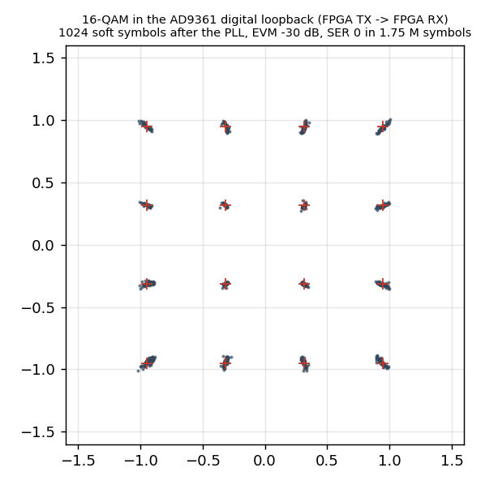
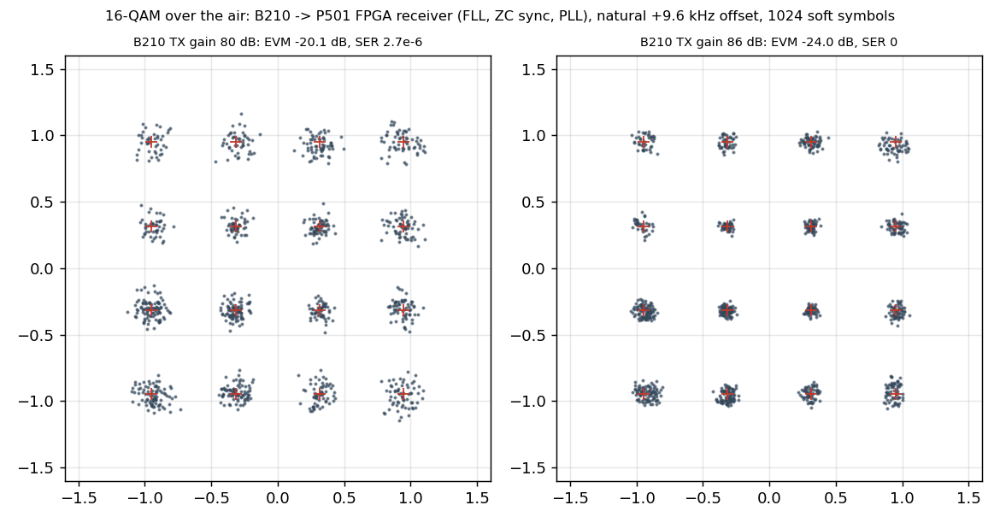
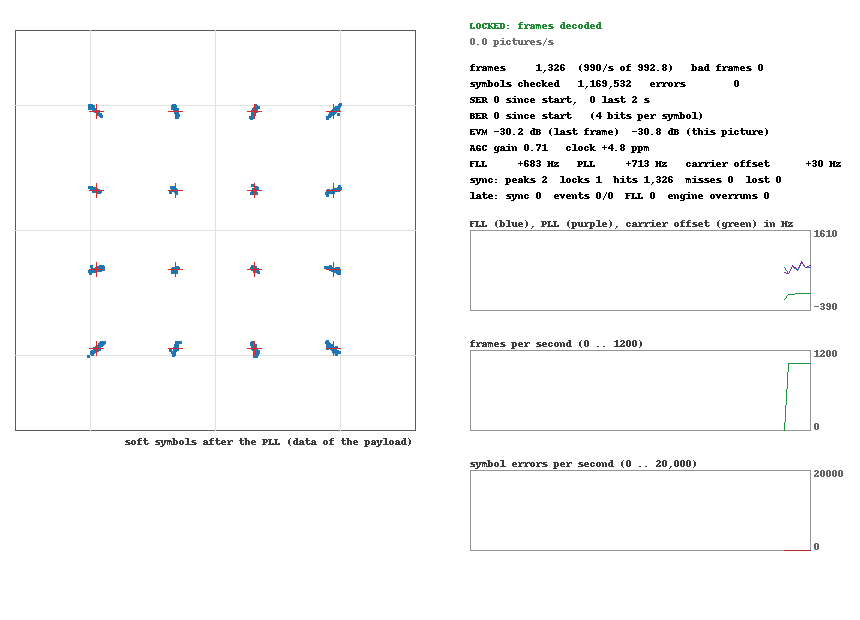

# 16-QAM with a Zadoff-Chu frame sync in the FPGA: plan (no RTL yet)

Input: `handoff_16qam_zc/` (HANDOFF.md, `gnuradio/rx_block.py` = `FrameRx`, the floating-point golden model, `tx_block.py` = the frame). Frame: `[CP 8 | ZC 63 root 1 | 14 x (63 16-QAM + 1 pilot)]` = 967 symbols, 960 ksym/s.
Receiver chain: AGC -> band-edge FLL -> RRC + polyphase timing -> ZC frame sync -> pilot / decision-directed PLL -> 16-QAM slicer.
The numbers marked *(study)* come from `study_zc_metrics.py` in this folder (numpy only).

## 1. What the existing RTL gives us (and two corrections to the handoff)

| | |
|---|---|
| Clock budget | `aclk` 100 MHz, 960 ksym/s: **104.2 clocks per symbol**. The engine `qpsk_rx.v` needs about 60 to 65 of them (47 MAC clocks for the 44-tap matched + derivative filter, S0..S9). The m-sequence synchroniser `qpsk_sync.v` is its **own state machine** (about 55 clocks, `late` = 0 in all tests): it does not compete with the engine for cycles. |
| Multipliers | **Not shared.** The 4 multipliers of the MAC (`xi*cm, xq*cm, xi*cd, xq*cd`) are busy 44 of the 60 clocks; every other product (AGC 4, timing error 2, AGC speed 1, gains 4, derotation 4, ...) is a separate DSP. That is how the engine has 53 DSP, the m-sequence sync 5 more. |
| Whole system (placed, `p501_qpsk_trx_sync`) | 16,290 LUT (13.9 % of 117,120), 22,447 FF (9.6 %), 6.5 BRAM (4.5 % of 144), **58 DSP (4.7 % of 1,248)**, timing WNS +0.417 ns at 100 MHz. |

Consequences:
1. **Resources are not the constraint, clock cycles per symbol and timing closure are.** Sharing the engine's 4 MAC multipliers would save DSPs we have 1,190 of and would put the correlator into the engine's schedule (which already has only about 40 free clocks). I propose a **separate synchroniser block with its own 4-DSP complex MAC**, like `qpsk_sync.v` is separate today.
2. **The ZC reference is a 63-entry ROM of 63rd roots of unity** (`n(n+1)` is always even, so `exp(-j pi n(n+1)/63) = exp(-j 2 pi (n(n+1)/2)/63)`); the handoff says 126th.
3. **`fixed_payload` cannot be reproduced in the FPGA** (`np.random.RandomState` = Mersenne Twister). For symbol/bit error counting in hardware the payload must come from an LFSR: PRBS-15, 4 bits per symbol, restarted at the first payload symbol of every frame (as in chapter 4e), or a payload RAM loaded by software. I recommend the PRBS-15 and a `payload='prbs15'` option in `tx_block.py` / `FrameRx`.
4. **CFO.** The sync word is unambiguous only for |CFO| < Rs/(2N) = 7.6 kHz, and the correlation magnitude is already down *(study)* to 0.89 (-1.0 dB) at 4 kHz, 0.83 (-1.6 dB) at 5 kHz, 0.64 (-3.9 dB) at 7.6 kHz and 0.46 (-6.8 dB) at 9.7 kHz. **The natural offset between our P501 and B210 is +9.5 to +9.7 kHz**, so without a front-end CFO correction the word is not found. The handoff's tests (250 ksym/s, +-1.5 kHz) scale to +-5.8 kHz at 960 ksym/s; the model (section 6) locks correctly up to 6 kHz at every SNR from 8 to 20 dB and up to 7.3 kHz at 20 dB, and fails at 7.6 kHz. We need the FLL in front (`qpsk_fll.v` exists, locks in 0.2 to 1 ms, scatter +-1 to 2 kHz), or a CFO hint in W0 for lab tests. The 4th-power estimator of chapter 4d is useless for 16-QAM.

## 2. Design of the three additions

### (1) AGC: power detector (extends the symbol-rate AGC of `qpsk_rx.v`)
* Keep the structure: gain `g` (Q10) applied after the matched filter, before the timing error and before the correlator, so everything downstream sees unit RMS.
* Detector: `P = mi2^2 + mq2^2` (2 DSP, 33-bit), error `Pref - P`, `g += (MU * err) >> k`. A register bit selects the old `max + min/2` magnitude detector, for A/B comparison.
* Scale: RMS R = 4096 * sqrt(10) = 12,953 counts, so the inner 16-QAM level is L = 4096 and the thresholds are 0 and +-2L = +-8192; the outer corner is 1.34 R = 17,380 of 32,767 (1.9 x headroom).
* Honest note: a power detector is not *required*. The magnitude detector reads 1.0275 on random 16-QAM (calibrate `REF`) and 1.087 on the ZC word (0.5 dB higher, harmless with a slow loop). The power detector's gain noise is 17 % lower (amplitude-equivalent CV 0.283 against 0.339) and it is exact for any constellation; it costs 2 DSP and about 80 LUT. The loop has to be slower than the QPSK one because the symbol power fluctuates (CV 0.57 of the power); the value of `MU` comes from the model.
* The ZC word gives the exact gain, `|h| = |C|/63`. Use it once, at the first lock, to kick `g` to the right value (one serial division of 20 clocks), so the AGC does not have to converge first. Afterwards the slow AGC runs on.

### (2) ZC correlator, energy normalisation, frame counter: new `qam_zc_sync.v`
* Input: `mi2, mq2` at state S2 (after AGC, before derotation), the same tap as `qpsk_sync.v`. Ring RAM 64 x 32 bit (LUTRAM), reference ROM 63 x (cos, sin) Q14.
* **One complex MAC (4 DSP, 48-bit accumulators), 1 tap per clock: 63 clocks + about 8 pipeline = about 71 of 104 clocks.** The whole correlation per symbol, SEARCH included, fits with 32 % margin; no 2-taps-per-clock needed.
* Normalisation without a square root: `rho_mag = |C| / sum|x|` (`|.|` = max + min/2), a running sum accumulated in the same loop (the existing trick), test `256 |C| >= THR * E`. *(study)* `rho_mag` and FrameRx's `rho_pow` differ by < 1 % at the peak (0.935 against 0.933 at 20 dB / 3 kHz) and the largest false value in a frame is 0.46 against 0.43: use THR about 0.6 for SEARCH (peak 0.75 at 6 kHz, false max 0.51) and 0.45 for LOCKED, as in the handoff. A false alarm needs `rho` > 0.6: about 1e-10 per symbol for random data.
* Multiplier-free alternative, held in reserve: an 8-phase reference (shift-add only) loses 0.2 dB at the peak (0.971 against 0.995, same sidelobes), 4-phase loses 0.9 dB *(study)*. Not needed at 71 of 104 clocks.
* Tracker as `FrameRx`: SEARCH (peak >= THR_S) -> VERIFY (second peak 967 +-3 later, THR_L) -> LOCKED; in LOCKED the correlation only runs in a +-4 window around the expected peak (9 of 967 symbols), more than 3 misses in a row -> SEARCH. A 10-bit frame counter (mod 967) re-aligns on every hit and gives each symbol its position: CP (0..7), word (8..70), data, pilot (every 64th after the word), as flags for the PLL and the checker.
* **Carrier from the word, once per frame at the peak (about 150 clocks, the correlator is idle then):** three partial sums are accumulated (taps 0..30 = C1, tap 31, taps 32..62 = C2), so `C = C1 + c31 + C2` costs nothing extra.
  * frequency: `w = arg(C2 conj C1) / 32` (a complex multiply on the idle MAC, the existing 18-iteration CORDIC from `qpsk_sync.v`, then a 5-bit shift). Unambiguous to +-15 kHz. *(study)* unbiased, std 86 Hz at 20 dB, 152 Hz at 15 dB, 220 Hz at 12 dB (the m-sequence estimate was 1 to 3.5 kHz low and 1 kHz noisy: ZC has constant amplitude, so no magnitude weighting).
  * phase at the first payload symbol: `theta0 = arg(C1 e^{+j 16 w} + C2 e^{-j 16 w}) + 32 w` (two small rotations by the engine's sine table, a second CORDIC pass; all phases in turns x 2^32, the wrap-around is free). FrameRx's formula derotates 63 products by the tone; this is the same number from the two half sums.
  * gain: `|C1 e^{..} + C2 e^{..}| / 62`, for the one-time AGC kick above.
* **Delay line:** the answer arrives about 1.5 to 3 symbols after the peak, but the engine derotates the first payload symbol right after it. Put the pair `(mi2, mq2)` through a 16-deep LUTRAM delay (D = 8 symbols, about 40 LUT) between S2 and the derotation. Then `theta0` and `w` are loaded (theta and omega registers; omega already has a load path from the m-sequence project, theta needs one) exactly when the first payload symbol is derotated. The timing loop and the AGC stay in front of the delay and are not affected.

### (3) 16-QAM phase detector with pilot weighting in the Costas loop
* Slicer: two comparators per axis against 0 and +-2L give the level in {-3, -1, 1, 3} (units of L); Gray bits `{00:-3, 01:-1, 10:+3, 11:+1}`.
* Error `e = Im(z conj(s)) = zq*si - zi*sq` with `s` in {+-1, +-3} L: **shift-add only (3x = 2x + x), no multiplier**. Pilot (`s = +-1`, `sq = 0`): `e = w * zq * p` with `w = 3` (shift-add), taken from the frame counter flags. The registers CA/CB scale for the different error size (the model computes them).
* Known symbols through the PLL: CP and word (71) and pilots (14) are 8.8 % of the frame. FrameRx freezes the PLL over CP + word; the hardware can instead keep tracking with the **known** ZC symbols as data-aided references (`e = Im(z conj(ZC_n))`, 2 more DSP, the ROM again). A register selects freeze or data-aided, so the model can decide on numbers.
* Ring weighting (error divided by the radius, or the corner points only) is a known improvement for 16-QAM decision-directed loops: shift-add weights {4, 1, 1/2}; to be decided with the cycle-slip simulation.
* Phase ambiguity: resolved absolutely by `theta0` at every lock (the word is coherent), so the 4-fold ambiguity of a QAM loop never reaches the data; slips between frames are bounded to one frame by the word / pilots.
* Checker: 4 bits per symbol against the PRBS-15 restarted at the first payload symbol (the frame counter gives the position), bit errors (popcount) and symbol errors, gated by the frame counter, plus the soft-symbol capture RAM for the constellation.

## 3. Resource and cycle estimate (+-30 %, scaled from the m-sequence synchroniser: 1,260 LUT / 5 DSP for a similar structure)

| block | LUT | FF | DSP | BRAM | clocks / symbol |
|---|---|---|---|---|---|
| power AGC detector + mode bit | 80 | 80 | +2 | 0 | within the engine's 60 |
| ZC correlator, ring, ROM, energy, metric | 700 | 900 | 5 | 0 | 71 (own FSM) |
| tracker, frame counter, position flags, statistics | 500 | 400 | 0 | 0 | parallel |
| carrier from the word (complex multiply on the idle MAC, CORDIC, sine ROM, control) | 700 | 500 | 0 to 4 | 0 to 1 | once per frame |
| delay line + theta / omega load | 100 | 100 | 0 | 0 | +2 in the engine |
| slicer, PD, data-aided reference, 4-bit PRBS checker, counters | 600 | 400 | 2 | 0 | +2 in the engine |
| about 30 new AXI registers | 400 | 900 | 0 | 0 | |
| **new total** | **about 3,100** | **about 3,300** | **about 11 to 15** | **0 to 1** | |

Replacing `qpsk_sync.v` by `qam_zc_sync.v` (-1,260 LUT, -5 DSP): **overlay about 18,000 LUT (about 15 %), about 65 to 70 DSP (about 5.5 %), about 7 BRAM.** Resources are a non-issue; the risk is the 100 MHz timing closure (WNS is +0.417 ns today): the CORDIC and the 48-bit accumulators get pipeline registers from the start.
Engine schedule: about 64 of 104 clocks (+4), synchroniser 71 (parallel), no conflict. A 16-QAM transmitter (not part of this task) needs a real FIR (45 taps, the QPSK one is adder-only): 2 serial MAC DSPs at 26 clocks per sample are enough.

## 4. Verification plan: the model first, bit-exact

1. **Make `FrameRx` importable without GNU Radio** (the file imports `gnuradio` at the top) and put the handoff files under `tutorial/qam16/ref/`.
2. **`FrameRxHW` (float, streaming)**: the algorithm the hardware will use, with the same input/output as `FrameRx`: `rho_mag`, +-4 window, half-word frequency, centre phase from C1/C2, shift-add slicer / PD, data-aided word option, PRBS-15 payload. Regression against `FrameRx` on the handoff's test matrix (SER at 40 dB / 30 dB +-1.5 kHz / 25 dB / 18 dB / 15 dB / 12 dB, scaled to 960 ksym/s) must agree within 0.2 dB EVM / the same SER.
3. **The items marked NOT validated in the handoff, measured here:** detection and false-alarm probability against SNR and CFO, lock-time distribution, cycle-slip rate of the PD variants (plain, ring-weighted, pilot weight 1 / 3 / 5, freeze or data-aided word), AGC with and without the word kick, and the whole chain with the real front end (`qpsk_rx_fixed.py` polyphase / timing / AGC extended: a new `qam16_rx_fixed.py`).
4. **Integer model** `qam_zc_fixed.py` + `qam16_rx_fixed.py`, bit-exact to the RTL, with `regs_from_bw`-style register computation.
5. **RTL** `qam_zc_sync.v`, changes in a copy of `qpsk_rx_sync.v` (`qam16_rx.v`), xsim testbench against the integer model on synthetic frames (RRC at 4 sps, CFO, timing offset, noise, as `gen_sim_samples.py`).
6. **Overlay** (`QAM16RX=1` in `create_project.tcl`), driver, notebook, GRC (`qam16_zc_tx.grc` for the B210 TX exists), digital loopback, then the air. Expect a marginal link: the best QPSK constellation we measured (spread 8.3 deg) is about 17 dB, where 16-QAM has SER about 2e-3; 16-QAM needs about 17 dB Es/N0 for 1e-3 BER, so test the loopback first and the air at the shortest range.

## 5. Decisions (answered 2026-10-23)
1. Front-end CFO: the existing FLL in front of the polyphase filter. 2. Payload: PRBS-15 restarted in every frame. 3. Known word symbols in the PLL: both, `word_mode` freeze / aided and `anchor` first / every as registers.
4. Steps 1 and 2 (models and measurements, no RTL): done, results below.

## 6. Results of steps 1 and 2 (float model, 1 sample per symbol, 960 ksym/s)

Files: `frame16.py` (frame, PRBS-15 payload, channel with CFO / gain / Wiener phase noise / frequency ramp), `framerx_ref.py` (loads the handoff's `FrameRx` without GNU Radio), `framerx_hw.py` (**FrameRxHW**, the model of what the FPGA will do),
`test_regression.py` -> `results_regression.txt`, `study_qam16_rx.py` -> `results_qam16_study.txt`, `study_zc_metrics.py`, `ref/` (the handoff files).

* **Regression against FrameRx** on the handoff's own test matrix (60 frames, 8 conditions): the hardware model has the same or fewer symbol errors everywhere: 0 at 40 / 30 / 25 dB, 0 to 1.3e-4 at 20 dB / 1.9 kHz (FrameRx 9.8e-2, near its CFO limit), 6e-4 at 18 dB (1.3e-3), 2.0e-2 at 15 dB (2.4e-2), 0.12 at 12 dB (0.12); both fail beyond Rs/(2N) (2.4 kHz at 250 ksym/s). The frequency from the two half sums replaces the FFT without loss.
* **Detection and lock** (60 trials per cell, 5 frames, random lead-in, `norm='mag'`, approximate magnitudes, thresholds 0.6 / 0.45): the lock is on the true word position and the frequency error is small for **every SNR from 8 to 20 dB up to 6 kHz CFO (60 of 60)**; at 7.6 kHz only 28 to 34 of 60 are right (the peak moves by one symbol: the time / frequency ambiguity, estimate off by Rs/63 = 15.2 kHz), at 9.7 kHz 0 of 60.
  Lock time 1.48 frames on average (about 1.4 ms: the word, then the verify one frame later). Frequency error (std, unbiased): 76 Hz at 20 dB, 134 Hz at 15 dB, 190 Hz at 12 dB, 239 Hz at 10 dB, 301 Hz at 8 dB.
* **False alarms** (2 million symbols each): **no peak at all above 0.5** for noise, random 16-QAM and 16-QAM at 15 dB, with either normalisation; at 0.45 the magnitude normalisation gives 28 (noise) and 5 to 7 (data) peaks per million symbols, the power normalisation 0.5 to 1. SEARCH threshold 0.55 to 0.6, LOCKED threshold 0.45 (only used in the +-4 window, 9 positions per frame). 0 locks in all cases.
* **Phase detector and word modes** (CFO 3 kHz, 265,000 symbols per point, no phase noise): all variants are within 10 % of the ideal coherent 16-QAM SER from 14 to 22 dB (14 dB: 4.1e-2 against 3.7e-2, 18 dB: 6.3e-4 against 5.7e-4, 20 dB: 1.1e-5 against 1.2e-5) and have **no cycle slip**. `freeze/every`, `aided/first`, `aided/every`, pilot weight 1 / 3 / 5 and the ring-weighted PD are indistinguishable; the corner-only PD is 2 x worse at 20 dB.
* **Phase noise** (Wiener, SNR 22 dB; 0.0256 rad per symbol = 100 Hz linewidth): up to 0.01 rad / symbol nothing happens. At 0.02 and 0.03 the loop bandwidth decides: **bw 0.04 gives SER 3.4e-5 / 3.7e-3 with 0 / 1 bad frame, bw 0.02 gives 3.5e-4 / 4.0e-2 (0 / 19 bad frames), bw 0.01 fails (3.3e-2, 2.7e-1)**; pilot weight 5 or the ring PD halve the slips of bw 0.02 (4 bad frames at 0.03). With the loop at 0.04 the 14 dB SER is 4.8e-2 against 4.1e-2 at 0.02: the bandwidth is a trade between phase noise and noise, so CA / CB stay **registers** (they are) and the right value comes from measuring the real LO noise on the board.
  `aided` against `freeze` is a small gain under phase noise (4.0e-2 against 4.9e-2 at 0.03), `anchor=every` is the same as `first`: implement both as register bits as decided (the phase from the word is needed at the first lock anyway).
* **Frequency drift** of 1 and 10 kHz/s is no problem for the PLL (SER 0 and 3.8e-6): the limit is only the ZC ambiguity.
* **AGC accuracy needed:** with the slicer thresholds fixed, a gain error of -0.9 dB to +1.6 dB costs nothing at 22 dB SNR (SER <= 6e-6), **-1.9 dB gives SER 1.4e-2**. The AGC must hold the level within about +-1 dB; the gain from the word (|h|) at the first lock and a calibrated `REF` are enough, and a power or magnitude detector are equivalent for that.
* Not modelled yet (the next step): the real front end. The timing loop (derivative matched filter, non-data-aided) and the AGC in a loop with 16-QAM, quantisation of every stage, and the FLL residual. These need the 4 samples per symbol signal and `qpsk_rx_fixed.py` extended.

## 7. Results of step 3 (integer models, 4 samples per symbol)

Files: `make_signal16.py` (the ADC signal: RRC 0.35 at 4 sps, CFO, clock offset in ppm, Es/N0, 12-bit quantisation), `qam_zc_fixed.py` (**bit-exact synchroniser**: Q14 reference, A / B / D sums, M and E with `max + min/2`, 18-iteration CORDIC, tracker, w and theta0),
`qam16_rx_fixed.py` (**bit-exact receiver**: front end with the 16-QAM AGC, delay line D = 8, PLL with shift-add PD, pilot weight, aided / freeze word), `study_frontend16.py` (float sync on the QPSK front end), `study_integer16.py` -> `results_integer16.txt`, `study_fll16.py` -> `results_fll16.txt`.

* **The existing front end works for 16-QAM unchanged** (44-tap polyphase matched + derivative filter, 16 arms, derivative timing detector, second-order timing loop): it tracks clock offsets of -40 to +50 ppm, the timing detector output is clipped at +-8191 on only 6 % of the symbols (harmless), the EVM of the front end alone is -38.8 dB with no CFO and -32 dB with 3 kHz CFO and 10 ppm.
* **Bug found and fixed: the AGC gain bias.** The QPSK AGC rounds with a floor (`>> 16`), -0.5 LSB per symbol, which on 16-QAM leaves the level -0.6 dB low at MU 40 (-1.9 dB at MU 10): an EVM floor of **-23 dB even at 60 dB SNR** (a 7 % amplitude error against fixed slicer thresholds). The same class of bug as the Costas integrator of chapter 4d. In the 16-QAM AGC the update is rounded and the detector is the power `P = mi2^2 + mq2^2` (`g += (MU * ((PREF - P >> 8)) + 2^23) >> 24`, MU 136 equals the old MU 40 loop): level -0.02 dB, EVM -31.5 dB at 40 dB SNR, -21.5 dB at 22 dB (ideal -22).
* **Integer equals float:** on the same front-end symbols the integer engine and `FrameRxHW` give the same SER and EVM (25 dB: 0 and -24.2 dB; 20 dB: 1.7e-5 both; 18 dB: 8.4e-4 and 8.3e-4; 16 dB: 8.6e-3 both). Steady-state SER with the whole chain: 20 dB 0 to 1.1e-5 (ideal 1.2e-5), 18 dB 9.4e-4 (5.7e-4), 16 dB 9.5e-3 (7.2e-3): the loss against the ideal detector is about 1 dB, mostly from the 4 samples per symbol front end.
* **Causality:** with the delay line D = 8 the first payload symbol is derotated at least 3 symbols after the synchroniser's decision plus a margin of 2 symbols for the CORDIC / rotation chain (checked by an assertion on every frame): D = 5 would be enough, 8 leaves slack.
* **Start-up needs an acquisition mode** (not seen in the symbol-rate model). With the narrow loops from the start the timing loop rings for 5 to 8 frames and the frequency from the word at the first lock is wrong by 0.5 to 2 kHz (estimates per frame: 1355, 5139, 1465, 3907, 2532, 3180 ... 3000 Hz): 4 to 5 frames are lost. With a **wide timing loop (2 pi / 100) and a 4 x faster AGC until the synchroniser has locked and a few frames have followed** the first frame is clean (first clean frame 1.3 on average over CFO -5 to +5.5 kHz and clock -30 to +40 ppm, lock frequency error 131 Hz mean, 469 Hz max). The end of the acquisition must come from the synchroniser (lock + NSW hits, NSW about 4 or 5), not from a timer: with a 3000 symbol timer a signal that starts after 500, 1000 or 2500 idle symbols leaves 13 to 16 bad frames; with 6000 or more all of them are clean (first clean frame 1 to 3). Registers: timing gains narrow / wide, MU narrow / fast, NSW.
* **CFO with the full chain:** correct up to 6.5 kHz (0 bad frames, SER 0 after the start); the FLL is mandatory at the natural offset (next point).
* **The FLL in front** (`qpsk_fll_fixed.py`, the integer model of `qpsk_fll.v`, gain 0.002 for 3000 symbols then 0.0003): without it +9.7 kHz fails completely (99 of 99 frames bad, SER 0.94 for -9.7 kHz too); with it the residual offset is **mean +-0.4 kHz, std 1 kHz, maximum 4.5 kHz** for 3 kHz, +-9.7 kHz, 20 kHz, 40 kHz and -60 kHz (the FLL noise the project already knew), and the receiver is clean (first clean frame 2 to 9, SER 0 after the start). The maximum of 4.5 kHz is inside the 6.5 kHz margin but not far: a narrower tracking gain or the freeze handover of chapter 4d is worth having for the FLL.

Specification that follows for the RTL: R = 12953 counts (unit RMS), inner level L = 4096, thresholds 0 and +-8192; reference Q14, 63 entries; THR_S 154 / THR_L 115 (/256); window +-4, tolerance +-3, 3 misses; D = 8; CA / CB from `loop_gains(0.02)` with K_e = 640 (`regs16`); `anchor = first` only (the float study found `every` no better, so it is not implemented); `word_mode` aided / freeze as a register bit.

## 8. Step 4: the RTL (bit-exact against the integer models)

Files: `rtl/qam_zc_sync.v` (the synchroniser and `qam_zc_carrier`), `rtl/qam_zc_rom.v` (generated by `gen_zc_rom.py`), `rtl/qam16_rx.v` (the receiver, ID `0xDD520006`, register map in its header), `sim/` (`gen_zc_vectors.py`, `tb_qam_zc_sync.v`, `compare_zc.py`, `run_zc.sh`;
`gen_rx_vectors.py`, `tb_qam16_rx.v`, `compare_rx.py`, `run_rx.sh`). `cd tutorial/qam16/sim; python3 gen_zc_vectors.py; python3 gen_rx_vectors.py; ./run_zc.sh a; ./run_rx.sh a` (xvlog / xelab / xsim; about 10 s each).

* **Synchroniser alone** (4 vectors: 20 dB / +3 kHz; a gap of 7 silent frames with misses, a lost lock and a new lock at 12 dB; 10 dB / +5 kHz; a 2-symbol timing slip): per symbol E, M, the two candidate flags (13,000 to 26,000 symbols each), every event (kind, e, known, miss, w, th0) and the counters are **identical to `qam_zc_fixed.sync()`**; `late` 0 at 104 clocks per symbol.
* **Whole receiver** (4 vectors of ADC samples at 4 sps: 22 dB / +3 kHz / 10 ppm; a gap of 5 silent frames after 5 frames with 700 idle symbols in front, -2 kHz, 30 ppm; 26 frames with a gap after frame 12, +5.5 kHz, -25 ppm, the acquisition mode ends and starts again; 15 dB / -6 kHz / 50 ppm): per symbol `mi2, mq2, g, rate, e_t`; per processed symbol position, label, `zi, zq, e, omega, theta`;
  the events as the engine applies them; frames, symbol and bit errors, bad frames, EVM sums of the last frame, locks, `late`, `ev_late`, `ev_over` are **identical to `qam16_rx_fixed.py`: 0 mismatches in all four**.
* **Changes that came with the RTL** (the models were changed first and the float study repeated): the engine labels with a position counter set by the events (causal: an event is applied at the engine step `known + 2`, D = 10 so that the earliest frame of the +-4 window has not started yet); the SEARCH rule is the streaming one (`lastp` of the last THR_S peak, no peak list);
  the carrier arithmetic scales A and D to 18 bits first (the products fit 36 bits); **the acquisition mode now follows the synchroniser**: on until NSW = 4 frames have followed a lock, on again at a lost lock (`acq_auto`, register `NSW`; the ACQ symbol count is only a minimum). The lead-in test (signal starting after 0 to 2500 idle symbols): 0 bad frames in all six, first clean frame 0 to 3 (the 3000-symbol timer failed 13 to 16 frames for three of them).
* **Utilization** (out-of-context synthesis, xczu5ev, 100 MHz, the same settings for both; post-synthesis WNS +3.9 ns): `qam16_rx` **5,822 LUT, 3,772 FF, 3.5 BRAM, 49 DSP** against `qpsk_rx_sync` 4,129 LUT, 2,697 FF, 2.5 BRAM, 28 DSP: **+1,693 LUT (+41 %), +1,075 FF, +1 BRAM, +21 DSP** (the plan's estimate was +1.8 k LUT net and +6 to 10 DSP: the LUTs are as expected, the DSPs are over because the carrier sequencer, the thresholds and the AGC power use plain multipliers; 49 of 1,248 is 3.9 %).
  The system with the AD9361 interface is the 16.3 k LUT of the m-sequence overlay + 1.7 k, about 18 k LUT (15 %).
* **Found by the RTL tests / not solved:** (1) at CFO about 6 kHz and low SNR (15 dB) the lock can land one symbol off (the ZC time / frequency ambiguity), and then the whole payload is shifted for as long as the lock holds (scenario d: SER 0.77); the FLL keeps the residual below 4.5 kHz, so this is a margin, not a failure of the plan; a check of the frequency estimate against the CFO range would catch it.
  (2) After a gap of silence the first 3 to 4 frames after the new lock are bad (the AGC and the timing loop have drifted in the noise; the acquisition mode helps but the payload errors are 800 of 882 for those frames); the loops could be reset at a lost lock.
  (3) Not in this step: the AXI wrapper is in `qam16_rx.v` (same interface as `qpsk_rx_sync.v`) but there is no overlay (`create_project.tcl` option), driver or notebook yet, and no FPGA transmitter.

## 9. Step 5: overlay `p501_qam16_trx`, driver, first board test in the digital loopback

* **FPGA transmitter** `rtl/qam16_tx_fr.v` (+ `rtl/qam16_tx_zc.v`, generated by `qam16_tx_model.py`): frames of 967 symbols, PRBS-15 payload restarted per frame, 24 multipliers for the RRC FIR (the symbols are not +-1), same ports as `qpsk_tx_fr.v`.
  Bit-exact against `qam16_tx_model.py` (14,000 samples, 0 mismatches: `sim/tb_qam16_tx_fr.v`, `compare_tx.py`). The first build had the 12-DSP sum chain in one clock: 10.09 ns against the 10 ns the constraints give l_clk (WNS -0.011 ns); the products are now registered
  (the sum captured at the ce edge is the same as before because ce comes at most every second clock), WNS +0.417 ns, WHS +0.010 ns (the one pulse-width endpoint at -0.002 ns is the same as in the m-sequence overlay).
* **FLL in front** (as planned): `qam16_rx.v` now contains `qpsk_fll.v` between the sample RAM and the engine (the registers at 0xBC to 0xD8, the same as the FLL overlay). The whole receiver incl. the FLL is bit-exact against the models with the FLL stage (`qpsk_fll_fixed.fll_stage`):
  4 vectors, 0 mismatches (`sim/run_rx.sh`; every vector starts the FLL at the negative CFO with the tracking gain 0.0003, `gen_rx_vectors.py`).
* **Overlay** `QPSK=1 QAM16RX=1` in `create_project.tcl` (`bd/qam16_rx_chain.tcl`, `tutorial/qam16/steps/`, `src/qam16_rx_cdc.xdc`): the instance `qam16_rx` at 0x9C470000, the transmitter `qam16_tx_fr` in the place of the QPSK one, the register block `qpsk_regs` (enable, amplitude) as before.
  `vivado -mode batch -source create_project.tcl -tclargs FFT=0 QPSK=1 QAM16RX=1 RUN=bit` (12 minutes), `python3 tools/fix_hwh.py build/overlay/p501_qam16_trx.hwh`. Placed and routed: **20,013 LUT (17.1 %), 24,676 FF, 8.5 BRAM, 123 DSP (9.9 %)**
  (the m-sequence overlay: 16.3 k LUT, 58 DSP: the difference is the FLL stage, the 16-QAM engine and the 24 + 2 multipliers of the transmitter).
* **Driver** `notebook/p501_qam16_rx.py` (`P501Qam16Rx`: `configure`, `acquire`, `stats`, `capture`, FLL control; `P501Qam16Tx`), board script `tutorial/qam16/p501_qam16_loopback.py`. Board folder `/home/xilinx/jupyter_notebooks/p501_qam16/` (`p501_qam16_trx.{bit,hwh}`, `p501_qam16_rx.py`).
* **First board test, AD9361 digital loopback** (`results_board_loopback.txt`): the receiver locks 23 ms after the start (including the FLL's 20 ms acquisition), **0 symbol errors in 1.75 million symbols (1,988 frames) at three transmitter amplitudes** (0.15, 0.25, 0.40), EVM -29 to -31 dB,
  the soft-symbol constellation shows 16 clean clusters (`../img/qam16_loopback_constellation.png`), 994 frames per second (992.8 expected), no synchroniser or FLL lateness, no event overrun, no missed frame. The FLL reports +25 to +780 Hz (digital loopback has no carrier offset: its measurement noise and bias).

## 10. Step 6: over the air, B210 -> P501 (the natural +9.6 kHz offset, no hint)

`qam16_frame_tx.py` (the B210 transmits the 16-QAM frames made in Python: the same RRC filter and frame as the models, one frame period repeated), `p501_qam16_levels.py` (board: a cold start per level, `rx.acquire()`, counts) and `run_qam16_b210.py` (host); results in `results_board_b210.txt`.
B210 TX gain 80, 82, 84 and 86 dB (as requested; the transmitter's own limit in the older QPSK scripts was 80 dB), antennas a few centimetres apart, P501 RX gain index 70, 3 s counted per level (about 2.63 million symbols, 2,980 frames), the P501 does not transmit:

| B210 digital RMS | TX gain | frames found (2,978 sent) | symbol errors | SER | EVM |
|---|---|---|---|---|---|
| 0.18 | 80 dB | 2,982 | 1.60 M of 2.63 M | 0.61 | -10.6 dB |
| 0.18 | 82 dB | 2,981 | 1.02 M | 0.39 | -12.3 dB |
| 0.18 | 84 dB | 2,981 | 183,466 | 7.0e-2 | -15.3 dB |
| 0.18 | 86 dB | 2,982 | 7,832 | 3.0e-3 | -16.1 dB |
| **0.35** | **80 dB** | 2,982 | **7 of 2.63 M** | **2.7e-6** | -20.1 dB |
| **0.35** | **82 dB** | 2,982 | **0** | **0** | -21.9 dB |
| **0.35** | **84 dB** | 2,982 | **0** | **0** | -18.1 dB |
| **0.35** | **86 dB** | 2,980 | **0 of 2.63 M** | **0** | -24.0 dB |

* Every level, both amplitudes: the receiver starts from cold and **locks in 23 ms** (FLL acquisition 20 ms + the first two frames), **finds every frame** (one lock, no miss, no lost lock, no late event, no engine overrun) and measures the natural offset of the two radios as **+9.5 to +9.9 kHz**
  (the PLL's frequency minus the FLL's: the FLL takes -5.9 to -8.1 kHz, the PLL the remaining +1.6 to +4.4 kHz: the residual after the FLL is inside the 6.5 kHz margin of the Zadoff-Chu word but not far from it).
* With the B210 digital level 0.18 (RMS) the link is **noise-limited**: EVM improves by about the TX gain (-10.6 dB at 80 dB, -16.1 dB at 86 dB) and 16-QAM needs about -17 dB for a SER of 1e-3; with 0.35 (peak 0.64, +5.8 dB) the signal-to-noise ratio is 20 to 24 dB and **there is no error in 2.6 million symbols at 82, 84 and 86 dB**
  (7 errors at 80 dB). The EVM is not monotonic in the gain at the 0.35 level (-21.9 dB at 82, -18.1 dB at 84): the B210 level and the multipath at a few centimetres change from one cold start to the next; the figures are one measurement each.
* The EVM floor of the FPGA chain itself is -30 dB (digital loopback), so the over-the-air EVM is the link's, not the receiver's.

## 11. Step 7: the P501 transmitter over the air and the sensitivity (`results_board_sensitivity.txt`)

* **P501 transmitter -> P501 receiver, TX attenuation 20 to 60 dB** (amp 0.25, RX gain 70): 20 dB SER 0 in 1.75 M symbols (EVM -24 / -20 dB in two runs), 22 dB SER 5.7e-6 (EVM -17.4), 24 dB 4.3e-5 (-16.8), 26 dB 6.2e-3 (-15.6), 28 dB 6e-2 (-11.7);
  **from 32 dB on the PLL no longer holds the carrier** (SER 0.5 to 0.9, EVM -10 to -9 dB) although the synchroniser still finds every frame (1,988 of 1,988 up to 44 dB, 1,665 at 48 dB with 14 lost locks, 255 at 50 dB, 7 at 52 dB, none at 54 dB).
  The decision-directed PLL therefore sets the limit of the 16-QAM data at an EVM of about -15 dB (SER 1e-3 needs -16 dB, a SER of 5e-2 is at -12 dB, below that the loop slips continuously), and **the frame synchronisation works about 20 dB below that** (the AGC gain at the end of the lock range is 55 against 7 at the decode limit: 18 dB).
  The levels vary by several dB between runs (the same attenuation gave EVM -23.9 and -20.2 dB, and 30 dB gave -16.1 dB in one run and 28 dB gave -11.7 dB in another).
* **B210 -> P501 sweep of the TX gain 80 to 56 dB** (digital RMS 0.35): in this session the received level was 6 to 9 dB lower than in the session of section 10 (AGC gain 15.5 at 80 dB against 5.7), the PLL did not hold the carrier at any of the gains (SER 0.85 to 0.94, EVM -9 dB), so the sweep shows the **synchroniser's limit**:
  every frame found down to 66 dB (AGC gain 55), 43 misses at 64 dB, 281 misses and 6 lost locks at 62 dB, 59 lost locks at 60 dB, no lock at 56 to 58 dB. The same limit as with the P501's own transmitter (AGC gain 50 to 60).
  The decode threshold cannot be read from this session's B210 sweep (it was below it everywhere); section 10 and the P501 sweep give it.
* What this means for the design: (1) the Zadoff-Chu synchroniser and the FLL are not the limit, the carrier PLL is: 16-QAM data needs an EVM of -15 dB or better, and the decision-directed loop loses the carrier below -12 dB. The ZC word could keep the PLL alive at low SNR (data-aided loop on the word and the pilots only, hold the NCO frequency over the data): a design option for a rate-adaptive link
  (QPSK-fallback payload at low SNR with the same ZC word); (2) the loop bandwidth: 0.04 helped under phase noise in the float study, and costs 0.7 dB at 14 dB; the hardware registers (CA, CB) can be changed without a rebuild.

## 12. Step 8: a PLL that survives 12 to 14 dB: the finding is the FLL's tracking gain, not the PLL

`study_pll_lowsnr.py` (the integer receiver with the FLL cold-starting on +9.7 kHz as on the board: acquiring gain 0.002 for 20 ms, then the tracking gain), `study_pll_variants.py`, `study_pll_fll.py`, `study_pll_fine.py` (the float PLL `FrameRxHW` on the integer front end's symbols, 3 to 4 realisations
per point; new options `data_weight` and `dd_gate`), results `results_pll_lowsnr.txt`, `results_pll_variants.txt`, `results_pll_fll.txt`, `results_pll_fine.txt`.

* **The board's loss of the carrier below about 14 dB is reproduced in the integer model** (FLL tracking gain 0.0003 as used on the board): SER 0.11 at 14 dB (ideal 0.037), 0.21 at 13 dB, 0.36 at 12 dB, bad frames 5, 9 and 21 of 39.
* **PLL variants do not cure it:** bandwidth 0.01: total loss; 0.03 / 0.04: twice better than 0.02 at 12 to 14 dB but 0.06 and 0.015 worse; data-aided only (pilots, CP, word, frequency held over the data), with any bandwidth 0.02 to 0.10: SER 0.3 to 0.8 (the NCO cannot hold the frequency, the carrier wanders in 67 us between the pilots);
  half-weight data symbols, gated decision-directed (only symbols near a decision point), ring weighting: all the same or worse. **The phase of the carrier is not what fails; the frequency noise the FLL puts into the signal is.**
* **The cause is the FLL's tracking noise** (band-edge detector at 960 ksym/s: +-1 to 4 kHz of frequency jitter at gain 0.0003, seen in `study_fll16.py` as std 1 kHz, maximum 4.5 kHz). With the tracking gain **0.0001** (or 0.00003, or the FLL held after the acquisition) the same PLL (bandwidth 0.02, pilot weight 3, aided word) is within 1.2 to 1.5 x of the ideal SER at every SNR from 12 to 20 dB
  and has no bad frame down to 13 dB (integer receiver, `results_pll_lowsnr.txt`: 12 dB 0.13 against 0.11, 13 dB 0.085 against 0.067, 14 dB 0.047 against 0.037, 16 dB 9.7e-3 against 7.2e-3; with 0.0003: 0.36, 0.21, 0.11, 1.9e-2). Bandwidths 0.015 to 0.03 are then equivalent; 0.04 and above are worse.
  Known-word aiding matters (freezing the loop over CP and word: 0.21 against 0.083 at 13 dB); pilot weight 6 is a little better than 3 at 10 to 11 dB (not significant).
* **No RTL change is needed**: the FLL gain is a register (`FLL_GI`). The driver's `acquire()` now uses `trk_gi=0.0001` (and `hold=True` loads the FLL with its mean frequency and stops it); the overlay and the models are as before.
* **On the board** (`results_board_quietfll.txt`): P501 transmitter over the air: TX attenuation 22 dB SER 3.7e-5, 26 dB 4.0e-3 (EVM -15.4 dB), 28 dB 1.8e-2 (-14.6 dB), **30 dB 8.8e-2 (-12.4 dB, ideal at that SNR 0.09)**, 32 dB 0.43; before (0.0003): 28 dB 6e-2, 32 dB and above no carrier at all.
  B210 -> P501 in the weaker-link session (the EVM floor of the B210 path was -13.5 dB in this session): at 86 dB SER 5.8e-2 instead of 0.43 with the same signal level, 84 dB 0.10, 82 dB 0.13, 80 dB 0.29 (before 0.57 to 0.66).
  So the decoding limit moved from an EVM of -15 dB to -12 dB (3 dB, about 1.5 dB of attenuation steps on this link).
* The B210's EVM floor in the weak session (-13.5 dB at 82 to 84 dB, against -22 to -24 dB at the same AGC gain in the strong session) says that the noise in the P501's receiver input was 9 to 11 dB higher in that session at the same signal level (another transmitter in the band, or the B210's own noise / LO leakage: not identified).

## 13. Step 9: the live notebook `notebook/P501_QAM16_Live.ipynb`

Built by `make_notebook_qam16.py` (18 cells, like `P501_QPSK_SYNC_Live`), deployed to `/home/xilinx/jupyter_notebooks/p501_qam16/` next to `p501_qam16_trx.{bit,hwh}` and `p501_qam16_rx.py` (the driver gained `set_pll`, `set_timing`, `set_sync`, `hold_fll` and the transmitter's `enabled`, `amp`, `set`).

* **Self-tests in the digital loopback** (29 checks, all PASS when the notebook is executed on the board with `jupyter nbconvert --execute`): the overlay and the AD9361 come up; **no false lock without a transmitter**; at three transmitter amplitudes (0.15, 0.25, 0.4) the receiver locks in 23 ms, finds every frame (1,491 in 1.5 s for 1,489 expected, no miss),
  decodes **1.3 million symbols per amplitude with 0 errors**, EVM -31.0 / -30.3 / -29.0 dB, nothing late anywhere; the live machinery (21 pictures in 3 s, locked, soft EVM -30.5 dB); the controls moved from Python (PLL and timing gains, pilot weight, thresholds and NSW follow the controls in the registers, FLL **hold** stops the FLL at a constant frequency and decoding goes on without an error, FLL **off** and **track** start and lock).
* **The live picture**: the 16-point constellation of the data symbols with the ideal points, LOCKED / not locked, frames (per second against 992.8), symbols checked and errors, SER and BER since the start and over the last 2 s, EVM of the last frame (from the hardware sums) and of the picture, AGC gain, clock offset in ppm, the frequencies of the FLL and the PLL and the carrier offset (their difference), the synchroniser's counters and every lateness / overrun counter, and strips of the frequencies, of the frames per second and of the symbol errors per second.
  **Controls**: Start receiver (cold start with the FLL acquiring then tracking), FLL mode (track / hold / off), FLL acquiring and tracking gain, Hold FLL now, PLL bandwidth, aided word, pilot weight, timing loop, search and lock thresholds, frames before the acquisition mode ends, RX gain, digital loopback, FPGA transmits (frames), TX attenuation and amplitude, Apply (all live). A cell sweeps the TX attenuation over the air (`RUN_AIR = False` until you set it).
* The B210 as the transmitter: `qam16_frame_tx.py` on the host, as described in the notebook.

## 14. Step 10: the GNU Radio flowgraphs (`results_grc.txt`)

* **`qam16_b210_frame_tx.grc`** (B210 -> P501; generated by `make_flowgraph_qam16.py` with Companion's API like the QPSK ones): an embedded block makes the frames (CP | ZC word | 14 x (63 16-QAM + pilot), PRBS-15 payload restarted per frame, RRC 0.35, one period of 3868 samples, unit RMS), `tx_amp` x `tx_on` (OFF at the start), the UHD sink on the TX/RX port, spectrum and envelope displays.
  Controls: *Transmit*, *B210 TX gain* 0 to 86 dB, *TX digital amplitude* (RMS 0.35 by default). Compiled and run headless (`run_qam16_b210.py --grc`) into the P501 receiver: the same lock, frames and EVM as the Python transmitter in the same session.
* **`qam16_b210_frame_rx.grc`** (P501 -> B210): RX2 -> AGC (reference 0.947) -> limiter -> FLL band-edge -> polyphase clock sync -> **"16-QAM ZC receiver"**, an embedded block that runs `qam16_stream_rx.StreamRx`: the algorithm of the float FPGA model as a streaming class (any chunk size): Zadoff-Chu frame sync (SEARCH / VERIFY / LOCKED), carrier frequency and phase from the two half-word correlations, the PLL (decision directed + pilots + known CP and word), PRBS-15 symbol error counting.
  Outputs: the data symbols (constellation), symbol error rate, EVM, lock, frames decoded and the carrier offset left for the PLL (number sinks), spectrum. **`test_stream_rx.py`: StreamRx gives the same data symbols and the same errors per frame as `FrameRxHW`** with random chunk sizes.
  `test_grc_loopback.py` (software only, the two embedded blocks, +9.6 kHz, 25 dB): 2975 frames, 0 errors in 2.6 M symbols. **On the air, the P501's FPGA transmitter into the B210 with this flowgraph: 0 symbol errors in 7 M symbols at TX attenuation 20 dB (EVM -19.6 dB), SER 2.6e-5 at 26 dB and 3.5e-5 at 30 dB**, one lock, no missed frame (`run_qam16_grc_rx.py`, `p501_qam16_tx_only.py` on the board).
* A GNU Radio gotcha found on the way: a Python block must be kept alive by a reference in the flowgraph's class (a local variable of `__init__` is garbage collected and the scheduler segfaults).
* The FLL of the flowgraph is `fll_div` = 1600 (2 pi / 1600) by default: it pulls in the +9.6 kHz and leaves 0 to 1.7 kHz to the PLL; the FLL noise matters here too (the same finding as in the FPGA): a larger N is quieter.

## 15. Next
11. The two open points of section 8 (a lock one symbol off near 6 kHz at low SNR, 3 to 4 bad frames after a gap); the noise in the band during the weak-link session; a tutorial chapter that tells the story of the 16-QAM receiver.
