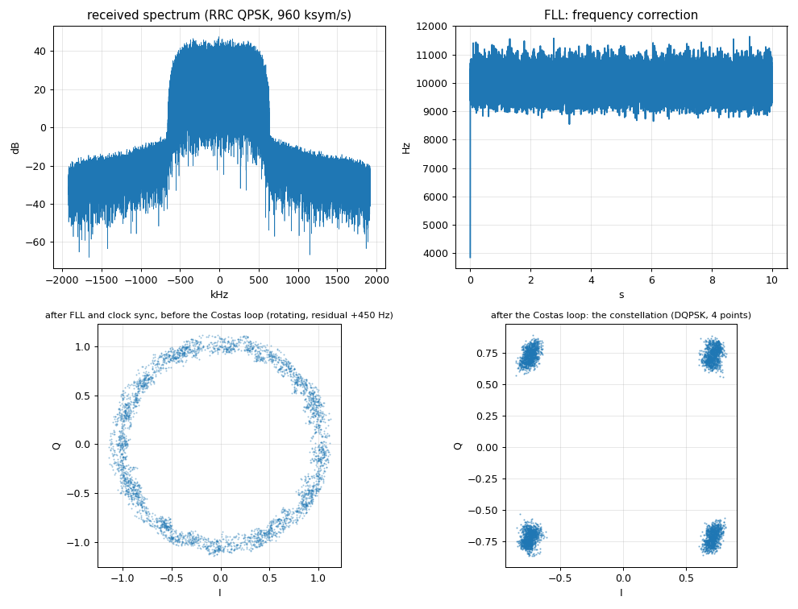

# GNU Radio QPSK reference link on one B210 (chapter 4a)

`qpsk_b210_loop.py` sends differential QPSK (960 ksym/s, 4 samples per symbol, root-raised-cosine roll-off 0.35, 1.92 Mbit/s) from the B210's TX/RX port to its RX2 port
(two antennas a few centimetres apart) and receives it with the standard GNU Radio chain; `qpsk_analyze.py` counts the bit errors against the known repeating pattern
and draws the spectrum, the FLL correction and the constellation. This is the reference the P501 modem is judged against (chapters 4b to 4d).

```bash
cd tutorial/qpsk/gnuradio
source ../../../tools/gnuradio_env.sh
python3 qpsk_b210_loop.py --out /tmp/qpsk_run --rx-offset-hz 9500 --seconds 10     # TX gain 60, RX gain 20 by default
python3 qpsk_analyze.py /tmp/qpsk_run
```

Very low power: TX gain 60 dB and RX gain 20 dB with the antennas of the two ports close together (the received peak stays at about 0.25 of full scale); check the rules
where you are before radiating. `--rx-offset-hz` tunes the receiver that far from the transmitter: a deliberate carrier frequency offset
(the B210 and the P501 are about 9.5 kHz apart, see `../link_up/RESULTS.md`). `--save-raw` keeps the whole received stream for offline replays.



## The chain

```
bits (repeating pseudo-random pattern, packed into bytes)
  -> generic_mod   : bytes -> 2-bit symbols -> differential encoder -> DQPSK points -> RRC pulse shaping, 4 samples per symbol
  -> B210 TX/RX (915.0 MHz) ~~ antennas ~~ B210 RX2 (915.0 MHz + offset)
  -> AGC -> FLL band-edge (coarse frequency) -> polyphase clock sync (32 matched filters: symbol timing, 1 sample per symbol)
  -> Costas loop (order 4: phase and fine frequency) -> constellation decoder -> differential decoder -> symbol map -> unpack to bits
```

## What went wrong on the way (and why the script looks the way it does)

| symptom | cause | what the script does |
|---|---|---|
| BER 0.5 even in a pure software simulation | `generic_mod` takes **packed** bytes (8 bits per byte); one bit per byte makes 3 of 4 symbols zero | `np.packbits(...)` at the transmitter |
| 4 phase-lock outcomes, only one decodes (match 1.00 / 0.75 / 0.56 in the simulation) | `constellation_qpsk` has no pre-differential code: differential decoding does not make it rotation-proof | `constellation_dqpsk` plus the symbol map `map_bb(invert_code(pre_diff_code))` |
| the flowgraph stalls after 0.3 s | a finished `head` block on a branch back-pressures the whole stream | taps with `keep_m_in_n` / `keep_one_in_n`, which never finish |
| 26 TX underflows in 10 s | too few UHD buffers | `--dev-args num_send_frames=128,...` (1 to 2 underflows left, at the start) |
| half the runs never lock, the output is noise | the timing loop (limit 1.5 samples per symbol in the stock block) runs away on the start-up transient while the transmitter is still underflowing | the transmitter runs alone for 2 s first (`--rx-delay`), and the timing loop is limited to 0.05 (`--max-rate-dev`) |
| the FLL frequency tap reads 0 | `fll_band_edge_cc` writes outputs 1 to 3 only if all four are connected | the unused ones go to null sinks |
| the "constellation" is a rotating ring | it was tapped before the phase loop | tapped after the Costas loop |

## Results (TX gain 60 dB, RX gain 20 dB, 10 s, 19.2 million bits)

`qpsk_analyze.py` on the reference run (RX LO 9.5 kHz above the TX LO):

```
received 19197990 bits (10.0 s of the link)
TX samples: rms 0.200, peak 0.311 (full scale 1.0) | RX samples: rms 0.151, peak 0.244 (clipping at 1.0)
alignment shift 5806 bits; 323 bit errors in 19197990 bits
RESULT: pull-in: the last error is at bit 1612 (0.84 ms after the receiver start); then 19196377 bits without any error (BER < 5.2e-08)
FLL frequency (the correction it applies, second half of the run): mean +9968.6 Hz, std 371.8 Hz  ->  carrier offset of the received signal -9969 Hz
residual rotation before the Costas loop (4th-power estimate): +450 Hz
constellation after the Costas loop: EVM 6.9 % of the symbol amplitude (angular spread 2.9 degrees)
figure: /tmp/qpsk_ref/qpsk_run.png
```

Carrier offsets 0, +-9.5 kHz and +-20 kHz, 6 s each (11.5 million bits per run): every run pulls in within 0.75 ms (the first few hundred or a thousand bits carry the errors of
the loops' pull-in) and then runs **without a single bit error**; the EVM after the Costas loop is 5 to 8 % of the symbol amplitude.
The FLL alone brings a 20 kHz offset (2 % of the symbol rate) down to a few hundred Hz; the Costas loop removes the rest. With the same frequency requested for TX and RX
the B210 itself shows an offset of about -520 Hz (its two synthesizers round differently).

## The interactive demo: `qpsk_b210_tx.grc` and `qpsk_b210_rx.grc`

Two GUI flowgraphs for the P501's FPGA modem (chapter 4d), generated by `make_flowgraph.py` with Companion's own API (`python3 make_flowgraph.py`) and opened in `gnuradio-companion`
or compiled with `grcc`; `run_flowgraph_headless.py tx|rx` runs them without a screen. **One direction at a time** (both radios use 915.0 MHz).

| flowgraph | direction | controls | shows |
|---|---|---|---|
| `qpsk_b210_tx.grc` | B210 -> P501 (the P501 notebook receives) | *Transmit* OFF/ON (OFF at start), *TX gain* 0 to 80 dB (default 80), *TX digital amplitude* | spectrum of the transmitted signal |
| `qpsk_b210_rx.grc` | P501 -> B210 (the notebook's *P501 transmits*) | *RX gain*, *loop bandwidth* 2 pi / N for the FLL, timing and Costas loops (live) | constellation after the Costas loop, received spectrum, **PRBS-15 BER box** (0 = locked and error-free, 0.17 = not locked, 0.5 = no valid stream) |

```bash
source tools/gnuradio_env.sh
gnuradio-companion tutorial/qpsk/gnuradio/qpsk_b210_tx.grc          # or: python3 tutorial/qpsk/gnuradio/run_flowgraph_headless.py tx --on --tx-gain 80 --seconds 60
```

Lessons built into them: the receive chain has a **limiter** (+-1.5 per component) between the AGC and the FLL, because a signal that appears after the receiver has run on noise would otherwise make the polyphase clock sync run away and stall the flowgraph (a limited start and a signal dropout both re-lock; tested);
the BER block reports 0.5 for a stuck stream (all zeros also satisfies the PRBS rule); the transmit and the receive chain are separate flowgraphs because together they underflow the transmit stream. Tested against the P501: B210 at 80 dB TX gain, `qpsk_b210_tx.grc` -> FPGA receiver locks every time (`rx.acquire()`), and the P501's FPGA transmitter at 30 dB attenuation -> `qpsk_b210_rx.grc` shows a BER of 1e-7 or lower.
At 75 dB TX gain the B210's signal gave irregular results through the air (several cold starts ended at 0 Hz carrier with 2 % errors); 70 and 80 dB were fine.
