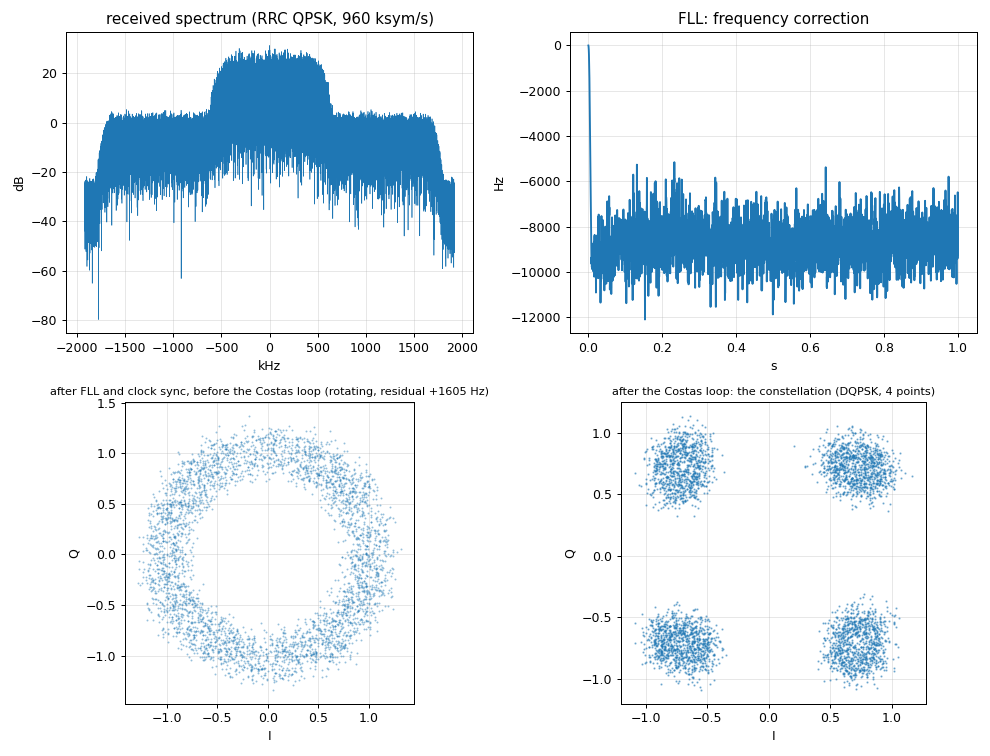

# Chapter 4b: the P501 receives the B210's QPSK (offline decode)

The B210 transmits the DQPSK signal of chapter 4a (TX/RX port, 915.0 MHz); the P501 records one second of raw I/Q (3.84 MSPS, 15 MB) with its ADC DMA;
the recording is copied to the PC and decoded **offline** with the same GNU Radio receiver chain. This tells us what the P501's receive path delivers, and what
offsets and drift the receiver (later: in the FPGA) has to track.

```bash
source tools/gnuradio_env.sh
cd tutorial/qpsk/p501_capture
scp p501_capture.py xilinx@192.168.2.1:/tmp/                    # once
python3 run_capture_4b.py --out /tmp/p501_cap75 --tx-gain 75 --rx-gain 70         # the B210 transmits, the P501 records
cd ../gnuradio
python3 qpsk_decode_file.py /tmp/p501_cap75/p501_cap.c64 --out /tmp/p501_dec --freq-bw 0.0157 --timing-bw 0.0157 --phase-bw 0.0157
python3 qpsk_analyze.py /tmp/p501_dec
python3 ../p501_capture/measure_offsets.py ...   # two-tone capture (run_capture_4b.py --signal twotone), see below
```

`p501_capture.py` runs on the board (it needs the combined overlay in `/home/xilinx/jupyter_notebooks/p501_fft_dds/`): receive only, TX fully attenuated, DDS off,
waits for `/tmp/go`, then one DMA transfer of 1 s (a transfer is limited to 16 MiB = 1.09 s). Very low power: the B210 at TX gain 60 to 75 dB with the antennas a few
centimetres apart; check the rules where you are before radiating.



## Results

**How the decode depends on the B210's TX gain** (digital amplitude 0.25, P501 RX gain index 70, loop bandwidths 2 pi/400, 1.92 million bits per capture):

| B210 TX gain | spectral SNR | P501 ADC rms / peak (counts of 2047) | result |
|---|---|---|---|
| 60 dB | 10 dB | 15 / 49 | not decodable: BER 14 % |
| 70 dB | 18 dB | 33 / 80 | locks, BER after the pull-in about 6e-5 |
| 75 dB | 21 dB | 46 / 100 | locks, **no error after the pull-in** in 3 of 3 captures |

At 75 dB, three captures: pull-in 29 ms, 5 ms and 31 ms (the last error is at bit 56349, 9339 and 60312), then **1.86, 1.91 and 1.86 million bits without a single error** (BER < 5e-7).
The constellation after the Costas loop shows four clusters with an angular spread of 8 to 10 degrees (an effective SNR of about 15 dB).

**Loop bandwidths matter more than for the B210 alone.** The stock bandwidths (2 pi/100 for the FLL, the timing loop and the Costas loop) pull in fast but add noise: on the same 75 dB
capture they give a BER of 2e-4; 2 pi/200 gives 3e-4 (all errors in the first 100000 bits, a few later); 2 pi/400 gives zero errors after a 30 ms pull-in. Narrowing only
the Costas loop (with the others wide) is clearly worse (1e-2 to 3e-2 on the 70 dB capture). The offset is nearly constant and the SNR is moderate, so narrow loops are right here;
for the FPGA receiver this means a pull-in aid (the preamble, or the FFT chain's estimate of the offset) is worth having.

**The two radios** (two tones at +-1.5 MHz sent by the B210, captured by the P501, `measure_offsets.py`):

| quantity | value |
|---|---|
| tone near +1.5 MHz arrives at | 1 509 513.12 Hz |
| tone near -1.5 MHz arrives at | -1 490 518.02 Hz |
| LO offset (B210 - P501) = mean of the two | **+9497.6 Hz = +10.38 ppm** at 915 MHz |
| sample-clock offset (B210 / P501 - 1) = (difference - 3 MHz)/3 MHz | **+10.38 ppm** = +39.9 Hz of 3.84 MSPS |
| timing slip at 960 ksym/s | **+9.96 symbols per second** |

The carrier-frequency and sample-clock offsets are the same number of ppm (to 0.01 ppm): both radios derive LO and sample clock from their reference oscillator, and the two references differ
by **10.38 ppm**. Earlier single-tone measurements agree (+9473 Hz B210 -> P501 at 30 dB gain, -9510 Hz P501 -> B210 in the other direction). With the QPSK recordings the FLL's own estimate
is +8.7 to +9.1 kHz with a noise of 1 to 5 kHz (it is a coarse estimator; the Costas loop takes over).

What this means for the receivers:

* the **frequency loop must pull in about +-10 kHz** (1 % of the symbol rate) and track a drift of the order of 0.5 Hz/s (warm-up);
* the **timing loop must slip a symbol every 100 ms** (10 per second) for as long as the link runs: the stock polyphase clock sync does it without a bit error;
* the **SNR needed** is about 15 dB effective (an angular spread of 10 degrees) with a margin of a few dB over the pull-in: 10 dB is not enough;
* the clock-sync loop's own *rate* output is too noisy to read a 10 ppm offset from one second of data (std 0.15 against a signal of 0.006); the two-tone method resolves 0.1 ppm.

## What is not done yet

The plan also called for a **NumPy reference receiver** (polyphase clock sync and Costas loop in a few dozen lines) as the model the FPGA blocks are checked against. It is the first step of
chapter 4d, where it is needed; the offline GNU Radio decode here is the reference for now.
