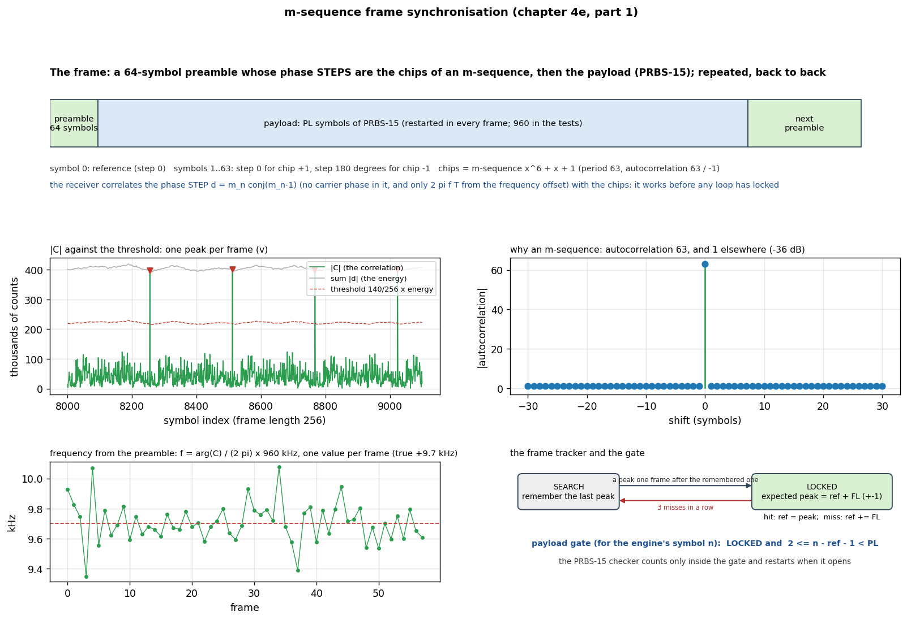
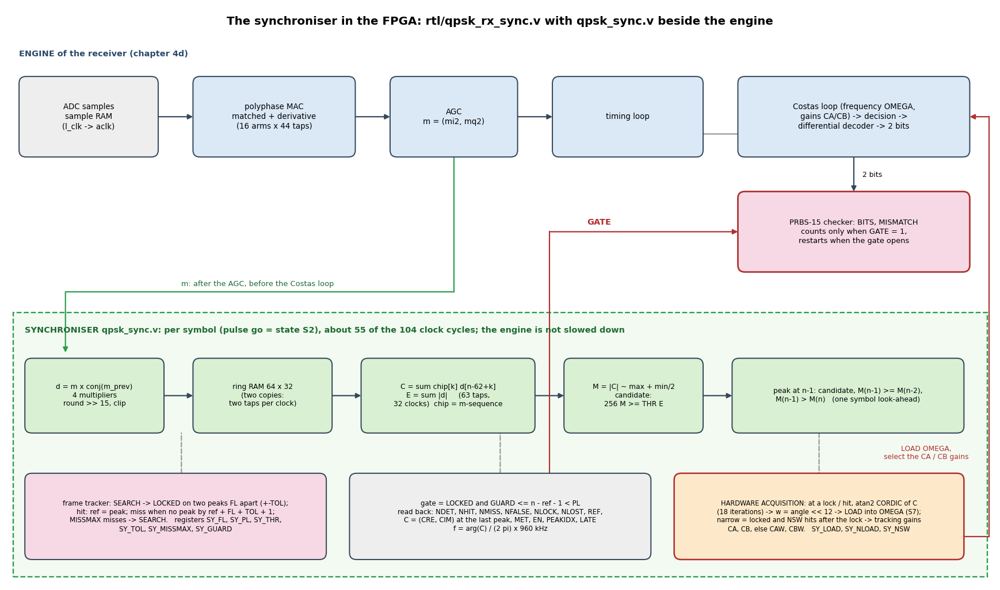

# Chapter 4e, part 1: synchronisation with a known m-sequence (overlay `p501_qpsk_trx_sync`)

Status: **done and tested**: frame format, integer model, RTL bit-exact in simulation (four scenarios), own overlay built (timing met), a GNU Radio flowgraph and a Python transmitter for the B210,
tested over the air against the B210 (frames found at every carrier offset from -91 to +110 kHz, with the Costas loop unlocked, and at TX gains where the data can no longer be decoded).



## What it does

The transmitter sends **frames**: a 64-symbol preamble followed by `PL` payload symbols of PRBS-15 (restarted in every frame), back to back (`FL = 64 + PL`; the tests use `PL = 960`, `FL = 1024`, 1.067 ms).
The preamble is known. Its 63 phase **steps** (symbols 1..63; symbol 0 is a reference) are the chips of an **m-sequence** (LFSR x^6 + x + 1, period 63): step 0 for a chip +1, step 180 degrees for a chip -1.

The receiver correlates the **phase steps** `d = m_n conj(m_n-1)` of the symbols (after the polyphase filter, the timing loop and the AGC, before the Costas loop) with the 63 chips:

* a step does not contain the carrier phase and has only `2 pi f T` from the frequency offset, so the correlator works **before any loop has locked** (shown below, Costas loop deliberately unlocked);
* the m-sequence has a periodic autocorrelation of 63 and -1 elsewhere: one sharp peak at the **last step of the preamble**, 36 dB above the sidelobes;
* `arg(C) = 2 pi f T`: the correlation also measures the **frequency offset** (data aided: unambiguous for |f| < 480 kHz, against 120 kHz of the 4th-power estimator, with no `x4` noise penalty);
* two peaks one frame apart **lock** the frame tracker; it predicts the next peak (+-1 symbol), counts hits and misses, and after three misses in a row searches again;
* the tracker gives a **payload gate**; the PRBS-15 checker of the receiver counts only inside the gate (and restarts when it opens), so the bit error counts are those of the payload alone.



| file | what |
|---|---|
| `qpsk_frame.py` | the frame format: `mseq()`, `chips()`, `frame_bits(pl)` (checks: autocorrelation 63 / -1) |
| `qpsk_sync_fixed.py` | the bit-exact integer model: correlator, peak detector, tracker, gate, the gated PRBS checker |
| `make_frame_signal.py`, `study_sync.py` | synthetic frames (offset, noise, gaps) and the offline study (SNR sweep) |
| `rtl/qpsk_sync.v` | the synchroniser: d, ring RAM (two copies), 63-tap correlation at two taps per clock (about 55 of the 104 clocks per symbol), peak, tracker, gate |
| `rtl/qpsk_rx_sync.v` | `qpsk_rx.v` + the synchroniser, ID `0xDD520005`; the checker counts only inside the gate when `SY_CTRL` bit 0 is set |
| `sim/` | testbench, `compare_sync.py`, `gen_sim_samples.py` (the three test signals: frames at 20 dB, with a gap of 900 symbols, at 6 dB) |
| `steps/`, `bd/qpsk_rx_sync_chain.tcl`, `QPSKRXSYNC=1` in `create_project.tcl` | the project (the clock-crossing constraints of `src/qpsk_rx_cdc.xdc`) |
| `notebook/p501_qpsk_rx_sync.py` | driver `P501QpskRxSync`: `configure_sync`, `gate_enable`, `sync_status`, `wait_lock`, `corr_freq_hz` |
| `qpsk_b210_frame_tx.grc` (`make_flowgraph_frame.py`) | **the GNU Radio flowgraph** for the B210: frames -> differential QPSK -> TX/RX port, with Transmit ON/OFF, TX gain, amplitude, `payload_syms`, spectrum and envelope displays |
| `qpsk_frame_tx.py` | the same transmitter in Python (`FrameTx`, command line or module): the one the tests use |
| `make_notebook_sync.py` -> `notebook/P501_QPSK_SYNC_Live.ipynb` | the interactive notebook: loopback self-tests, live picture (constellation, the correlation vectors C at the peaks, frequency from the preamble and from the Costas loop, frames found per second, payload mismatches), start modes (carrier search + sync / sync only with the Costas loop unlocked), live threshold / tolerance / misses / guard / gate, experiments (frequency from the preamble, detection against the RX gain, lock time) |
| `p501_sync_link.py`, `run_sync_test.py`, `p501_sync_false.py`, `run_false_alarm.py` | board side and host side of the over-the-air tests |
| `make_diagrams_sync.py` | draws the two figures |

Registers (added to those of the receiver): `0x54 SY_CTRL` (bit 0: gate the checker), `0x58 SY_FL`, `0x5C SY_PL`, `0x60 SY_THR` (Q8; 140 = 0.55: a clean preamble gives 0.9, random data 0.13), `0x64 SY_TOL` (1), `0x68 SY_MISSMAX` (3), `0x6C SY_GUARD` (2),
`0x70 SY_STATUS` (bit 0 locked, bit 1 gate), `0x74 NDET` (peaks), `0x78 NHIT`, `0x7C NMISS`, `0x80 NFALSE`, `0x84 NLOCK`, `0x88 NLOST`, `0x8C REF`, `0x90 CRE`, `0x94 CIM` (the correlation at the last peak), `0x98 MET`, `0x9C EN`, `0xA0 PEAKIDX`, `0xA4 LATE`.

## Verification

1. **RTL vs integer model** (xsim, 60000 samples = 14989 symbols; per symbol C, E, M and the candidate flag; every peak; the gate of every symbol; all counters and the last C; the 8 engine columns; the gated checker):
   **0 mismatches** with frames at 20 dB (57 hits, locked once), with a gap of 900 symbols (3 misses, lock lost and found again, 2 false peaks), at 6 dB, and at 6 dB with a lower threshold. `late = 0`.
2. **Offline** (synthetic signal, `study_sync.py`): the lock is found at 20 dB down to 0 dB sample SNR with no miss; the frequency from the preamble is +9707 Hz (true +9700), std 131 Hz per frame.
3. **Build** (`... -tclargs FFT=0 QPSK=1 QPSKRXSYNC=1 RUN=bit`): WNS +0.417 ns, WHS +0.011 ns. 15356 LUTs, 6.5 BRAM tiles, 58 DSPs (the receiver without the synchroniser: 14097 LUTs, 53 DSPs: it costs 1260 LUTs and 5 DSPs).
   Files `build/overlay/p501_qpsk_trx_sync.{bit,hwh}`, board folder `/home/xilinx/jupyter_notebooks/p501_qpsk_trx_sync/`.

## Hardware results

B210 at 915 MHz + offset, `FrameTx` (payload 960, TX gain 80 dB unless stated), P501 RX gain index 70. The natural offset of the two radios is +9.5 kHz.

**Lock time**, cold start, wide loops (2 pi/100), 10 starts: median **1.8 ms** (1.7 to 1.8; two preambles one frame apart must be seen; a frame is 1.07 ms), all locked.

**With the Costas loop unlocked** (loops 2 pi/1600 from a cold start: it cannot pull in the offset, OMEGA stays at 0, the constellation spins, spread 22 degrees) the synchroniser still locks after 1.4 to 3.2 ms and then finds every frame
(402 hits, no miss or loss in the 0.2 s that were counted). Its frequency estimate against the Costas loop's frequency (the Costas loop locked, `rx.acquire()`; the true offset):

| B210 carrier | frequency from the preamble (mean of 100 frames, std of single frames) | Costas loop | difference |
|---|---|---|---|
| 915.000 MHz | +8716 Hz (916 Hz) | +9550 Hz | -0.8 kHz (-9 %) |
| 915.030 MHz | +36929 Hz (1148) | +39499 Hz | -2.6 kHz (-6.5 %) |
| 914.940 MHz | -46789 Hz (1819) | -50229 Hz | -3.4 kHz (-6.8 %) |
| 915.070 MHz | +77708 Hz (1434) | +79504 Hz | -1.8 kHz (-2.3 %) |
| 914.900 MHz | -88348 Hz (1146) | -91058 Hz | -2.7 kHz (-3.0 %) |
| 915.100 MHz | +108797 Hz (594) | +109598 Hz | -0.8 kHz (-0.7 %) |

The preamble gives the offset to within 1 to 3.5 kHz, always low: enough to start the Costas loop (its pull-in is several kHz), not a replacement for it. The weighting of the steps by their magnitude is the likely cause (the same amplitude / phase effect
that biased the 4th-power estimator); a unit-magnitude correlator would need a CORDIC per step and was not built.

**Frame detection against signal level** (frames per 3 s: 2816 expected; the receiver's own demodulation is also shown, because it is the reference):

| B210 TX gain | hits | misses | false peaks | lock lost | payload bit errors (gated) | Costas loop |
|---|---|---|---|---|---|---|
| 80 dB | 2815 | 0 | 0 | 0 | 16 mismatches in 5.35 Mbit (BER 1e-6) | locked |
| 76 dB | 2816 | 0 | 0 | 0 | BER 2e-3 | not locked by the search |
| 72 dB | 2816 | 0 | 0 | 0 | BER 0.12 (not decodable) | not locked |
| 68 dB | 2612 | 116 | 39 | 28 | not decodable | not locked |
| 64 dB | 72 | 187 | 12 | 51 | - | - |
| 60 dB | 0 | - | - | - | - | - |

The synchroniser finds **every frame down to 72 dB**, 8 dB below the level at which the data decode cleanly and where the demodulator itself is lost; it degrades at 68 dB and fails at 64 dB.
Over the whole run `late` was 0: the synchroniser kept up with every symbol.

**False alarms** (the same threshold, 19.2 million symbols each, 20 s): receiver noise only: 29 peaks, no lock; PRBS-15 data at 80 dB without a preamble: **0 peaks**, no lock. A lock needs two peaks one frame apart.

## Notes and what is left

* The transmitter is the B210 (GNU Radio flowgraph or `FrameTx`); the FPGA transmitter of chapter 4c does not send frames yet, so there is no all-FPGA loopback test of this overlay.
* The synchroniser does not feed the Costas loop; with the frequency from `arg(C)` it could load the Costas frequency like chain 3 does (`qpsk_fe_auto.v`).
* Part 2 of chapter 4e (a header with a length, a CRC, packets, the round trip) builds on this: the gate gives the position of the payload.
* The frame format has no spare symbols for the very first frame after a long silence: the AGC and the timing loop must have settled (a few ms) before the first preamble is seen.

## Run it

```
source tools/gnuradio_env.sh
python3 tutorial/qpsk/p501_sync/make_flowgraph_frame.py                   # (re)writes qpsk_b210_frame_tx.grc; open it with gnuradio-companion
python3 tutorial/qpsk/p501_sync/run_sync_test.py --out /tmp/p501_sync_run --gains 80,76,72,68,64,60 --payload 960 --seconds 3 [--freq 915.03e6]
python3 tutorial/qpsk/p501_sync/run_false_alarm.py --what noise|prbs --seconds 20
cd tutorial/qpsk/p501_sync/sim; python3 gen_sim_samples.py              # the simulation signals; xvlog/xelab/xsim as in the README of chapter 4d, plusargs hex=samples_a.hex thr=140 fl=256 pl=192
SIGNAL=a python3 compare_sync.py 256 192 140
```
Board folder (once): `p501_qpsk_trx_sync.{bit,hwh}`, `p501_qpsk.py`, `p501_qpsk_rx.py`, `p501_qpsk_rx_sync.py` -> `/home/xilinx/jupyter_notebooks/p501_qpsk_trx_sync/`; `p501_sync_link.py`, `p501_sync_false.py` -> `/tmp/`.
In the GRC flowgraph set `payload_syms` (a multiple of 4) to the same value as `SY_PL` (and `SY_FL` = 64 + `payload_syms`); switch **Transmit** ON after the P501 is ready.
