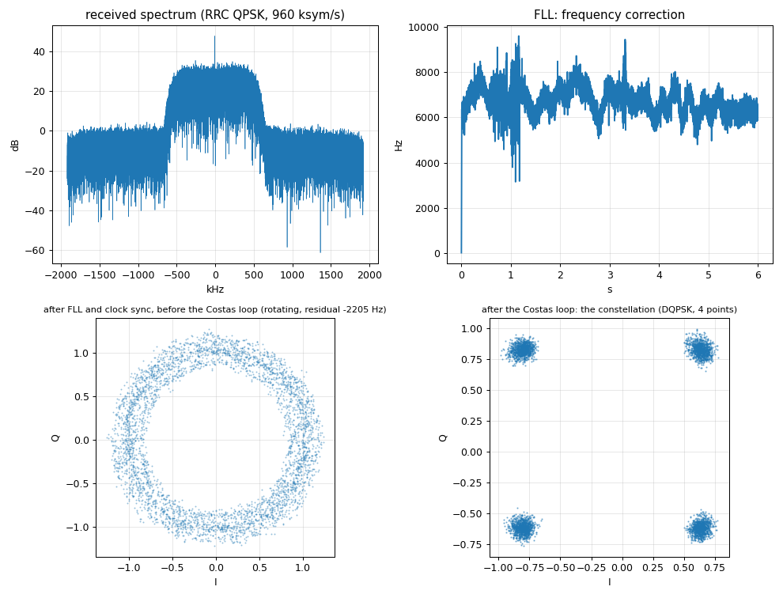

# Chapter 4c: the QPSK transmitter in the FPGA (PRBS first)

The P501's FPGA generates the QPSK signal itself, with no samples from Python: a **PRBS-15** bit source, a differential QPSK mapper (the order of GNU Radio's
`digital.generic_mod`), and a root-raised-cosine pulse filter (roll-off 0.35, 4 samples per symbol, 960 ksym/s = 1.92 Mbit/s). It replaces the DAC DMA path for TX1, like the DDS of
tutorial 2 (so the two cannot be in one design). The **B210 with GNU Radio's standard receiver** judges it.



| piece | file |
|---|---|
| transmitter (PRBS, mapper, polyphase RRC FIR with adders only) | `rtl/qpsk_tx.v` |
| the 12 coefficients of each of the 4 filter phases (generated) | `rtl/qpsk_rrc_coef.v` |
| enable and amplitude registers: the register block of the DDS, instance `qpsk_regs` at `0x9C460000` | `rtl/dds_regs.v` |
| block-design steps (registers, transmitter, DAC connection, constraints) | `bd/qpsk_chain.tcl`, `steps/step1_regs.tcl` ... `step4_constraints.tcl` |
| bit-exact NumPy model and the ROM generator | `qpsk_model.py` |
| simulation | `sim/tb_qpsk_tx.v` |
| board side / host side of the over-the-air test | `p501_qpsk_tx.py`, `run_tx_test_4c.py` |
| Python wrapper (`start(amp)`, `stop()`) | `notebook/p501_qpsk.py` |

```bash
vivado -mode batch -source create_project.tcl -tclargs FFT=0 QPSK=1 RUN=bit          # project and overlay p501_qpsk; then tools/fix_hwh.py
# copy build/overlay/p501_qpsk.{bit,hwh} to /home/xilinx/jupyter_notebooks/p501_qpsk/ and p501_qpsk_tx.py to /tmp/ on the board
source tools/gnuradio_env.sh
python3 run_tx_test_4c.py --out /tmp/p501_tx_run --p501-atten 40 --seconds 6               # P501 transmits, the B210 decodes live
python3 ../gnuradio/qpsk_analyze.py /tmp/p501_tx_run prbs15                                # bit errors against the PRBS-15
```

Very low power: the P501's TX attenuation is the knob (30 to 40 dB used here, the power is of the order of a microwatt or less, estimated from the AD9361's data, not measured);
check the rules where you are before radiating. Every run starts with the TX attenuation at its maximum and ends the same way.

## How it was checked

1. **Bit-exact against the model.** The Verilog was simulated with xsim (`sim/tb_qpsk_tx.v`: `ce` every second clock, like `dac_valid`) and compared with `qpsk_model.py` over 4000 samples: **0 mismatches** on I and on Q.
2. **Compatible with GNU Radio.** The model's waveform, with a 9.5 kHz offset and noise added, decodes in the receiver chain of chapter 4a: error-free after the first 1075 bits.
3. **On the air.** The P501 transmits, the B210 (RX2) decodes live with the chain of 4a (loop bandwidths 2 pi/400) and the bits are compared with the PRBS-15:

| P501 TX attenuation | B210 RX rms (full scale 1) | pull-in | BER after the pull-in |
|---|---|---|---|
| 55 dB | 0.0089 | - | not decodable (12 % errors) |
| 50 dB | 0.0062 | 917 ms | 1.3e-2 |
| 45 dB | 0.0077 | 21 ms | 4.1e-4 |
| 40 dB | 0.0361 | 10 ms | 8.7e-6 |
| 35 dB | 0.0264 | 10 ms | 1.7e-6 |
| **30 dB** | 0.0653 | 10 ms | **0 errors in 11.5 million bits** (< 8.7e-8) |

(6 s per run, 11.5 million bits each; the receiver of the B210 is fixed at RX gain 45 dB, so the received level follows the P501's attenuation; the pull-in of 10 ms is the resolution of the analysis, 20000 bits.)

## Notes

* **Levels.** At full amplitude (`amp` = 1.0) the transmitter's complex rms is 0.48 of the DAC's full scale and its peak 0.54; the default amplitude 0.5 gives 0.24 rms. Nothing clips.
* **The carrier feed-through.** The received spectrum shows a spike at the P501's LO (DC of its own baseband): the AD9361's residual LO leakage. It shifts the constellation clusters off-centre
  (the figure) and costs a little SNR; it does not prevent decoding. A DC correction at the transmitter (the chip's own, or a small offset in the FPGA) would remove it.
* **The FLL's coarse estimate** reads the carrier offset about 2 to 3 kHz off here (the spike pulls it), the Costas loop does the rest. The true LO offset of the two radios is 9.5 kHz (chapter 4b).
* **No samples through Python**: Python only writes `enable` and `amp` (and the AD9361 is configured over SPI once). The pattern starts from its first bit every time `enable` goes high.

## Next

4d: the receiver in the FPGA. The NumPy reference receiver (polyphase clock sync and Costas loop) comes first, then the blocks, checked against GNU Radio's decode of the same recordings
(`../p501_capture/`) and live against this transmitter and against the B210.
